# 020：验证系统需求 🔍

在本节课中，我们将要学习如何验证系统需求。在通过领域模型捕获了所有数据需求、通过用例模型捕获了所有功能需求以及所有非功能需求之后，我们必须对我们已捕获的所有需求进行验证。

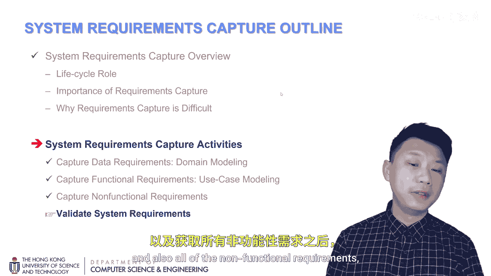

上一节我们介绍了如何捕获需求，本节中我们来看看如何确保这些需求的质量。

## 需求验证的目标 ✅

所有记录在**系统需求规格说明书**中的需求，都必须持续地与客户或用户进行验证，以确保它们满足以下关键特性：

*   **完整性**：意味着我们已经捕获了所有必要的需求。
*   **一致性**：意味着需求之间没有自相矛盾。
*   **清晰性**：意味着所有利益相关者都能理解这些需求。
*   **正确性**：意味着需求准确地反映了用户的真实意图。
*   **现实性**：意味着需求在技术上是可行的。

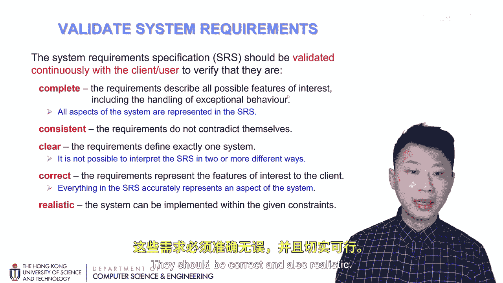

验收测试是验证系统实现是否满足需求的主要手段，我们将在讨论测试时详细讲解。在验收测试中，我们会在客户或用户面前验证所有需求。

## 需求验证示例与解决方案 🛠️

以下是几种常见需求问题的具体例子及其解决方案。

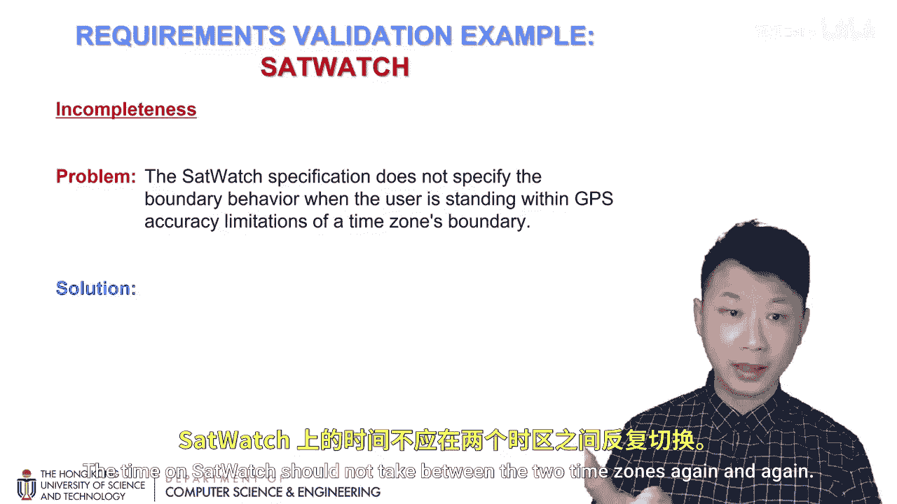

### 不完整的需求

**问题描述**：智能手表规格说明没有指定当用户站在GPS精度限制内的时间区边界时的行为。这意味着当用户站在两个时区的交界处时，手表上的时间不应在两个时区之间反复切换。

**解决方案**：需要增加一条功能需求：**“手表显示的时区变化频率不应高于每五分钟一次。”** 这样就能确保时间不会频繁跳动。

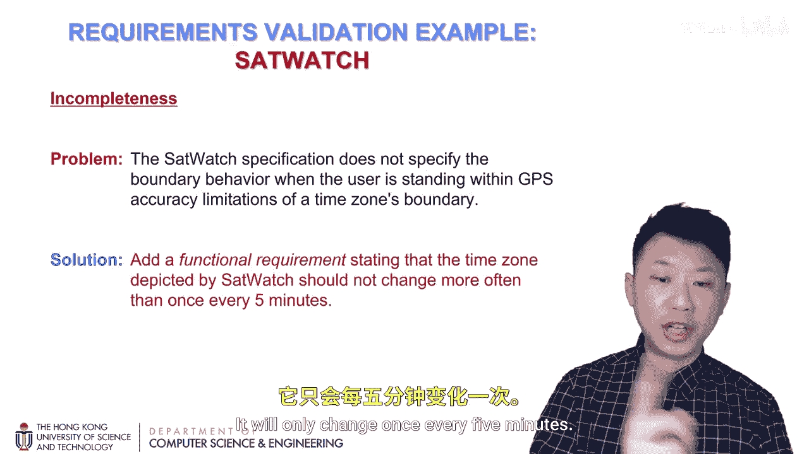

### 不一致的需求

**问题描述**：第一条需求说“手表软件不应有缺陷且无需升级”，而第二条需求却说“手表软件应能通过USB接口轻松升级”。这两条需求相互冲突。

**解决方案**：必须修订其中一条冲突的需求，使其保持一致。例如，可以修改第一条需求，或明确第二条需求为“在必要时，软件应能通过USB接口进行升级”。

### 不清晰的需求

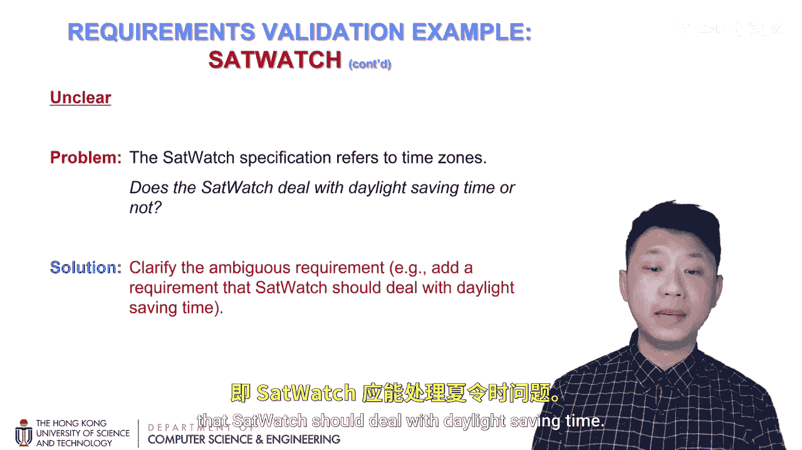

**问题描述**：智能手表规格说明提到了“时区”，但没有明确是否需要处理夏令时。

**解决方案**：需要细化和澄清该需求。可以增加一条需求：**“手表应能处理夏令时调整。”**

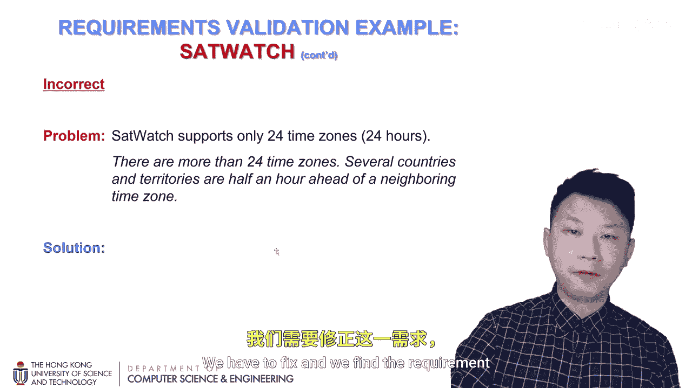

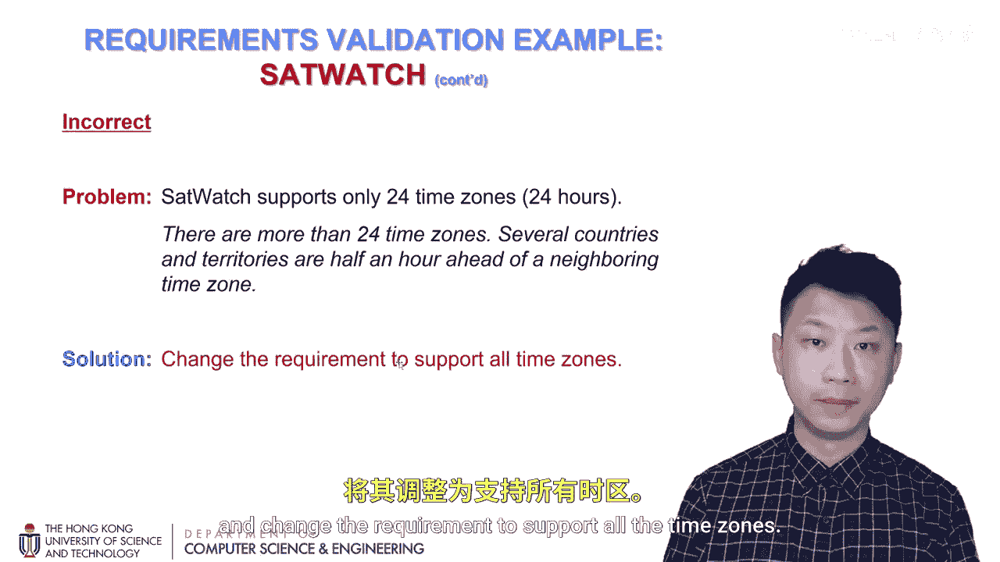

### 不正确的需求

**问题描述**：需求说明“手表仅支持24个时区”。但现实中全球有超过24个时区。

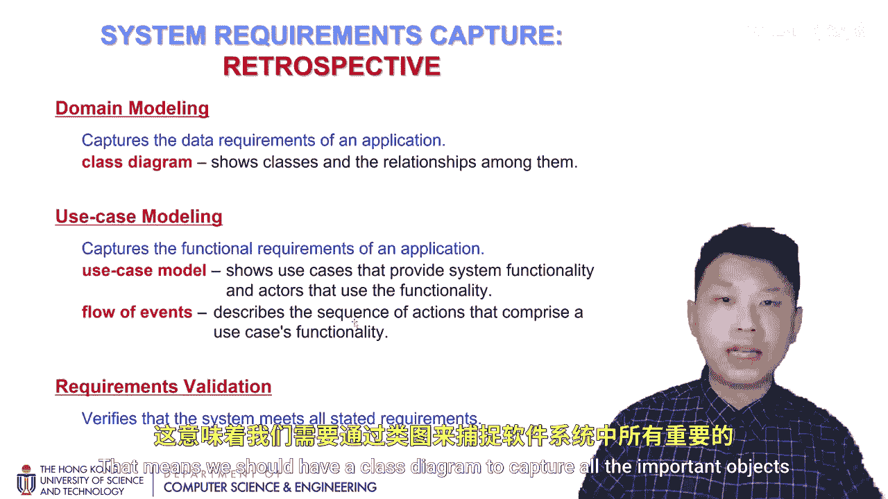

**解决方案**：必须修正该需求，将其改为“支持所有时区”。

## 需求规格说明书的核心构成 📄

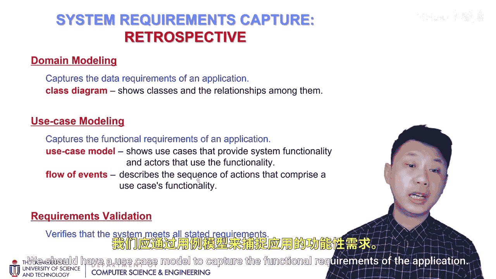

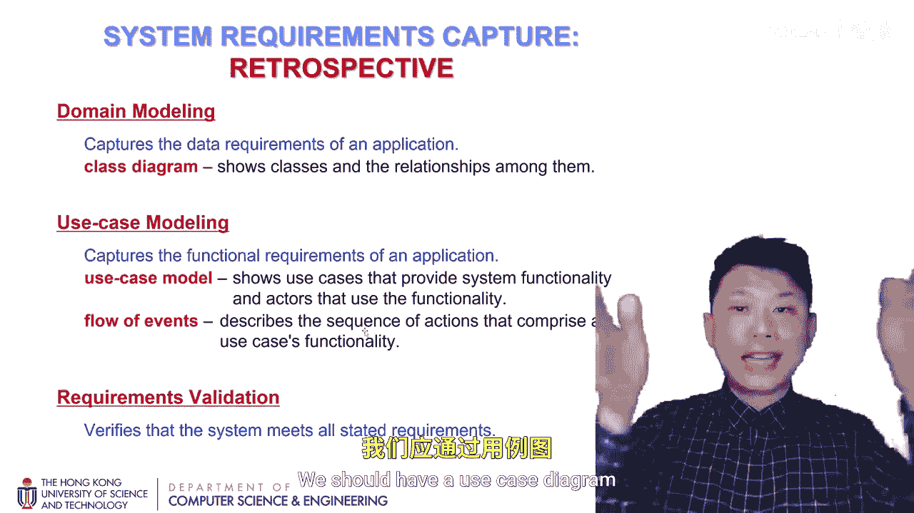

一个完整的系统需求规格说明书应包含以下核心部分：

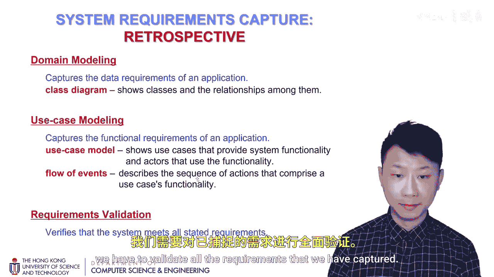

1.  **领域模型**：用于捕获应用程序的所有数据需求。这通常是一个**类图**，用于表示软件系统中持久存在的重要对象及其关系。
2.  **用例模型**：用于捕获应用程序的功能需求。这包括一个**用例图**，用于展示软件系统提供的所有功能，以及用**用例规格说明**来描述每个用例的事件流。
3.  **非功能需求**：描述对用例或整个系统的附加约束。
4.  **已验证的需求**：经过上述完整性、一致性、清晰性、正确性和现实性验证的所有需求。

## 需求在开发流程中的演进 🔄

在捕获并验证了初始需求之后，开发流程并未结束。在后续的迭代或阶段中，我们需要：

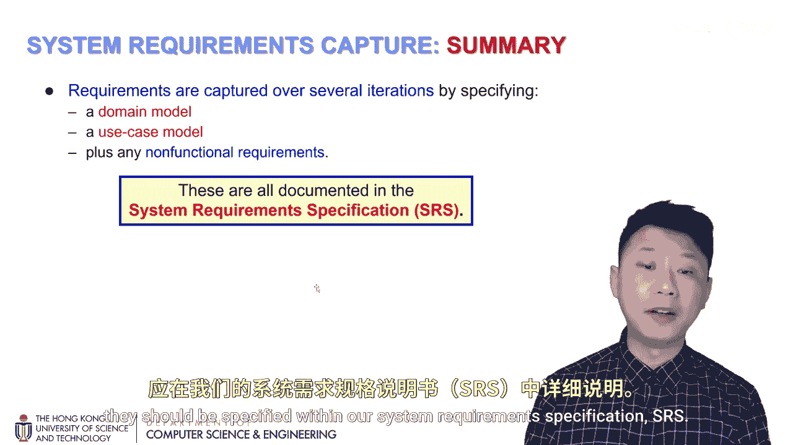

1.  **细化需求**：为上述的领域模型、用例模型等工件指定更多细节。
2.  **创建测试模型**：制定一组测试用例，用于后续验证。
3.  **进行分析与设计**：在分析模型中创建匹配的**用例实现**，并在设计模型中创建更详细的**用例实现**。分析模型和设计模型将直接用于指导系统实现。

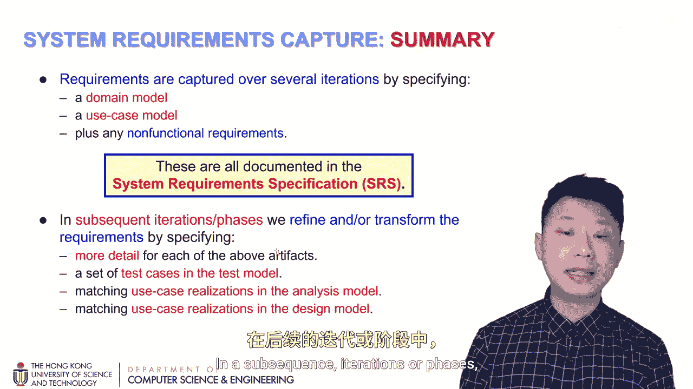

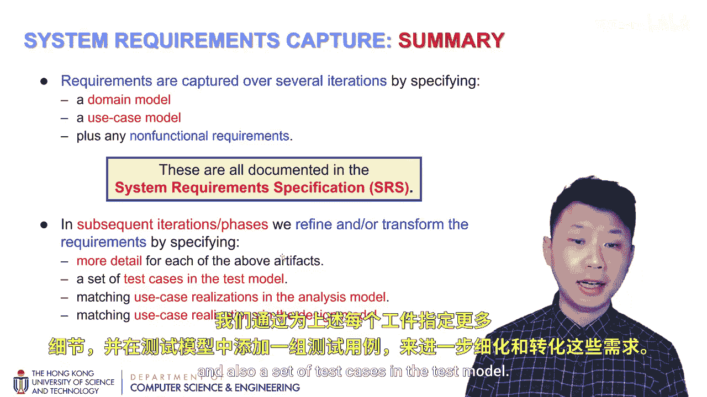

正是通过这种方式，**用例驱动着后续的迭代和开发阶段**，确保软件开发始终围绕用户需求展开。

## 总结 📝

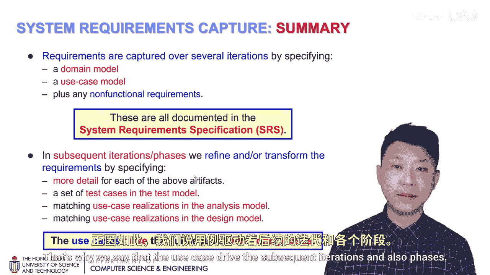

本节课中我们一起学习了系统需求验证的重要性与方法。我们了解到，一个合格的需求必须具备**完整性、一致性、清晰性、正确性和现实性**。我们通过具体示例分析了不完整、不一致、不清晰和不正确的需求问题及其修正方法。最后，我们回顾了需求规格说明书的核心构成，并了解了已验证的需求如何驱动后续的分析、设计与实现工作，从而确保最终交付的软件产品能够真正满足用户的需要。