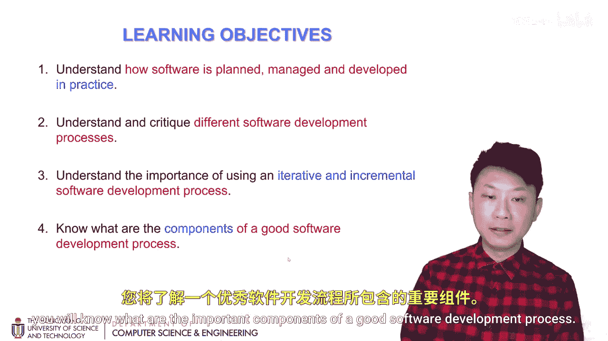
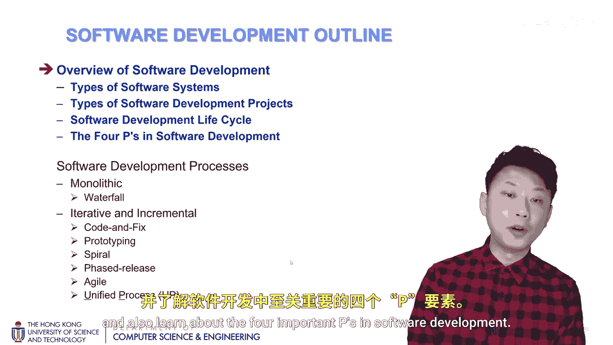
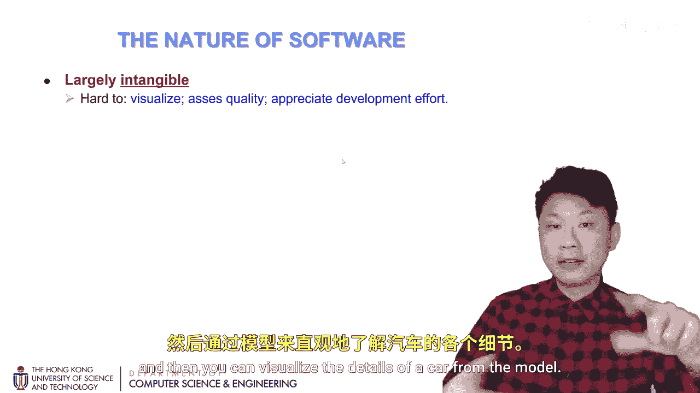
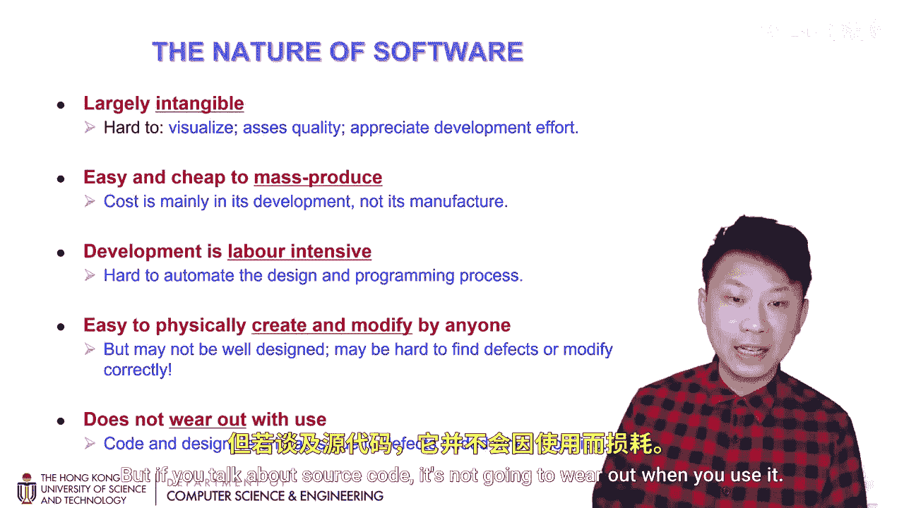
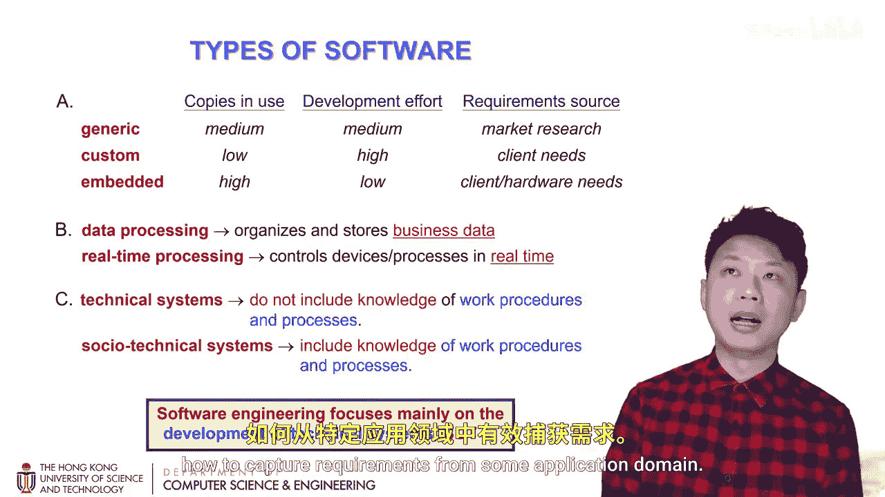
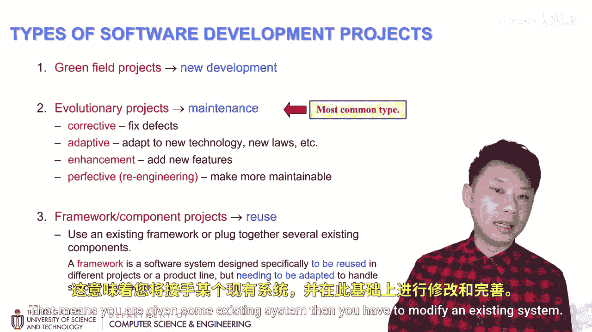
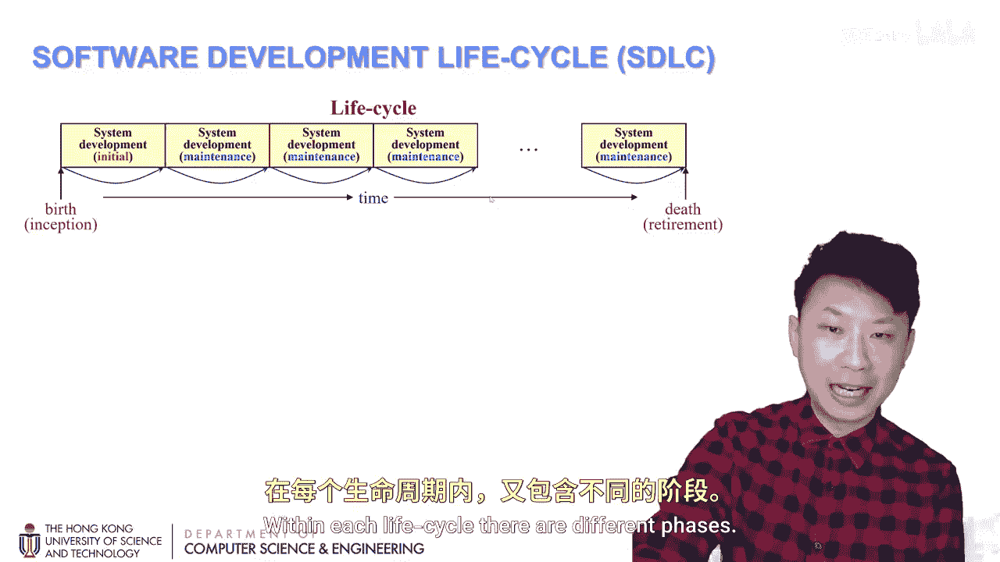
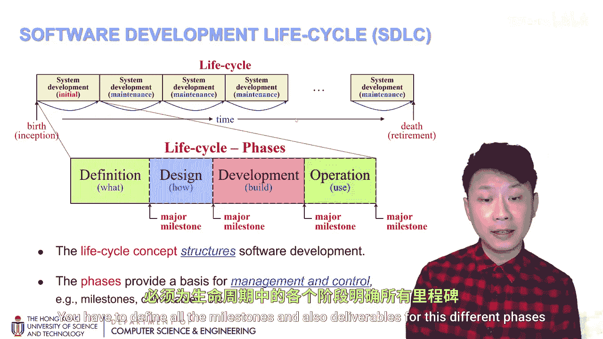
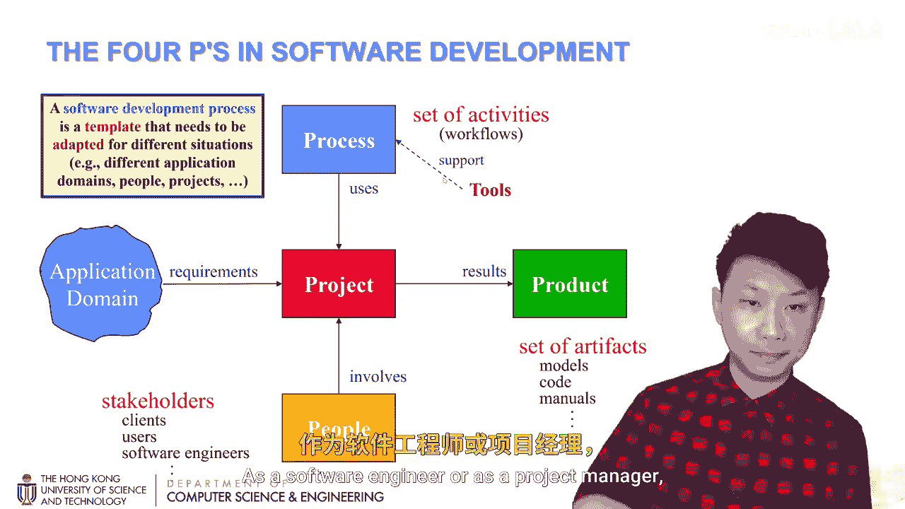
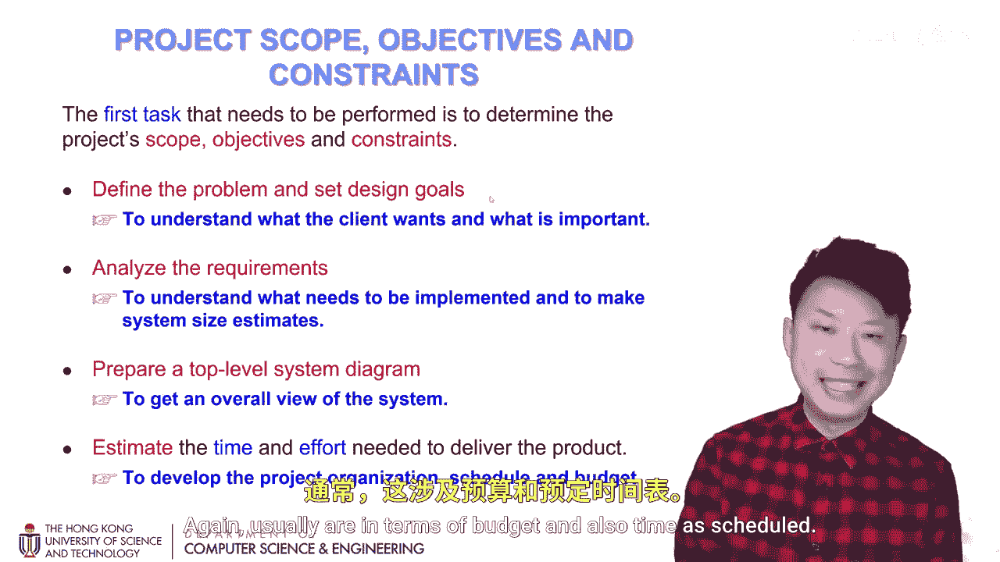

# 021：软件开发入门 🚀

在本节课中，我们将对软件开发进行概述。你将了解软件在实践中的规划、管理和开发方式，并理解在构建软件系统时使用迭代和增量式开发流程的重要性。最后，你将认识到一个优秀的软件开发流程应包含哪些重要组成部分。

## 软件开发项目的本质

上一节我们介绍了课程目标，本节中我们来看看软件开发项目本身的特点。

软件开发项目在很大程度上是无形的。这意味着很难可视化项目中的所有细节。这与制造汽车不同，你可以制作汽车模型，并从模型中可视化汽车的细节，并且大规模生产既容易又便宜。

对于软件工程项目，产品通常以源代码的形式存在。源代码易于复制和批量生产。

开发过程是劳动密集型的。这意味着你需要的主要资源将是程序员，他们负责构建源代码。

任何人都可以轻松地物理创建和修改它。任何懂编程的人都可以在项目完成后修改产品（源代码）。

它不会因使用而磨损。这与汽车不同，汽车在使用过程中会磨损。但源代码在使用时不会磨损。

## 软件的类型

在软件工程中，你可能需要为客户构建不同类型的软件。以下是几种主要类型：

*   **通用软件**：例如 Windows 10、Microsoft Office 或可以从 App Store 或 Google Play 下载的应用程序。基本上，所有需求都来自市场调研。
*   **定制软件**：为特定应用领域（例如餐厅）构建的软件系统。所有需求都来自客户需求。开发工作量很高，因为必须在构建系统之前捕获所有需求。使用副本数量较少，因为可能只有一家餐厅使用该软件系统。
*   **嵌入式软件系统**：例如 DVD 播放器中的嵌入式系统。开发工作量较低，因为从 DVD 播放器本身你已经知道了所有需求。使用副本数量很高，因为所有 DVD 播放器都将使用相同的系统。

此外，软件还可以按处理方式分类：

*   **数据处理系统**：负责组织和存储业务数据。
*   **实时处理系统**：实时控制设备和流程。
*   **技术系统**：不包含应用领域相关知识、工作流程和过程。
*   **社会技术系统**：需要先了解应用领域，然后才能开发软件系统。

软件工程主要侧重于技术系统（即通用软件或嵌入式系统）的开发。但在本课程中，我们仍将重点关注定制软件，因为许多定制软件之所以失败，是因为无法满足用户需求，或者无法在项目一开始就正确捕获所有需求。因此，本课程的一个重要主题是如何从某个应用领域捕获需求。

## 软件开发项目的类型

作为一名软件工程师，你可能需要处理不同类型的软件开发项目。

*   **绿地项目**：意味着你必须从零开始。
*   **演进式项目**：你获得一个现有系统，然后基于该系统修复缺陷、适应新技术、添加新功能或提高其可维护性。这是最常见的类型。
*   **基于框架的项目**：你获得一个框架，然后必须根据特定需求调整该框架。

信不信由你，当你以后在行业工作时，你会发现大多数项目都是演进式项目。

## 软件开发生命周期

一个软件项目在开始开发后，其开发生命周期包括持续地维护，直到项目终止。

在每个生命周期内，包含不同的阶段：

1.  **定义**：确定在该生命周期内需要做什么，即为客户构建什么。
2.  **可行性研究**：双重检查计划要做的事情是否可行。如果可行，则继续；如果不可行，则停止并告知客户。
3.  **设计**：提出所有设计细节。
4.  **构建**：构建系统。
5.  **部署**：最终部署系统。

生命周期概念为软件开发提供了结构，这些是你在软件开发中必须做的事情。各个阶段为管理和控制提供了基础，你必须为生命周期中的不同阶段定义所有里程碑和交付成果。

## 软件开发的四个重要组成部分

在一个软件开发项目中，有四个重要的组成部分：

1.  **需求**：必须从应用领域为项目捕获所有需求。
2.  **人员**：在项目中需要与不同的人员合作，例如不同的利益相关者，包括客户、用户和软件工程师。
3.  **流程**：在开发中使用不同的流程，即项目中必须执行的一系列活动。
4.  **制品**：最终获得一系列制品作为产品，例如在软件系统中使用的不同图表、模型、源代码，甚至用户手册。

软件开发流程是一个模板，需要考虑不同的情况，例如团队中不同的人员、开发中将使用的不同流程以及产品中将包含的不同制品等。

## 项目规划与管理

作为一名软件工程师或项目经理，首要任务是定义项目的范围、目标和约束。

*   **范围**：意味着在项目中必须做什么或不做什么。必须准确定义项目的需求。
*   **目标**：希望在项目中实现什么。
*   **约束**：通常指预算和时间。

在项目计划中，必须定义问题并设定设计目标。在第一讲中我们提到，在项目一开始就必须选择合适的设计目标。然后，基于设计目标来设计系统。

接着，需要分析需求，从应用领域捕获所有需求。

然后准备一些图表，例如：
*   **类图**：捕获应用领域中所有重要的数据对象。
*   **用例图**：捕获软件系统的所有功能。这将为你提供系统内所有需求的概览。

最后，估算交付产品所需的时间和精力，通常也以预算、时间和进度来表示。

---

**本节课总结**

在本节课中，我们一起学习了软件开发的基础概览。我们探讨了软件开发项目的无形和劳动密集型本质，认识了通用软件、定制软件和嵌入式软件等不同类型。我们了解了从绿地项目到演进式项目等不同的项目类型，并梳理了软件开发生命周期的各个阶段。最重要的是，我们明确了软件开发中需求、人员、流程和制品这四个核心组成部分，以及项目初期定义范围、目标和约束的重要性。这些概念为理解后续更具体的软件开发流程奠定了坚实的基础。