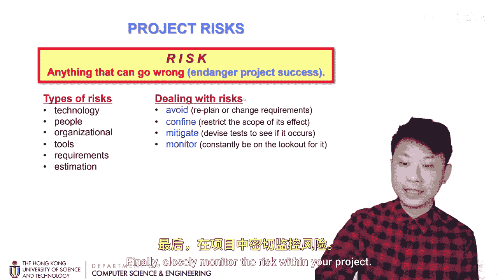
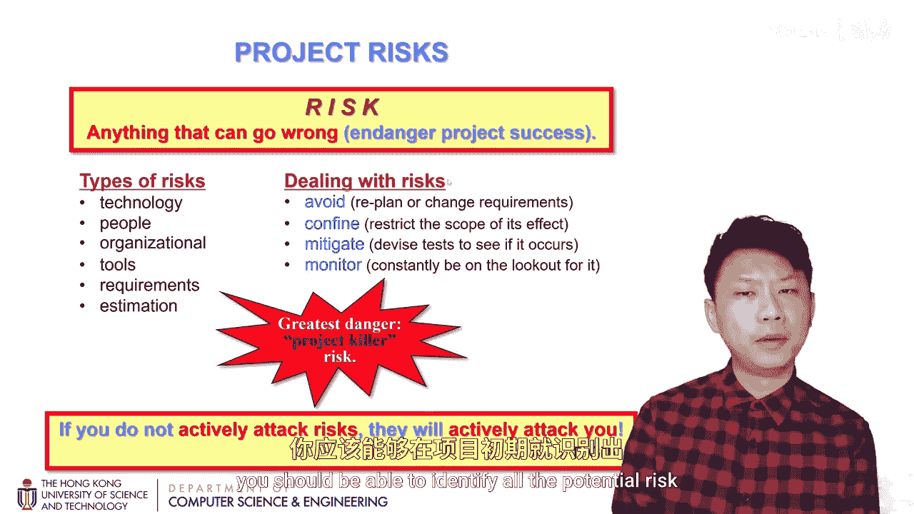
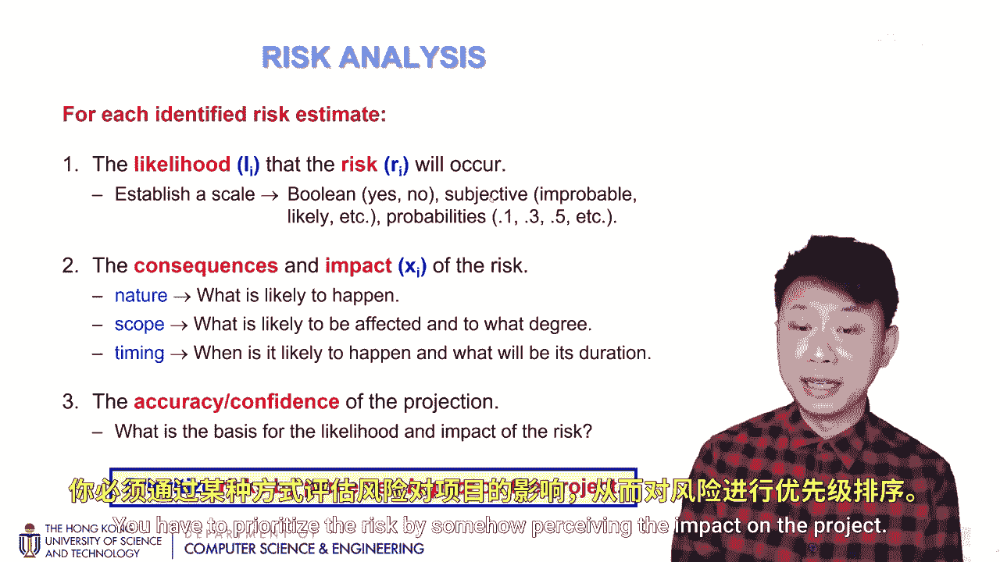
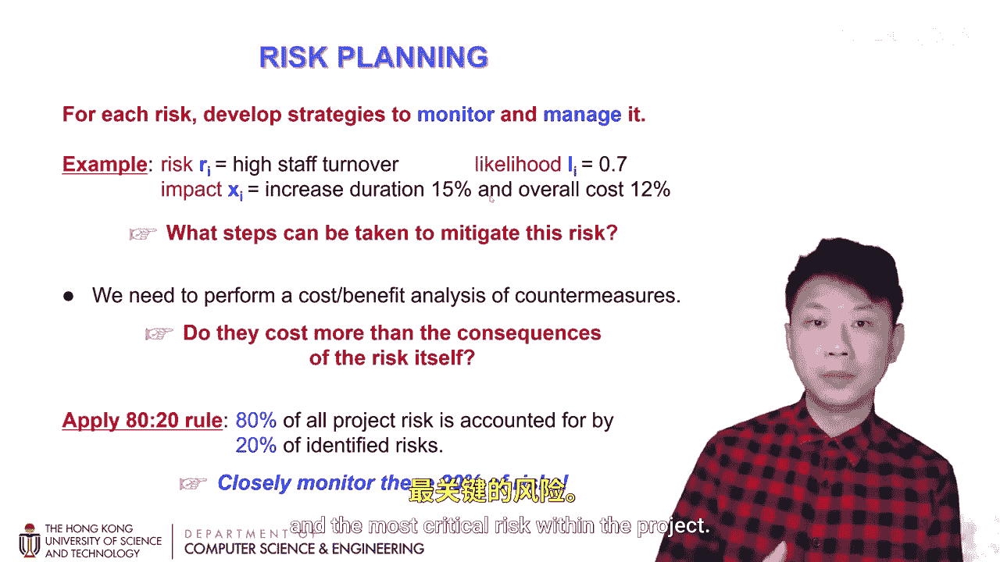
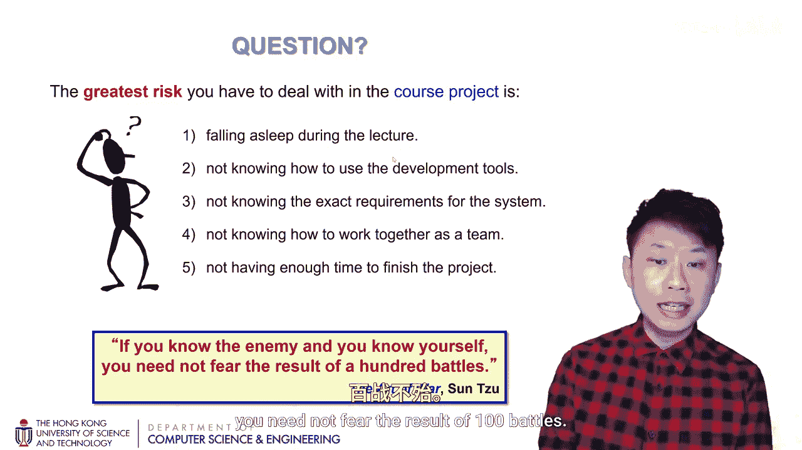

# 022：项目风险管理 🛡️

在本节课中，我们将学习项目管理中的一个核心环节：风险管理。作为项目经理，识别并应对项目中可能出现的所有风险至关重要。我们将了解风险的定义、分类以及一套系统的应对策略。

## 风险的定义与分类

上一节我们介绍了项目经理的职责，本节中我们来看看什么是项目风险。风险的定义很简单：**项目中任何可能出错的事情**。

风险可能来源于多个方面：

以下是风险的主要类别：
*   **技术风险**：与技术实现相关。
*   **人员风险**：与团队成员相关。
*   **组织风险**：与公司或团队结构相关。
*   **工具风险**：与开发工具和环境相关。
*   **需求风险**：与项目需求相关。
*   **估算风险**：与时间、预算的估算相关。错误的估算会导致项目延期或超支，这本身就是一种重大风险。

## 风险的应对策略

认识了风险的类型后，我们需要知道如何应对它们。处理风险主要有四种策略：

以下是四种核心的风险应对策略：
1.  **规避**：尝试阻止风险发生。
2.  **限制**：当风险无法避免时，尽量限制其影响范围。
3.  **缓解**：设计任务来探测风险是否会发生，或降低其发生的可能性。
4.  **监控**：对风险进行密切监控。

> 请注意，如果你不主动管理风险，风险就会主动攻击你。因此，优秀的项目经理应在项目初期就识别所有潜在风险。

## 风险评估与规划

仅仅识别风险是不够的，我们还需要对它们进行评估和排序。这并非易事，因为你需要为每个潜在风险评估其**发生概率**和**影响程度**。

*   **发生概率**：指风险发生的可能性，例如“此风险有80%的概率会发生”。
*   **影响程度**：指风险的性质、可能造成的后果、影响范围以及持续时间。

此外，你还需要为这些评估提供依据，即评估的准确性和置信度。最后，根据风险对项目的潜在影响进行优先级排序。

这是一个风险规划的例子：

*   **风险**：高人员流动率。
*   **概率**：70%。
*   **影响**：项目工期延长15%，总成本增加12%。

## 成本效益分析与帕累托法则

确定了风险及其影响后，项目经理需要思考采取哪些步骤来缓解风险，并进行**成本效益分析**。

这意味着你需要权衡：**应对风险所付出的成本，是否高于风险发生所造成的后果成本**。如果后果微不足道，修复成本极低，有时选择让风险发生后再修复可能是更经济的选择。

由于项目中潜在风险很多，我们需要应用**帕累托法则（80/20法则）**。我们不应同等地监控所有风险，而应聚焦于那**20%最关键、最重要的风险**，并对它们进行密切监控。

## 课堂项目的风险思考

让我们思考一个有趣的问题：在课程项目中，最大的风险是什么？

以下是几个可能的选项：
*   上课时睡着？
*   不知道如何使用开发工具？
*   不清楚项目的具体需求？
*   不知道如何团队协作？
*   没有足够的时间完成项目？

答案可能是“以上所有”，因为它们都可能对项目成功构成关键威胁。这正说明了在项目开始时全面识别风险的重要性。

> 正如孙子兵法所言：“知己知彼，百战不殆。”了解你的项目，了解潜在的风险，你就能从容应对各种挑战。

## 总结

本节课中我们一起学习了项目风险管理。我们明确了风险是“任何可能出错的事”，并将其分为技术、人员、估算等类别。我们掌握了规避、限制、缓解、监控四种应对策略，并学会了通过评估概率和影响来规划风险。最后，我们理解了通过成本效益分析和应用帕累托法则（聚焦关键的20%），可以更高效地管理风险，确保项目顺利进行。