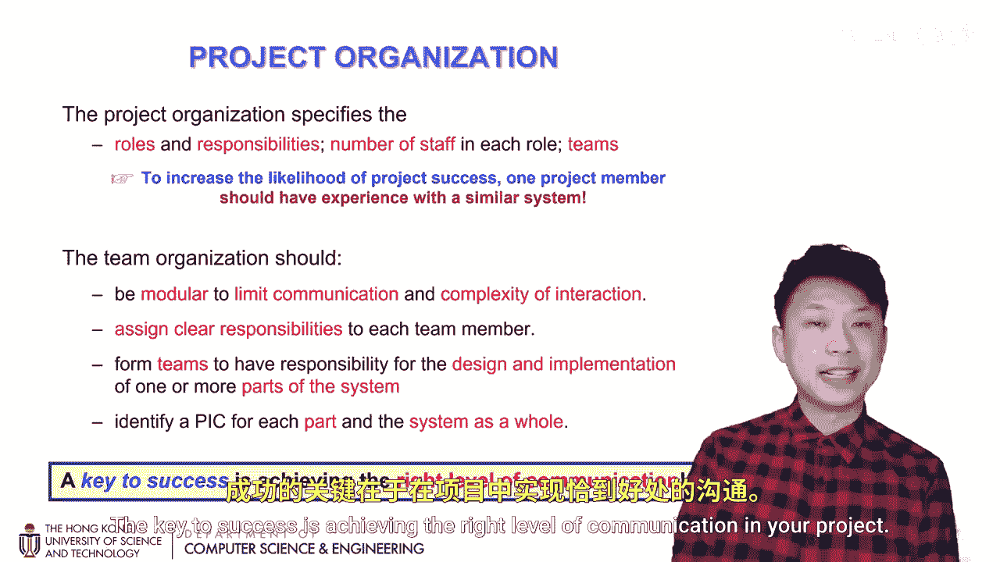
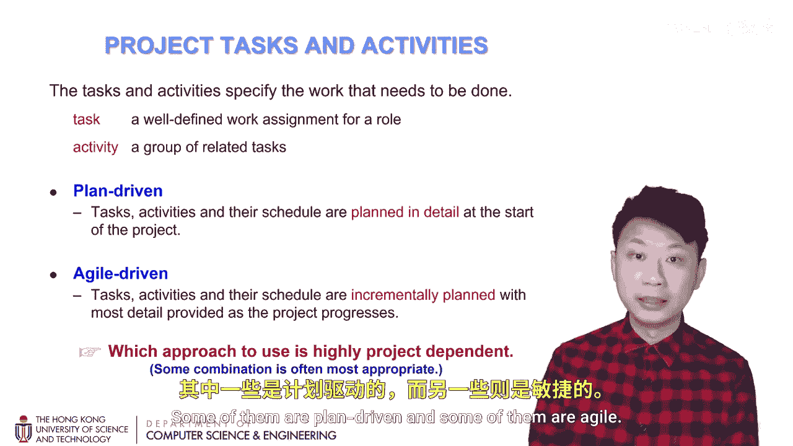
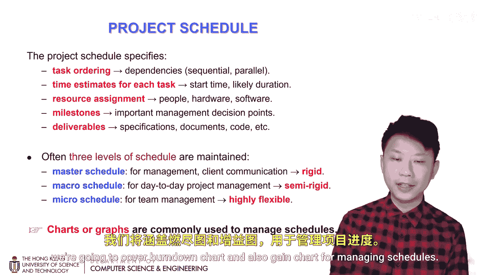
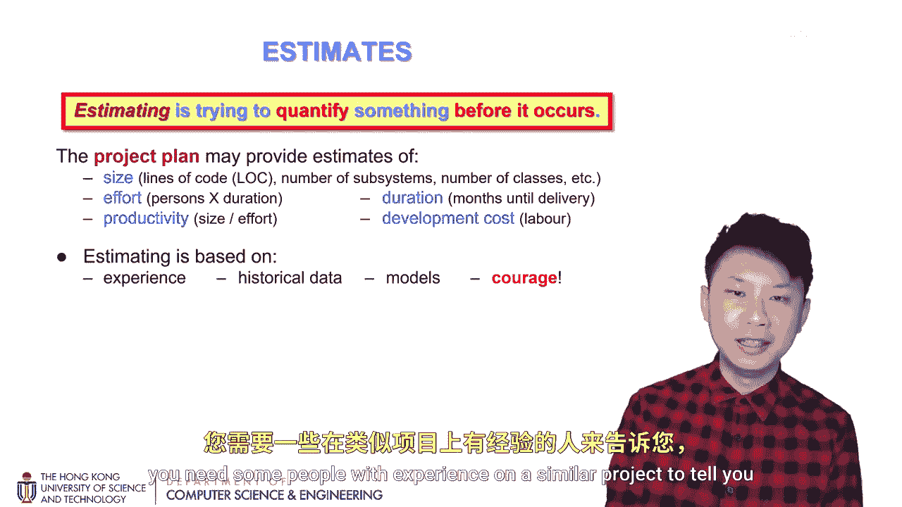
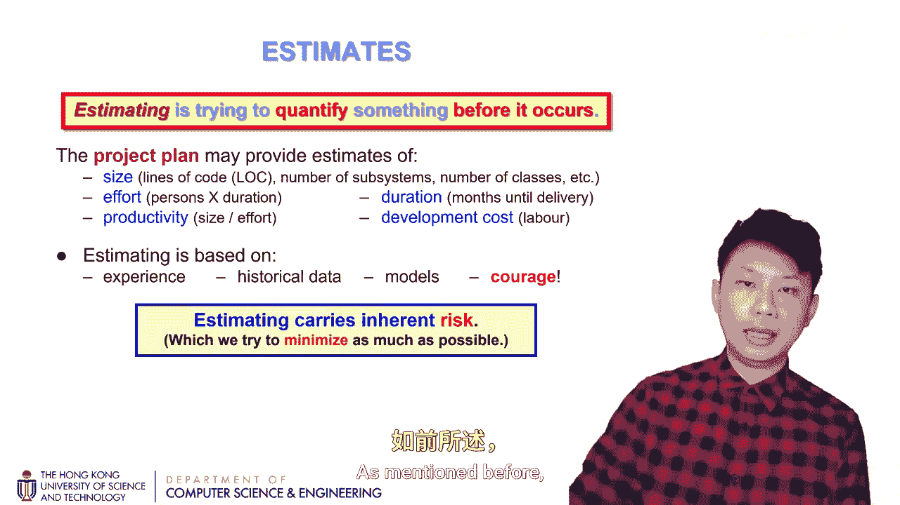
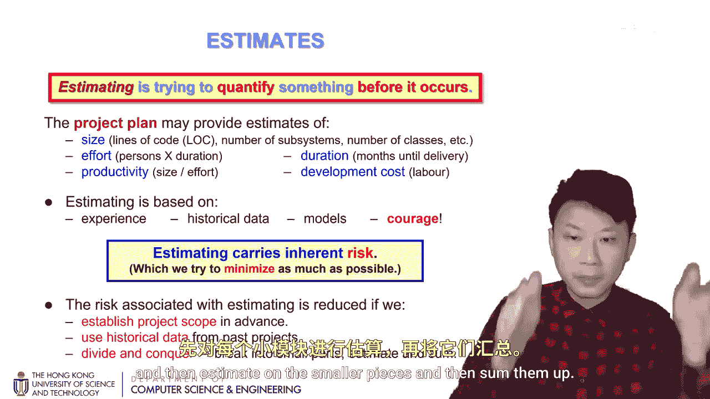
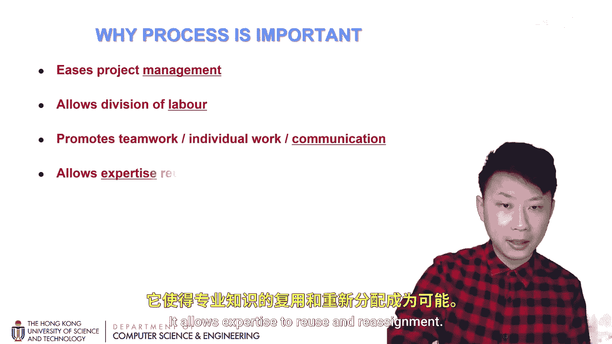
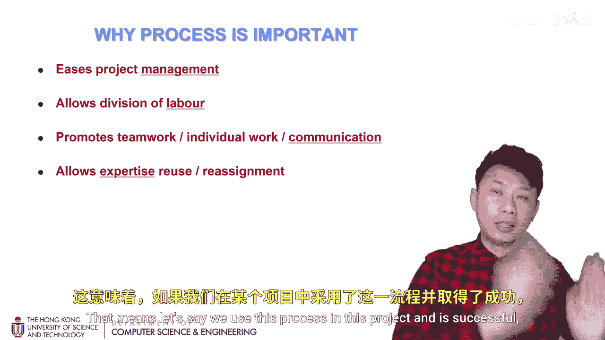
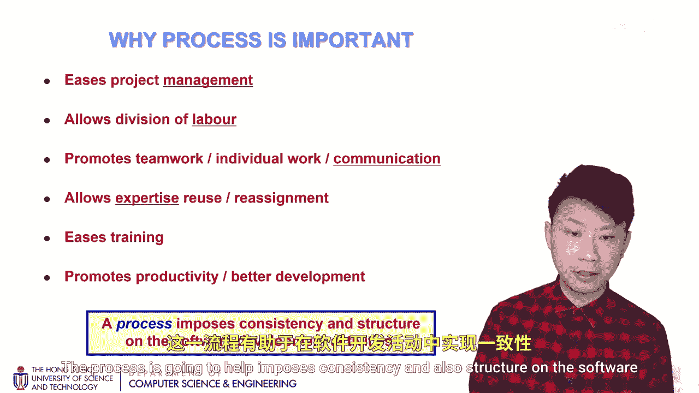
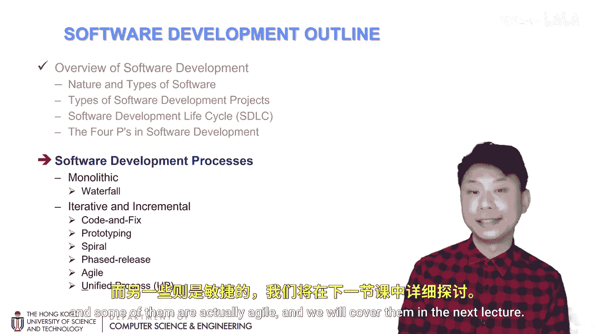

# 023：项目规划

在本节课中，我们将学习如何制定一个全面的项目计划。项目计划是软件项目管理的核心，它定义了项目的组织结构、任务活动、进度安排、估算方法以及开发流程。一个清晰的项目计划是项目成功的关键。

## 项目组织结构

在项目计划中，必须明确项目的组织结构。这包括指定团队中的角色、职责以及所需的人员数量。

为了提高项目成功的可能性，一个好主意是吸纳一位对类似系统有经验的团队成员。这里的“类似系统”指的是与你将要构建的项目相似的系统。

团队组织结构应该是模块化的，以限制沟通和交互的复杂性。因为如果团队人数过多，沟通会变得复杂。必须为团队中的每个成员分配明确的职责。

每个团队应负责系统一个或多个部分的设计与实现。这再次体现了“分而治之”的原则。我们将大型软件系统分解成更小的部分，然后每个团队负责系统的一个或多个小部分。

此外，必须为每个部分以及整个系统指定一位负责人。这样，如果项目中任何环节出现问题，你都可以找到相应的负责人进行沟通。

成功的关键在于在项目中实现适当程度的沟通。

## 任务与活动

在项目计划中，还必须明确项目内的任务和活动。

**任务**的定义是：为一个角色分配的、定义明确的工作。
**活动**的定义是：一组相关的任务。

有些项目是**计划驱动型**的。这意味着任务、活动及其时间表在项目一开始就进行了详细的规划。

有些项目则是**敏捷型**的。这意味着任务、活动及其时间表会随着项目的进展而增量式地规划。具体采用哪种方法高度依赖于项目本身。我们将在下一讲中介绍不同的软件开发流程，其中一些是计划驱动的，另一些是敏捷的。

## 项目进度安排

同样在项目计划中，我们必须制定一个**项目进度表**。它规定了项目中的所有任务、任务的顺序、每项任务的时间估算、资源分配、里程碑以及项目内的可交付成果。

通常，我们需要在项目中跟踪三个层次的进度表：
1.  **主进度表**：为管理层和团队沟通提供整个项目的概览。
2.  **宏观进度表**：用于日常项目管理。
3.  **微观进度表**：用于团队内部管理。

在本课程中，我们将介绍用于管理进度的燃尽图和燃起图。

## 项目估算

你必须在项目计划的一开始就进行所有估算，例如：项目规模、需要投入的工作量、工期、生产率以及开发成本等。

估算是基于经验、历史数据甚至数学模型进行的。为了获得正确或接近正确的估算，你需要一些有类似项目经验的人来告诉你项目中可能使用的数字。

如前所述，估算本身带有固有风险。通过在项目一开始就明确项目范围，可以降低这种风险。这样你就能清楚地知道在项目开始时必须做什么，以及不必做什么。

此外，使用过去项目（尤其是类似项目）的历史数据。例如，你知道你的项目需要这么多行代码和这么多人，那么你就可以借鉴过去的项目进行估算。同时，运用“分而治之”的方法，尝试将大型软件系统分解成更小的部分，先对每个小部分进行估算，然后再将它们汇总。

## 软件开发流程

软件项目中另一个重要的“P”是**流程**。

流程的定义是：将用户需求转化为软件产品所需的一整套活动（有时称为工作流）及其顺序。

一个流程规定了项目中的所有主要活动，并有一套指导原则来解释每个活动的目标。流程会使用一些资源，并且可能由一些子流程组成。

每个流程活动都有**入口**和**出口**标准，这样我们就知道活动何时开始、何时结束。

流程活动按顺序组织，以便我们可以一个接一个地执行。

**约束**和**控制**可能适用于流程活动。我们可能会在某个特定活动上花费时间，或者安排特定人员去完成项目中的某个活动。

那么，流程为何重要？因为它有助于简化项目管理。通过确切知道项目中必须执行哪些活动，可以帮助你更好地管理项目。

它也允许劳动分工。因为确切知道项目中必须做什么，就可以将这些活动分配给团队中的不同成员。同时，它能促进团队合作、个人工作以及沟通。

它还允许专业知识的重用和再分配。这意味着，如果我们在一个项目中使用了某个流程并且成功了，那么我们就可以将相同的流程应用到另一个类似的项目中。

此外，流程有助于培训，能提高生产率和促进更好的开发。流程有助于在软件开发活动中强加一致性和结构。

## 总结

本节课我们一起学习了项目规划的多个核心组成部分。我们明确了在项目计划中定义组织结构、任务活动、进度安排和估算方法的重要性。同时，我们介绍了软件开发流程的概念及其对项目管理的关键作用，例如促进分工、提高一致性等。下一讲，我们将深入探讨不同的软件开发流程，包括计划驱动型和敏捷型方法。