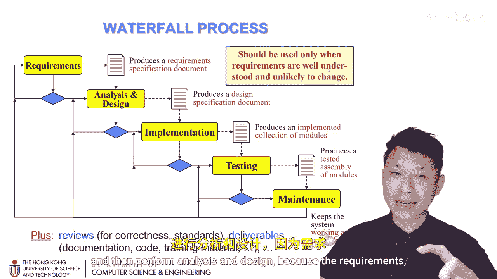
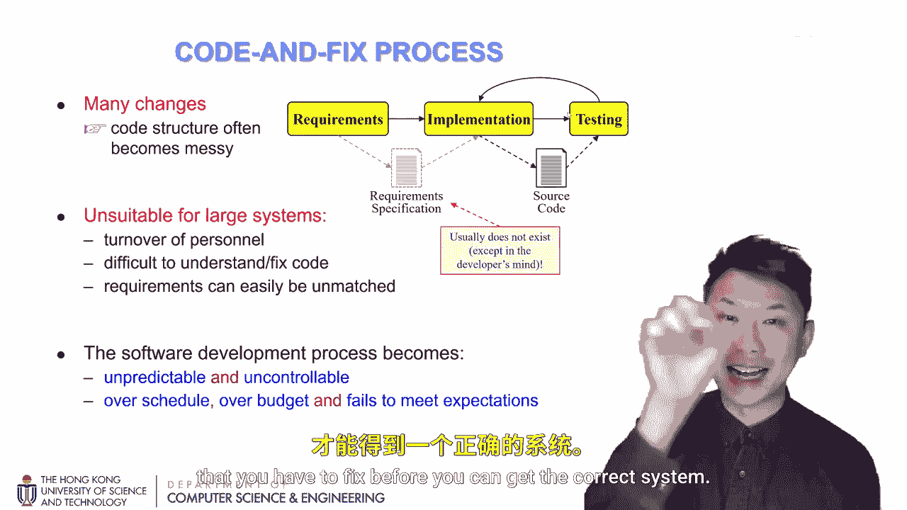
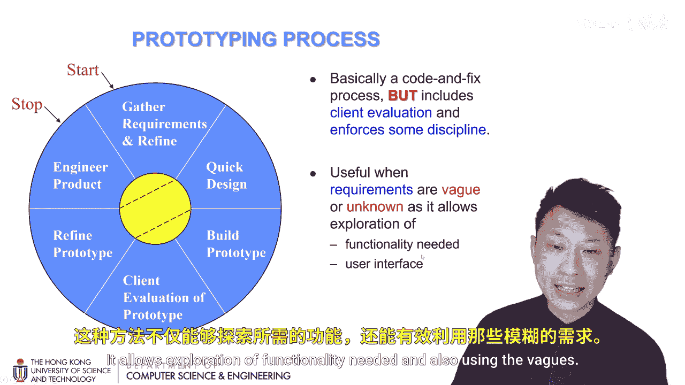
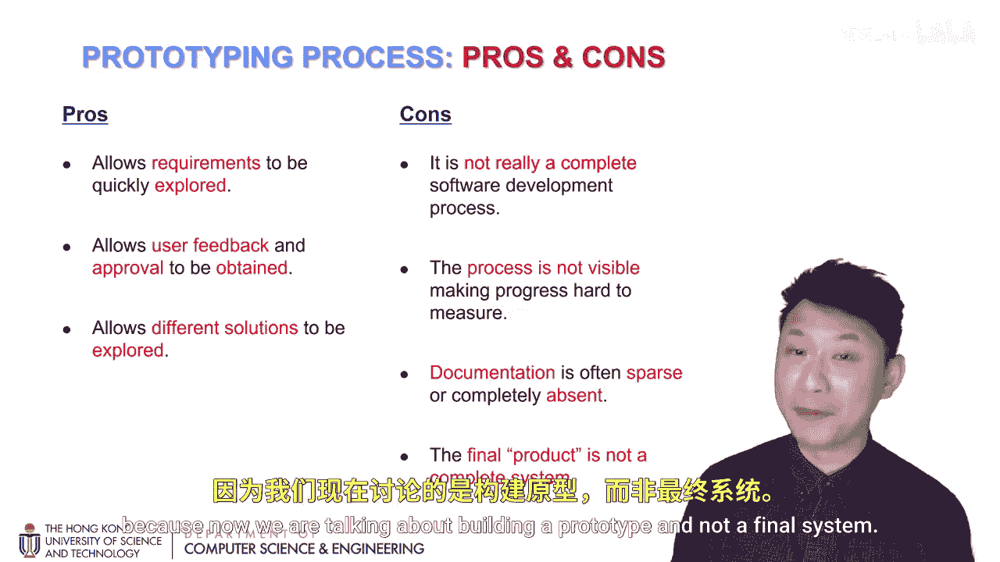
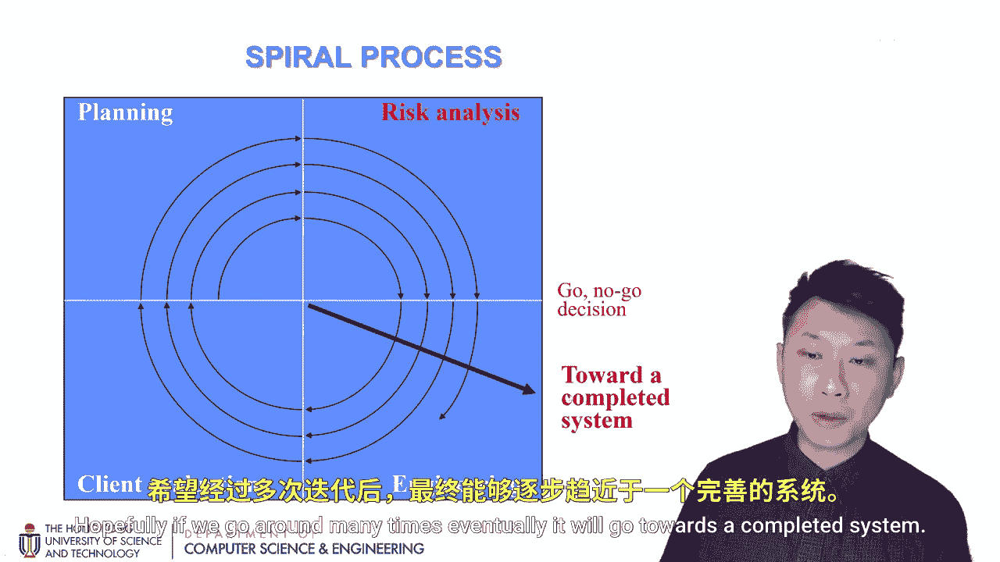
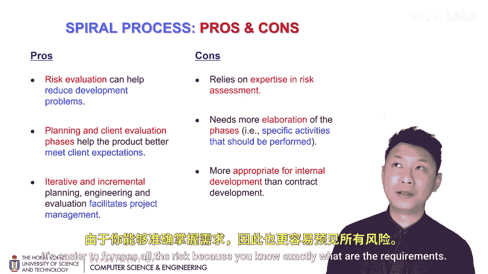
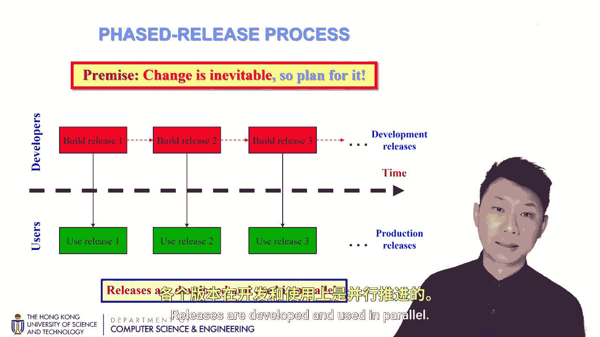
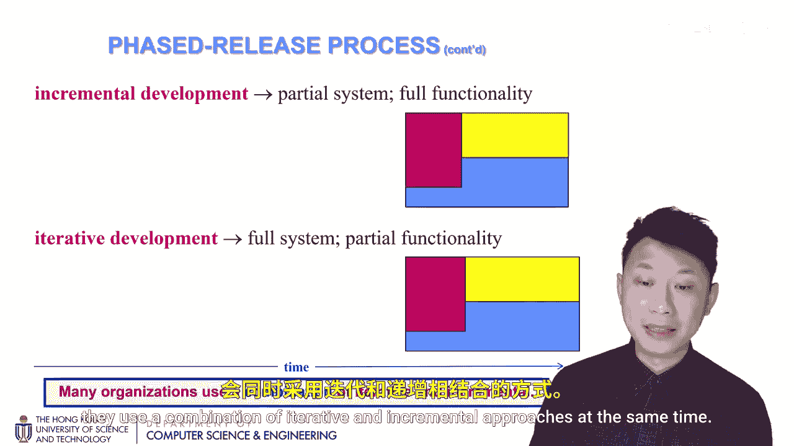
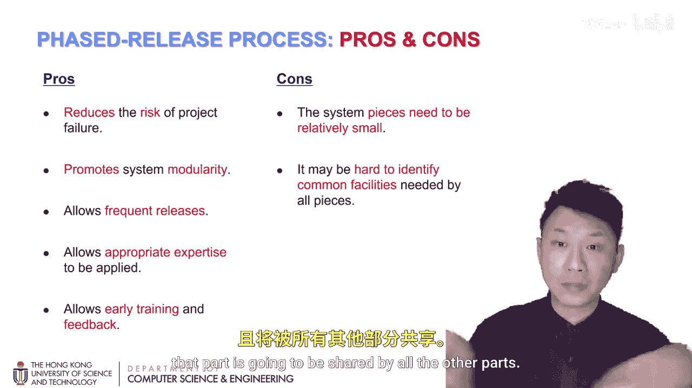

# 024：软件开发流程 🛠️

在本节课中，我们将探讨可用于软件开发的不同流程。我们将介绍瀑布模型、边做边改、原型法、螺旋模型、阶段发布、敏捷开发以及统一过程等模型。无论为项目选择哪种流程，最终都会包含以下几个阶段：**获取需求**、**分析与设计**、**实现系统**以及**最终测试**。不同的软件开发流程主要区别在于这些阶段如何组合、强调和执行。学习完这些流程后，最重要的是理解各自的优缺点，以便在特定场景下选择最合适的开发过程。

## 瀑布模型 🌊

上一节我们概述了软件开发的基本阶段，本节首先来看瀑布模型。在瀑布模型中，我们首先获取所有需求。然后基于这些需求进行系统分析与设计，并创建用于实现的模型。接着，我们进行系统实现。实现完成后，执行测试以确保软件系统没有缺陷。最后，进行系统维护。

我们称之为瀑布模型，是因为流程总是向下进行：获取需求后进行分析设计，然后实现、测试、维护。虽然理论上可以回溯（例如，发现设计因需求错误而不正确时），但回溯的代价很高。因此，我们通常希望流程一直向下，避免回溯。

正因如此，在完成特定阶段（如分析与设计）后，必须进行评审，仔细检查设计是否正确，然后才能进入下一步，因为回溯成本高昂。该模型仅适用于**需求被充分理解且不太可能变更**的情况。因此，这是一种更规范的模型，但在工业界并不常用，因为软件系统的需求很可能发生变化，很难在项目初期就捕获并冻结所有需求。

以下是瀑布模型的优缺点：

**优点：**
*   流程规范、有纪律性。
*   使开发过程可预测且易于监控，因为阶段间顺序推进并尽量避免回溯。
*   强制执行文档标准，并要求在进入下一阶段前批准文档。
*   与其他工程流程模型（不限于软件工程）契合良好。

**缺点：**
*   假设线性顺序开发是可行的，即尽量避免回溯。
*   过于僵化，假设每个阶段的结果在进入下一阶段前都可以被“冻结”。
*   不同阶段常使用不同的语言和符号。
*   几乎不提供或很少提供用户反馈的机会，这是高风险来源，因为它假设项目中的所有内容都不会改变。

## 迭代与增量式开发流程 🔄

上一节我们讨论了线性的瀑布模型，本节开始介绍一些迭代和增量式的软件开发流程。

### 边做边改模型

第一个是“边做边改”模型。这通常是我们在完成编程作业时使用的方法。在编程作业中，你会得到一组需求，然后基于需求进行构建。如果正确，就继续；如果不正确，则进行测试，发现软件有误后，返回去修复实现。这就是所谓的“边做边改”：编码、测试、发现问题、修复。

如果使用此流程，很可能会有很多变更，因为一旦出错就必须修复。代码结构通常会变得混乱，因为需要在源代码中加入许多变通方案才能使其工作。它不适合大型系统，通常仅用于编程作业。使用此流程会使过程不可预测、难以控制，很可能导致预算超支、进度延误，并且无法满足期望，因为你无法确切知道需要修复多少次才能得到正确的系统。

因此，这是我们应避免的流程。

### 原型法 🧪

接下来要讨论的流程是原型法。在原型法中，我们尝试快速收集一些需求，然后进行快速设计。接着，我们构建一个原型，并让客户参与评估该原型。请注意，原型不是整个系统，也不是完整系统。例如，如果我们正在构建一个Web应用程序，可能只构建应用程序的用户界面，以便向客户展示UI，从而获取关于系统的进一步反馈。

从客户那里收集反馈后，我们必须改进原型，并可能根据客户反馈重新设计系统，然后构建另一个原型，直到获得最终产品。本质上，它类似于“边做边改”，但通过原型法，我们引入了客户评估，并强制执行了一定的纪律性。

当**需求模糊不清**时，原型法非常有用。当你不确切知道需求是什么时，可以快速进行一些设计，构建一个小型原型，然后询问客户这个原型是否满足他们的需求。如果满足，则进一步改进原型；如果不满足，则必须改进设计并构建新的原型。因此，当需求模糊时，它非常有用，因为你可以利用原型从客户那里收集更多需求。它允许探索所需的功能，并且通常具有创新性。

以下是原型法的优缺点：

**优点：**
*   允许快速探索需求。
*   允许在进一步改进系统之前获得用户反馈和批准。
*   允许探索不同的解决方案。

**缺点：**
*   并非一个完整的软件开发流程。
*   过程不可见，使得进度难以衡量，因为你不知道在获得最终系统之前需要改进原型多少次。
*   文档通常很少或完全缺失。
*   最终产品可能不是完整的系统，因为我们讨论的是构建原型，而不是最终系统。

### 螺旋模型 🌀

下一个要介绍的流程是螺旋模型。螺旋模型的特点是引入了另一个阶段：**风险分析**。

我们要做的是：进行一些规划，然后进行风险分析，以预见项目中所有可能的风险。在收集所有风险后，决定是否继续推进。如果决定继续，则实现系统，之后让客户参与评估，然后再次规划系统并重新进行风险分析，如此循环。因此我们称之为螺旋模型，因为在获得最终系统之前必须进行多轮循环，希望经过多次循环后最终能趋近于一个完整的系统。

螺旋模型的优点如下：

**优点：**
*   风险评估有助于减少开发问题，因为你在实际实现系统之前就试图预见所有风险。
*   规划和客户评估阶段有助于产品更好地满足客户期望，因为在进入下一轮循环之前，你总会征求客户反馈。
*   迭代和增量的规划、工程和评估有助于项目管理。

**缺点：**
*   需要风险评估专家来识别项目中的所有风险。
*   在获得最终系统之前，需要对各个阶段进行更详细的阐述。
*   它更适合内部开发而非合同开发，因为如果是内部系统，你确切知道需求是什么，也更容易预见所有风险。

### 阶段发布流程 📦

接下来介绍的流程是阶段发布流程。由于项目中很可能发生变更，因此我们必须为此做好计划。在阶段发布中，我们尝试一部分一部分地发布系统。通过不时发布系统的不同构建版本，然后进一步改进构建版本一，得到构建版本二，构建版本二完成后，再发布给用户，依此类推。因此，发布版本是并行开发和使用的。

请注意，开发可以是**增量式**的，即从系统的一部分开始，然后构建另一部分，直到获得所有功能。也可以是**迭代式**的，即尝试构建完整系统，但使系统变得越来越复杂。许多组织同时使用迭代和增量方法的组合。

以下是阶段发布流程的优缺点：

**优点：**
*   降低了项目失败的风险，因为每次只专注于系统的一部分。
*   促进了系统模块化。
*   允许频繁发布。
*   允许将适当的专业知识应用于系统的特定部分。
*   允许早期培训和用户反馈。

**缺点：**
*   系统各部分需要相对较小。
*   可能难以识别所有部分所需的公共设施。我们假设各部分相互独立，但实际上很可能存在一些共享或所有部分都需要的公共设施，因此需要识别出这部分，因为它是关键部分，将被所有其他部分共享。

## 总结 📝

本节课我们一起学习了多种软件开发流程。我们从线性的瀑布模型开始，了解了其规范性和适用场景。接着探讨了迭代和增量式开发，包括应避免的“边做边改”模型、适用于模糊需求的原型法、强调风险管理的螺旋模型，以及通过分阶段发布来管理变更和风险的阶段发布流程。理解这些流程的优缺点至关重要，它能帮助我们在实际项目中，根据需求明确度、变更可能性、风险水平等因素，选择最合适的开发方法，从而提高软件项目的成功率。