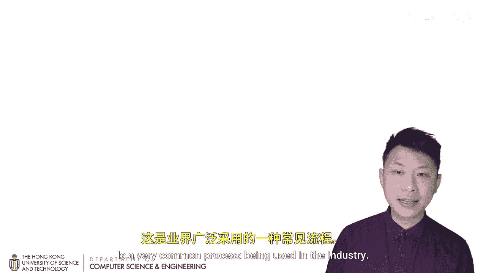
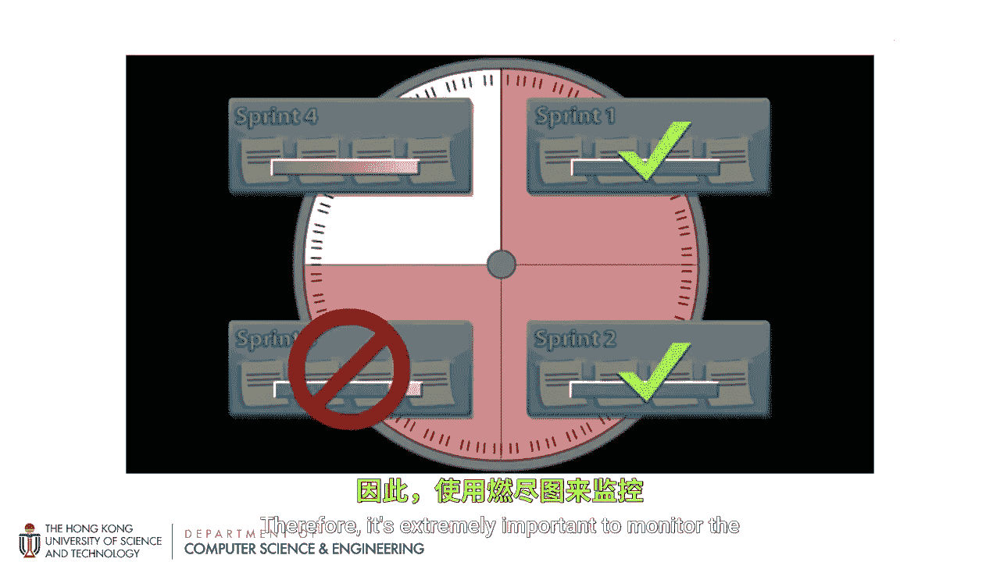
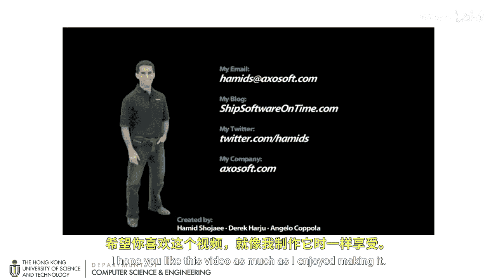
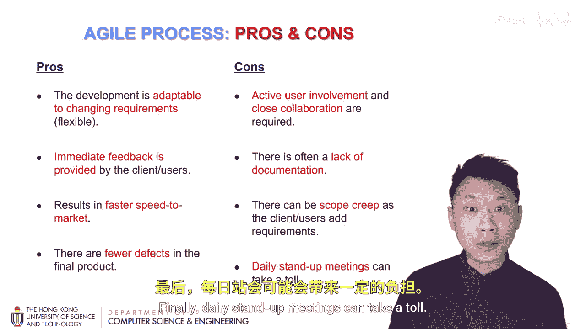

# 025：敏捷开发 🚀

在本节课中，我们将要学习敏捷开发方法。我们将介绍敏捷的核心思想，并详细探讨三种具体的敏捷过程：极限编程、持续集成和Scrum。通过学习，你将理解敏捷开发如何通过强调个体协作、可工作软件和快速响应变化来提升软件开发效率。

## 敏捷宣言与核心思想

上一节我们介绍了传统的软件开发模型。本节中我们来看看一种更灵活的方法——敏捷开发。

敏捷开发的核心思想体现在“敏捷宣言”中。它强调我们应更关注左侧项目的价值，而相对减少对右侧项目的关注。

例如，我们更关注：
*   **个体和互动** 而非 流程和工具
*   **可工作的软件** 而非 详尽的文档
*   **客户合作** 而非 合同谈判
*   **响应变化** 而非 遵循计划

这意味着，相比于花费大量时间制定文档或计划，我们更侧重于实际的软件实现。这就是我们在谈论敏捷过程时所关注的焦点。

但这并不意味着右侧的项目没有价值，只是我们的关注重点有所不同。

## 常见的敏捷实践

在深入具体过程之前，我们先了解一些被多种敏捷方法采用的通用实践。以下是几种常见的敏捷实践：

*   **计划扑克**：一种用于估算项目所需资源、人力、时间和进度的协作式估算技术。
*   **结对编程**：两名开发者共同在一台计算机上工作，一人编写代码（驾驶员），另一人实时审查每一行代码（领航员）。公式可以表示为：`代码质量 ≈ 驾驶员实现 + 领航员审查`。这样做是为了通过他人的双重检查来避免错误。
*   **测试驱动开发**：在编写实现代码之前，先编写该功能的测试用例。其流程可概括为：**红（测试失败） -> 绿（测试通过） -> 重构（优化代码）**。

## 极限编程

首先，我们将要介绍的是极限编程。这是一种将敏捷价值观贯彻到具体实践中的开发方法。

在极限编程中，流程通常如下：
1.  **需求收集与分析**：开发者确定系统所需的功能。
2.  **估算**：为每个功能提供时间和成本估算。
3.  **迭代规划**：客户选择在特定开发迭代中要包含的功能。
4.  **任务分解**：开发者将每个迭代分解为多个任务。
5.  **任务分配**：不同的人和团队负责不同的任务。
6.  **测试先行**：针对每个任务，开发者先设计测试用例（测试驱动开发）。
7.  **结对实现**：使用结对编程的方式实现任务。
8.  **集成**：最后，将所有任务集成在一起，形成一个可用的产品。

## 持续集成

接下来，我们探讨持续集成。这是一种强调频繁集成代码的敏捷软件开发实践。

持续集成是指开发者每天多次将代码集成到共享仓库中。这意味着开发者完成一部分工作后，会立即将代码集成到主分支。

我们为什么要这样做？因为只集成一小部分代码到仓库时，我们为集成和测试所需付出的努力是最小的。因此，我们希望快速执行集成和测试，以便立即发现任何错误或集成问题。

以下是使用持续集成的优势：
*   **早期集成与测试**：允许开发者尽早集成和测试代码。
*   **快速发现缺陷**：快速发现并暴露可能破坏构建的错误。
*   **减少集成冲突**：通过持续集成，减少大规模集成时的冲突。
*   **可视化进度**：帮助开发者检查开发进度，因为所有工作都体现在共享仓库中。
*   **自动化构建与测试**：使用CI服务器上的脚本自动完成构建和测试。

其架构通常如下：
1.  开发者将更改提交到版本控制仓库。
2.  CI服务器从版本控制仓库拉取最新代码。
3.  CI服务器尝试构建和测试最新版本。
4.  如果最新版本存在任何问题，会将反馈发送给开发者。

需要注意的是，这需要一个CI服务器来定期编译代码并向开发者报告结果，同时需要在服务器上准备所有脚本，以自动完成构建和测试。

## Scrum框架

现在，我们来看看在业界非常流行的Scrum框架。Scrum是一个敏捷软件开发过程，它主要规定了开发软件产品应该做什么，但没有规定具体的软件工程实践，团队需要自行决定如何工作。

在Scrum中，需求以产品待办事项列表的形式捕获，这是一个软件系统所需功能的列表。产品负责人（客户）为这些条目设定优先级。

软件产品通过一系列称为“冲刺”的迭代来开发。团队自组织地决定交付产品的最佳方式。

### 核心概念与流程

以下是Scrum中的核心概念：
*   **产品待办列表**：包含系统所有所需功能的列表。
*   **冲刺**：一个时间固定的迭代周期，通常为2到4周。团队专注于完成该冲刺内选定的功能。
*   **冲刺规划**：从产品待办列表中选取一部分功能，放入一个冲刺中。
*   **不变的需求**：在一个冲刺期间，需求不允许变更。

### 角色、会议与工件

Scrum定义了特定的角色、会议和工件来支持开发：
*   **角色**：
    *   **产品负责人**：代表客户或关键利益相关者，负责定义和排序产品需求，根据需要调整每次迭代的需求和优先级，决定发布日期和内容，并验收工作成果。
    *   **Scrum主管**：通常是项目经理，负责推行Scrum价值观和实践，确保团队功能完整、高效生产，促进各角色和职能之间的紧密合作，并移除进度障碍，保护团队免受外部干扰。
*   **会议**：
    *   **冲刺规划会**：决定在接下来的冲刺中要开发哪些功能。
    *   **每日站会**：一个简短的会议，团队成员通常回答三个问题：昨天做了什么？今天计划做什么？有什么障碍吗？这有助于跟踪开发进度。
*   **工件**：
    *   **产品待办列表**：记录所有需求的文档。
    *   **冲刺待办列表**：从产品待办列表中选出、计划在当前冲刺中完成的功能子集。
    *   **燃尽图**：用于跟踪开发进度的图表，显示剩余工作量随时间减少的趋势。

### 燃尽图

燃尽图是Scrum中至关重要的进度跟踪工具。它按日测量给定冲刺或发布中剩余的工作量。

在图表中，你可以看到剩余工作量每天上下波动，但总体趋势是向零下降。通过燃尽图，团队可以快速计算图表斜率，即“燃尽速度”，也就是每天的平均生产率。这使得团队能够预测冲刺或发布的预计完成日期，并与计划进行对比，从而早期判断项目是否在正轨上。

## 敏捷方法的优缺点

最后，我们来总结一下敏捷方法的优点和缺点。

**优点**：
*   **适应变化**：开发能适应不断变化的需求。
*   **即时反馈**：客户或用户可提供即时反馈。
*   **快速上市**：能够实现快速推向市场。
*   **缺陷更少**：最终产品缺陷更少，因为每个冲刺内的缺陷都应在进入下一冲刺前被清理。

**缺点**：
*   **要求高参与度**：需要用户积极参与和紧密协作。
*   **文档可能不足**：通常缺乏详尽的文档。
*   **可能存在范围蔓延**：随着用户不断提出新需求，项目范围可能不断扩大。
*   **站会负担**：每日站会可能对团队造成负担。

---

本节课中我们一起学习了敏捷开发的核心思想，并深入了解了三种具体的敏捷实践：极限编程、持续集成和Scrum。我们看到了敏捷如何通过迭代、协作和快速反馈来应对软件开发的复杂性。理解这些框架的优缺点，能帮助你在实际项目中做出更合适的选择。