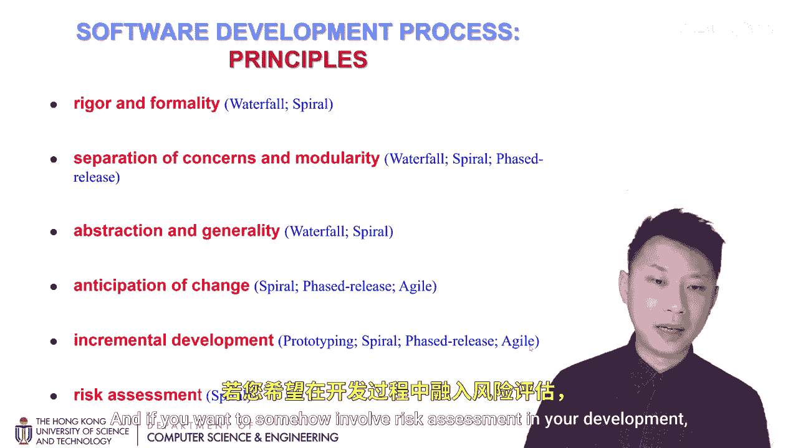
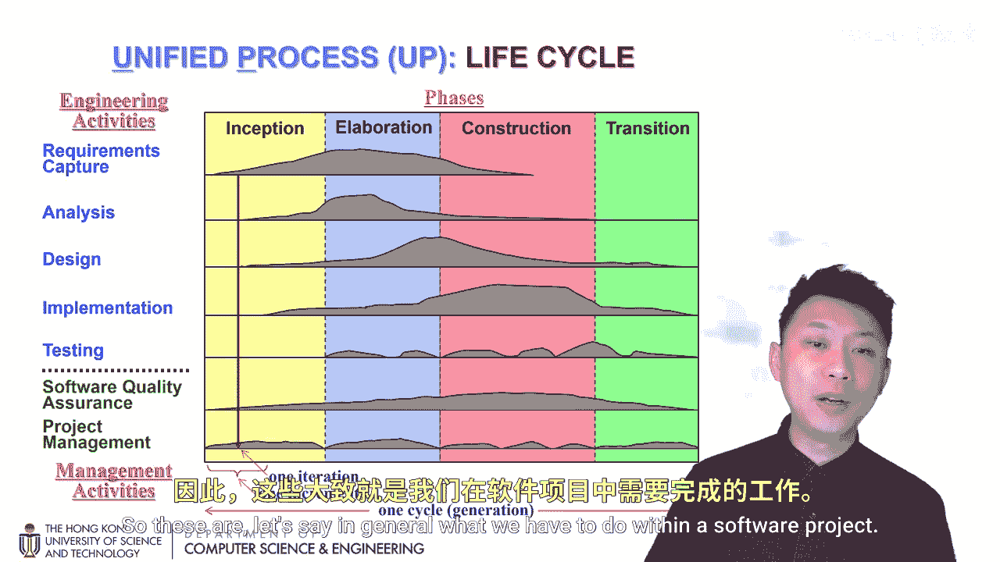
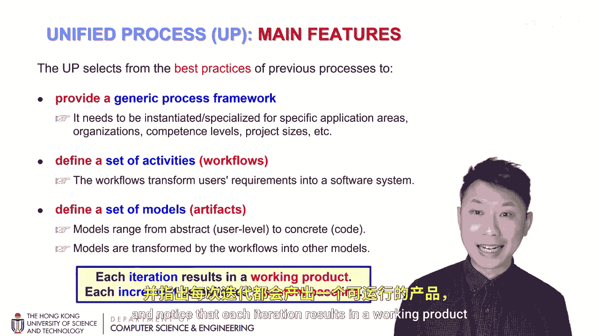
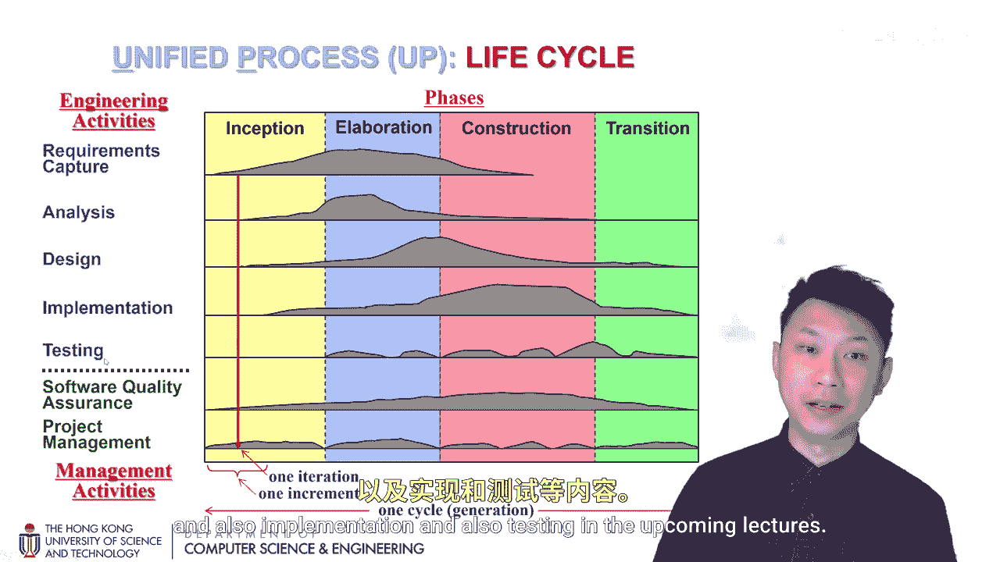
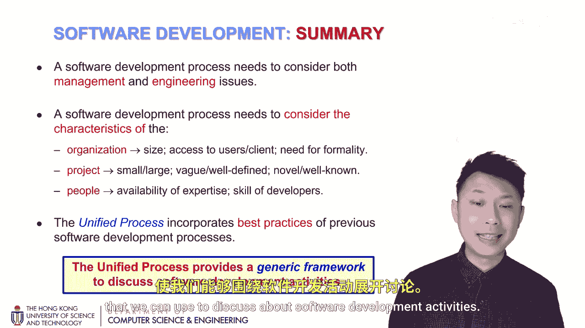

**软件工程：P26：统一过程** 🧩

在本节课中，我们将学习如何将之前介绍的各种软件开发过程整合到一个通用框架中，即统一过程。我们将了解其核心活动、阶段划分，以及它如何融合其他过程的优点。

---

上一节我们介绍了多种软件开发过程模型。本节中，我们来看看如何根据项目需求选择合适的过程。

如果你需要**形式化和纪律性**，可以选择瀑布模型或螺旋模型。
如果你需要**关注点分离和模块化**，可以选择瀑布模型、螺旋模型或分阶段发布模型。
如果你需要**抽象性和通用性**，可以选择瀑布模型或螺旋模型。
如果你需要一个能**预见变化**的过程，可以选择螺旋模型、分阶段发布模型或敏捷模型。
如果你希望进行**增量式开发**，可以选择原型模型、螺旋模型、分阶段发布模型或敏捷模型。
如果你希望在开发中**进行风险评估**，可以选择螺旋模型。

---

基于以上选择标准，我们引入一个通用框架。这就是所谓的**统一过程**。它是一个可用于软件开发的通用框架。无论你最终选择哪种具体过程进行开发，基本上都需要执行以下核心活动。

以下是软件开发必须执行的核心活动：
*   **捕获需求**
*   **进行分析**
*   **完成设计**
*   **实现系统**
*   **测试系统**

在项目内部，还需要执行**软件质量保证**以确保最终软件的质量，并进行**项目管理**。

此外，项目内部会经历不同的阶段：
*   **初始阶段**：收集所有需求，并再次确认需求是否可行。如果可行则继续，否则可能终止项目。
*   **细化阶段**：制定用于实现的设计方案。
*   **构建阶段**：实现系统。
*   **移交阶段**：部署并维护系统。

这些就是在一个软件项目中通常需要完成的工作。

---

因此，我们说**统一过程**从先前各种过程中选取了最佳实践，为软件开发提供了一个通用的过程框架。它定义了一组在软件开发中必须执行的活动，并定义了一个可以在项目中遵循的模型。

请注意，统一过程中的**每次迭代都会产出一个可工作的产品**，而**每个增量都会建立一个系统基线**。

---

在接下来的课程中，我们将反复回到统一过程的这张示意图。因为我们将详细讨论不同的活动，例如分析、设计、实现和测试。

---

**总结**

本节课中我们一起学习了：
1.  一个软件开发过程需要同时考虑**管理**和**工程**问题。
2.  一个软件开发过程需要考虑**组织、项目和人员**等特性。
3.  **统一过程**融合了先前各种软件开发过程的最佳实践。
4.  它提供了一个通用框架，可用于讨论软件开发活动。