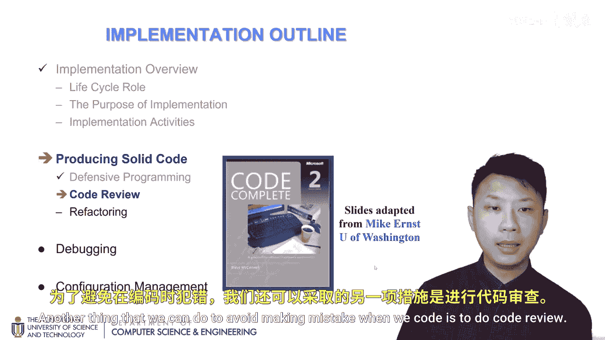
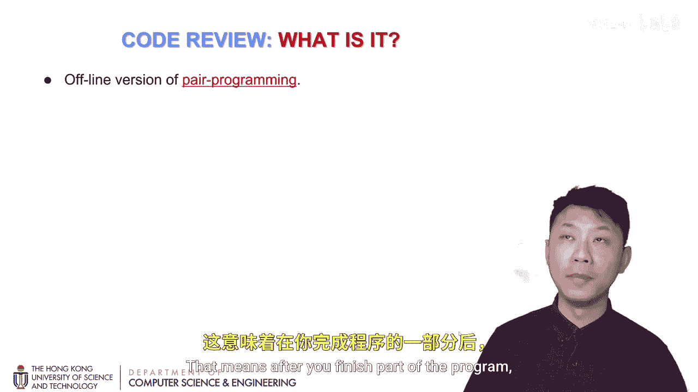
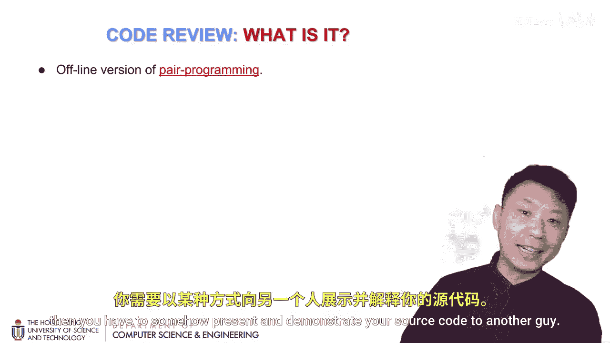
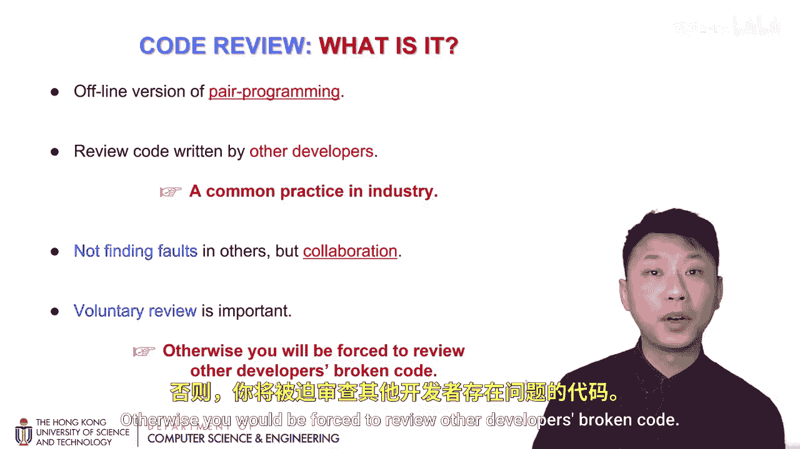
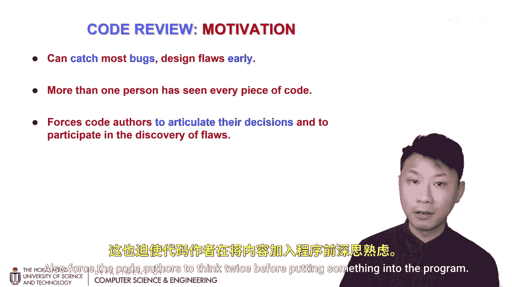
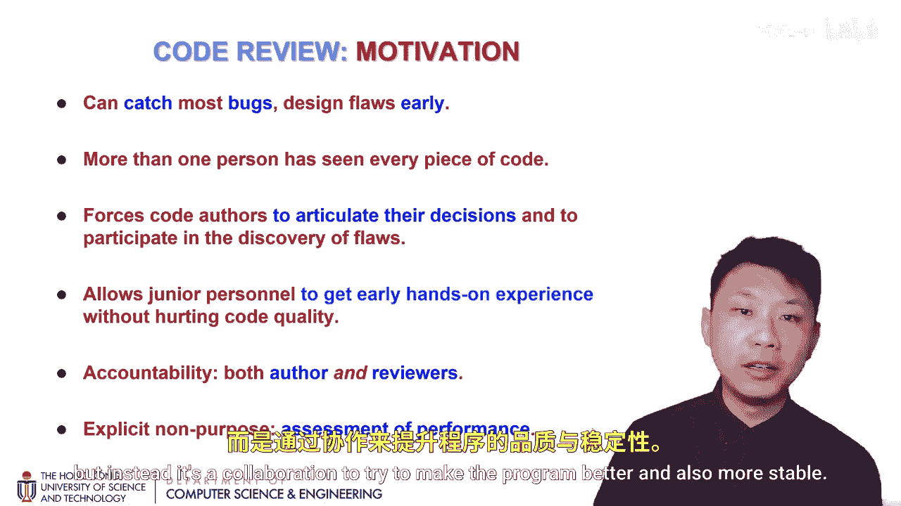
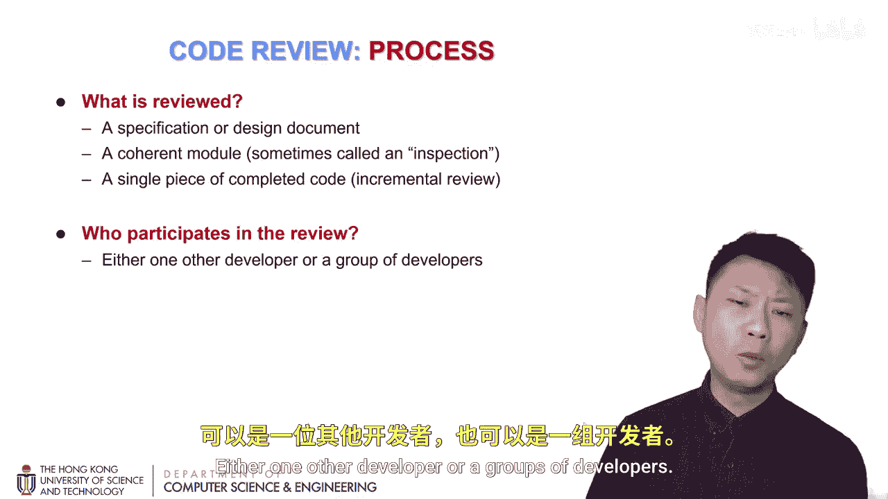
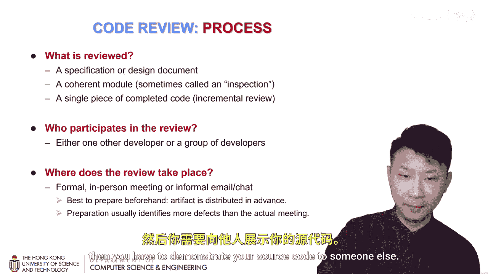
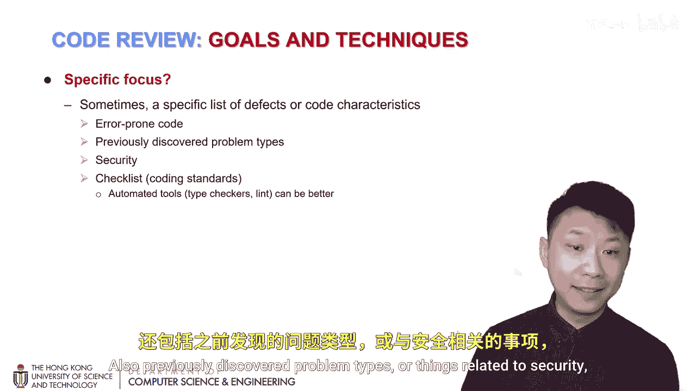
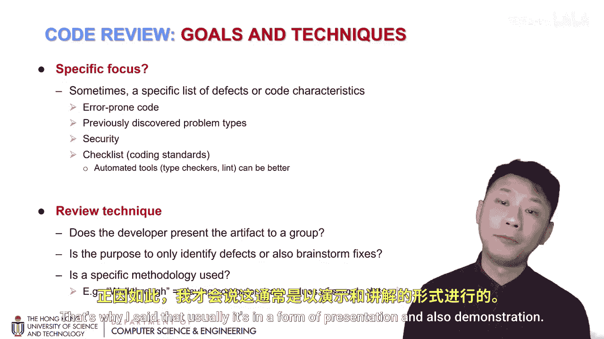

软件工程：P28：代码审查 🔍

在本节课中，我们将要学习一种在编码过程中避免错误的重要实践：**代码审查**。这是一种通过他人检查代码来提升程序质量和稳定性的协作方法。

---

### 什么是代码审查？🤔

上一节我们介绍了结对编程，代码审查可以看作是结对编程的离线版本。这意味着在你完成部分程序后，需要向另一位开发者展示和解释你的源代码。在代码审查中，我们尝试评审其他开发者编写的代码。这是行业中非常普遍的实践，但其目的并非挑刺，而是通过协作让程序变得更好、更稳定。

**自愿进行审查非常重要**，否则你可能会被迫去审查其他开发者写得很糟糕的代码。其动机在于，通过让另一位开发者双重检查你的源代码，我们可以尽早发现大多数缺陷和错误。同时，这也能确保系统中的每一段代码都被不止一个人看过，迫使代码提交者在将内容加入程序前三思，并允许初级程序员向更有经验的开发者学习。

责任由**代码提交者**和**审查者**共同承担。再次强调，目的不是绩效评估，而是一种旨在让程序更好、更稳定的协作。

---

### 审查什么？谁参与？在哪里进行？📋

现在，我们来看看代码审查的具体实施细节。以下是关于审查内容、参与者和地点的要点：

*   **审查内容**：可以审查**文档**、一个**连贯的模块**或一段**已完成的独立代码**。
*   **参与者**：可以是**另一位开发者**，也可以是一个**开发者小组**。
*   **地点**：通常在你自己的电脑前进行，你需要向他人演示你的源代码。

---

### 审查时关注什么？🎯

了解了基本框架后，我们来看看在执行代码审查时应该关注哪些方面。以下是一些常见的关注点：

*   **易错代码**：指那些你反复出错的地方，我们可以重点审查这些部分。
*   **先前发现的程序缺陷类型**。
*   **与安全相关的问题**。
*   **基于清单**，即根据某些编码标准进行检查。

---

### 如何执行审查？🗣️

最后，我们来探讨如何具体执行一次代码审查。基本上，你需要以**演示和陈述**的形式向他人展示你的源代码。

你必须展示你的代码，并逐步讲解代码的执行逻辑，向另一位开发者解释你的程序中发生了什么。因此，我说这本质上是一种演示和陈述。

---

### 总结 📝

本节课中，我们一起学习了**代码审查**。我们了解到，代码审查是一种通过开发者间相互检查代码来早期发现错误、提升代码质量和团队知识的协作实践。它审查的内容包括代码、文档和模块，需要提交者进行演示和讲解，其核心精神是协作改进，而非个人评估。掌握并实践有效的代码审查，是成为一名优秀软件工程师的重要一环。