# 029：重构 🛠️

在本节课中，我们将要学习软件工程中的一个重要实践——重构。重构是在不改变软件外部行为的前提下，改善其内部结构的过程。我们将探讨为何需要进行重构、重构的不同层次以及如何在实际项目中应用重构。

## 概述

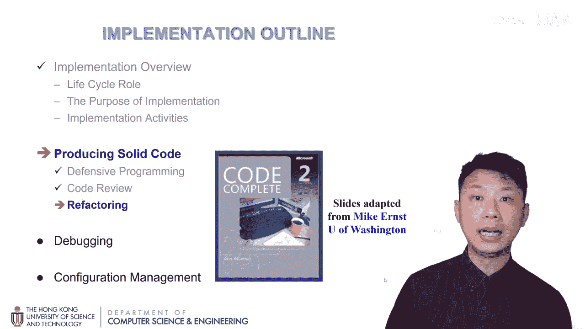

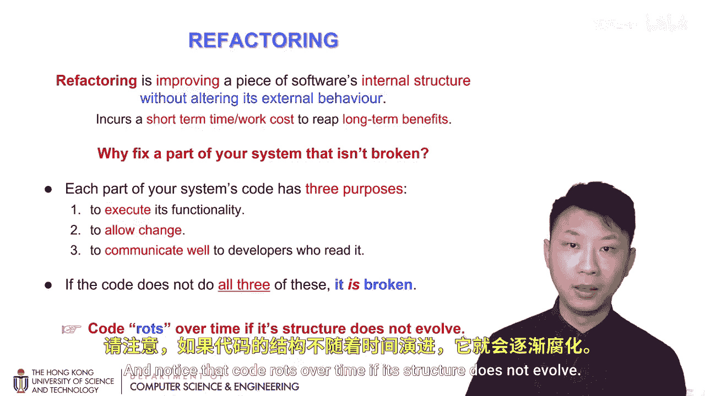

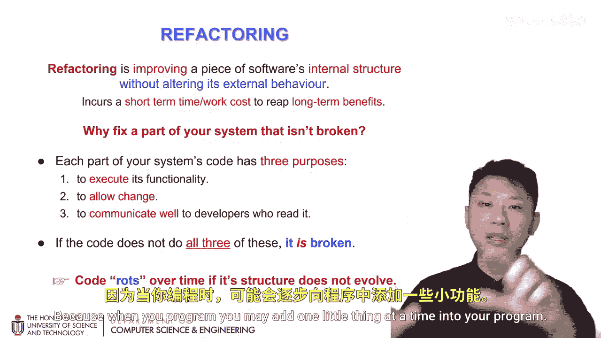

重构旨在提升代码质量，使其更易于理解、维护和扩展。即使代码当前功能正常，其结构也可能随着时间推移而恶化。通过重构，我们可以确保代码不仅能够正确执行功能，还能适应未来的变化，并且对其他开发者友好。

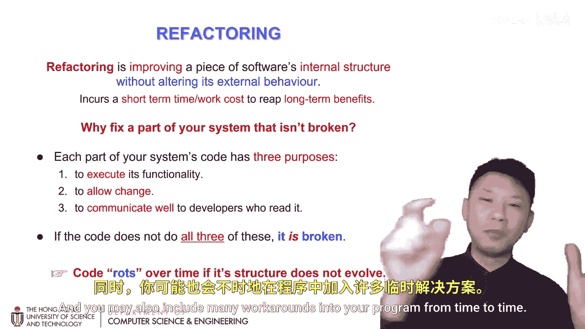

## 为何需要重构？🤔

代码会随着时间推移而腐化。当程序员向程序中逐步添加新功能时，可能会引入临时的解决方案和变通方法。久而久之，代码的结构就会变得混乱和难以维护。

因此，为了改善程序的整体结构，我们必须定期进行重构。

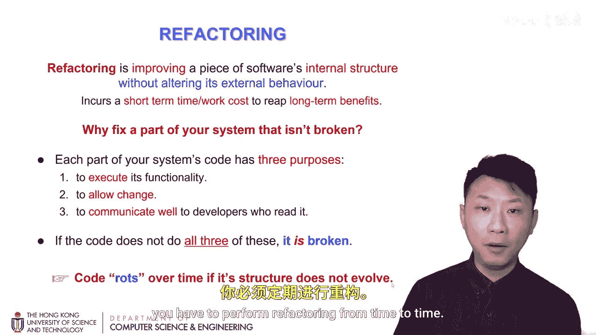

## 低层次重构

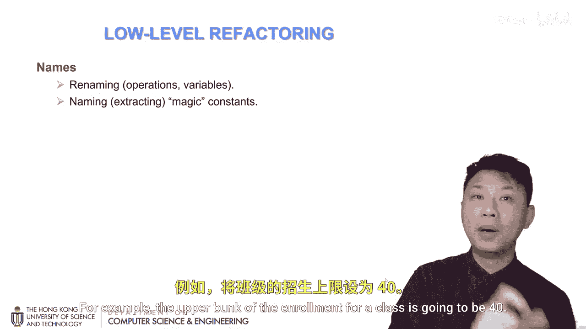

低层次重构主要关注代码的微观层面，例如重命名和代码组织。以下是常见的低层次重构操作：

*   **重命名操作和变量**：使用有意义的名称代替模糊的名称（如 `function1`, `x`, `y`）。例如，将常量 `x = 240` 重命名为 `MAX_ENROLLMENT = 240`。
*   **提取方法**：将一段代码提取成一个独立的方法，以提高可读性和复用性。
*   **提取模块或操作**：将通用的功能提取到独立的模块或操作中。
*   **修改操作签名**：优化方法或函数的参数列表，使其更清晰。
*   **拆分操作**：将一个庞大的操作拆分成几个更小、内聚性更强的操作。
*   **组织相关语句**：将语义上相关的代码语句在物理位置上放在一起。

许多集成开发环境（IDE）都支持上述类型的自动化重构。

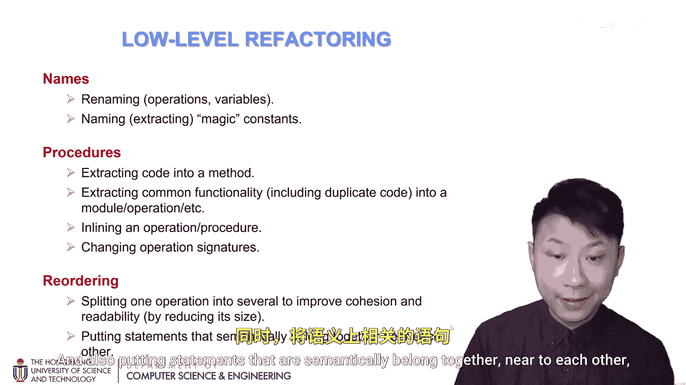

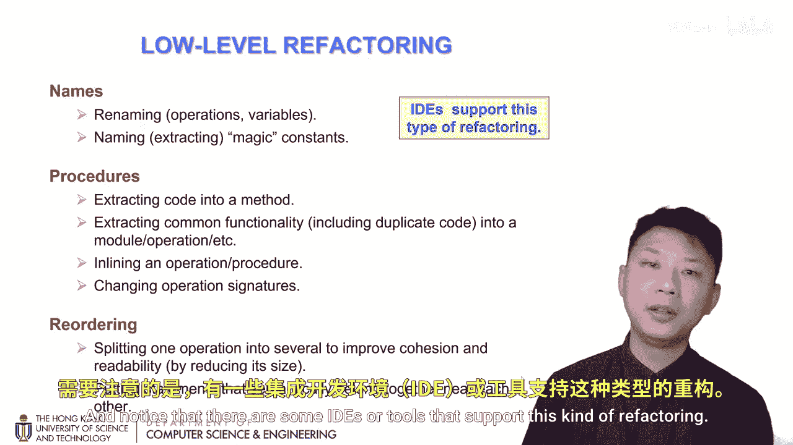

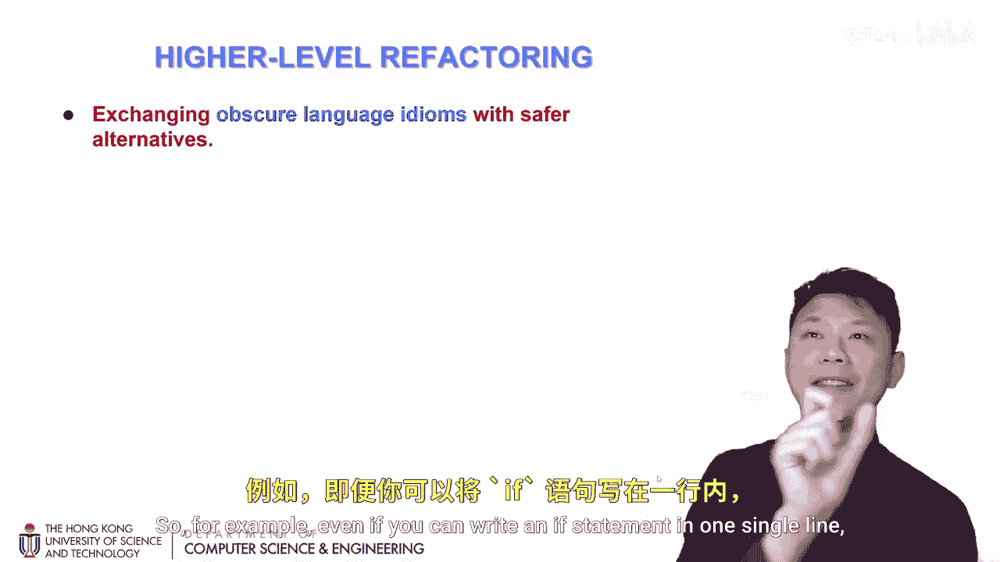

## 高层次重构

上一节我们介绍了低层次重构，本节中我们来看看更重要的高层次重构。高层次重构关注改善程序的宏观架构，通常需要手动进行，且对提升代码可维护性至关重要。

以下是高层次重构的关键实践：

*   **替换晦涩的语言习惯**：使用更安全、更清晰的替代方案。例如，避免将整个 `if` 语句写在一行内，即使语法允许。
*   **使用注释澄清**：对随着时间演变或含义不清的代码段添加清晰的注释。
*   **应用设计模式**：根据特定的设计模式来重构代码结构（我们将在后续课程中介绍设计模式）。

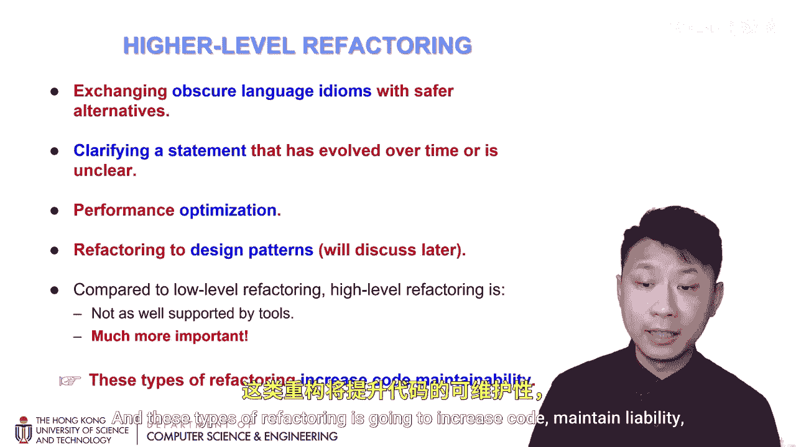

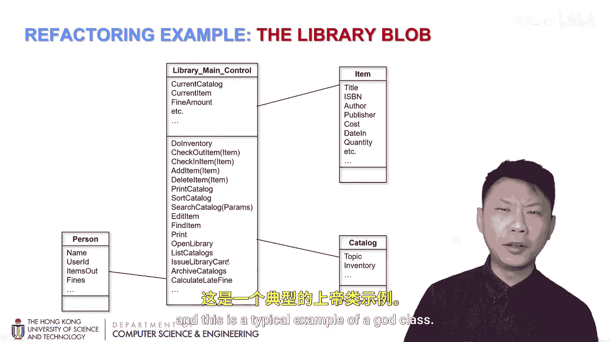

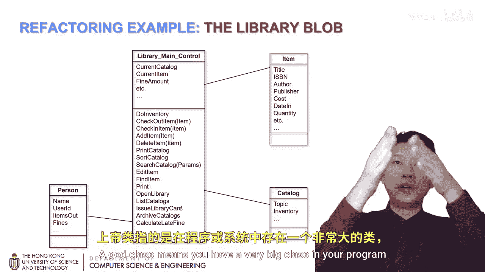

## 重构实战：图书馆系统示例 📚

现在，让我们通过一个图书馆管理系统的例子来看如何应用重构。假设我们有一个 `Main` 类，它包含了几乎所有系统功能，这形成了一个典型的“上帝类”（God Class）。

“上帝类”是指一个试图完成系统中所有事情的庞大类，它会导致代码难以阅读和维护。

为了改善结构，我们可以按以下步骤进行重构：

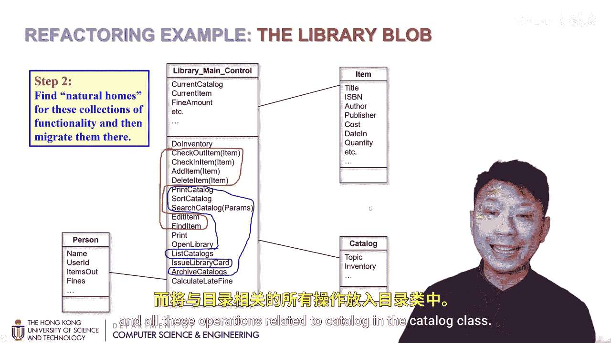

1.  **识别并分类相关属性和操作**：从类图中找出功能上相关的操作。例如，所有与“物品”（Item）相关的操作（如借出、归还、添加、删除、查找物品）应该归为一类；所有与“目录”（Catalog）相关的操作（如打印、排序、搜索、列出目录）应该归为另一类。
2.  **为功能集合找到“自然归属”并迁移**：将识别出的操作迁移到它们逻辑上所属的类中。将与`Item`相关的操作移到`Item`类，将与`Catalog`相关的操作移到`Catalog`类。
3.  **移除瞬态关联**：用类型化的属性和操作参数替换不必要的直接关联。例如，`Main`类通过`Catalog`类来访问`Item`，因此可以移除`Main`类与`Item`类之间的直接关联。

经过以上重构，我们得到了一个更清晰、更易于理解的类图，其中职责分配明确，结构得到了显著改善。

## 何时以及如何进行重构？⏰

假设你需要向一个设计不佳但当前运行正常的代码中添加新功能，正确的做法是：

1.  假设你有足够的时间把事情做对。
2.  编写单元测试来验证现有代码的正确性。
3.  重构代码，改善其结构。
4.  添加新的功能。

你可能会争论说项目时间有限，没空重构。许多开发者和项目经理也不喜欢重构，因为他们认为这是在浪费时间，且可能引入风险。

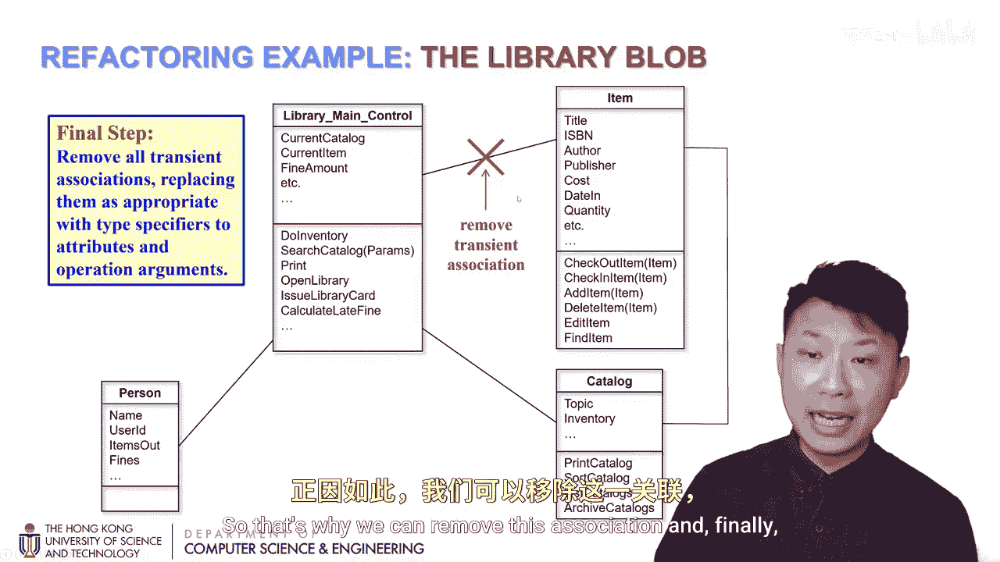

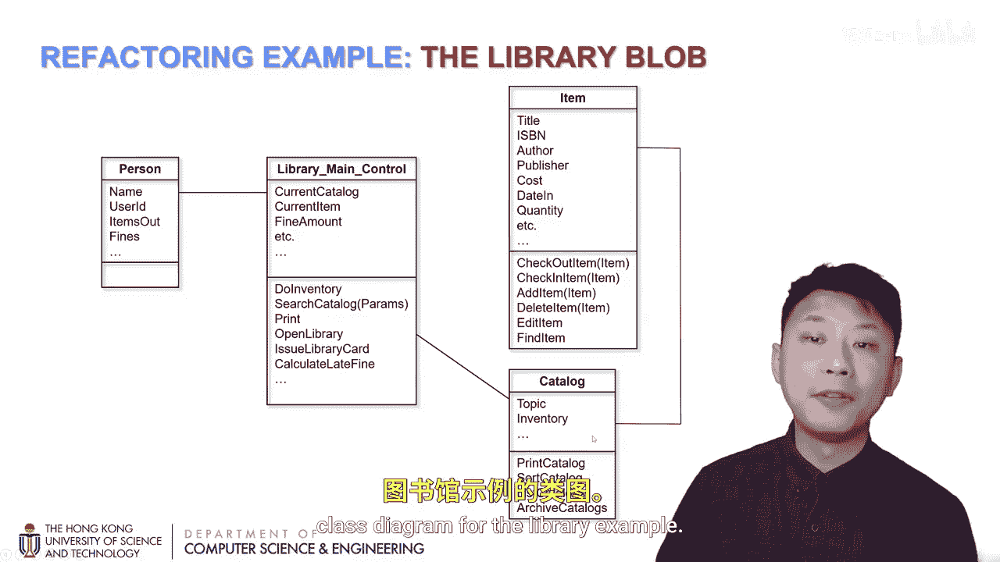

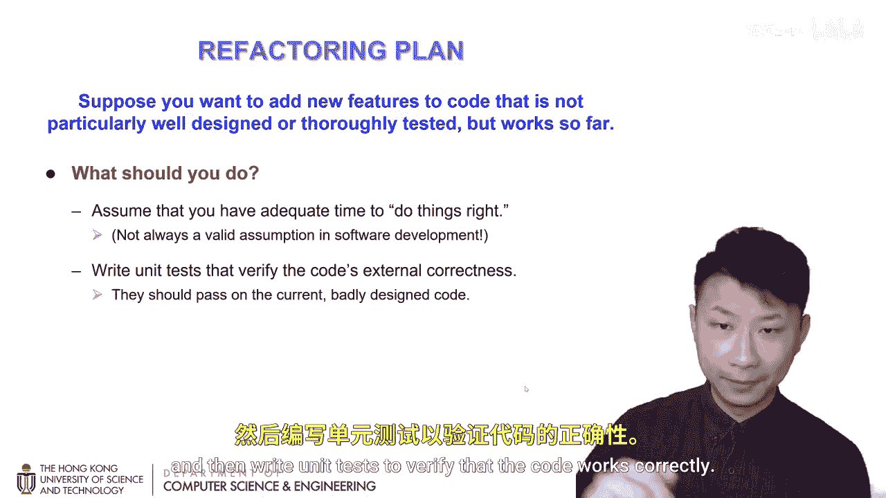

然而，进行重构至关重要，因为：
*   **结构良好的代码更有利于快速开发**。
*   **完成重构能提升开发者的士气**，因为大家都更愿意在“干净的房子”（结构良好的程序）里工作。

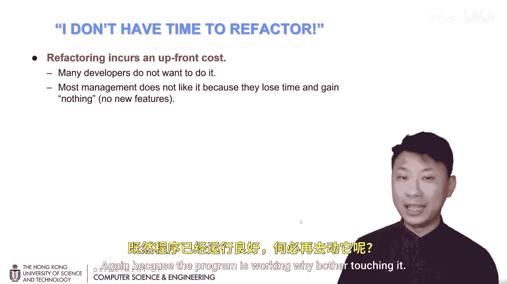

我们应该将重构作为开发过程的一部分**持续进行**（开发 -> 重构 -> 开发 -> 重构）。在项目后期进行大规模重构会非常困难，因为系统功能已经很多，改动一处可能影响其他部分。

## 总结

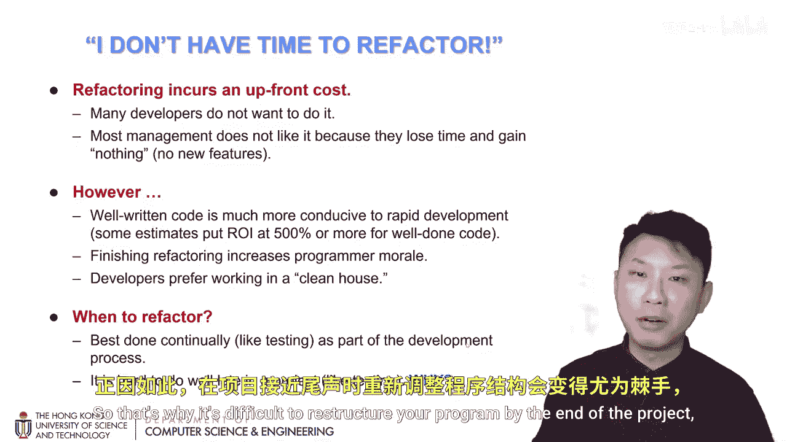

本节课中我们一起学习了重构的概念与实践。我们了解到，重构是通过改善代码内部结构来提升软件可维护性、可读性和可扩展性的关键活动。我们区分了低层次重构（如重命名、提取方法）和高层次重构（如应用设计模式、改善架构），并通过一个图书馆系统的例子演示了重构的实际步骤。最后，我们强调了将重构作为持续开发过程一部分的重要性，以确保代码质量随着项目进展而不断提升。