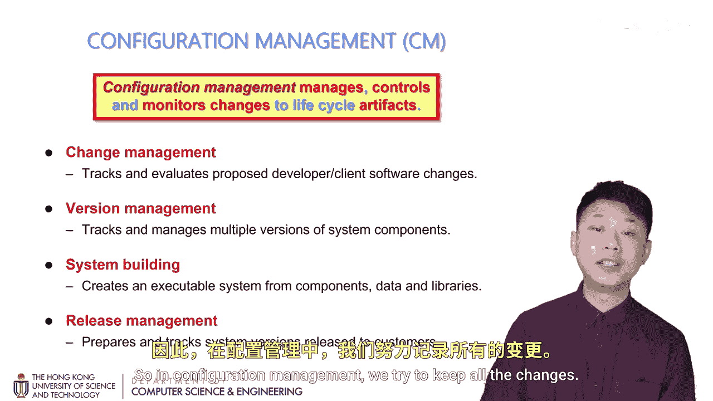
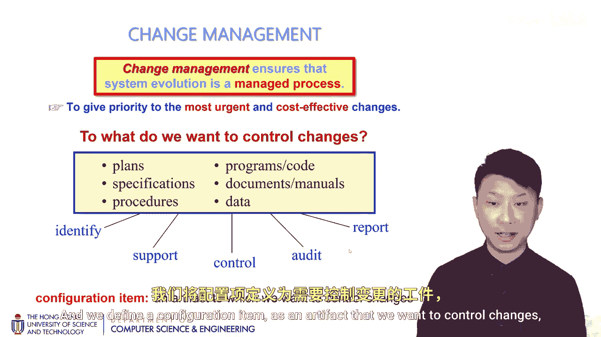
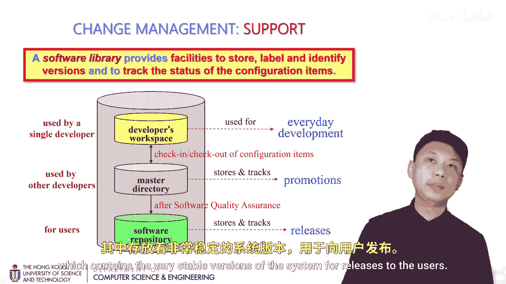
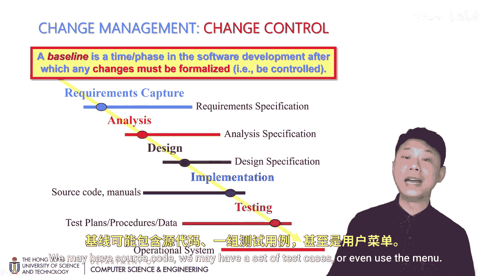
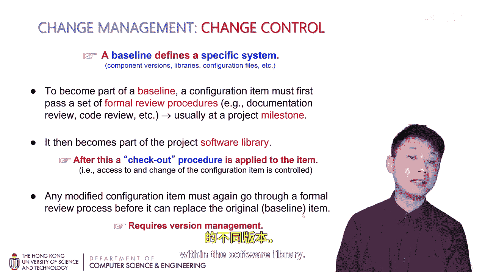
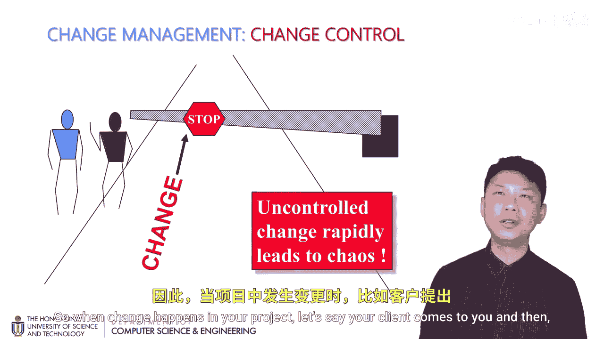
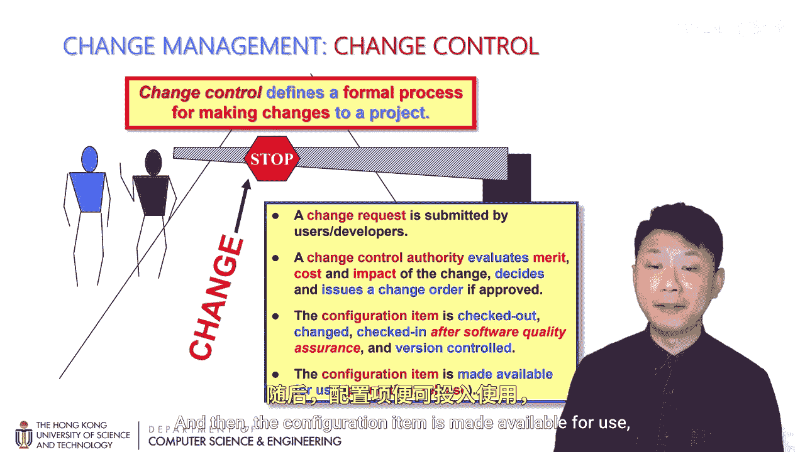
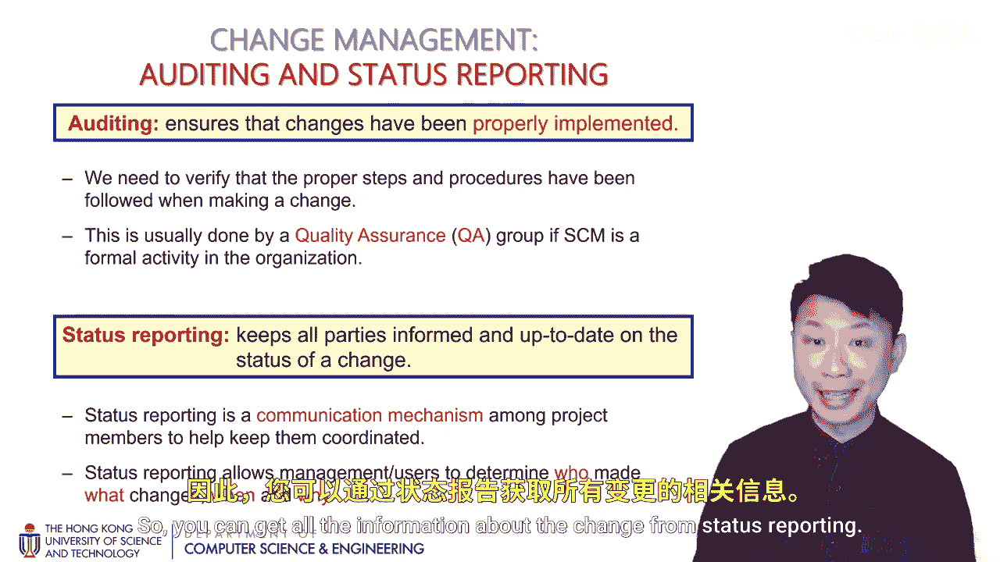
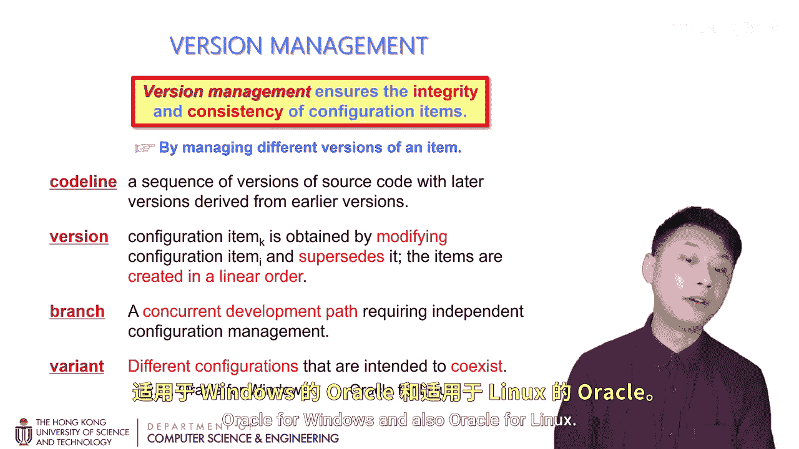
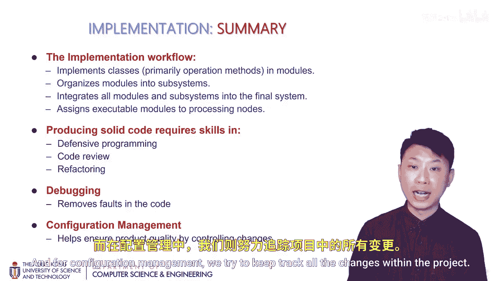

# 031：配置管理 📦

在本节课中，我们将要学习软件工程中的一个重要实践——配置管理。配置管理旨在系统地管理、控制和监控软件生命周期中所有产物的变更，确保项目的有序进行和系统的稳定性。

---

## 概述

配置管理意味着我们尝试管理、控制并监控对生命周期产物的变更。这里的“产物”不仅指源代码，还包括文档、规格说明甚至用户手册。我们试图跟踪这些项目上的所有变化，这服务于变更管理。

---

## 什么是配置管理？🔍

配置管理主要包含以下几个核心活动：

*   **变更管理**：跟踪并评估由开发人员或客户提出的软件变更建议。
*   **版本管理**：跟踪并管理系统组件的多个版本。
*   **系统构建**：从代码库中的组件和数据库中构建可执行的系统。
*   **发布管理**：准备并跟踪发布给客户的系统版本。

在配置管理中，我们试图保留所有的变更记录。变更管理确保系统演进是一个受控的过程，我们会优先处理最紧急且最具成本效益的变更。

那么，我们想要控制哪些变更呢？它可能包括计划、文档、规格说明、流程、程序源代码、手册甚至数据。在一个项目中，我们希望捕获并跟踪所有这些项目上的变更。

---

## 配置项与软件库 📚

我们定义一个**配置项**为需要控制其变更的产物。

为了支持变更管理，我们需要一个**软件库**。软件库提供了存储、标记、识别版本以及跟踪配置项状态的设施。

以下是一个软件库的示例结构：

*   **开发者工作区**：供单个开发者用于日常开发。
*   **主目录**：包含相对稳定的版本，供其他开发者在此基础上工作。
*   **软件仓库**：包含非常稳定的系统版本，用于发布给用户。

---

## 基线 📍

一个**基线**是软件开发中的一个时间点或阶段，在此之后任何变更都必须经过正式流程。这意味着我们在某个特定时间点“冻结”系统。当我们实现了一些重要功能且系统趋于稳定时，我们就可以在某个时间点冻结系统，并声明我们已经达到了一个基线。

再次强调，我们讨论的不仅仅是源代码。在一个基线中，可能包含文档、源代码、一组测试用例甚至用户手册。基线定义了在特定时间点的一个具体系统。

一个配置项要成为基线的一部分，必须首先通过一系列正式的评审和测试，并且通常是在一个项目里程碑处。这意味着我们必须进行测试以确保系统是稳定的。在实现了重要功能并达到项目里程碑后，我们就可以冻结系统，声明我们有了一个基线。

然后，我们可以从软件库中检出配置项。任何修改后的配置项在替换原始项之前，必须再次经过正式的评审流程。这也正是需要版本管理的原因——我们必须跟踪软件库中配置项的不同版本。

---

## 变更流程 🔄

当项目中发生变更时（例如客户要求修改某些内容），在实施变更之前需要完成以下步骤：

以下是变更流程的步骤：

1.  **提交变更请求**：由用户或开发人员提交。
2.  **评估变更**：变更控制机构评估变更的成本和影响，并决定是否批准，如果批准则发布变更指令。通常由管理人员决定变更是否可行。
3.  **检出与修改**：检出配置项，进行修改，并在软件质量保证（例如，经过测试团队测试）后重新检入。
4.  **版本控制**：对修改后的项进行版本控制。
5.  **发布与审计**：使配置项可供使用（例如，用于升级或发布），并应进行审计和状态报告。

**审计**确保变更已被正确实施，通常由软件质量保证团队或测试团队执行。**状态报告**机制则让所有相关方了解变更的状态，并允许管理层或用户确定谁在何时、为何做出了何种变更。

---

## 版本管理 📈

我们必须执行版本管理来跟踪软件库中特定配置项的所有版本。版本管理确保配置项的完整性和一致性。

以下是版本管理中需要跟踪的内容：

*   **主线**：源代码版本的一个序列，后续版本由早期版本衍生而来。
*   **分支**：如果进行并行开发，则会产生不同的分支。
*   **变体**：如果存在旨在共存的、针对不同环境的配置（例如，用于Windows和Linux的Oracle软件系统），则会产生变体。

下图是一个描述项目变更历史的演化图示例：

从图中可以看到不同的版本。当我们从一个版本到另一个版本时，有一条主线。如果进行并行开发，会产生不同的分支，最终这些分支会合并回主线。通过这个图，我们可以直观地看到配置项的演化过程。

---

## 本章总结 📝

在本节课中，我们一起学习了配置管理的核心概念。

首先，我们介绍了配置管理的定义及其包含的四大活动：变更管理、版本管理、系统构建和发布管理。

接着，我们探讨了配置项和软件库的概念，理解了基线在控制项目稳定性中的关键作用。

然后，我们详细分析了正式的变更控制流程，从请求提交到审计报告的完整步骤。

最后，我们学习了版本管理，包括如何通过主线、分支和变体来跟踪和管理软件的不同版本。

配置管理是确保软件项目在持续变更中保持可控、可追溯和高质量的重要基石。掌握这些实践，能帮助团队更高效地协作并交付可靠的软件产品。