# 032：测试基础

在本节课中，我们将要学习软件测试的基础知识。测试是软件开发中至关重要的环节，旨在发现软件系统中的缺陷和错误。我们将探讨测试的目的、基本测试用例类型、测试用例的生成方法，以及基于组件和系统的测试原则与策略。

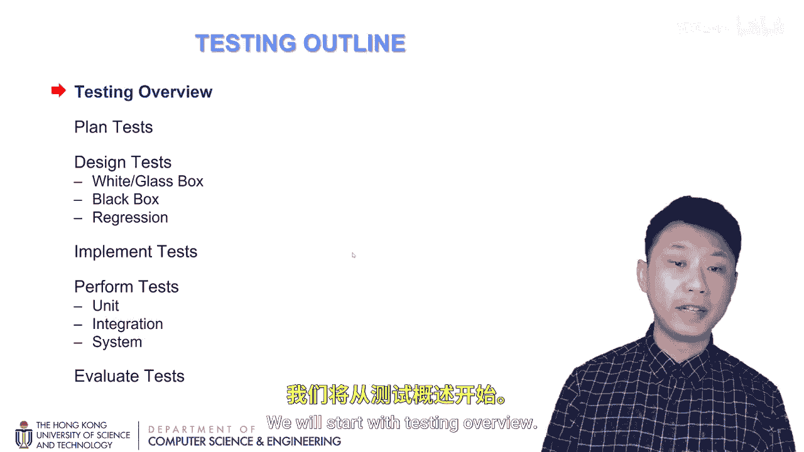

上一节我们介绍了测试的总体目标，本节中我们来看看为什么测试如此重要。

## 为什么需要测试？

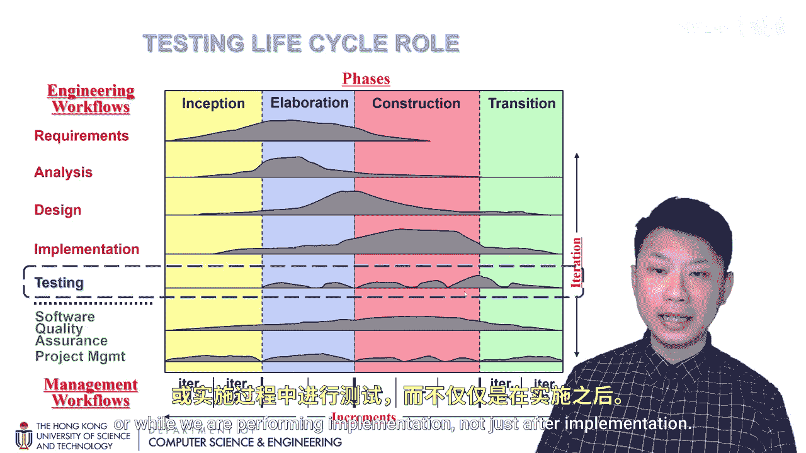

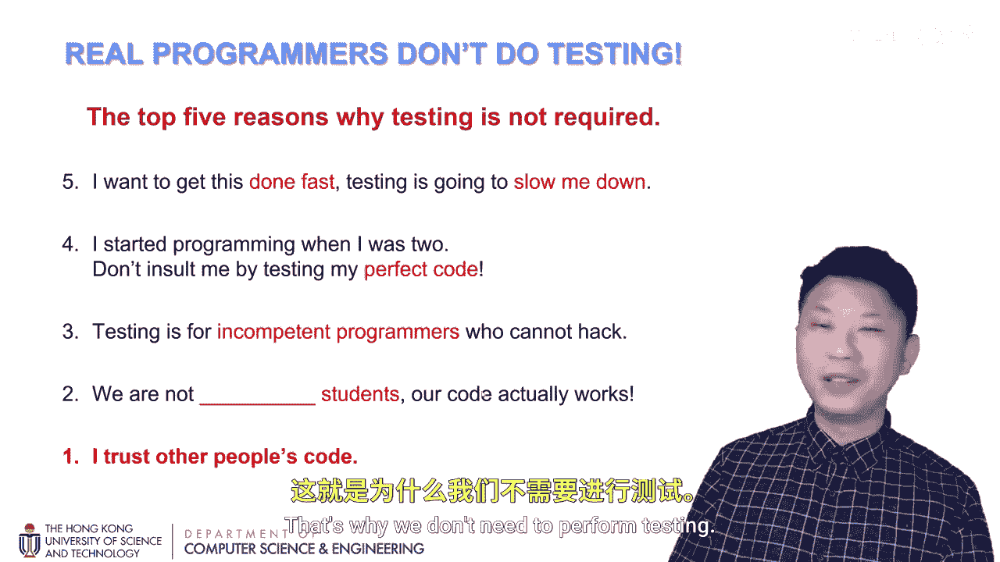

一些开发者可能认为测试主要在实现后进行，但事实并非如此。在测试驱动开发中，我们必须在实际编码之前就考虑所有可能的测试用例和测试计划。因此，测试可能在实现之前或实现过程中进行，而不仅仅是在实现之后。

以下是程序员可能不愿进行测试的几个常见原因：
*   希望快速完成项目，认为测试会拖慢进度。
*   对自己的代码能力过于自信，不怀疑代码的完美性。
*   认为测试是能力不足的程序员才需要做的事情。
*   相信自己的代码能正常工作，或盲目信任队友的代码。

然而，如果不进行充分测试，微小的错误也可能摧毁整个系统。

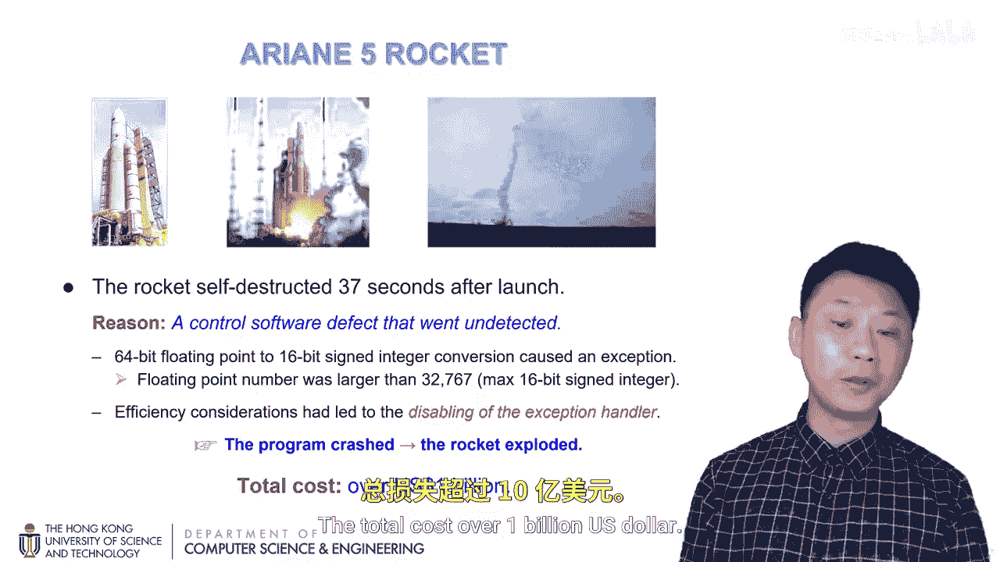

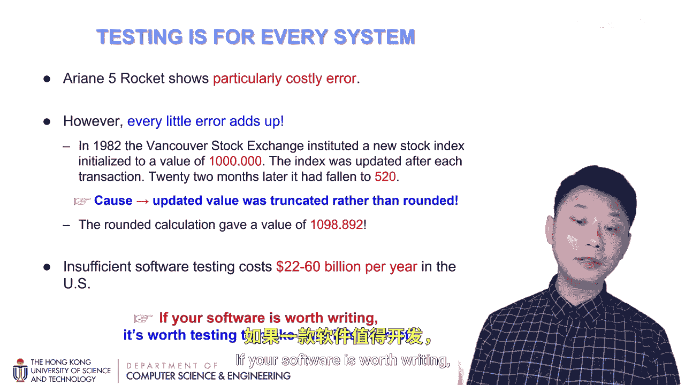

**案例一：阿丽亚娜5型火箭**
火箭在发射37秒后爆炸，原因是系统试图将一个64位浮点数转换为16位有符号整数时发生异常，程序崩溃导致火箭爆炸，总损失超过10亿美元。

**案例二：温哥华证券交易所系统**
1992年，新系统启动时将指数基准设为1000。由于更新值时采用了截断而非四舍五入，22个月后指数跌至520，而正确的计算值应为1098点。软件测试不足在美国每年造成高达600亿美元的损失。

如果你的软件值得编写，那么它也值得被测试，以确保其正确性。

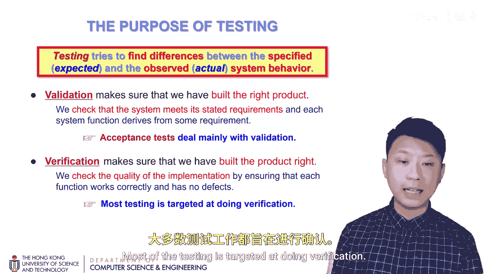

## 测试的定义与目标

在测试中，我们试图发现软件系统中预期行为与实际观察到的行为之间的差异。测试主要涉及两大任务：

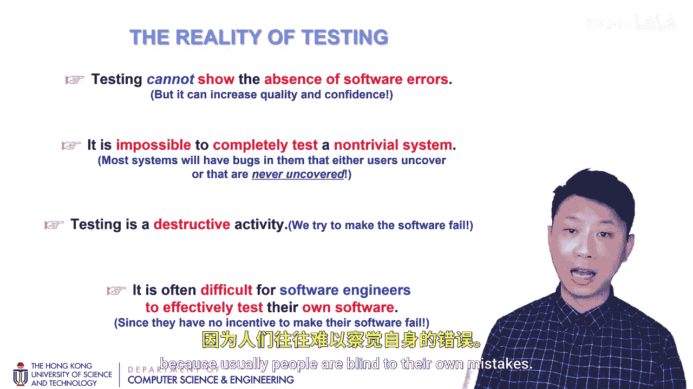

1.  **验证**：确保我们根据需求文档构建了“正确的产品”。
2.  **确认**：确保我们“正确地构建了产品”，即检查实现质量，保证所有功能正确运行且没有缺陷。

大多数测试工作都集中在确认上，即发现软件系统中的错误。我们的目标是设计一套测试用例，能够系统地发现软件缺陷。

**重要原则**：测试无法证明软件没有错误。对于一个非平凡的系统，由于存在太多可能的输入和状态，进行穷尽测试是不现实的。测试是一项“破坏性”活动，我们试图让软件失败。同时，软件工程师通常难以有效地测试自己编写的软件，因为人们往往对自己的错误视而不见。

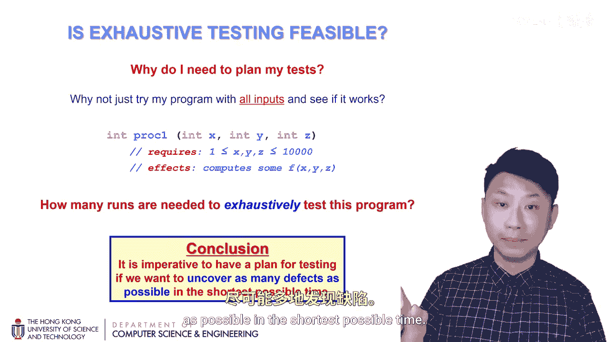

## 测试计划与策略

既然无法进行穷尽测试，我们如何制定测试计划？关键在于找到一小组能在最短时间内发现最多缺陷的测试用例。这是因为测试通常在实现后进行，而项目有严格的截止日期。

我们的目标是：**用最少的时间和精力，找到最有可能发现缺陷的测试用例**。

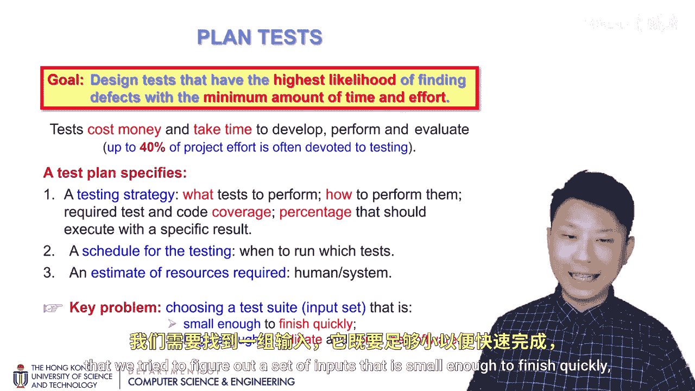

一个测试计划需要明确：
*   **测试策略**：执行哪些测试、如何执行、需要达到的代码覆盖率以及预期的通过标准。
*   **测试进度**：何时运行测试。
*   **资源估算**：测试所需的人力或系统资源。

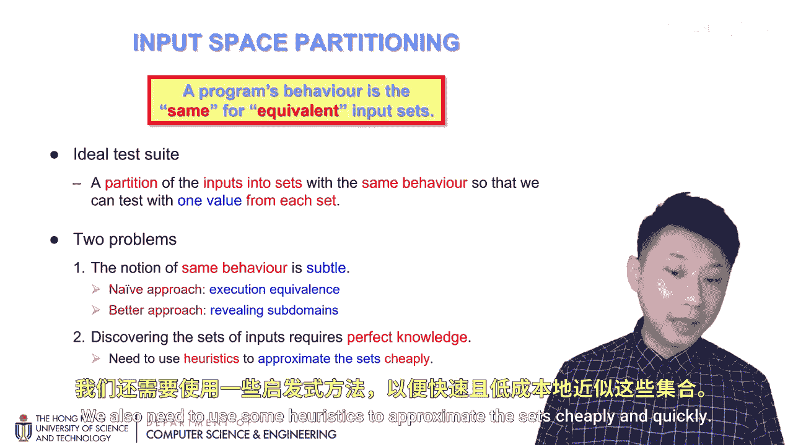

核心问题是：如何找到一组输入，它**小到可以快速完成**，但又**大到足以验证和确认系统**？

## 测试用例生成：等价类划分

为了解决上述问题，我们采用的主要方法是**等价类划分**。其思想是将所有可能的输入值划分为若干个集合（等价类），使得同一集合中的值在软件中具有相似的行为。然后，我们从每个集合中选取一个代表值进行测试。

如何定义“相似行为”？有两种主要方法：

**1. 执行等价**
根据程序执行路径是否相同来划分输入。例如，对于一个函数：
```python
if x < 0:
    return -x
else:
    return x
```
我们可以将输入划分为两个集合：`{x | x < 0}` 和 `{x | x >= 0}`。然后从每个集合选取一个值（如-3和3）进行测试。

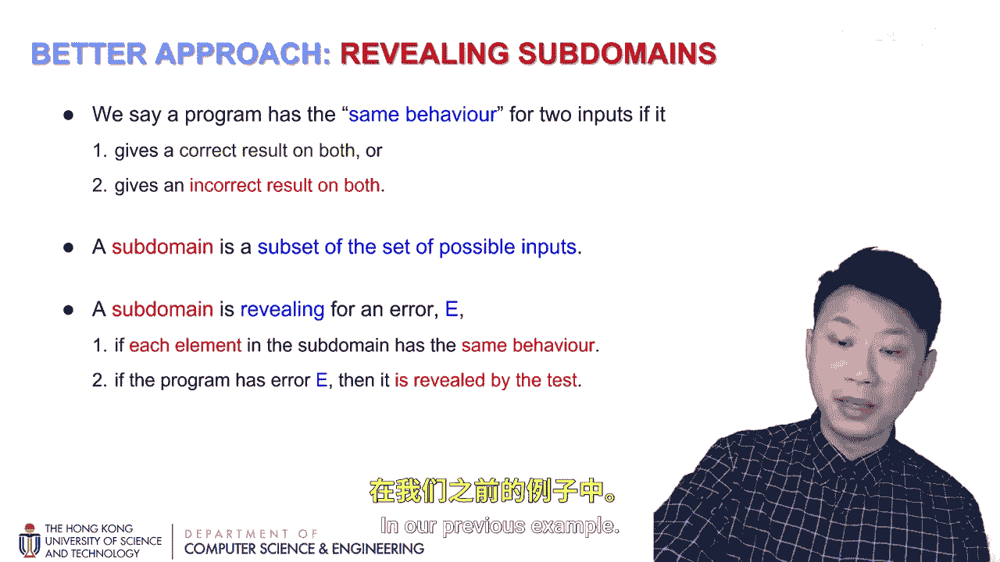

**2. 子域划分**
根据输入是否会导致正确或错误的结果来划分。考虑一个有缺陷的代码，其条件误写为 `if x <= -2`。此时：
*   **正确子域**：`{x | x < -2 或 x >= 0}`（返回正确结果）。
*   **错误子域**：`{x | -2 <= x < 0}`（返回错误结果）。

如果我们仅使用执行等价选取的测试值（-3和3），两者都落在正确子域，将无法发现这个错误。而如果我们从错误子域（如-1）和正确子域（如-3）各选一个值，就能有效地发现缺陷。

因此，一个理想的测试集应包含来自不同子域（尤其是可能触发错误的子域）的代表值，并且这个集合应尽可能小。

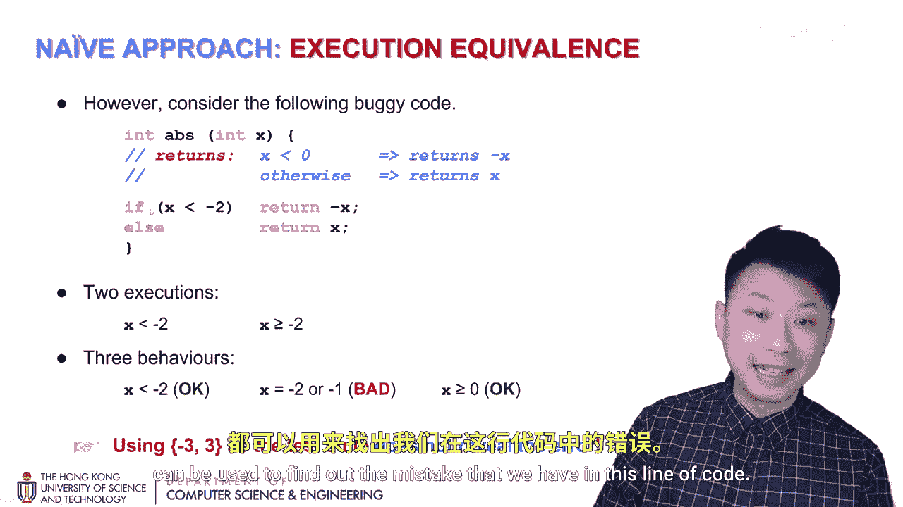

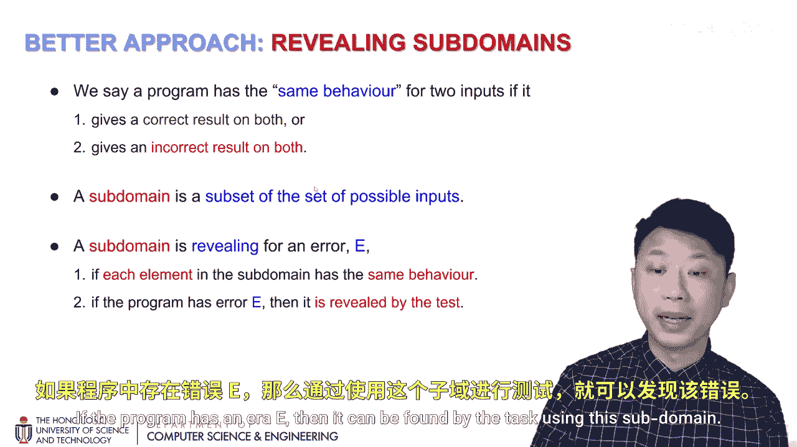

为了进行有效的划分，我们需要结合**程序依赖信息**（如源代码）和**程序独立信息**（如文档、算法、数据结构等）。不同的启发式方法针对不同类型的错误，因此在实践中，我们通常组合使用多种方法。

## 总结

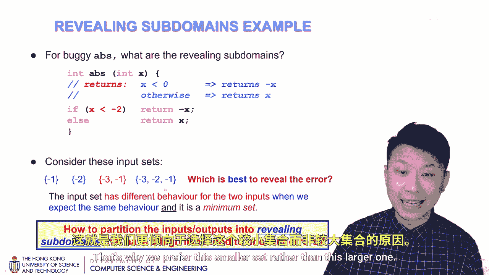

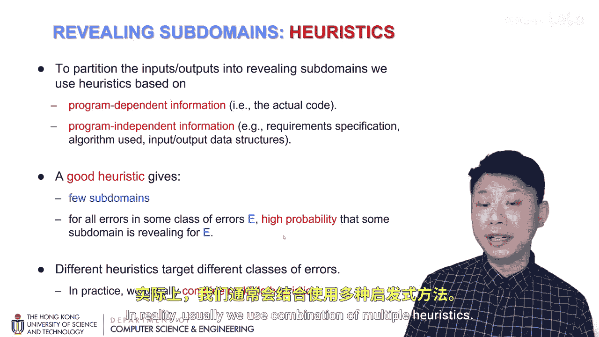

本节课中我们一起学习了软件测试的基础。我们明确了测试的目的是发现软件缺陷，并理解了验证与确认的区别。我们认识到穷尽测试的不现实性，因此测试策略的核心是**通过等价类划分等方法，精心挑选一小部分具有高缺陷发现率的测试用例**。我们介绍了基于执行路径的“执行等价”和基于输出正确性的“子域划分”两种生成测试用例的基本方法。记住，充分的测试是保证软件质量、避免灾难性后果的关键步骤。