软件工程：P33：设计测试

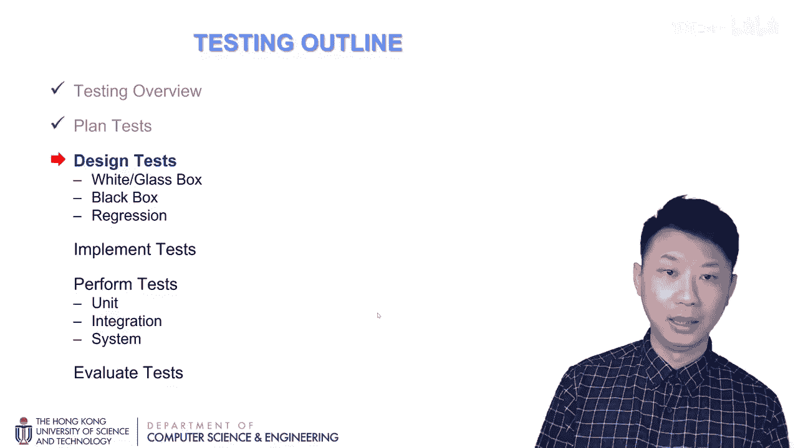

在本节课中，我们将学习软件测试设计中的核心概念，特别是如何运用启发式方法寻找子域来设计测试用例。我们将探讨白盒测试、黑盒测试和回归测试，并重点介绍白盒测试中的基本路径测试方法。

---

### 测试用例与基本步骤

测试用例是测试系统的一种具体方式。它规定了测试内容、测试条件、测试方法以及预期结果等。

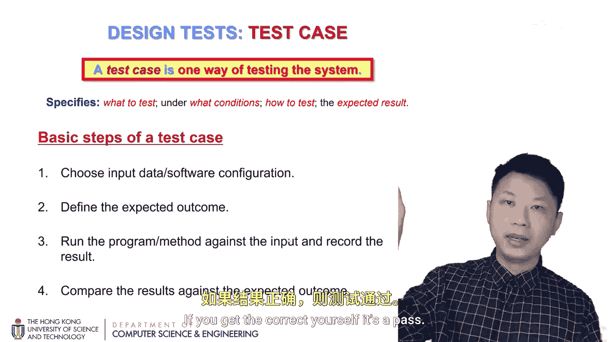

运行一个测试用例的基本步骤如下：
1.  选择用于测试的输入数据或软件配置。
2.  定义预期输出。
3.  使用输入运行程序或方法。
4.  记录实际结果。
5.  将实际结果与预期结果进行比较，判断测试是否通过。

如果实际结果与预期一致，则测试**通过**；否则，测试**失败**。

---

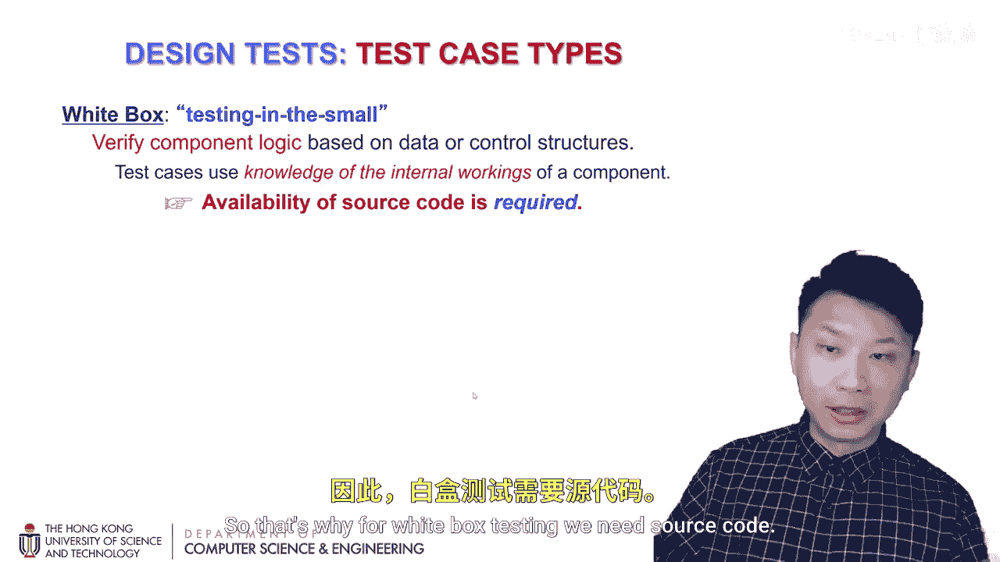

### 软件测试的三种类型

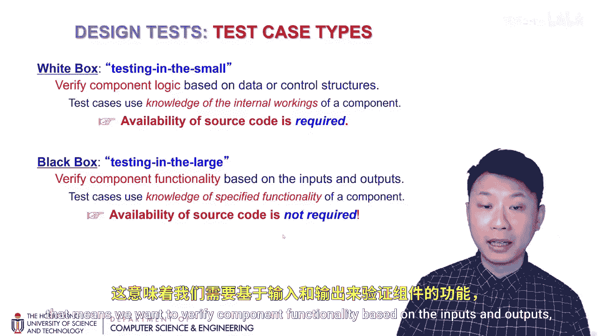

在软件系统上，我们可以执行三种主要类型的测试。

#### 白盒测试

白盒测试也称为“小规模测试”。其目标是基于数据或控制结构来验证组件的内部逻辑。测试用例的设计依赖于对组件内部工作原理（即源代码）的了解。因此，进行白盒测试需要源代码。

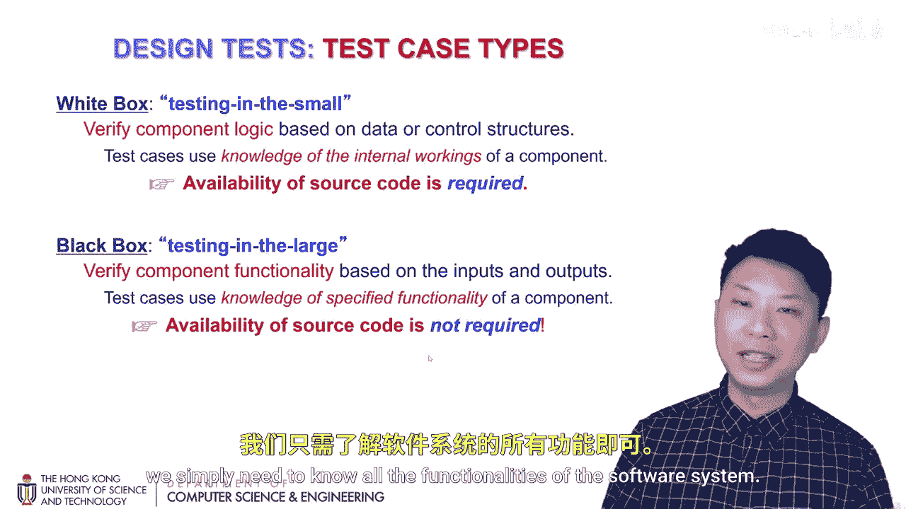

#### 黑盒测试

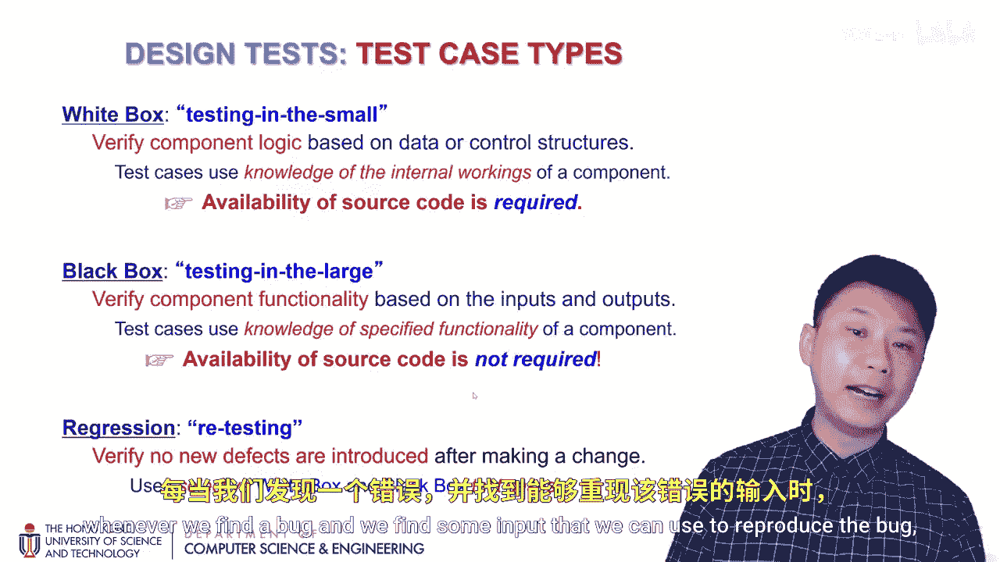

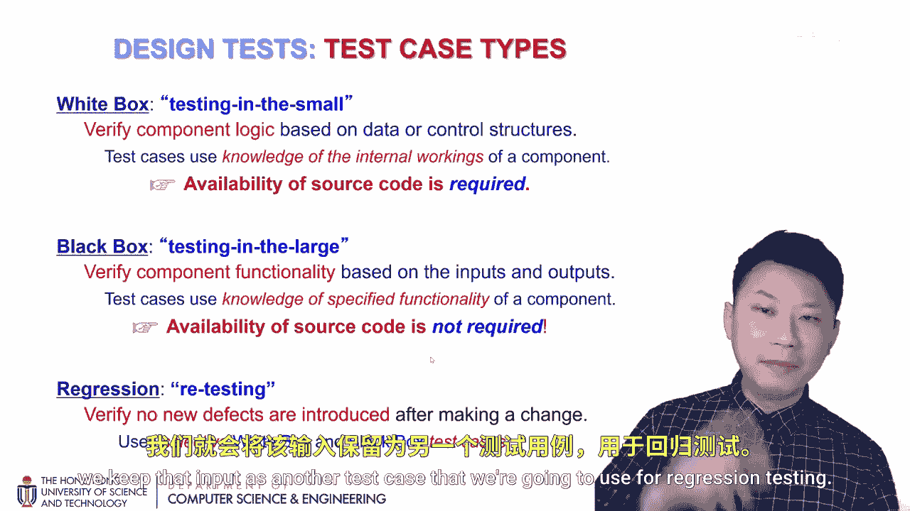

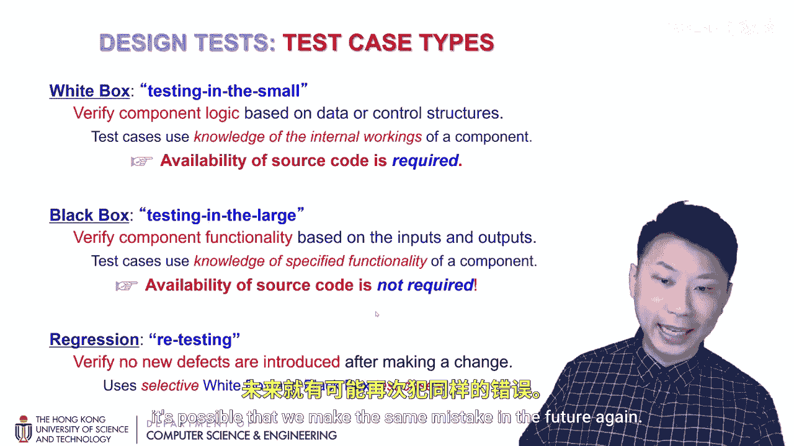

黑盒测试也称为“大规模测试”。其目标是基于输入和输出来验证组件的功能。测试用例的设计仅依赖于组件规定的功能，无需查看源代码。

#### 回归测试

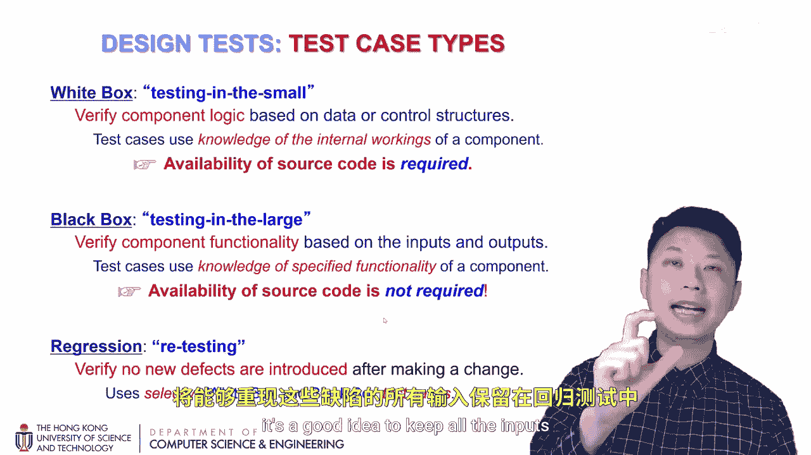

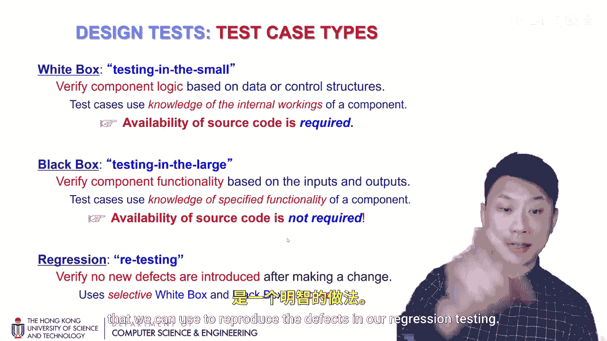

回归测试在我们讨论缺陷修复时已经涉及。其核心思想是，每当我们发现一个缺陷并找到能复现该缺陷的输入时，就将此输入保存为一个新的测试用例。因为一旦我们犯过一个错误，未来很可能再次犯同样的错误。因此，将能暴露缺陷的输入纳入回归测试集是一个好习惯。回归测试既可以使用白盒测试用例，也可以使用黑盒测试用例。

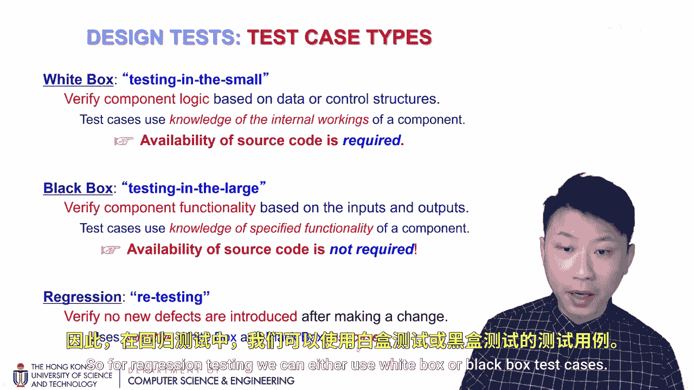

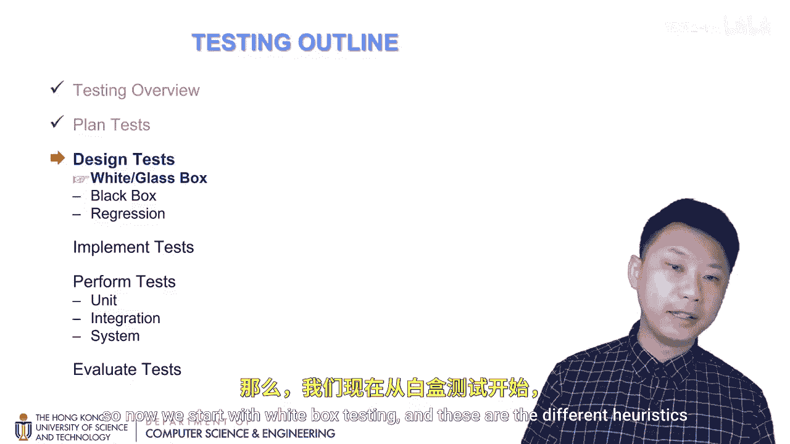

---

### 白盒测试的启发式方法

上一节我们介绍了测试的基本类型，本节我们将重点深入白盒测试。白盒测试的目标是寻找子域，以确保我们执行了程序中的所有独立路径、所有逻辑语句、所有循环以及检查了所有内部数据结构。

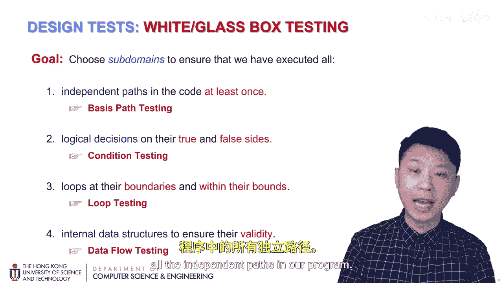

首先，我们将介绍**基本路径测试**，它专注于寻找能覆盖程序中所有独立路径的子域。

#### 为何需要覆盖独立路径？

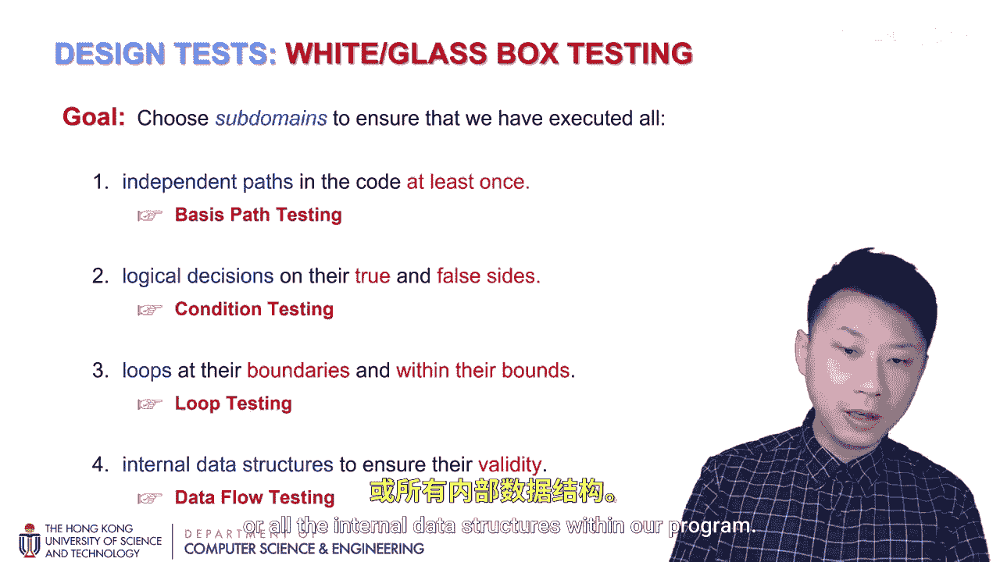


你可能会问，为什么我们需要费心研究程序中的独立路径？例如，如果我们只是执行程序中的每一条语句，这对于发现错误是否足够？

让我们来看一个例子。

```java
if (A && B) {
    // 执行语句块1
} else {
    // 执行语句块2（可能包含错误，如除数为零）
}
```

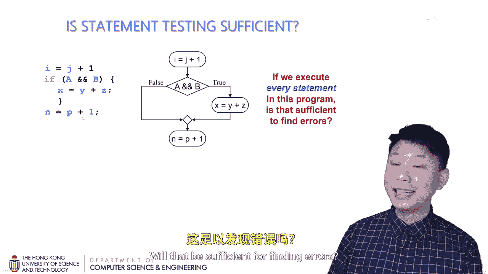

如果我们让条件 `A && B` 为真，那么我们将执行程序中的所有语句（即语句块1）。但这足够吗？答案是否定的。

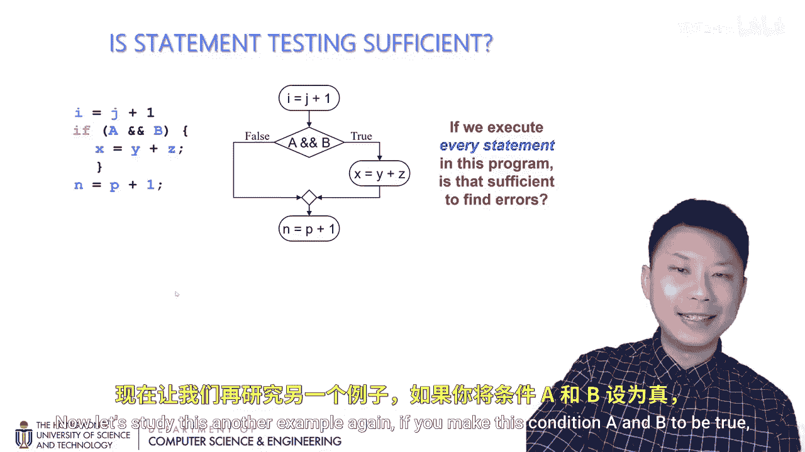

考虑另一种情况：如果我们让条件 `A && B` 为假，程序将执行 `else` 分支（语句块2）。如果该分支中存在错误（例如“除数为零”），那么仅测试真分支将无法发现这个错误。

因此，仅仅测试程序中的每一条语句是不够的，我们必须确保测试到条件语句的所有可能分支（即所有独立路径）。

---

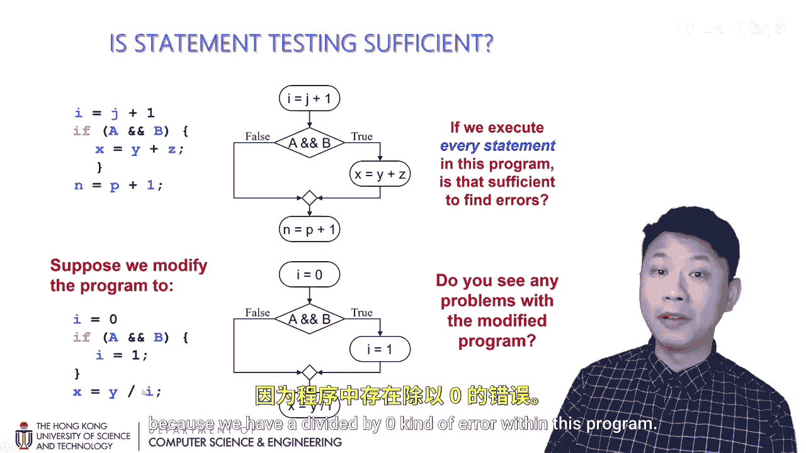

### 总结

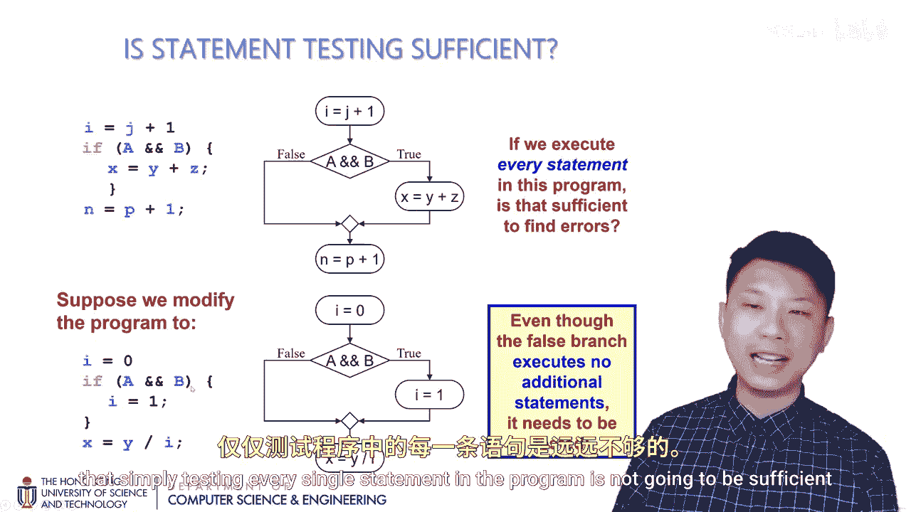

本节课我们一起学习了软件测试设计的基础。我们明确了测试用例的定义和运行步骤，区分了白盒测试、黑盒测试和回归测试三种类型及其适用场景。我们重点探讨了白盒测试中基本路径测试的重要性，并通过实例理解了为什么需要覆盖程序中的所有独立路径，而不仅仅是执行所有语句。掌握这些概念是设计有效测试用例、提升软件质量的关键第一步。