软件工程：P36：黑盒测试 🧪

在本节课中，我们将要学习黑盒测试。这是一种在不查看源代码的情况下，通过向系统输入数据并检查其输出来验证系统功能的方法。我们将重点介绍等价类划分、边界值分析、线程测试和基于状态的测试等核心概念。

---

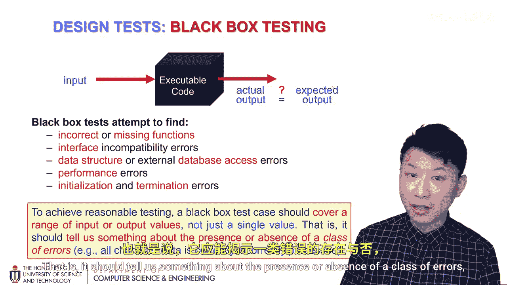

上一节我们介绍了黑盒测试的基本概念，本节中我们来看看如何进行等价类划分。

黑盒测试时，我们没有系统的源代码，只有可执行文件。我们的做法是向可执行文件输入一些数据，生成输出，然后核对输出是否与预期一致。之所以称为“黑盒”，是因为我们无法看到源代码，源代码被放在一个“黑盒子”里。

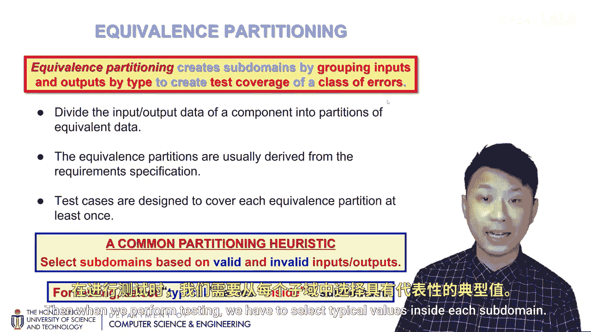

黑盒测试旨在发现系统中的错误，例如：功能错误或缺失、接口不兼容、数据结构或外部数据库错误、性能错误、初始化或终止错误。

为了达到合理的测试效果，一个黑盒测试用例应覆盖一系列输入或输出值，而不仅仅是单个值。这意味着它应能揭示一类错误的存在与否，而非仅针对单一错误。

我们将重点介绍**等价类划分**。该方法通过按类型对输入和输出进行分组来创建子域，以实现对一类错误的测试覆盖。我们尝试将组件的输入或输出数据划分为等价的数据分区。这些等价分区通常源自需求规格说明。然后，我们设计测试用例，目标是至少覆盖每个等价分区一次。

以下是划分等价类的启发式方法：尝试将所有输入划分为不同的子域，基于有效和无效的输入或输出。执行测试时，我们需要从每个子域中选择典型值。

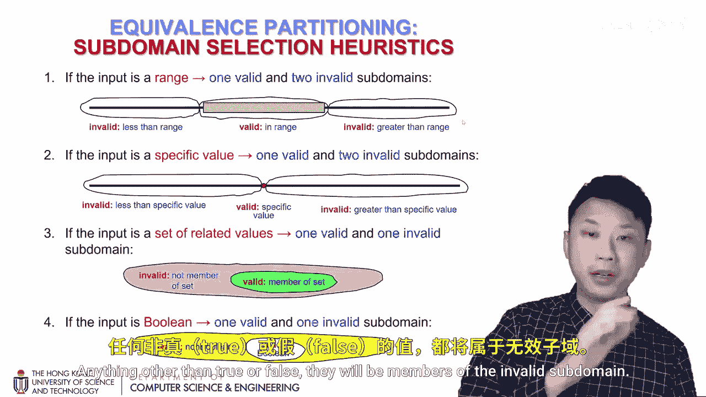

*   **如果输入是一个范围**：例如，学生ID的有效范围是 `0` 到 `9999`。那么有效子域是 `[0, 9999]`。无效子域是小于 `0`（如负数）和大于 `9999`（如 `10000`）的值。
*   **如果输入是一个特定值**：例如，有效值是 `100`。那么有效子域就是 `{100}`。任何小于 `100` 或大于 `100` 的值都属于无效子域。
*   **如果输入是一组相关值**：例如，星期几（周一至周日）。那么有效子域是 `{Monday, Tuesday, ..., Sunday}`。任何不在此集合中的值（如 `"Funday"`）都属于无效子域。
*   **如果输入是布尔值**：那么有效子域是 `{true, false}`。任何非布尔值（如 `"yes"`）都属于无效子域。

---

除了测试有效和无效子域，在进行黑盒测试时，我们还应该测试边界情况。这是因为错误更容易发生在子域的边界处，而非中心区域。

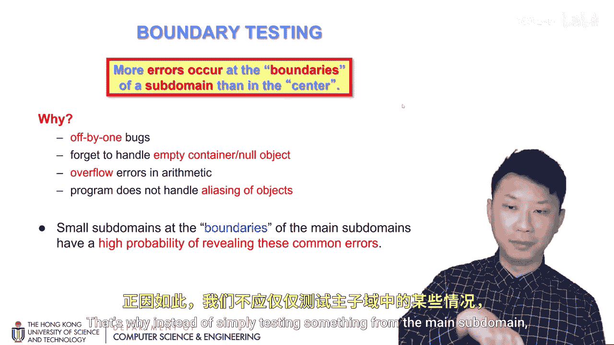

以下是进行边界测试的原因：你可能会犯“差一错误”、忘记处理空容器或空对象、出现算术溢出错误，或者程序未能处理对象的别名问题等。位于主域边界的小子域有更高的概率发现此类错误。因此，我们不仅要测试主域内的典型值，还应测试边界情况。

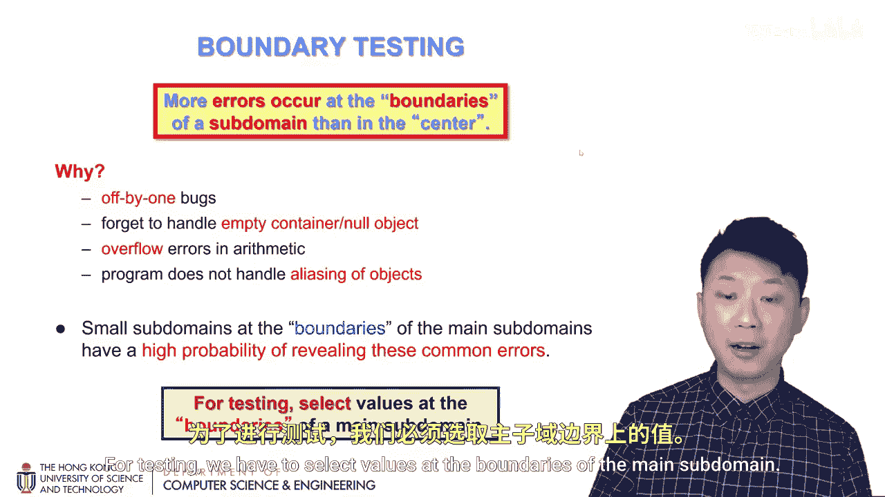

对于测试，我们需要选择主域边界上的值。

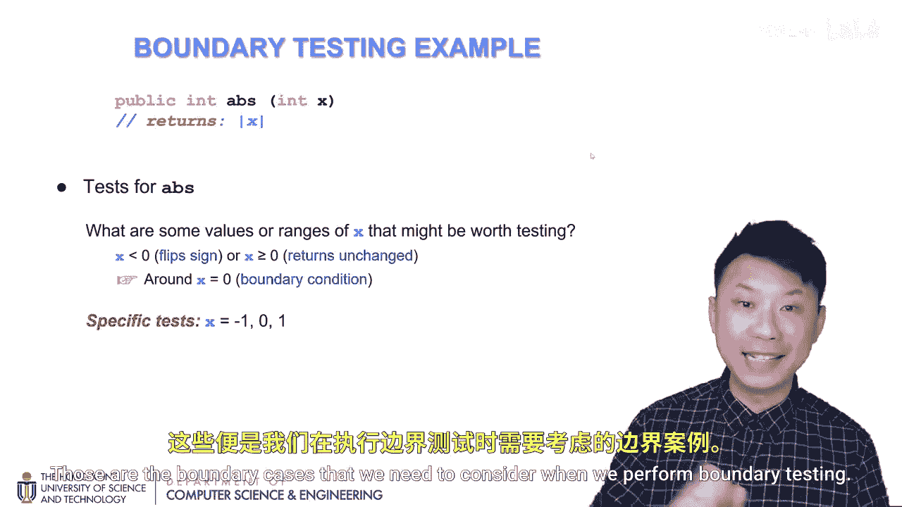

*   **示例：绝对值函数**：边界情况是 `0`。除了测试 `0`，我们还应该考虑边界附近的值，例如 `-1` 和 `1`。

以下是针对不同输入类型的边界测试指南：

*   **值范围**：例如，学生ID范围 `[0, 9999]`。
    *   下界：测试 `-1`, `0`, `1`。
    *   上界：测试 `9998`, `9999`, `10000`。
*   **离散值集合**：测试最小值、最大值以及紧邻最小值和最大值的值。
*   **值集合**：如果可能，测试集合中的所有值。例如，星期几的集合很小，应测试所有可能输入。如果输入集合很大，可以测试部分有效输入，并测试一个不在集合中的值（如非星期几的值）。
*   **布尔值**：测试两个布尔值 `true` 和 `false`，以及一个非布尔值。
*   **输出值**：也应应用上述指南，在最小和最大预期输出值处创建测试。
*   **数据结构边界**：例如，数组索引范围 `[1, 10]`。应测试索引 `0`, `1`, `2` 以及 `9`, `10`, `11`。我们关注最小索引、最大索引以及紧邻它们的索引。

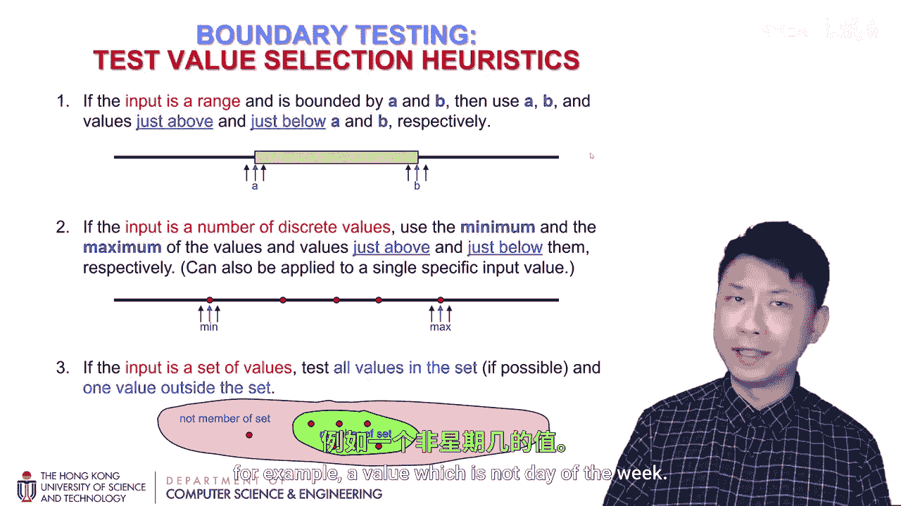

---

让我们再次以学生选课系统（ASU）为例。其中一个可能的输入是学生ID。

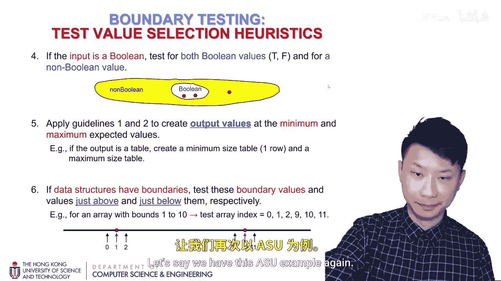

假设学生ID的有效范围是 `1000000` 到 `9999999`。那么，我们如何根据不同的情况（边界情况、典型情况、特殊情况）设计测试用例呢？

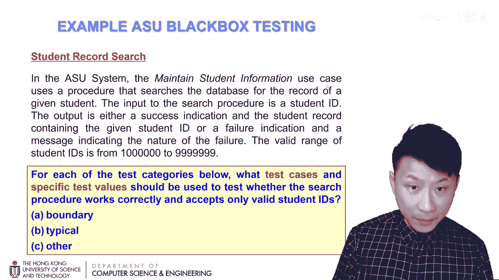

*   **边界情况**：测试最小值 `1000000`、最大值 `9999999`，以及紧邻它们的值 `999999` 和 `10000000`。
*   **典型值**：测试一个有效且存在于数据库中的学生ID，例如 `5000000`。测试一个在有效范围内但数据库中不存在的学生ID，例如 `5000001`。
*   **范围外值**：测试一个低于范围的值，例如 `500000`。测试一个高于范围的值，例如 `50000000`。
*   **特殊情况**：测试学生输入非数字值的情况，例如 `"5647ABC"`。应测试此特殊值，观察系统如何处理。

对于每个测试用例，你需要为其命名，描述测试设置、输入值，以及如何验证测试是否通过。你需要为黑盒测试准备的所有输入都这样做。

---

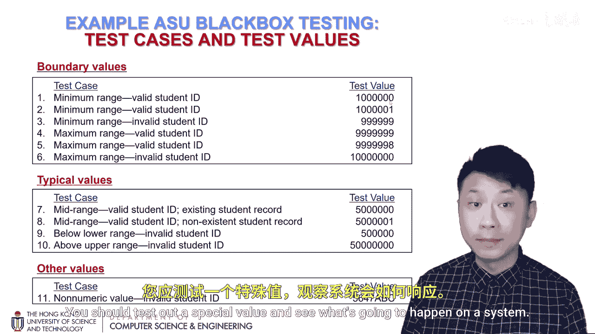

在黑盒测试中，我们还可以进行**线程测试**。

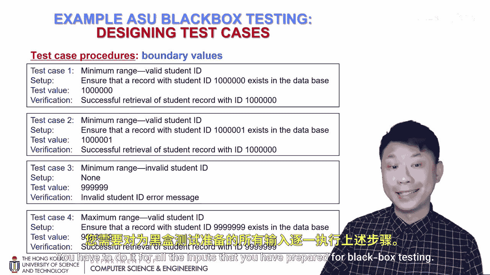

线程测试是一种基于事件的方法，测试基于触发系统动作的事件。这对于面向对象系统尤为重要，因为在一个OO系统中，一个对象可能调用另一个对象来为其执行操作。线程测试通常在类经过单元测试并集成到子系统之后使用。

但由于通常存在过多的输入或输出组合，可能无法完成所有线程测试。因此，我们只关注最常执行的线程。你可以从用例规格说明中的基本事件流中提取所有重要的线程。

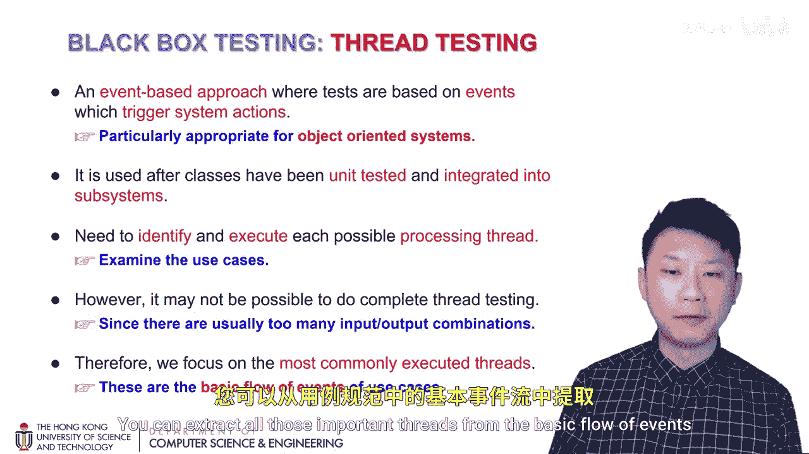

这是一个线程测试的示例：假设在你的系统中，对象1是学生，对象2是课程，对象5是大学。学生对象1可能调用课程对象2（因为想注册某门课），然后课程对象2可能不得不调用大学对象5来执行某些操作。因此，在进行线程测试时，我们需要测试从对象1到对象2再到对象5的这个线程。

线程测试的类型可能包括：
*   **单线程**：例如，对象3 -> 对象2 -> 对象4。
*   **多线程**：例如，对象1 -> 对象2，然后同时到对象4和对象5。
*   **多输入线程**：例如，多个输入同时进入对象1。

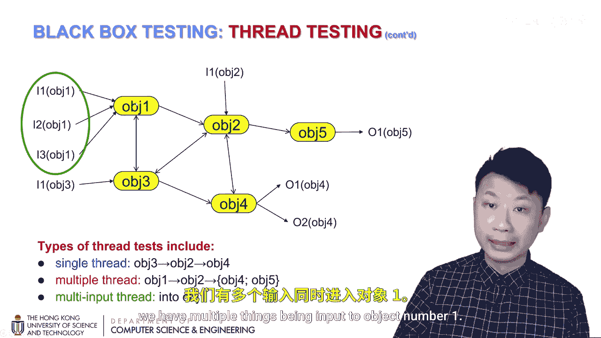

---

在进行黑盒测试时，我们也可以关注**基于状态的测试**。因为有些程序可以同时处于多种不同的状态。例如，在使用微软画图时，你可以将画笔设置为不同的颜色。进行测试时，我们应该将对象置于不同的状态（例如，将画笔设置为不同颜色），然后再执行操作（如在白板上画图）。

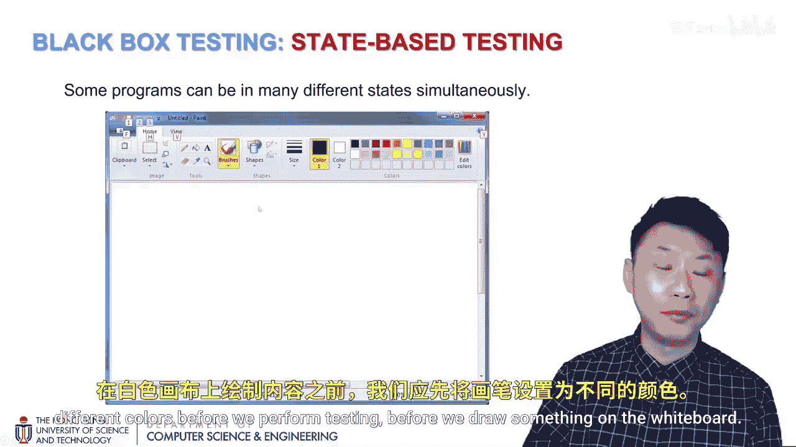

请注意，基于状态的测试侧重于比较类的最终状态与预期状态。系统中特定对象的所有状态都可以通过状态机图推导出来（我们将在后续课程中讨论如何绘制状态机图）。然后，我们应该为每个状态转换推导出一组有代表性的激励（输入），并在应用激励后检查类的属性或链接，以确定是否达到了特定状态。

我们可以基于对象的属性或与其他类的链接来确定对象的状态。
*   **基于属性**：例如，可以根据“班级人数”这个属性来确定一个班级是否已满。如果班级人数是 `50`（假设满员），那么我们就知道班级对象处于“已满”状态。
*   **基于链接**：例如，我们有一组电影。如果一部电影在系统中与某个客户对象链接，那么我们就知道这部电影已被该客户“租借”，处于“不可用”状态。我们可以通过检查电影到客户的链接来确定电影的状态（可用或不可用）。

在应用测试激励之前，我们必须使用激励或链接将类置于所需的状态。

---

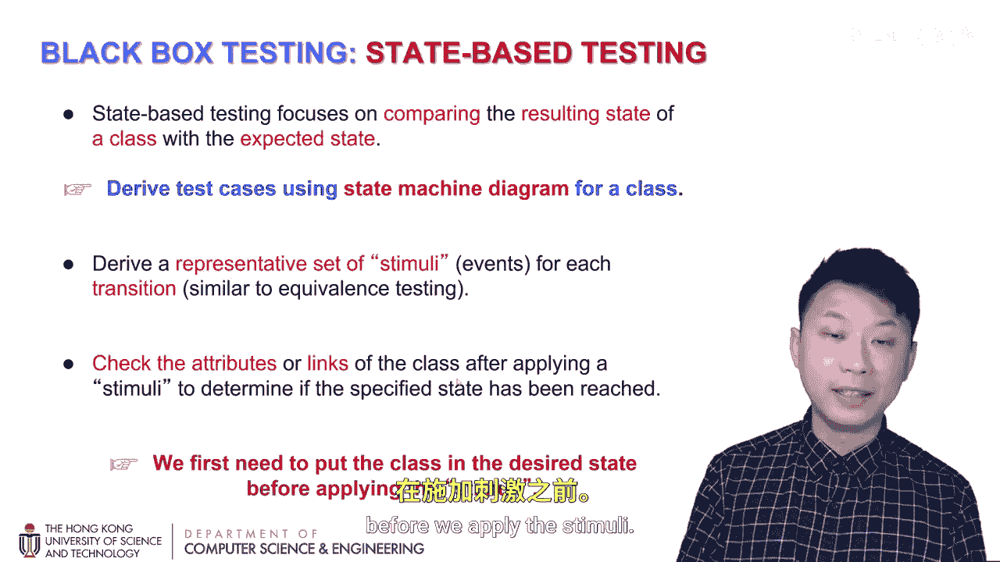

本节课中我们一起学习了黑盒测试的核心技术。我们了解了如何通过等价类划分来系统性地设计测试用例，如何通过边界值分析来发现常见的“差一”等错误，以及如何针对面向对象系统的特点进行线程测试和基于状态的测试。掌握这些方法，可以帮助我们在不了解内部实现的情况下，有效地验证软件的外部行为是否符合预期。