# 037：回归测试 🔄

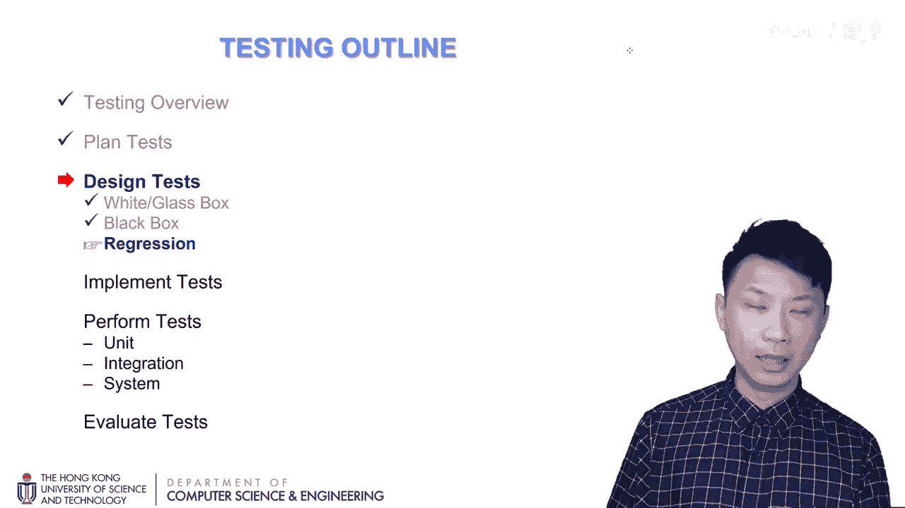

在本节课中，我们将要学习软件测试中的最后一种类型——回归测试。我们将回顾其核心概念，并理解为什么它在软件开发过程中至关重要。

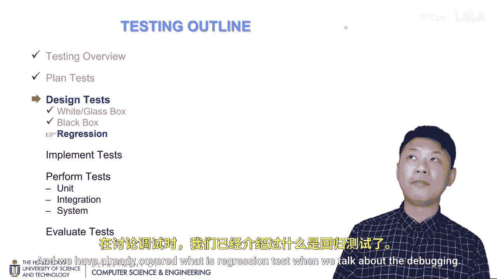

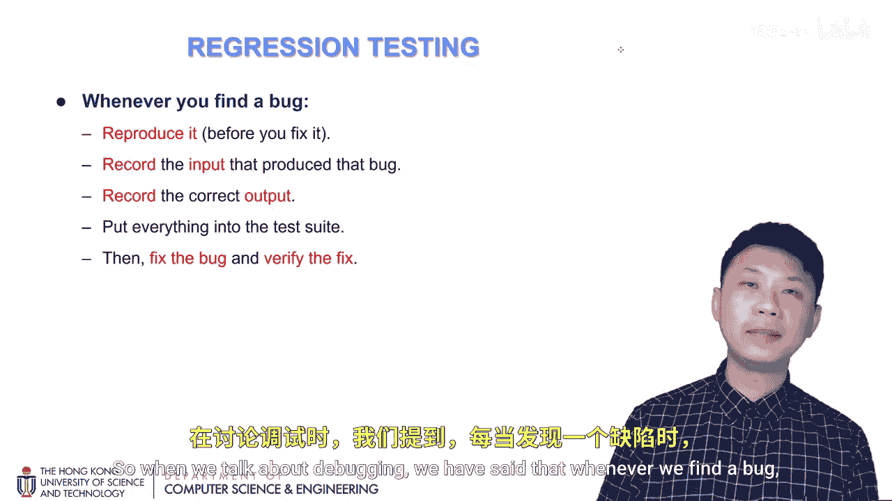

## 概述

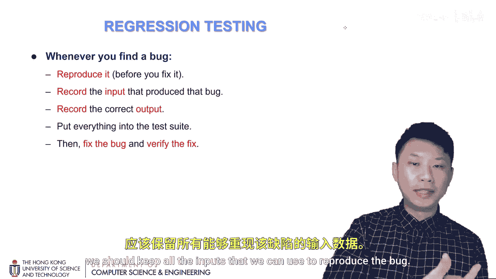

回归测试是一种旨在确保软件在修改后，原有功能依然正常工作的测试方法。其核心思想是：**曾经出现的错误，未来可能再次出现**。通过将已修复的错误转化为测试用例，我们可以持续防范这些错误的回归。

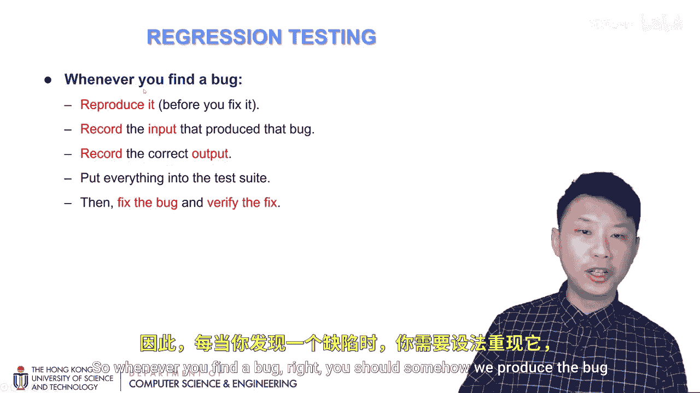

## 回归测试的核心流程

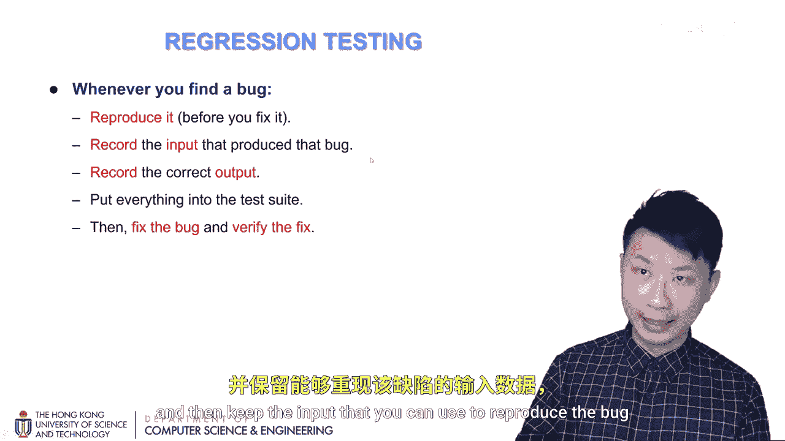

上一节我们介绍了调试的概念，本节中我们来看看如何将调试过程与回归测试结合起来。回归测试的流程紧密围绕错误的发现与修复展开。

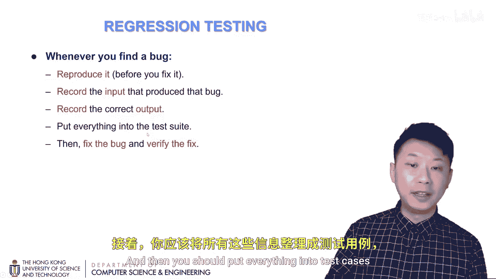

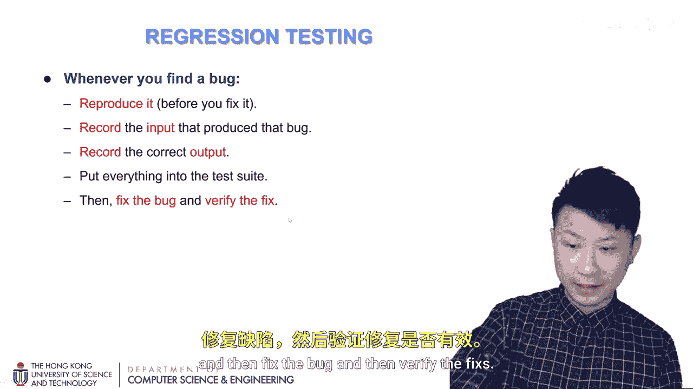

以下是回归测试的标准步骤：

1.  **发现并复现错误**：当在软件中发现一个错误（Bug）时，首要任务是找到能够稳定复现该错误的输入条件。
2.  **保存测试信息**：记录下用于复现错误的**输入**数据，以及该输入对应的**正确预期输出**。
3.  **创建测试用例**：将上述输入和预期输出整合，形成一个正式的测试用例。
4.  **修复错误**：对代码进行修改，以消除该错误。
5.  **验证修复**：运行新创建的测试用例，验证在修复后，程序对于该输入能产生预期的正确输出。

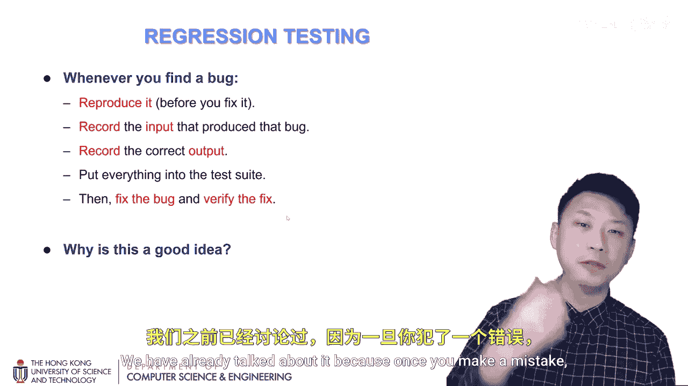

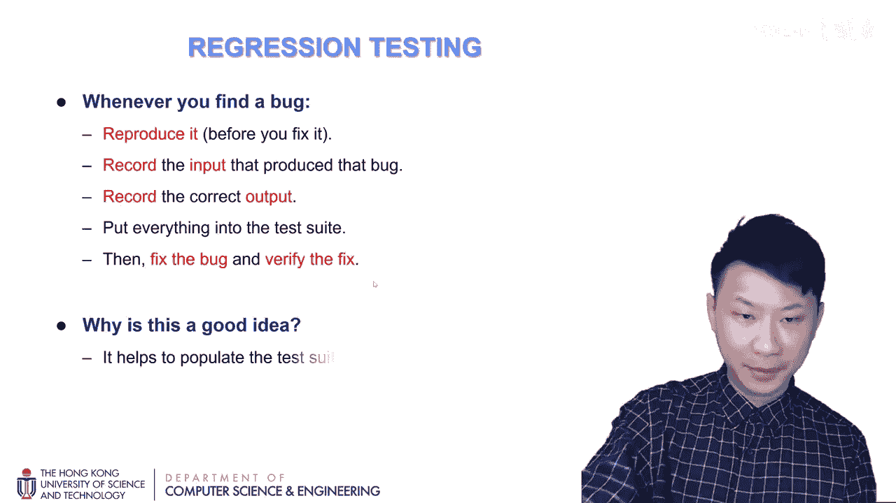

## 回归测试的重要性

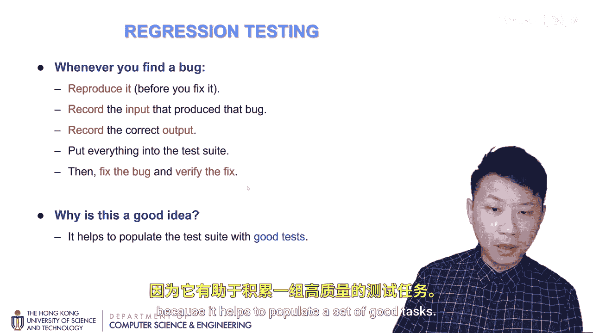

执行回归测试主要有两个关键好处，它们都源于同一个核心理念。

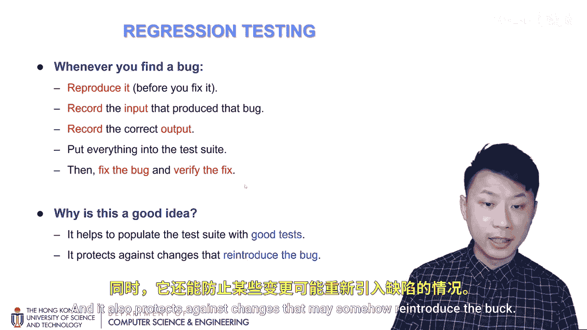

以下是回归测试的主要价值：

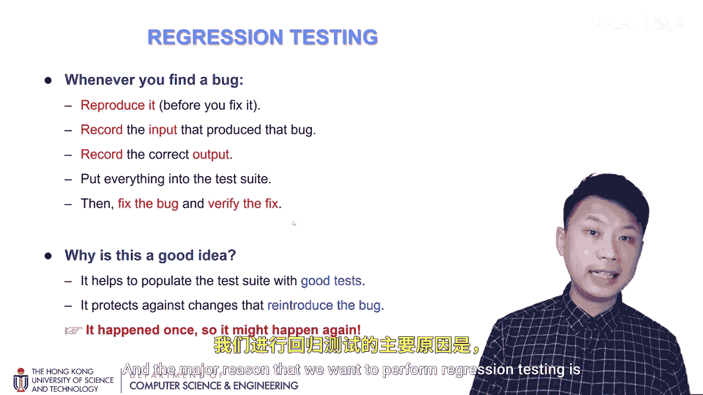

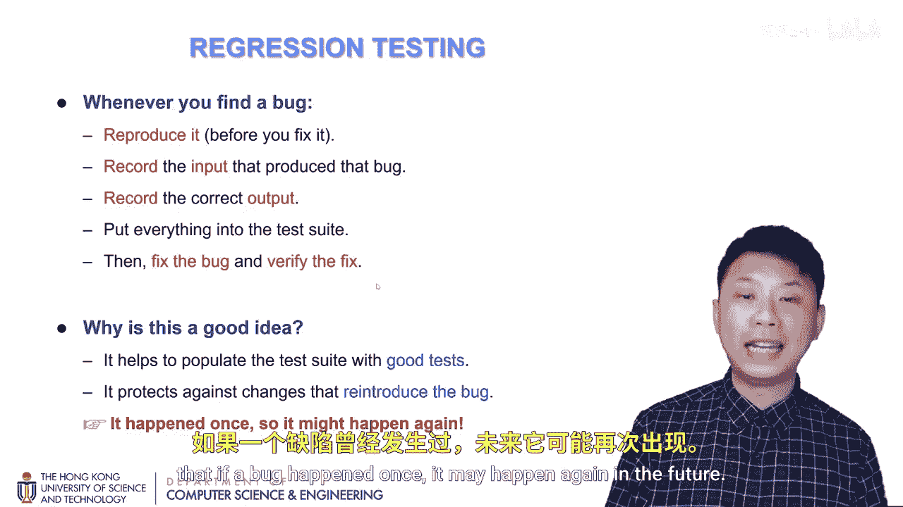

*   **积累高质量的测试套件**：每一个由真实错误转化而来的测试用例，都是针对程序薄弱环节的高价值测试。这能帮助团队构建一个强大且有针对性的测试集合。
*   **防范错误复发**：在未来的代码修改、功能添加或重构过程中，可能会无意间重新引入已修复过的错误。回归测试用例就像一个安全网，能够及时捕获这类“倒退”（Regression），确保软件质量不会因新的变更而下降。

## 总结

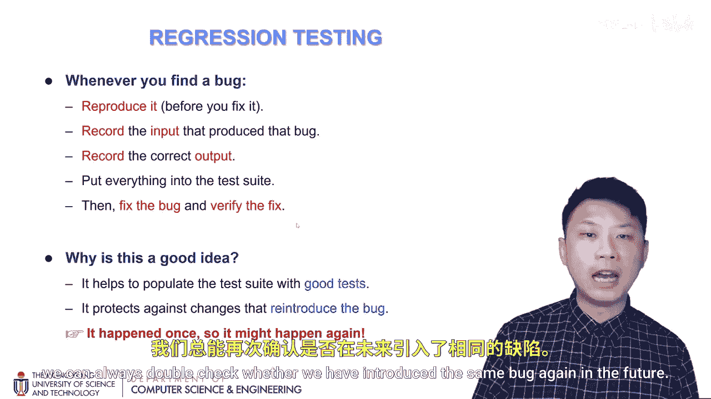

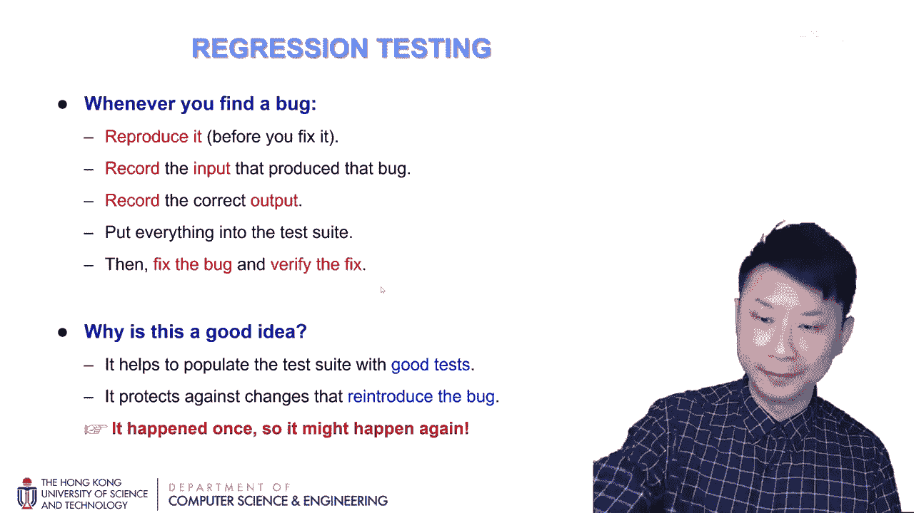

本节课中我们一起学习了回归测试。我们了解到，回归测试的本质是将已修复的错误转化为自动化的测试用例。其核心目的是防止相同的错误在未来再次发生，并通过不断积累由真实问题驱动的测试用例，来提升整体测试套件的有效性。记住这个简单而强大的公式：**Bug -> 测试用例 -> 持续防护**。