# 039：单元、集成与系统测试 🧪

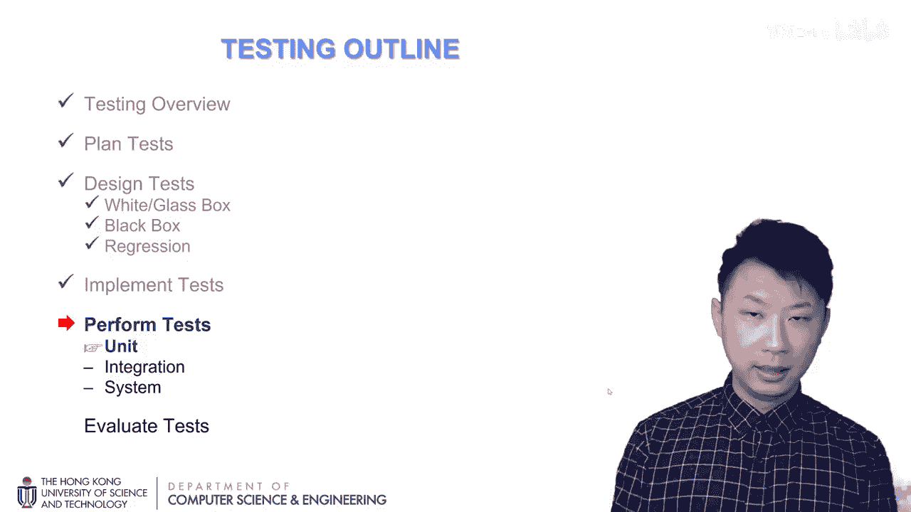

在本节课中，我们将学习软件测试的三个关键层次：单元测试、集成测试和系统测试。我们将了解每种测试的目的、方法以及在实际项目中如何应用它们。

---

## 单元测试 🔬

上一节我们介绍了测试的基本概念，本节中我们来看看最基础的测试类型——单元测试。单元测试针对的是软件中的最小可测试单元，通常是一个类或一个函数。

当我们进行单元测试时，我们有一个待测试的组件（通常是一个类或程序的一部分）。我们准备许多输入数据，并将其输入到待测试的组件中。测试用例的类型可以涉及接口、独立路径、边界条件、局部数据结构或错误处理路径等。我们强调白盒测试技术，因为此时我们讨论的是源代码。

但请注意，当我们测试一个类或系统的一部分时，系统的其他部分可能尚未准备就绪。那么，我们如何在没有其他部分的情况下进行测试呢？

因此，在进行测试时，我们需要所谓的**驱动模块**和**桩模块**来完成测试。

*   **驱动模块**帮助我们输入用于测试的数据，并将其输入到待测试组件内的函数中。例如，如果组件中有一个求绝对值的函数，那么驱动模块将帮助我将输入数据输入该函数，然后检查输出是否正确。
*   **桩模块**是被待测试组件调用的组件。这个组件可能会调用另一个类来执行某些操作。例如，该组件调用另一个类来获取一些学生信息。那么，为了完成测试，我不调用实际提供学生信息的类，而是使用一个虚拟类。这个虚拟类可能总是返回相同的学生信息给该组件，这样我就可以在没有学生类的情况下完成测试。因此，桩模块就是一个虚拟类，它将返回一些必要的信息，以便组件完成测试。

在面向对象测试中，我们应该对什么进行单元测试呢？一个单元测试至少应该针对一个类。我们必须测试软件系统中的每一个类。

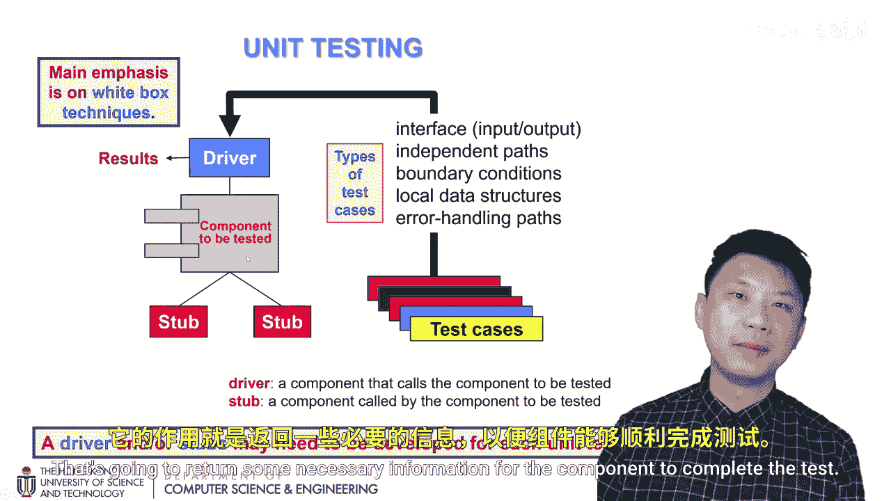

然而，我们知道系统中的对象可以处于不同的状态，因为一个对象可能有多种状态，这会使测试变得困难。这就是我们在上一讲中讨论过的内容：在测试之前，你必须将每个类置于每一个可能的状态中。

那么，如何处理继承和多态呢？这意味着当我们有超类和子类时，如果一个子类重写了已经测试过的超类的方法，那么需要测试什么？是只测试被重写的方法，还是测试所有的方法？

如何处理封装呢？封装意味着我们试图进行信息隐藏，试图隐藏对象内部的内容。这在面向对象编程中非常常见。为了进行测试，我们可能需要提供一个仅供测试使用的方法，该方法将报告对象的所有状态。我们将使用该方法来获取该特定对象内部的实际内容。

通常，当我们实现一个栈时，通常只有两个方法：`push` 和 `pop`。`push` 可以将某些内容压入栈，`pop` 可以从栈中取出内容。但为了进行测试，我们可能还需要一个名为 `peek` 的方法，以便查看对象（或栈）内部的实际内容。如果你查看一个空栈，应该看不到任何内容。如果你将某些内容压入栈然后查看，你应该看到刚刚插入栈的元素。如果你弹出某些内容然后查看，那么你应该看到有内容从栈中移除，等等。我们需要这个额外的 `peek` 方法，以便准确查看对象内部的内容。

---

## 集成测试 🔗

上一节我们学习了如何测试单个组件，本节中我们来看看当多个组件组合在一起时会发生什么，这就是集成测试。

有些人可能会问，如果所有组件在单元测试后都能正常工作，为什么还要进行更多测试？为什么需要进行集成测试？原因是**交互类错误**无法通过单元测试发现。例如，接口误用、接口误解或时序错误，这些都无法通过单元测试发现。因此，我们必须进行集成测试，以确保没有交互错误。

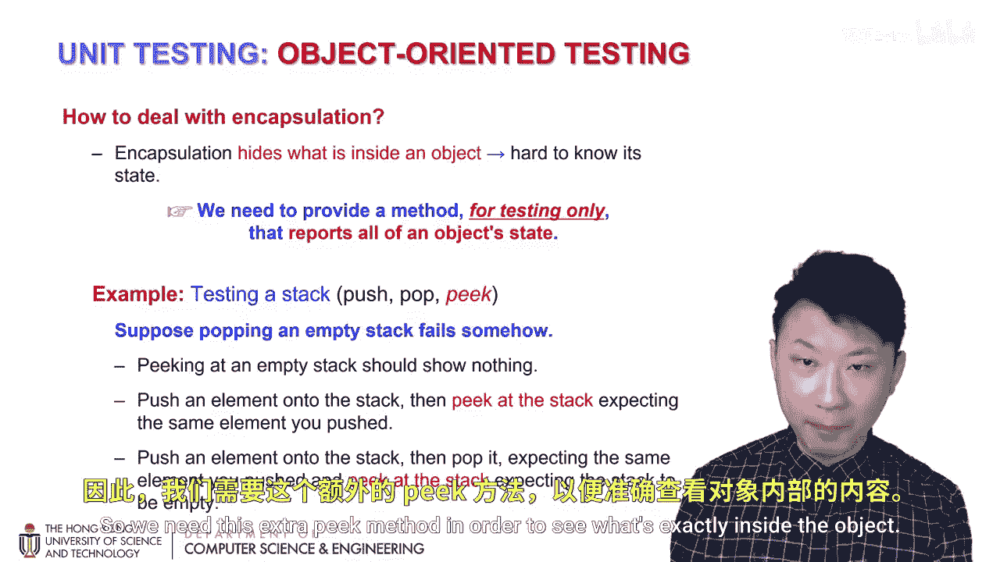

但是，当我们进行集成测试时，我们不会一次性完成所有集成。这意味着我们不会将所有类集成在一起，然后得到整个系统，再简单地测试整个系统。因为如果我们测试整个系统，那将与系统测试相同，而不是集成测试。因此，要进行集成测试，我们必须**增量式**地进行。

增量式意味着我们将类一个一个地集成到系统中，然后观察会发生什么。

对于集成测试，我们可以采用自顶向下的方法。通常，顶层系统将是用户界面组件。使用这种自顶向下的方法，我们首先测试顶层。

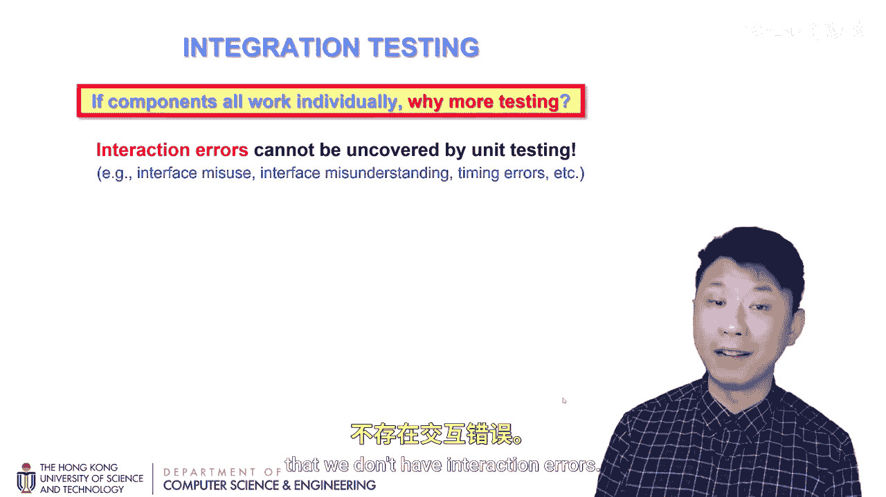

以下是集成测试的几种主要方法：

### 自顶向下方法

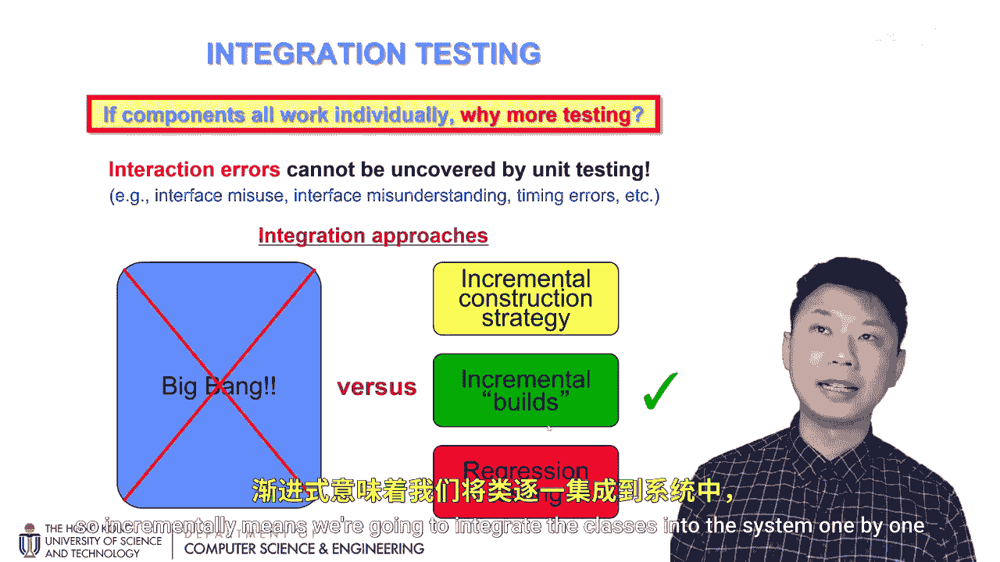

使用这种方法，我们首先测试顶层子系统，然后向下测试较低层的子系统。通常，顶层子系统是用户界面组件。因此，使用这种方法，我们将首先测试用户界面。

我们使用桩模块来测试顶层子系统。然后，我们将用实际的子系统逐个替换这些桩模块。每当集成一个新的子系统时，会重新运行先前测试的一个子集，例如进行回归测试。

自顶向下方法的好处是，它首先测试用户界面组件。如果用户界面组件在软件系统中至关重要，那么使用自顶向下方法是好的，因为你首先测试了关键组件。

但缺点是，在测试后期才能进行重要的低层处理。我们在执行测试时需要编写许多桩模块。通常，较低层的子系统是控制器，它们控制软件系统的行为。使用自顶向下方法意味着我们将在测试后期才测试它们。

### 自底向上方法

另一种我们可以使用的方法是**自底向上**方法。对于自底向上，我们首先测试底层子系统，然后使用驱动模块测试这些底层子系统。一旦我们完成了特定子系统的测试，就可以将该子系统与系统的顶层部分集成。

自底向上方法的好处是，我们将首先测试控制器。通常，控制器在软件系统中至关重要，因此首先测试它们是个好主意。缺点是，我们将在测试后期才测试用户界面组件。

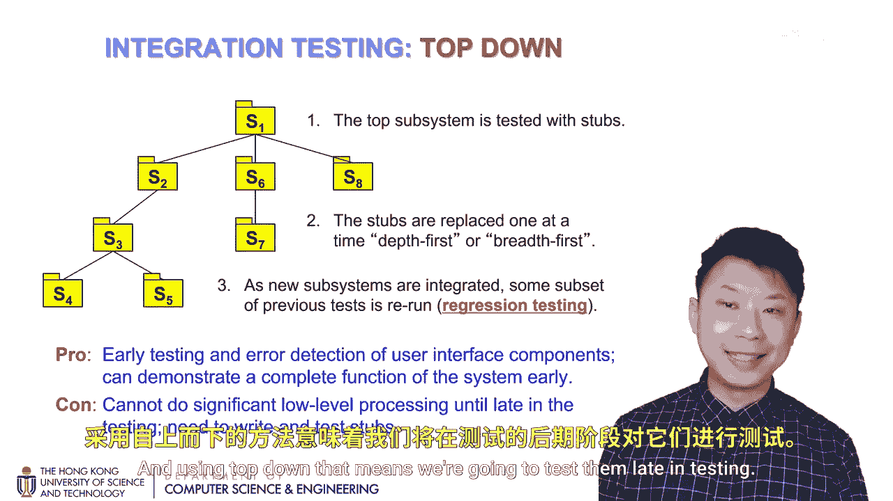

现在我们可以看到，如果使用自顶向下，我们将首先测试用户界面；如果使用自底向上，我们将首先测试控制器。

### 三明治方法

还有一种方法叫做**三明治方法**，这意味着我们将同时使用桩模块测试顶层部分，并使用驱动模块测试底层部分，因此我们可以并行进行。

在测试完系统的顶层和底层部分后，我们可以将它们集成在一起。这就是我们所说的三明治方法。

三明治方法的好处是，我们现在可以并行地对用户界面和控制器进行测试。但缺点是，我们必须编写许多桩模块和驱动模块。三明治方法非常高效，因为我们可以并行执行测试，并且可以缩短总测试时间。

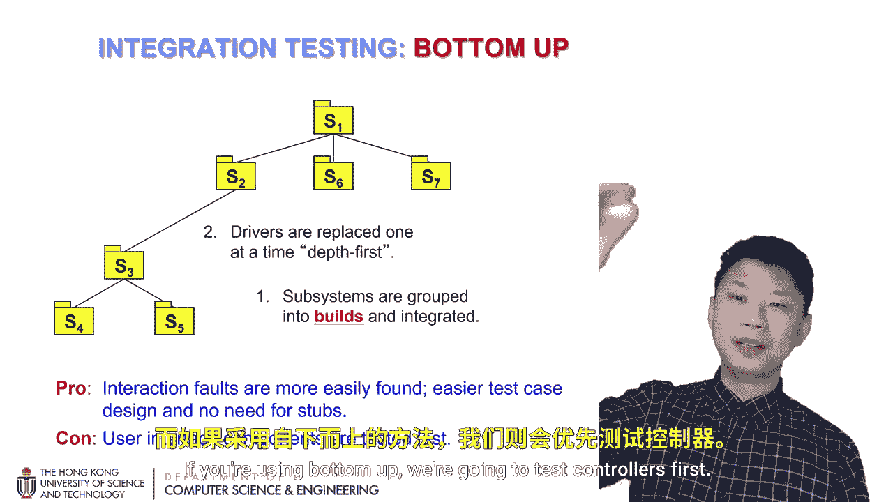

请注意，当我们执行测试时，**关键子系统应尽可能早地进行测试**。如果用户界面是关键，那么我们首先测试它们；如果控制器是关键，那么我们首先测试它们，等等。

此外，那些涉及多个软件需求或具有高级别控制（即具有较高的圈复杂度）的子系统，以及那些复杂或容易出错的子系统，或者具有特定性能要求（意味着需要满足该特定子系统的某些非功能性需求）的子系统，都应尽可能早地进行测试。

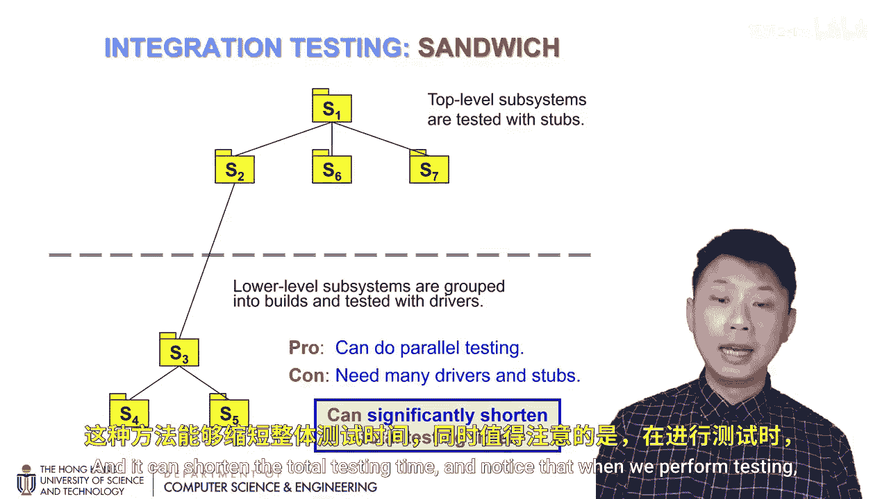

请注意，对关键子系统需要进行回归测试。为什么？因为子系统很重要，如果我们之前犯了错误，我们会尽量避免在同一子系统上再次犯同样的错误。

---

## 系统测试 🖥️

上一节我们讨论了如何将组件集成在一起测试，本节中我们来看看如何将软件作为一个完整的系统进行测试，这就是系统测试。

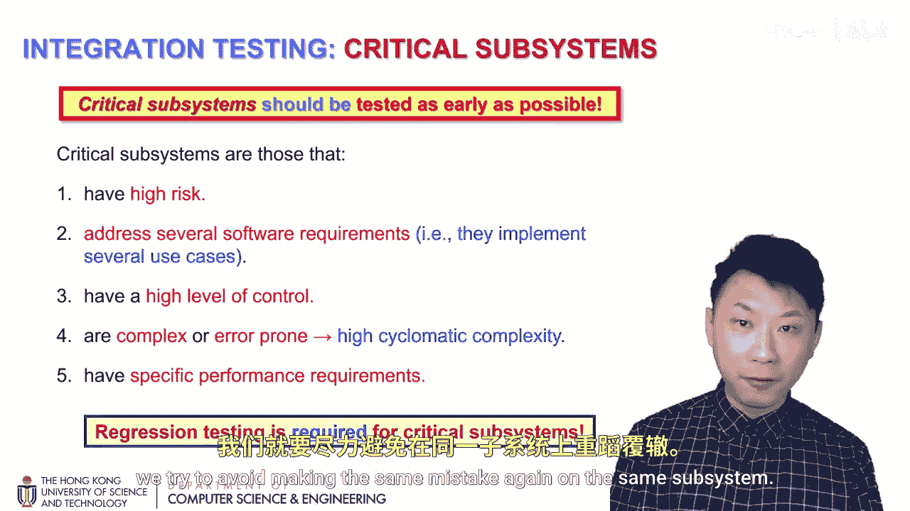

在系统测试中，我们将系统作为一个整体进行测试，以确保系统在集成后能正常运行。

以下是在进行系统测试时可能想要执行的一些特定类型的测试：

*   **功能测试**：验证系统需求规格说明中指定的所有功能。
*   **性能测试**：验证你在非功能性需求中指定的设计目标。
*   **引导测试**：选择一组最终用户来试用系统。
*   **验收测试**：让客户或用户使用系统，然后验证可用性，并根据系统需求规格说明验证所有功能和非功能需求。
*   **安装测试**：在实际使用环境中验证可用性，并验证功能和非功能需求。

在本讲中，我们重点关注性能测试、引导测试和验收测试。

### 性能测试

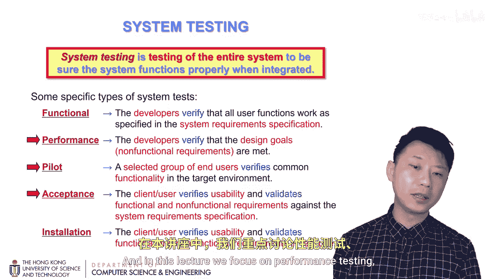

在性能测试中，我们讨论的是非功能性需求，例如：
*   **压力测试**：你的系统能否同时处理许多并发请求。
*   **容量测试**：你的系统能否处理大量数据、高复杂度算法或高磁盘碎片。
*   **安全测试**：验证安全保护机制。
*   **时序测试**：验证系统能否满足某些时间约束。
*   **恢复测试**：你必须验证系统在不同方式下被迫失败时能否恢复。

### 引导测试

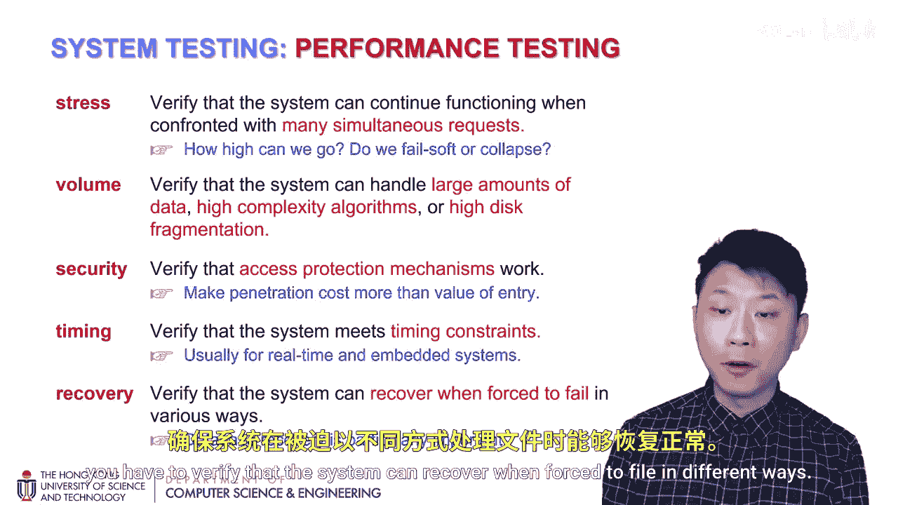

你也可以进行引导测试，这意味着尝试邀请一些最终用户来试用系统。

我们可以执行两种类型的引导测试：
1.  **Alpha测试**：你将用户邀请到开发地点。在Alpha测试中，你邀请一些用户到开发地点，然后在开发地点进行测试。因此我们说测试是在受控环境中进行的，在开发地点内。
2.  **Beta测试**：你将软件发布给最终用户，最终用户将在他们自己的机器上试用该软件。因此我们说，对于Beta测试，测试是在客户现场、在客户的机器上进行的。在游戏中，我们非常普遍地使用Beta测试。我们将游戏发布给玩家试用，如果他们发现游戏中的任何错误，可以向开发人员报告，开发人员可以修复这些错误。

### 验收测试

在验收测试中，我们试图向客户证明系统的某个功能或约束是完全可操作的。这意味着我们试图在客户面前演示某些东西。

以下是在验收测试中可以做的事情：
*   **功能验证**：系统是否提供所需的功能。
*   **接口验证**：例如，接口是否执行设计功能并遵循所需的设计标准。
*   **信息内容验证**：例如，系统是否会在系统上正确存储所有数据。
*   **性能验证**：系统是否满足特定的性能标准，等等。

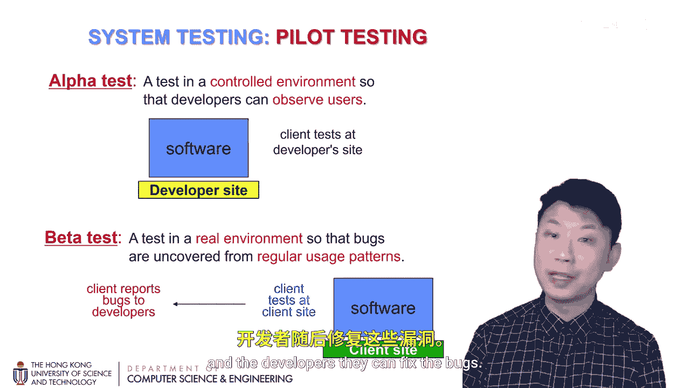

当你设计某个测试时，你需要以简洁、精确且可测试的方式编写需求，具体做法是：
1.  将相关的需求分组在一起。
2.  删除任何无法测试的需求。
3.  通过查看用例、查看领域模型以及查看系统需求规格说明中的非功能性需求，添加从用户那里收集的任何额外需求。

然后，对于每个需求，你必须想出一个评估场景，该场景将向客户证明你已经实现了相应的需求。

请注意，由于大多数评估场景都依赖于用户界面，因此在用户界面确定之前，它们无法完成或测试。

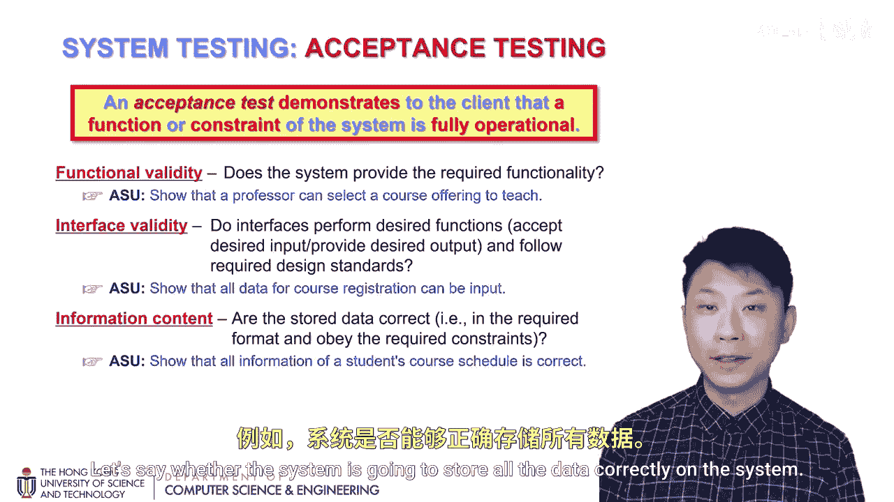

---

## 总结 📝

在本节课中，我们一起学习了软件测试的三个核心层次。

*   **单元测试**聚焦于测试最小的代码单元（如类或函数），需要使用驱动模块和桩模块来模拟未完成的部分，并需考虑面向对象特性（如状态、继承、封装）带来的测试挑战。
*   **集成测试**旨在发现组件间交互时产生的错误，主要采用增量式方法，包括自顶向下、自底向上和三明治策略，关键是要尽早测试系统中的关键部分。
*   **系统测试**将软件视为一个整体进行验证，包括功能测试、性能测试、引导测试（Alpha/Beta测试）和最终的验收测试，以确保系统满足所有指定的需求和标准。

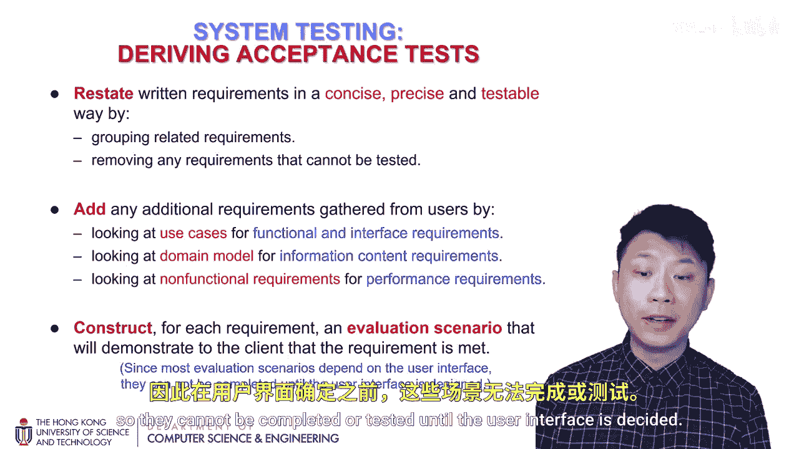

理解并正确应用这些测试层次，对于构建高质量、可靠的软件系统至关重要。