# 040：验收测试示例 📋

在本节课中，我们将学习如何为一个具体的需求陈述编写验收测试。我们将以大学课程注册系统为例，详细讲解从需求提取到编写可测试的验收标准，再到评估测试结果的完整流程。

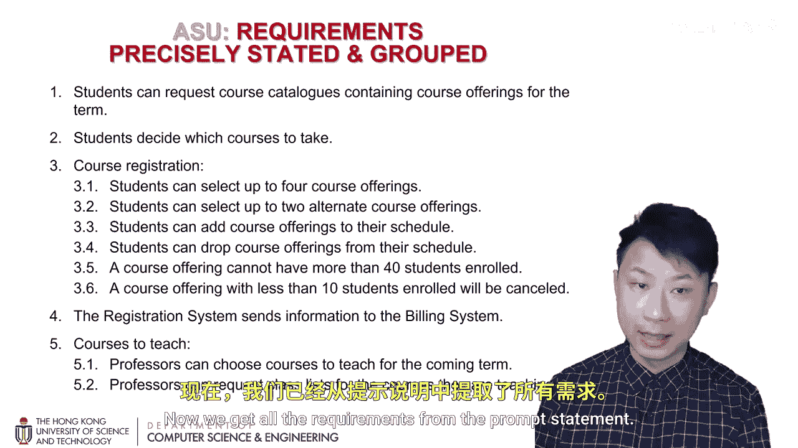

## 从需求到可测试的陈述

上一节我们介绍了验收测试的基本概念，本节中我们来看看如何将模糊的需求转化为可测试的陈述。

首先，我们有一个关于大学课程注册系统的需求陈述。我们需要从中提取所有需求。

以下是需求陈述中的部分内容：
*   学生可以请求包含本学期课程安排的课程目录。
*   学生决定选修哪些课程。
*   ……

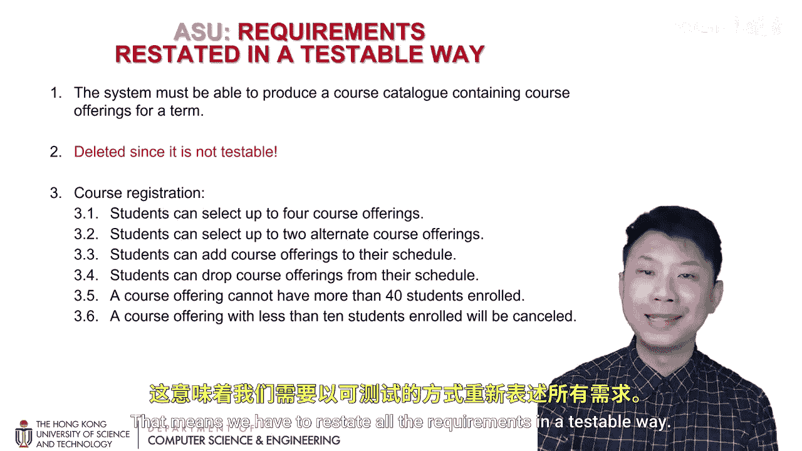

接下来，我们必须以可测试的方式重述所有需求。测试的重点是**系统能做什么**，而不是用户能做什么。

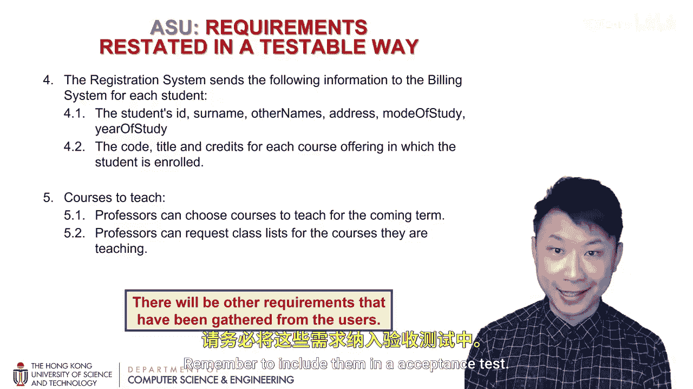

因此，我们需要将需求重述为对系统行为的描述。例如：
*   **原需求**：学生可以请求包含本学期课程安排的课程目录。
*   **可测试的陈述**：系统必须能够生成包含本学期课程安排的课程目录。

对于“学生决定选修哪些课程”这条需求，由于我们测试的是系统而非学生，因此该陈述**不可测试**，应被删除。

我们需要对所有剩余的需求执行相同的操作，将它们全部转化为可测试的陈述。

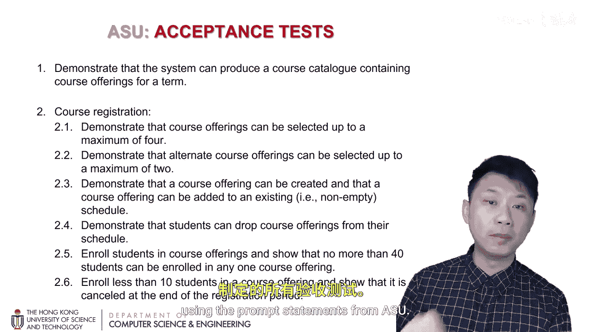

请注意，进行测试时必须包含所有已识别的需求。可能还有其他从用户或系统需求规格说明中收集到的需求，务必记得将它们也纳入测试范围。

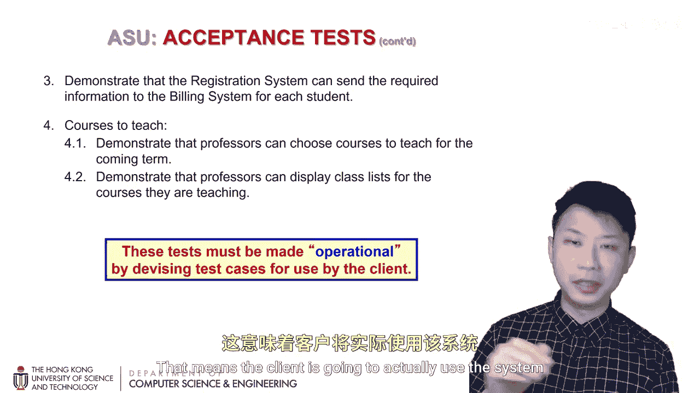

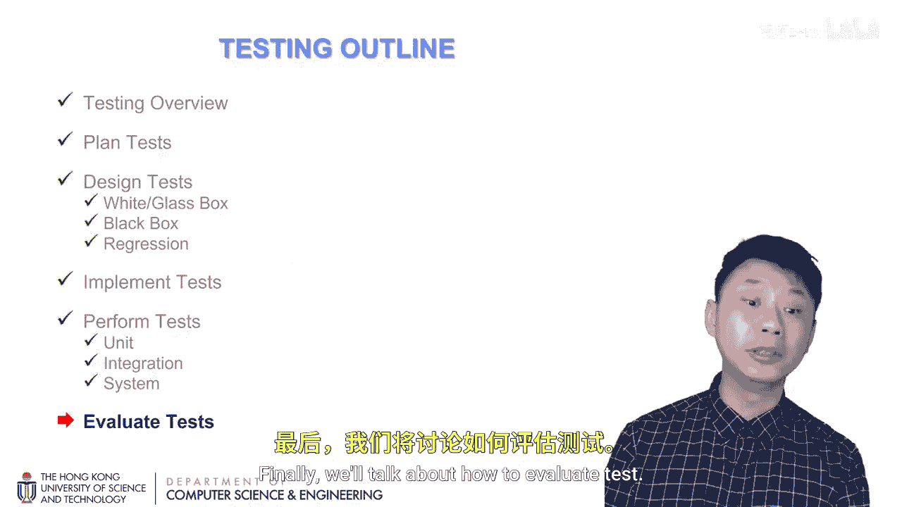

## 编写验收测试

在将需求转化为可测试的陈述后，我们就可以开始编写具体的验收测试了。

编写验收测试时，确保使用关键词 **“演示 (demonstrate)”**。因为验收测试需要在客户面前实际演示系统的功能。

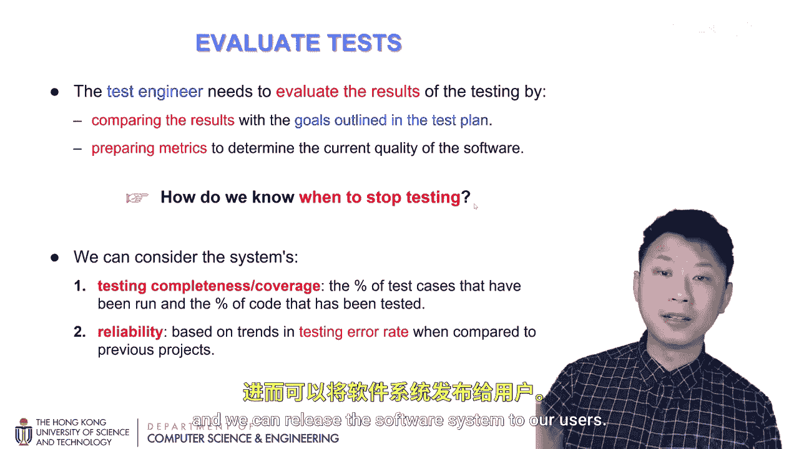

以下是为课程注册系统编写的一些验收测试示例：
*   演示系统能够生成包含本学期课程安排的课程目录。
*   演示课程注册功能，最多可选择四门主修课程。
*   演示课程注册功能，最多可选择两门备选课程。
*   ……

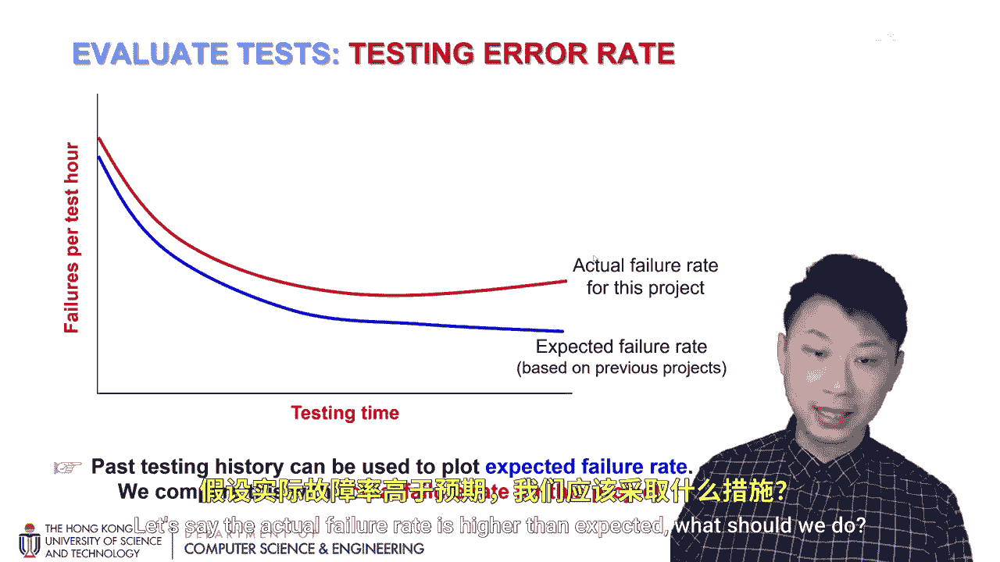

这些测试必须具有可操作性，即能为客户设计出具体的测试用例，让客户能够实际操作系统以验证所有需求是否得到满足。

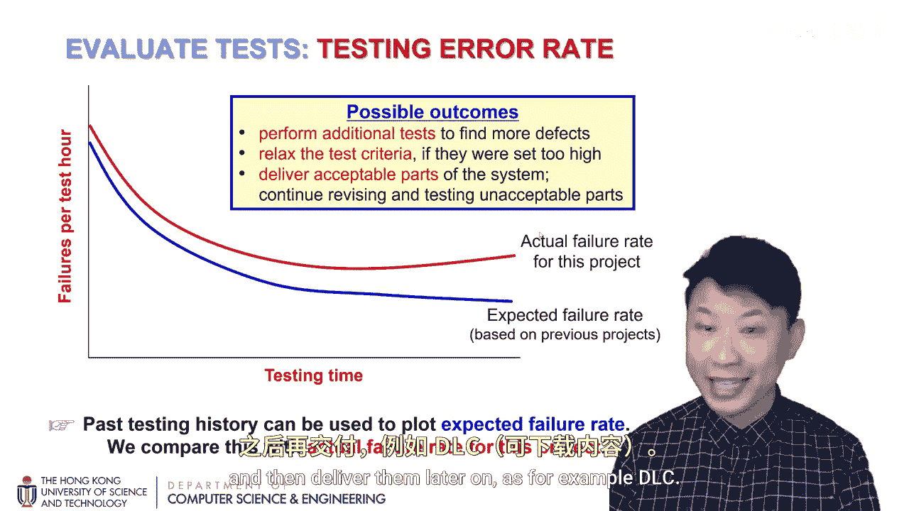

## 评估测试结果

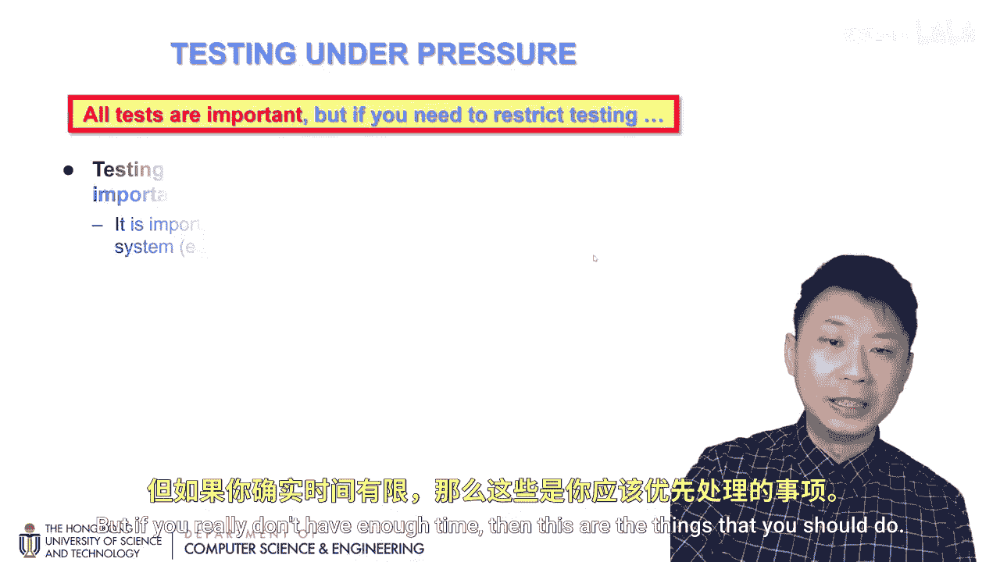

编写并执行测试后，我们需要评估测试结果。测试工程师需要通过以下步骤进行评估：
1.  将测试结果与测试计划中设定的目标进行比较。
2.  准备度量标准以确定软件的当前质量。

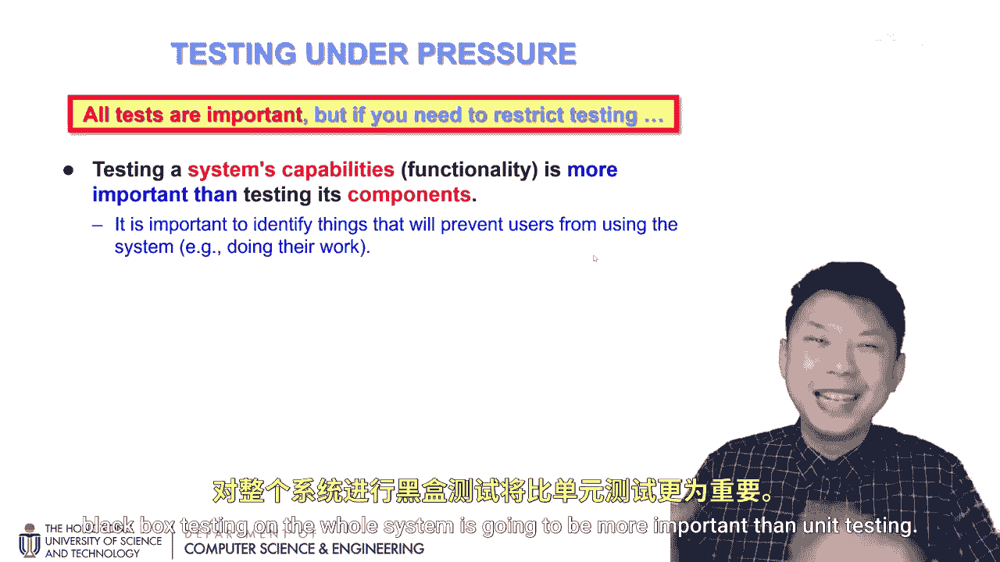

那么，我们如何知道何时可以停止测试并发布软件呢？可以考虑以下标准：
*   **任务完成度与覆盖率**：例如，如果通过了99%的测试任务，我们可以认为系统是可靠的。
*   **基于错误率的可靠性**：如果错误率很低，说明系统中错误不多，系统相对稳定。

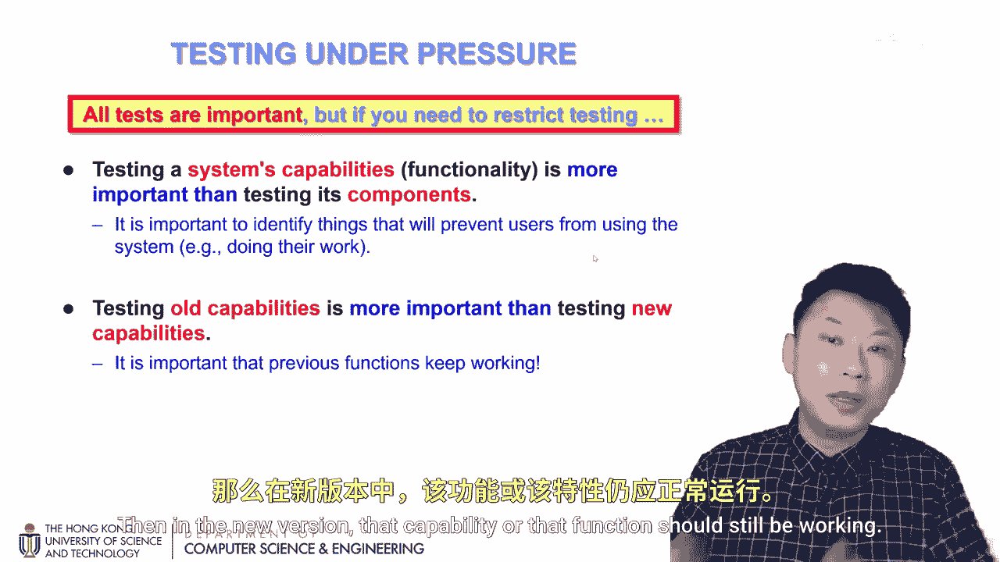

在项目中，我们需要持续追踪错误率。如果实际故障率高于预期，我们可以采取以下措施：
*   执行额外的测试以发现更多缺陷。
*   重新评估测试标准是否定得过高或过于严苛。
*   交付系统中可接受的部分，并继续修订和测试不可接受的部分，稍后作为增量更新交付。

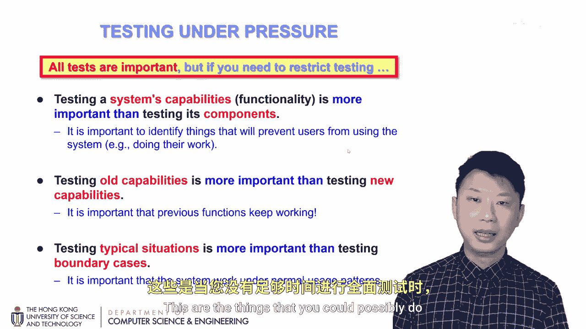

## 测试优先级策略

请注意，所有测试任务都很重要。但如果时间确实有限，应遵循以下优先级策略：

以下是时间不足时应遵循的测试优先级：
1.  **测试系统能力比测试组件更重要**：例如，对整个系统进行黑盒测试比单元测试更重要。
2.  **测试旧功能比测试新功能更重要**：在旧版本中正常工作的功能，在新版本中应依然正常工作。
3.  **测试典型情况比测试边界情况更重要**。

## 有效测试的要点总结

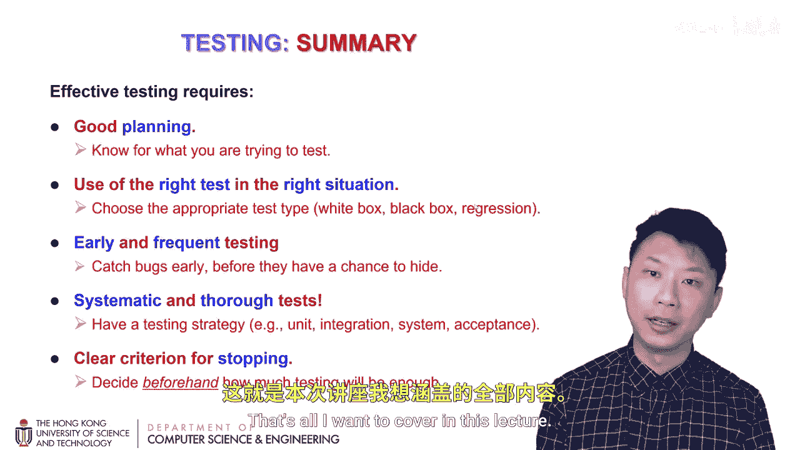

本节课中我们一起学习了验收测试的编写与评估。为了有效进行测试，需要牢记以下几点：
*   **良好的计划**：明确知道要测试什么。
*   **正确的技术**：在正确的情况下使用正确的测试技术（如本课程介绍的白盒测试、黑盒测试和回归测试）。
*   **尽早且频繁地测试**：测试通常在实现后进行，而此时时间压力较大，因此尽早开始测试是个好主意。
*   **利用自动化工具**：例如，使用 JUnit 来帮助系统、全面地运行所有单元测试。
*   **设定清晰的停止标准**：不可能等待一个完美的系统。需要事先决定通过多少测试才算足够，例如通过99%的测试后，即可考虑向最终用户发布系统。