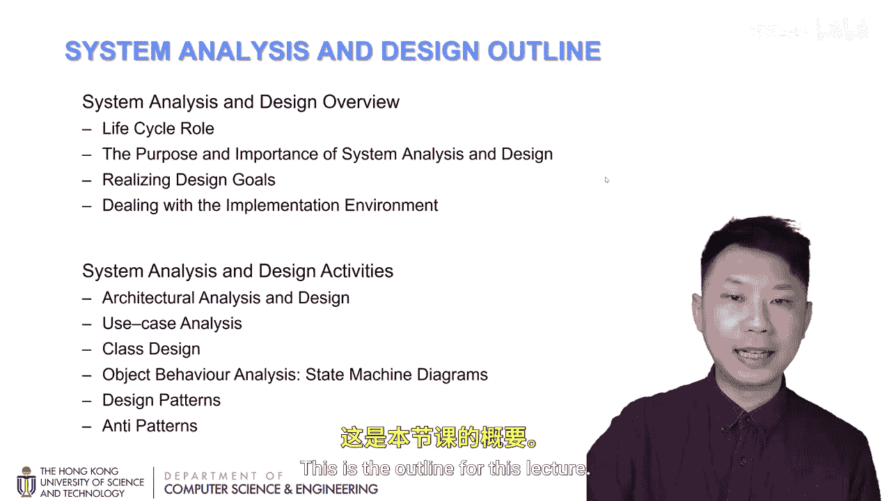
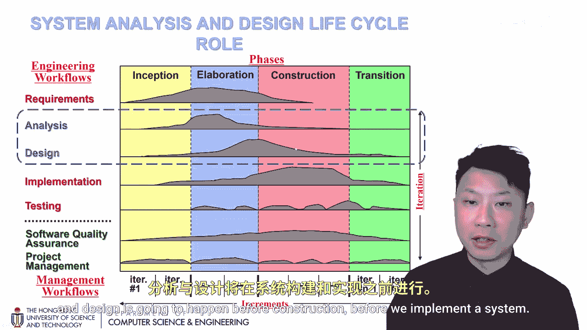
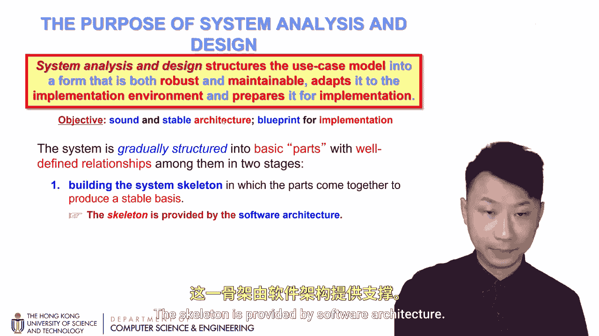
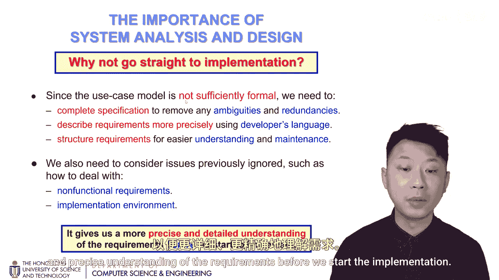
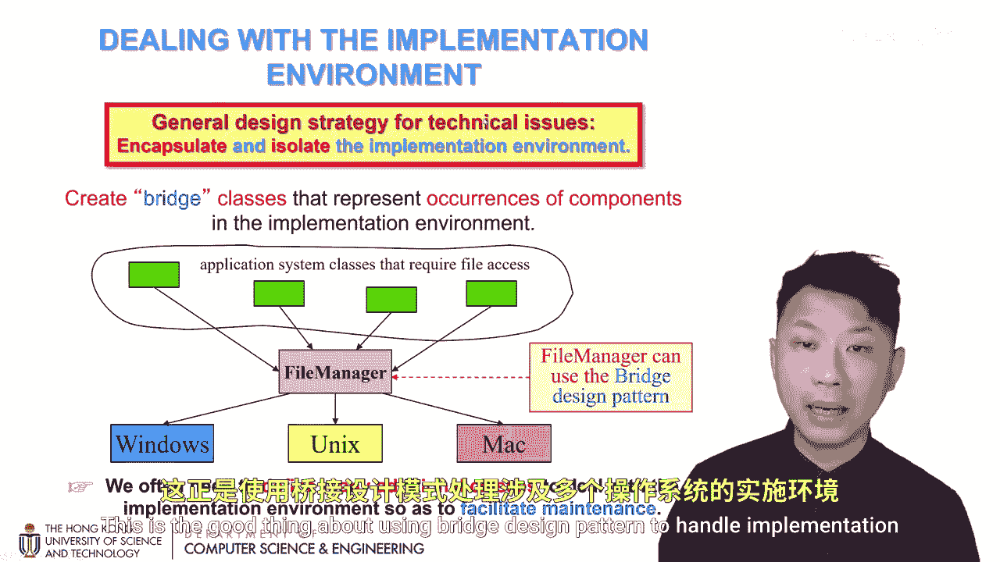

# 041：系统设计与分析简介 🏗️

在本节课中，我们将学习系统分析与设计。这意味着，在通过软件需求规格说明书（SRS）捕获所有需求之后，我们如何将这些需求转化为一个可以实际用于实现（编码）的模型。

本节课结束后，你将理解系统分析与设计在软件开发中的目的和重要性。你将了解系统分析与设计期间发生的主要活动。你还会知道如何在项目初期实现设计目标并处理实现环境。最后，你将了解什么是架构模式和设计模式，以及何时使用它们。

## 系统分析与设计的目的

上一节我们介绍了课程目标，本节中我们来看看系统分析与设计的核心目的。

当我们谈论分析与设计时，我们试图创建一个可以实际用于实现的模型。因此，分析与设计发生在构建（即实现系统）之前。

在系统分析与设计中，我们尝试将用例模型构建成一种健壮且可维护的形式，使其适应实现环境，并为实现做好准备。这意味着我们需要提出一个合理且稳定的架构，以及一个用于实现的蓝图。

## 构建系统的两个阶段

我们通过两个阶段，逐步将系统构建为由具有明确定义关系的基本部分组成的结构。

**第一阶段**，我们尝试构建一个系统骨架，其中的各个部分组合在一起，形成一个稳定的基础。这个骨架由软件架构提供。

**第二阶段**，我们尝试让系统生长，各个部分围绕骨架聚合，产生更精细的系统结构。这种生长是通过分析与设计工作流完成的。

当我们创建一个可用于实现的模型时，可能还需要考虑来自解决方案领域的技术方案。

## 为什么需要分析与设计？

一些同学可能会问，在捕获所有需求后，为什么不直接开始实现？

原因是，当我们构建用例模型时，用例模型中的信息不足以直接用于实现。这意味着在进入实现之前，我们必须完善规格说明，以消除任何歧义和冗余。

同时，我们需要使用开发者的语言（即编程语言）更精确地描述需求。我们可以描述所有的类，并尝试使用开发者的语言来创建模型。此外，我们还需要对需求进行结构化，以便于理解和维护。

因此，在进入实现之前，我们必须收集所有这些重要的信息。我们可能还需要考虑一些之前忽略的问题，例如非功能性需求和实现环境。现在，我们必须在进入实现之前，创建一个能够解决所有这些问题的模型。这意味着我们需要一个能让我们在开始实现之前，对需求有更详细和精确理解的模型。

## 处理实现环境的例子

以下是一个如何处理实现环境的例子。

假设我们必须构建一个系统，并且该系统需要在不同的操作系统上兼容。

那么，我们可能需要使用一个桥接类，即文件管理器，来处理不同操作系统上的文件访问。这就是我们所说的**桥接设计模式**。我们将在后续的一节课中详细介绍桥接设计模式。

因此，当我们尝试为实现创建一个模型时，我们还必须在设计和模型中考虑实现环境。我们通常需要定义许多额外的类来处理实现环境，以便于维护。例如，如果我们需要支持另一个操作系统，那么我们只需修改文件管理器，而无需修改整个系统。这就是使用桥接设计模式来处理涉及多个操作系统的实现环境的好处。

---

本节课中，我们一起学习了系统分析与设计的基本概念。我们了解到，分析与设计是将需求转化为可实施模型的关键桥梁，它发生在编码之前，目的是消除歧义、适应环境并构建稳定的系统架构。我们还通过一个例子，初步认识了设计模式（如桥接模式）在解决特定实现环境问题中的作用。