# 043：用例分析

在本节课中，我们将要学习用例分析的核心概念——分析类。分析类是对最终系统实现中一个或多个类的抽象。通过识别所有分析类，我们可以预估最终实现所需的类数量。在进入实现阶段前，先确定分析类是一个好方法，因为这能让我们大致了解需要哪些类来满足所有功能需求。因此，本节内容将聚焦于功能需求。

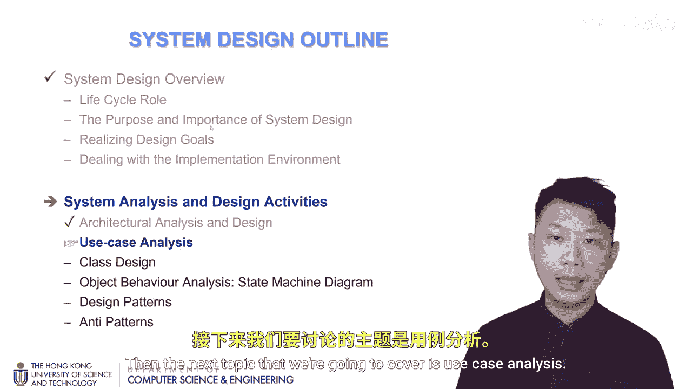

请注意，用于分析类的类描述是概念性的，而非面向实现的。这是因为我们正在进行抽象，试图跳过细节。具体表现为：属性类型是概念性的，而非编程语言类型；行为通过职责的文本描述来定义；关系也是概念性的，而非面向实现。

分析类属于以下三种原型之一：**边界类**、**实体类**或**控制类**。

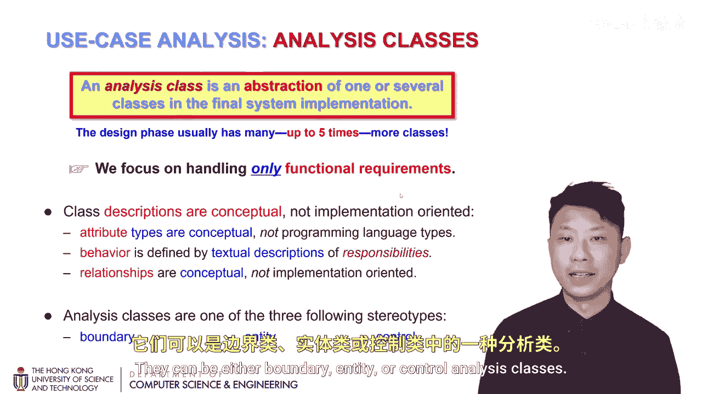

## 边界类

上一节我们介绍了分析类的概念，本节中我们来看看第一种类型——边界类。

边界类使用以下符号表示：`<<boundary>>`。它用于**建模系统与其参与者之间的交互**，代表实现特定功能所需的用户界面元素或设备的抽象。边界类与系统外部的参与者以及系统内部的对象进行交互。其描述应保持在相当高的概念层面，例如，对于某个功能，我们“需要一些用户界面”，而不是描述界面中的每一个按钮、菜单项。我们再次通过抽象来跳过细节，以处理设计的复杂性。

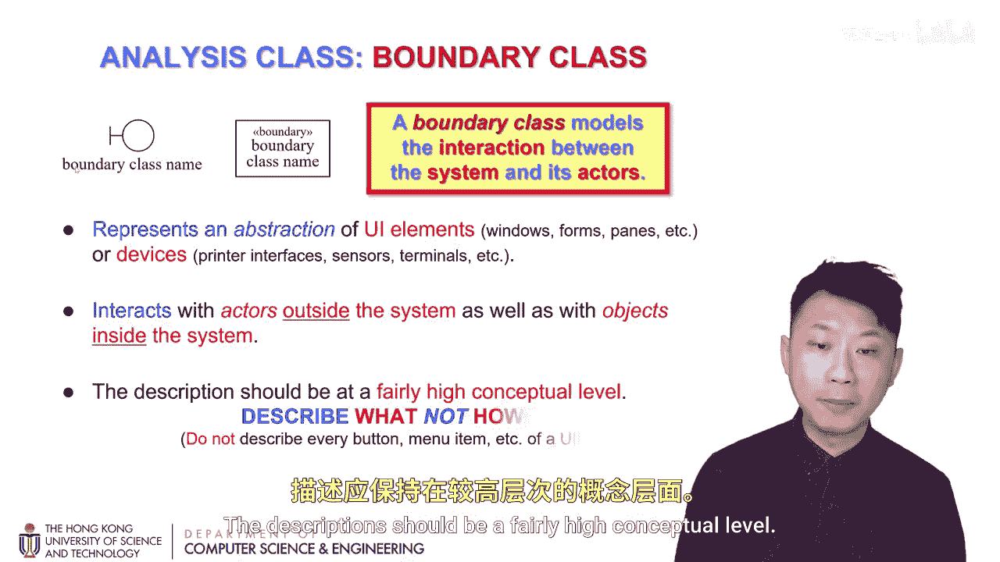

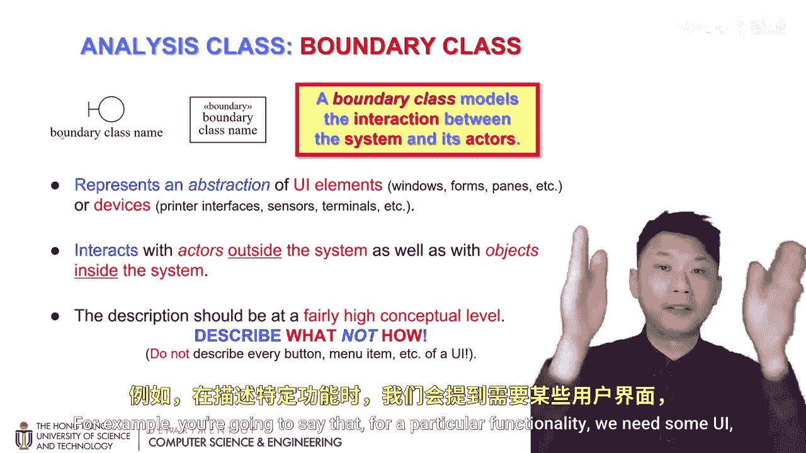

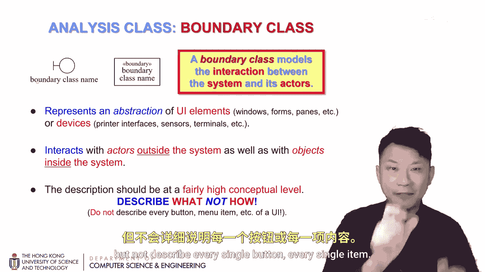

在设计中引入边界类，是为了**封装和隔离系统接口的变更**。如果我们想修改某个功能的用户界面，只需修改对应的边界类即可。

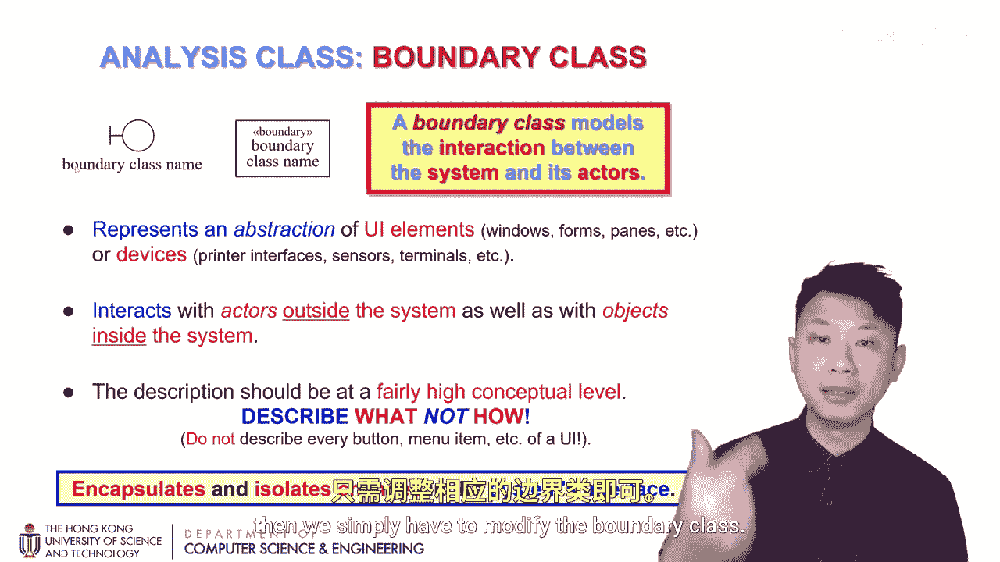

以下是识别边界类的方法：
通常从用例描述中寻找，从参与者出发，尝试识别向系统输入数据所需的表单和窗口，或识别系统用于响应的通知和消息。请注意，我们**不建模界面的视觉方面**，即不指定界面中的每一个按钮、图标或菜单。我们始终使用用户术语来描述界面。

最初，我们会为用例图中的**每个“参与者-用例”对**识别一个边界类实例。对于人类参与者，它代表参与者与系统交互的用户界面窗口；对于外部系统参与者，它代表与外部系统的通信接口。

现在，让我们看一个ASU课程注册系统的用例模型示例，重点关注教授可以在系统上执行的功能。

从用例图可知，我们需要一些教授用户界面，供教授选择要教授的课程以及请求注册信息。这意味着我们需要一个边界类，例如 `ProfessorUI`，供教授在系统上操作。

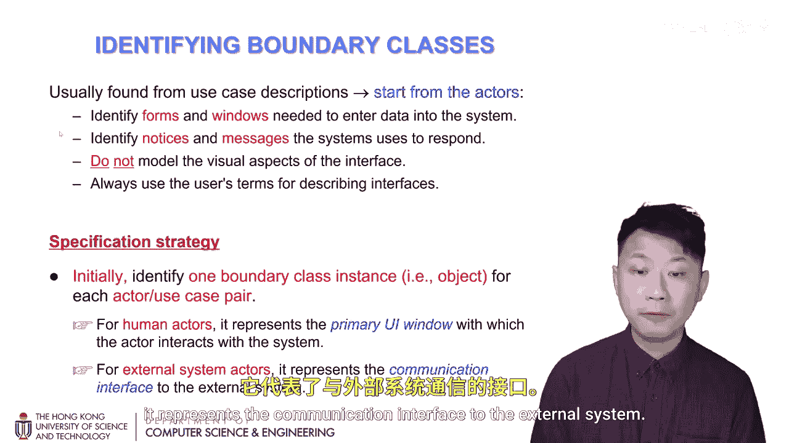

请注意，初始的边界对象之后可能会被聚合，或成为其他边界对象的聚合部分。例如，我们可能有 `SelectCourseToTeachUI`，它是 `ProfessorUI` 的一部分；还有 `RequestEnrollmentUI`，也是 `ProfessorUI` 的一部分。而在 `SelectCourseToTeachUI` 内部，可能还有更进一步的用户界面，例如 `CreateScheduleUI`、`ViewScheduleUI` 和 `ModifyScheduleUI`，它们是 `SelectCourseToTeachUI` 的一部分。

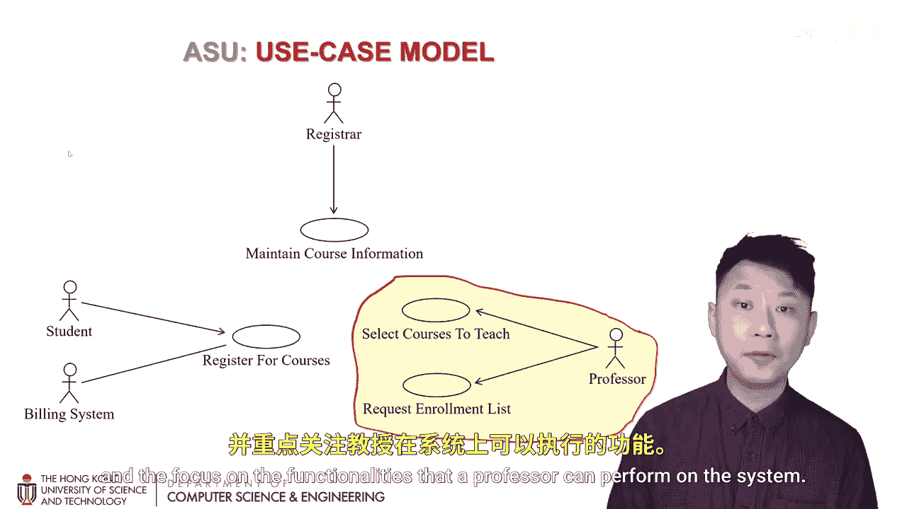

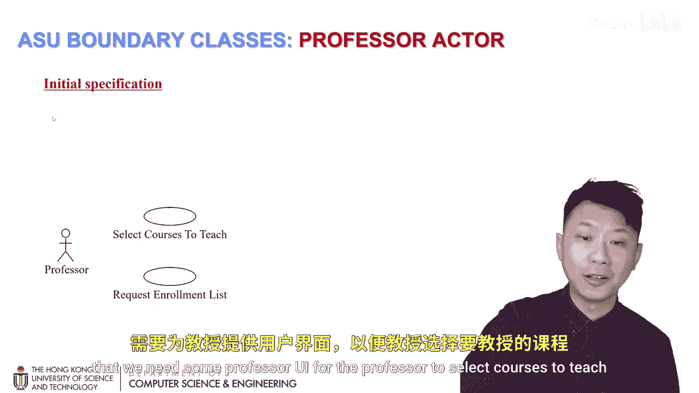

## 实体类

了解了边界类后，我们来看第二种分析类——实体类。

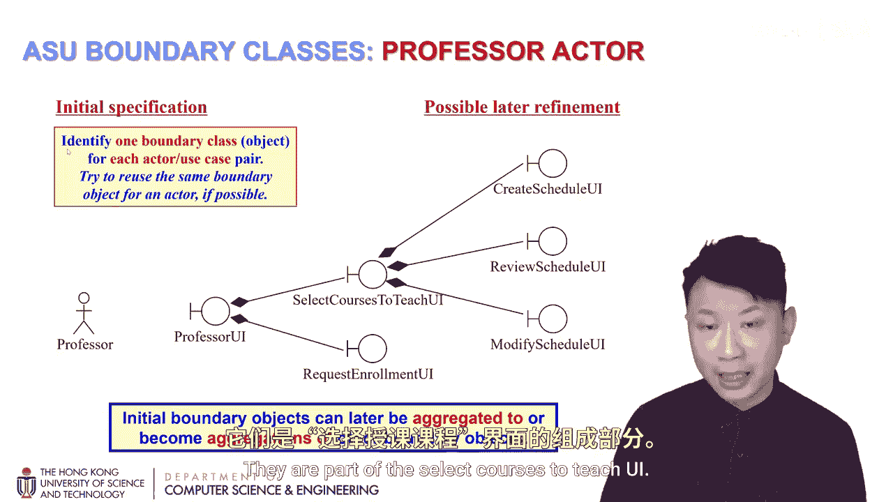

实体类用于**建模系统中长期存在且通常持久保存的信息**。我们关注在软件系统内持久存在的数据。从我们为软件系统构建的领域模型中识别实体类并不困难，我们再次聚焦于软件系统内持久存在的数据。

一个实体对象很可能从数据库获取数据。引入实体类是为了**封装和隔离其所代表信息的变更**。如果我们想修改系统中的某些信息，只需修改实体类。

以下是识别实体类的方法：
我们将检查用例的场景，并确定执行该用例需要哪些领域模型类。因此，我们必须回到领域模型，识别与特定用例场景相关的对象。

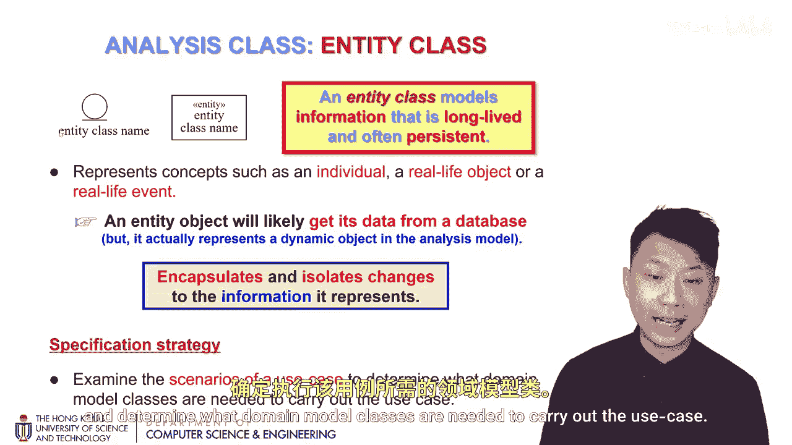

例如，对于“创建课表”场景，我们可以看到需要获取学期、年份、课程信息以及教学安排，这些都是持久保存在软件系统中的内容。因此，我们需要为“创建课表”场景准备三个实体类：`Course`、`CourseOffering` 和 `Professor`。在这个场景中，我们同样需要 `ProfessorUI` 这个边界类。

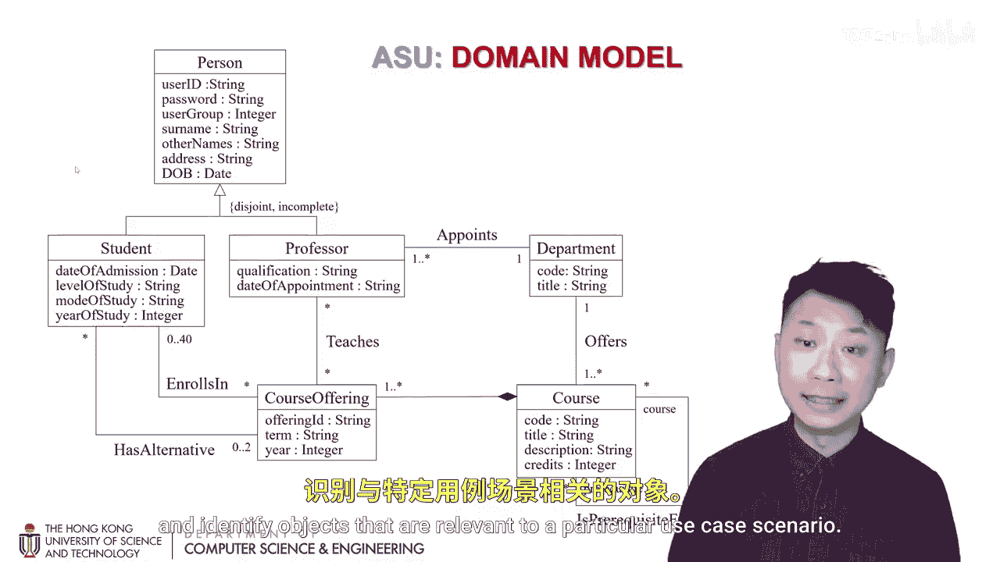

## 控制类

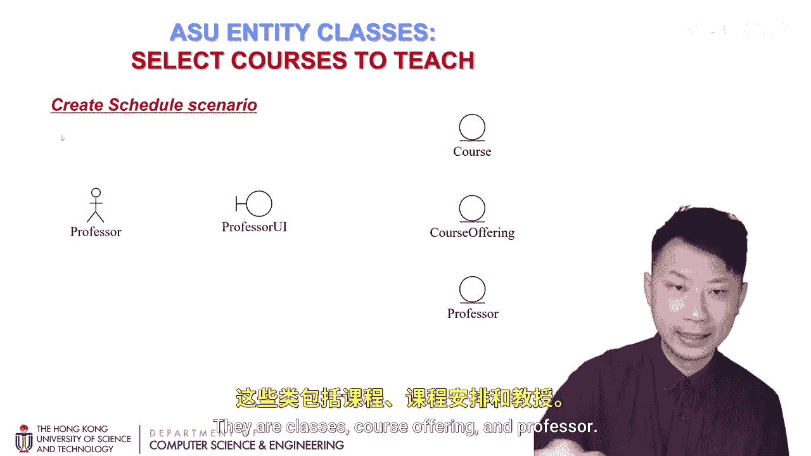

接下来，我们探讨最后一种分析类——控制类。

控制类用于**建模协调、排序、事务和控制行为**。这意味着控制类将控制软件系统的行为。请注意，控制类实例通常在应用领域中没有直接对应物。

控制对象提供了将其他类在一个用例实现中联系在一起的“粘合剂”。我们使用控制类在一个用例场景中将不同的类组织在一起。一个控制类实例用于表示与特定用例或业务逻辑相关的控制。通过使用控制类，我们可以**封装和隔离对控制或业务逻辑的变更**。这意味着，如果我们想改变程序行为的逻辑，只需修改控制类。

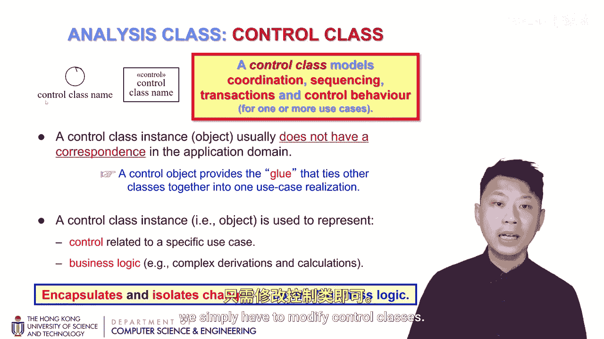

以下是识别控制类的方法：
最初，我们为每个“参与者-用例”对分配一个控制对象，该对象负责用例内部的事件流。如果一个用例内有复杂的行为，那么我们可能需要多个控制类。也有可能将多个控制对象组合在一起，或者消除一些不太重要的控制对象。

请注意，一个控制对象**最多只应与一个参与者关联**。这是因为系统需求的变更通常由参与者发起，并且通过将控制对象与至少一个参与者关联，我们可以将所需的变更隔离到仅该特定参与者所需的功能上。因此，为简化起见，我们将控制对象与最多一个参与者绑定。

现在，对于“选择要教授的课程”这个功能，我们可以看到需要 `ProfessorUI`，还需要一个 `SelectCourseToTeachManager` 来控制该用例内的行为，以及该特定用例所需的数据对象（实体类）。

## 连接分析对象

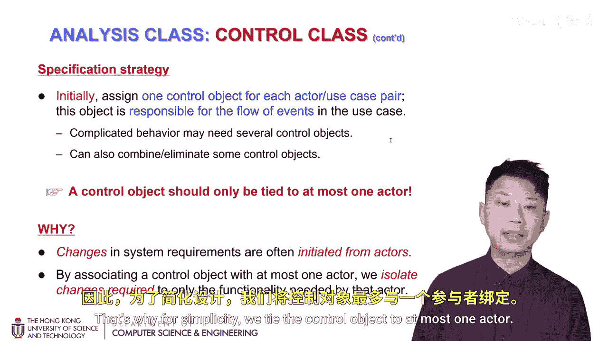

现在你可能会问，我们如何将边界、控制和实体对象连接在一起？以下是在一个用例内连接不同对象时可以使用的规则：

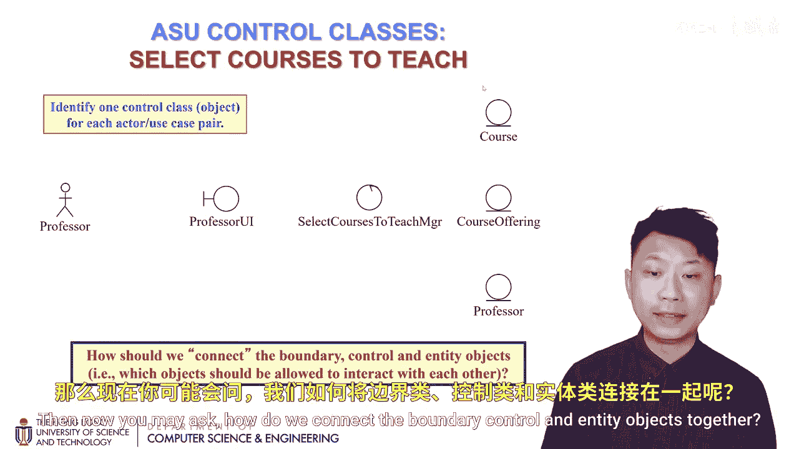

*   **参与者**只能与**边界对象**交互。
*   **边界对象**只能与**控制对象**交互。一个用户界面不可能直接与另一个用户界面交互；如果需要一个用户界面与另一个交互，必须通过控制对象完成。
*   **实体对象**只能与**控制对象**交互。例如，一个数据对象不能直接与另一个数据对象交互，必须通过控制器完成。
*   **控制对象**可以与**边界对象**、**实体对象**或**另一个控制对象**交互。

这些是我们可以用来连接分析对象的规则。现在你可以看到，教授将使用 `ProfessorUI`，而 `ProfessorUI` 连接到控制器 `SelectCourseToTeachManager`，以修改该用例内的数据。

## 为何进行三类划分

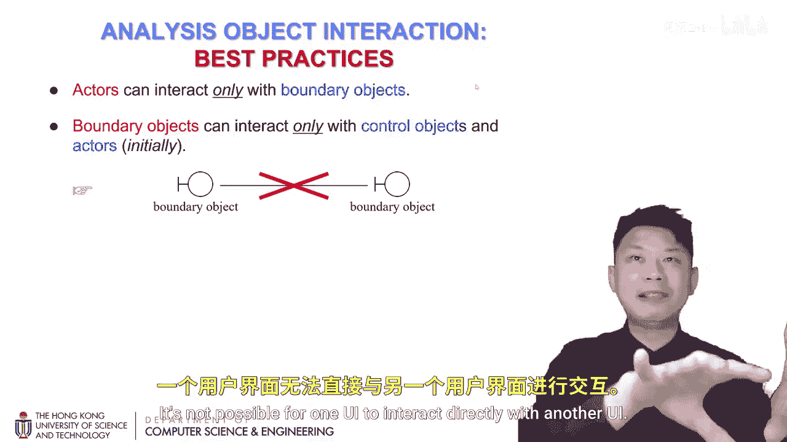

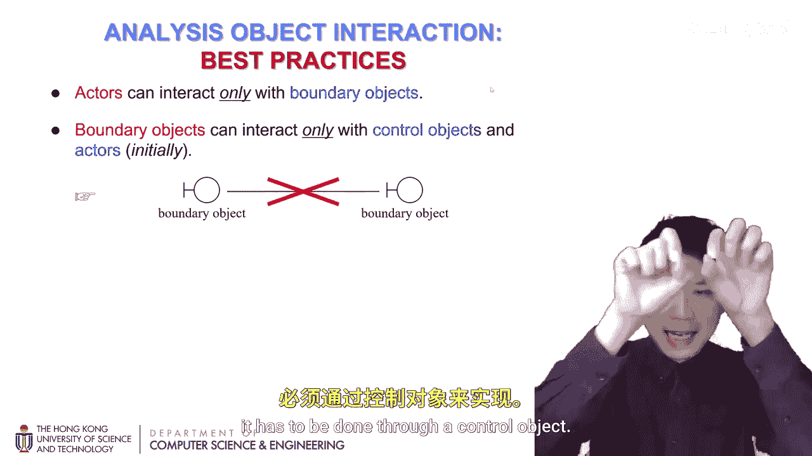

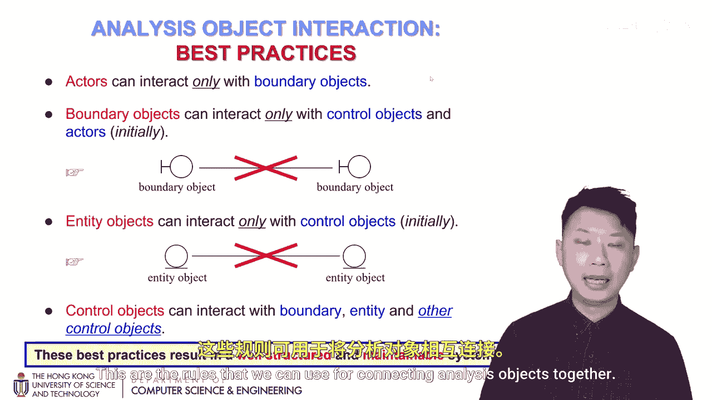

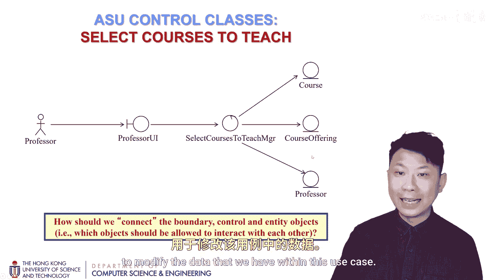

我们为什么要把一个用例划分为这三种类型的类呢？因为对于每个功能，我们都需要一些用户界面、一些控制器以及一些数据。这就是我们将用例划分为这三种类型的原因。

这样做的目标是**实现变更的局部化**，并尝试构建一个**稳定的系统**。因为，假设我们想修改用户界面，那么只需修改边界类，而无需触及其他两类；或者如果我们想修改某个功能的行为，也只需修改控制器，而无需再次触及其他两类。

但在现实中，我们可能需要对功能放置的位置做出许多判断。我们将在后续课程中讨论不同的设计模式，以帮助指导这些决策。

## 总结与关联

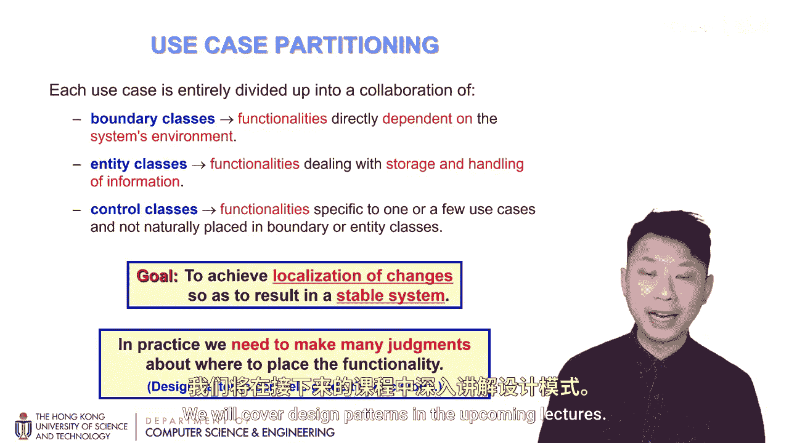

本节课中我们一起学习了用例分析中的三类分析类：边界类、实体类和控制类。

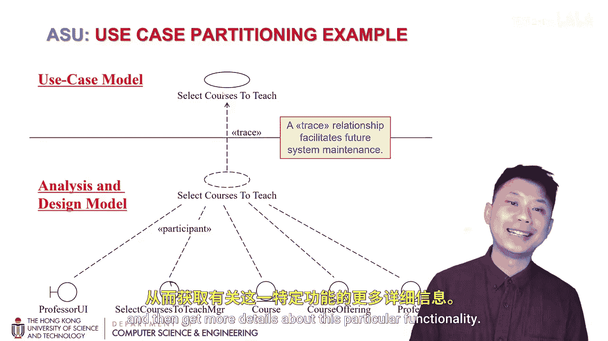

现在，对于“选择要教授的课程”这个用例，我们将拥有这些分析类。它们可以追溯回我们用例模型中的这个用例。这种追溯关系有助于未来的系统维护。例如，如果我们想修改或维护“选择要教授的课程”这个特定功能，我们总是可以追溯回我们的用例文档，然后获取有关该特定功能的更多细节。