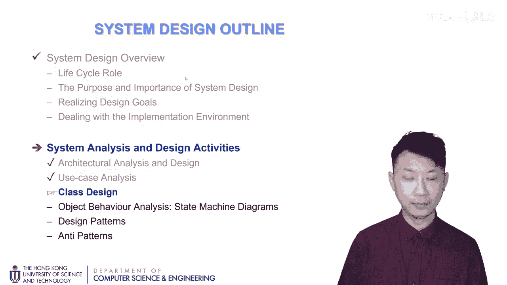
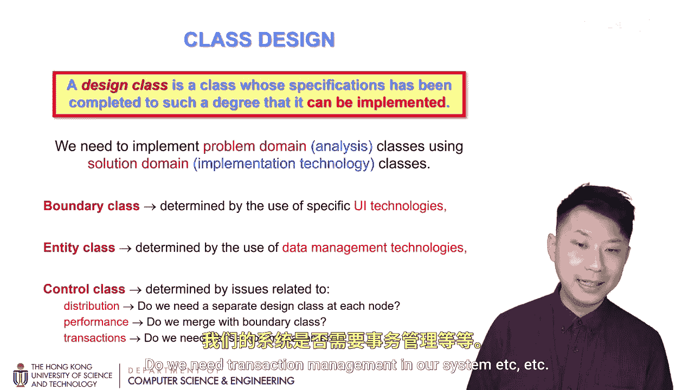
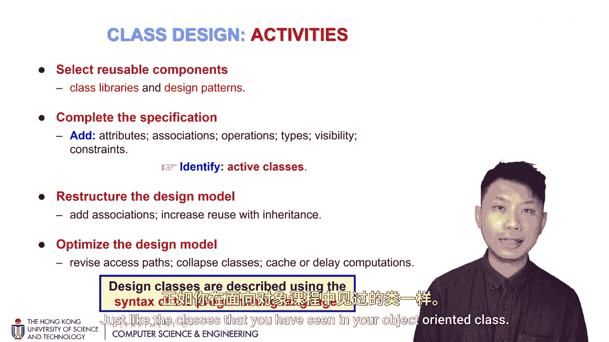
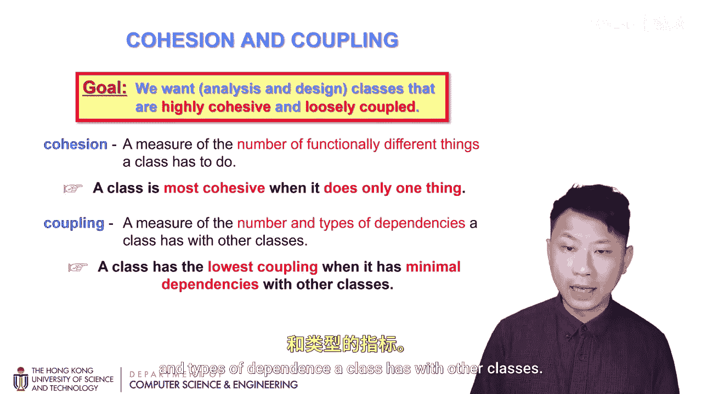
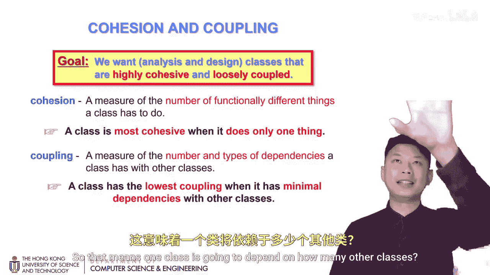
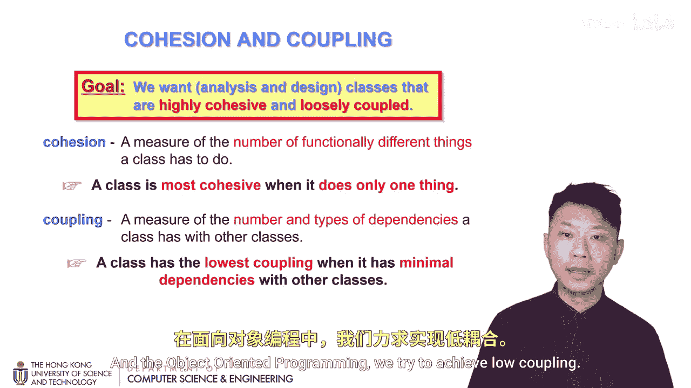
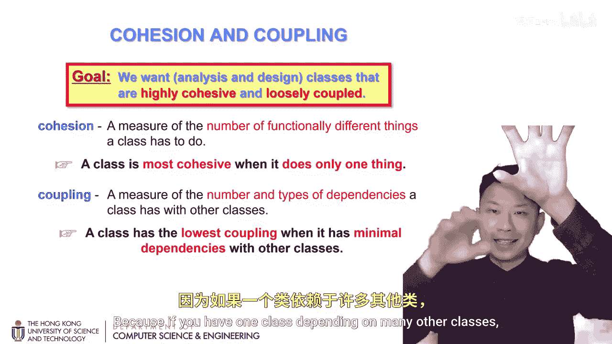

软件工程：04：类设计 🧱

在本节课中，我们将要学习软件设计中的一个核心环节——类设计。我们将探讨如何从分析模型过渡到具体的设计类，并理解如何构建高内聚、低耦合的类结构，这是构建健壮、可维护软件系统的关键。

上一节我们讨论了从分析到设计的过渡，本节中我们来看看如何具体地进行类设计。

在类设计中，我们需要为最终的实现确定所有要使用的类。这包括使用解决方案域中的类来实现问题域中的类。具体来说，我们需要处理三种主要类型的设计类：
*   **边界类**：与用户界面技术相关。
*   **实体类**：负责数据管理技术。
*   **控制类**：控制软件系统的行为。

当我们尝试确定控制类时，可能需要处理与**分布**、**性能**或**事务**相关的问题。例如，是否需要在每个节点都有一个独立的设计类？为了提升性能，是否需要将控制类与边界类合并？我们的系统是否需要事务管理？

---

确定了用于实现的基本类之后，我们还需要进行一系列细化工作。

首先，需要选择可复用的组件，例如判断是否有现成的库或设计模式可供复用。其次，必须完成每个类的详细规格说明。以下是需要为每个类补充的详细信息：
*   属性
*   关联关系
*   操作（方法）
*   类型
*   可见性（如public, private）
*   尽可能添加的约束条件

此外，还需要识别**主动类**。主动类的定义是**拥有自身控制线程的类**，它们通常是控制类或边界类。

接下来，需要**重构设计模型**，例如调整关联关系，或通过继承来提高代码复用性。同时，也要**优化设计模型**。例如，当类图中存在循环依赖时，可能需要重新审视设计；或者将多个类合并为一个类；亦或是缓存或延迟某些计算。

请注意，这些设计类是使用**编程语言的语法**来描述的，就像你在面向对象编程课程中看到的类一样。

---

当我们构建出所有类之后，还必须确保这些类具有**高内聚**和**低耦合**的特性。

那么，什么是内聚和耦合呢？**内聚**衡量的是一个类需要处理多少件功能上不同的事情。当一个类**只做一件事**时，它的内聚性最高。这意味着每个类应该只负责一个单一的职责，而不应将多个类的功能合并成一个庞大的“上帝类”。**上帝类**负责系统内的许多事情，是我们在软件系统中应该避免的，因为它难以维护和更新。

**耦合**衡量的是一个类与其他类之间依赖关系的数量和类型。也就是说，一个类依赖于多少个其他类。当一个类与其他类的依赖关系**最小化**时，它的耦合度最低。在面向对象编程中，我们追求低耦合，因为如果一个类依赖于许多其他类，那么这个类将变得难以维护和更新。因此，我们希望类之间的依赖尽可能少。

---

本节课中我们一起学习了类设计的基本流程与核心原则。我们了解了如何从分析模型导出边界类、实体类和控制类，并学习了如何通过补充属性、操作等细节来完成类的规格说明。更重要的是，我们掌握了构建优秀类设计的两个关键指标：**高内聚**（一个类只做一件事）和**低耦合**（最小化类间依赖）。遵循这些原则，有助于我们创建出更清晰、更易维护的软件系统。