# 046：状态机图示例 🚀

在本节课中，我们将学习如何为一个具体的类绘制状态机图。我们将通过分析一个大学课程注册系统中的“课程班次”类，来实践状态机图的构建方法，并探讨复合状态机图的概念。

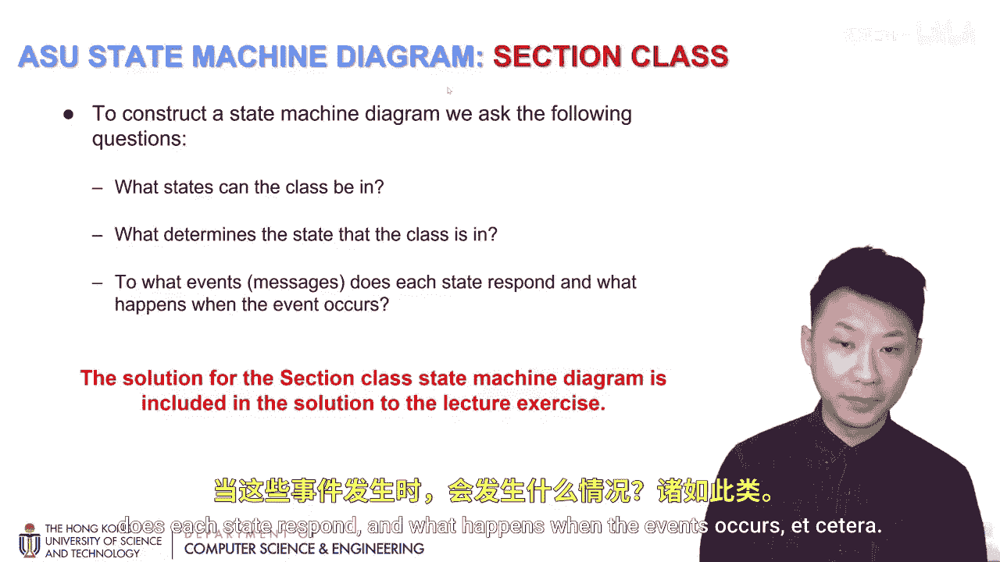

上一节我们介绍了绘制状态机图所需的所有基本组件。本节中，我们来看看如何应用这些知识解决一个实际问题。

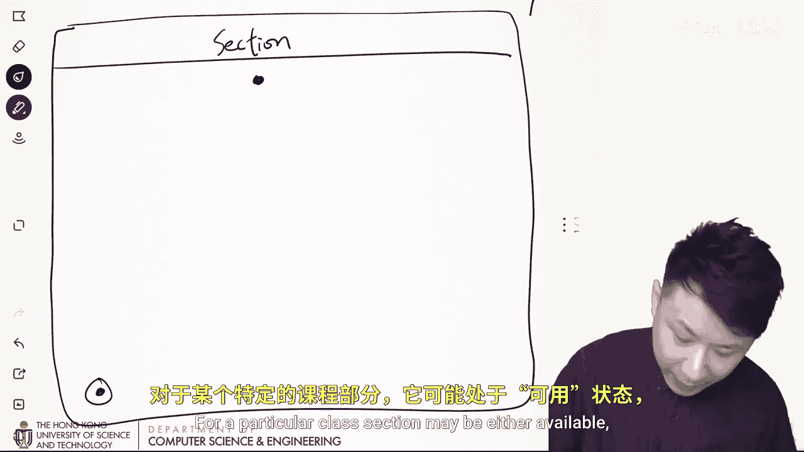

## 构建状态机图的步骤

要为一个类构建状态机图，你需要问自己以下几个问题：
*   这个类可能处于哪些状态？
*   是什么决定了类所处的状态？
*   每个状态会对哪些事件做出响应？
*   当事件发生时，会发生什么？

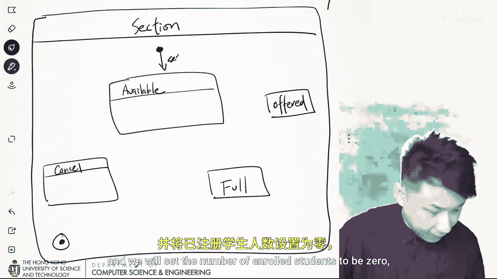

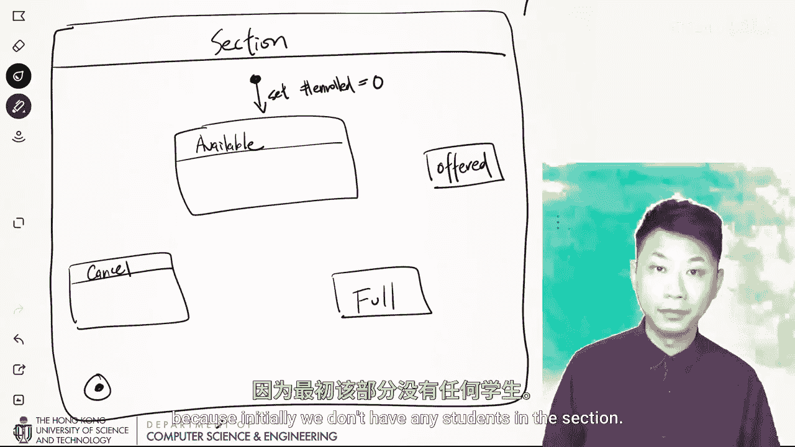

以下是针对“课程班次”类构建状态机图的具体过程。

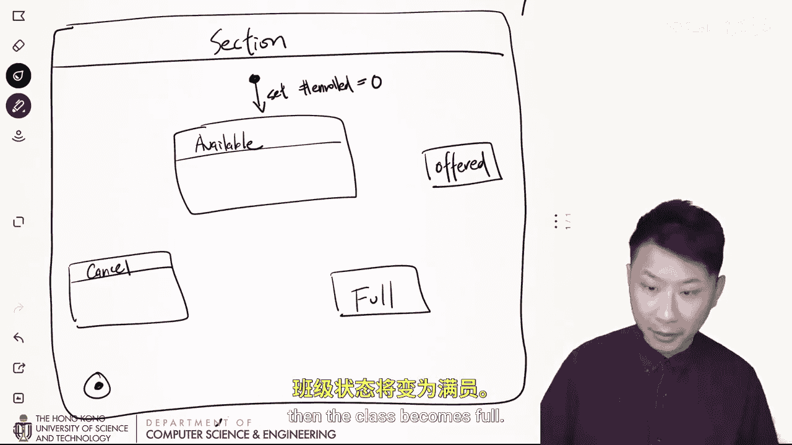

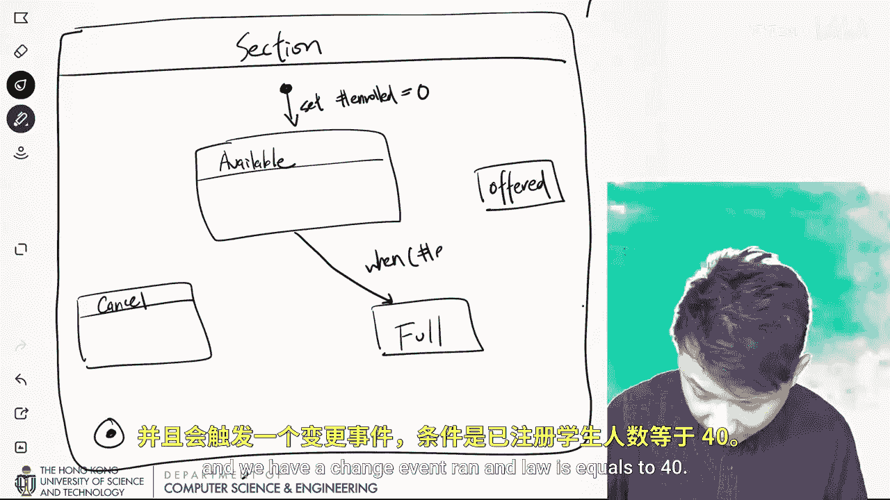

## 确定状态与初始设置

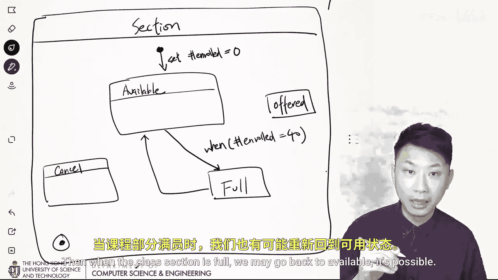

首先，我们需要为这个状态机图确定一个初始状态和一个最终状态。接着，思考“课程班次”类可能具有的状态。

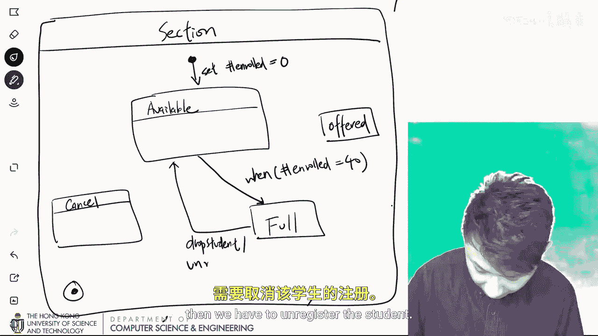

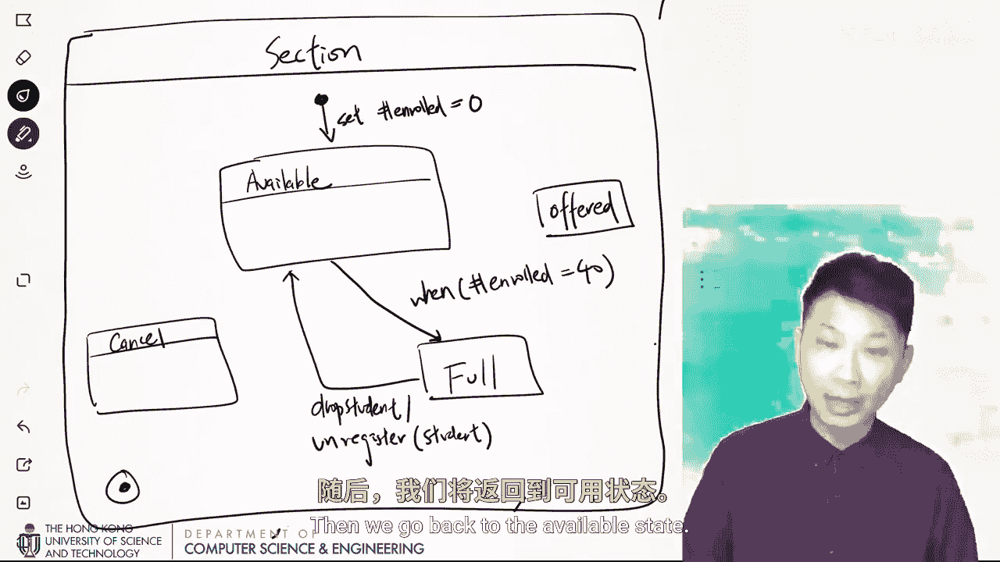

对于一个特定的课程班次，它可能处于以下几种状态：
*   **可用**：此时班次尚有名额。
*   **已满**：此时班次已无空余座位。
*   **已开课**：在注册期结束后，如果学生人数足够，课程将开课。
*   **已取消**：如果注册期结束后学生人数不足，课程将被取消。

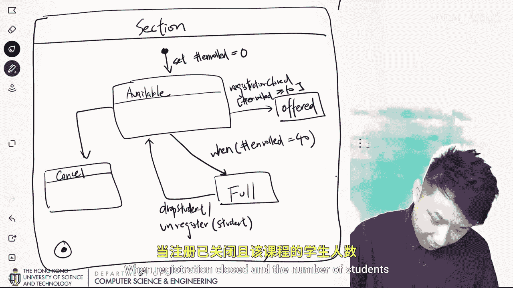

当我们创建一个班次时，会从初始状态进入“可用”状态，并需要将注册学生数初始化为0，因为最初班次里没有任何学生。

## 定义状态转移

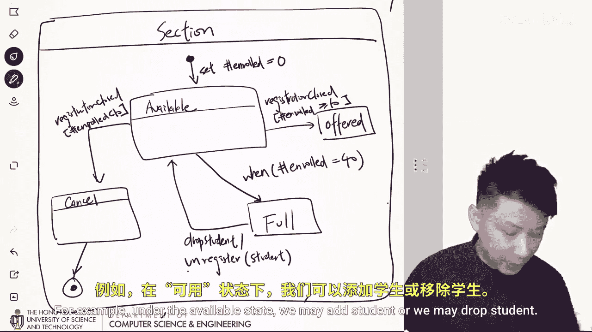

根据问题描述，当班次中有40名学生时，班次状态将变为“已满”。因此，我们可以从“可用”状态转移到“已满”状态。这个转移由一个变更事件触发，条件是 `enrolled == 40`。

当课程班次已满时，也可能因为学生退课而回到“可用”状态。这发生在调用 `dropStudent()` 操作时，该操作会注销学生。

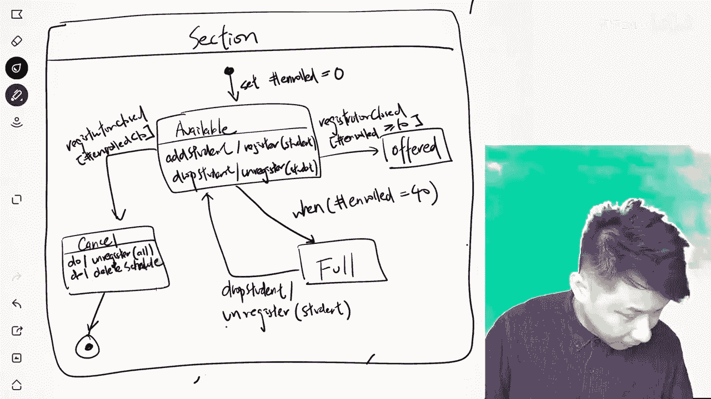

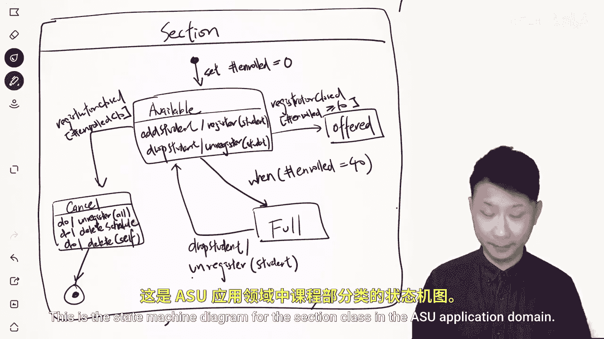

当课程处于“可用”状态时，如果注册期结束且班内学生数大于等于10，课程将进入“已开课”状态。反之，如果注册期结束且学生数小于10，课程将进入“已取消”状态。最后，在取消班次后，需要销毁该班次对象，进入最终状态。

## 丰富状态内的行为

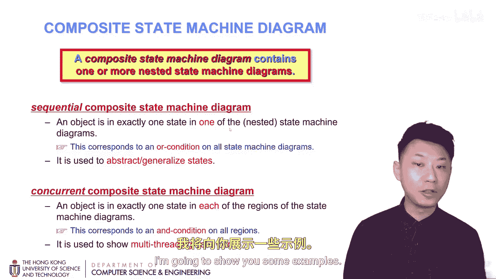

如果我们确切知道类中包含哪些操作，就可以在状态机图的状态内部添加更多信息。

例如，在“可用”状态下，我们可以执行 `addStudent()` 或 `dropStudent()` 操作。添加学生时需要注册该学生，退课则需要注销该学生。

同样，在“已取消”状态下，需要执行一系列操作：
*   注销所有学生。
*   删除课程安排。
*   删除班次本身。

## 复合状态机图

状态机图还可以是复合的，即一个状态机图嵌套在另一个状态机图中。这分为两种类型：顺序复合状态机图和并发复合状态机图。

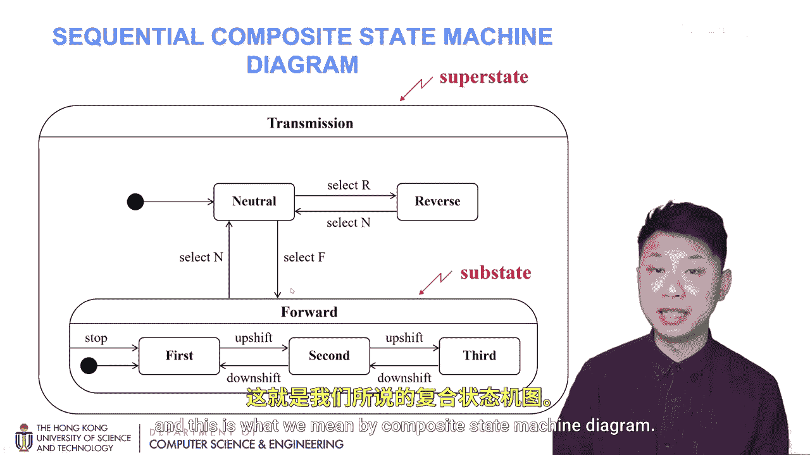

### 顺序复合状态机图

在顺序复合状态机图中，一个对象在嵌套的多个状态机图中，同一时间只处于其中一个状态。图标表示这是一个复合状态，其内部包含另一个状态机图。外部的状态称为超状态，内部的状态称为子状态。

转移可以从超状态边界进入复合状态机图的初始子状态，也可以从某个子状态直接退出复合状态机图，进入超状态中的另一个状态。

例如，在一个表示“前进”的超状态中，可能包含“一档”、“二档”、“三档”等子状态。无论当前处于哪个档位，当触发“停车”事件时，都会从复合状态的边界转移回“一档”。这让我们能够用状态机图捕捉更复杂的行为。

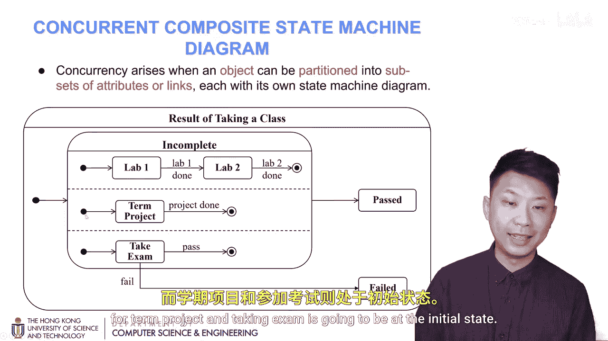

### 并发复合状态机图

在并发复合状态机图中，一个对象在状态机图的每个并发区域中同时各处于一个状态。图标同样表示这是一个复合状态。

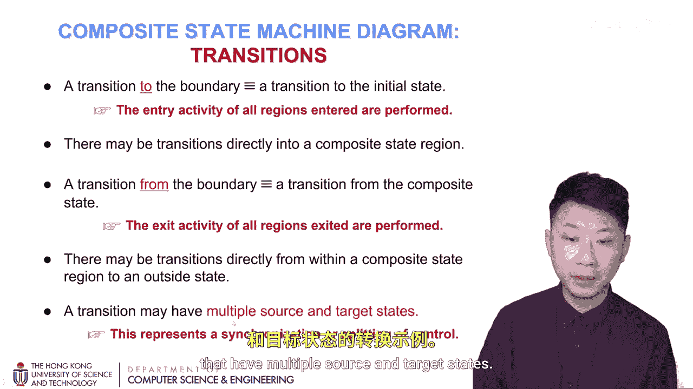

例如，在一个表示“课程未完成”的状态中，学生可能需要同时完成多项任务才能进入“通过”状态：完成所有实验、完成学期项目、并通过考试。状态机图内部分为不同的区域来分别表示这些并发任务。

### 同步与分叉

转移可以有多个源状态或目标状态，这代表了控制流的分叉或同步。在图中通常用一条粗横线（同步条）来表示。

*   **分叉**：一个转移指向同步条，同步条再指向多个目标状态（如A1和B1）。这表示控制流将**同时**进入A1和B1状态。
*   **汇合**：多个源状态（如A2和B2）的转移指向同一个同步条，再汇合成一个转移。这表示必须**同时**等待A2和B2状态都完成后，才能进行下一步（如进入“清理”状态）。

如果没有同步条，状态机图是确定性的，意味着在某一时刻只会选择多条路径中的一条，而不会同时执行。同步机制使得同时进入多个并发区域成为可能。

## 何时使用状态机图

你可能会问，是否需要为软件系统中的每个类都绘制状态机图？答案是否定的。一个软件系统包含大量类，为每个类绘制状态机图将耗费大量时间。

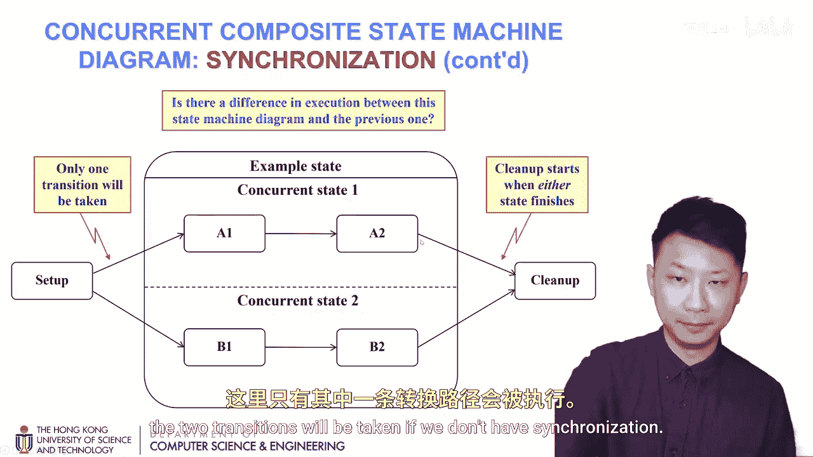

因此，没有必要为程序中的每个类都制作状态机图。我们通常只为那些具有**显著动态行为**的类绘制状态机图。如果对象的行为比较复杂，绘制状态机图有助于澄清其行为逻辑。

---

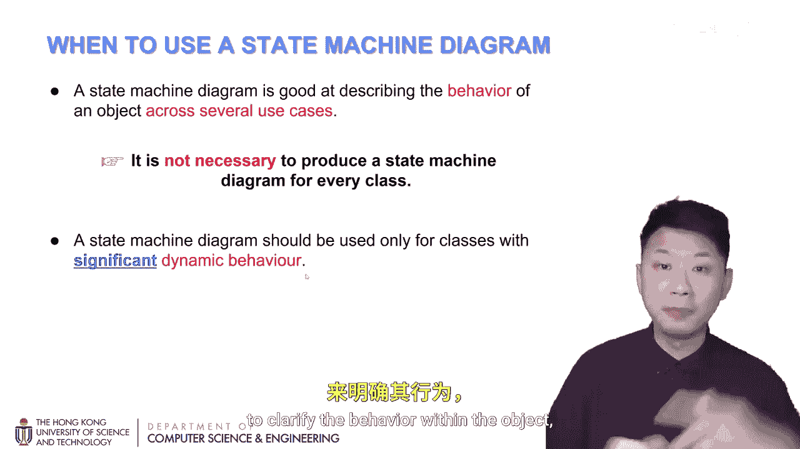

本节课中我们一起学习了如何为一个具体的类构建详细的状态机图。我们通过“课程班次”的例子，实践了从识别状态、定义转移，到丰富状态内部行为的全过程。此外，我们还探讨了顺序复合与并发复合状态机图的概念，以及如何使用同步条来表示控制流的分叉与汇合。最后，我们明确了状态机图的应用场景，即主要用于描述具有复杂动态行为的类。