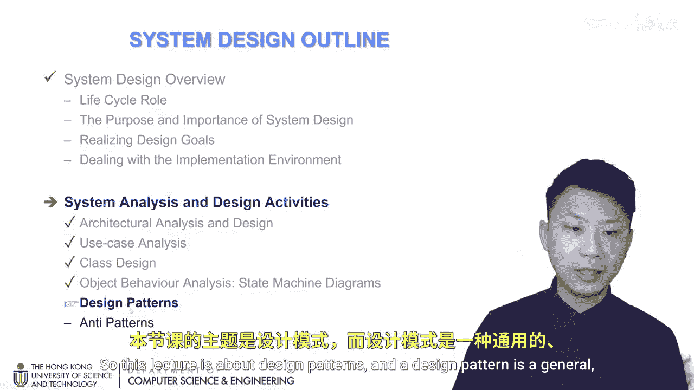
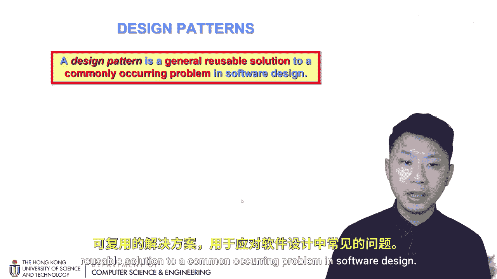
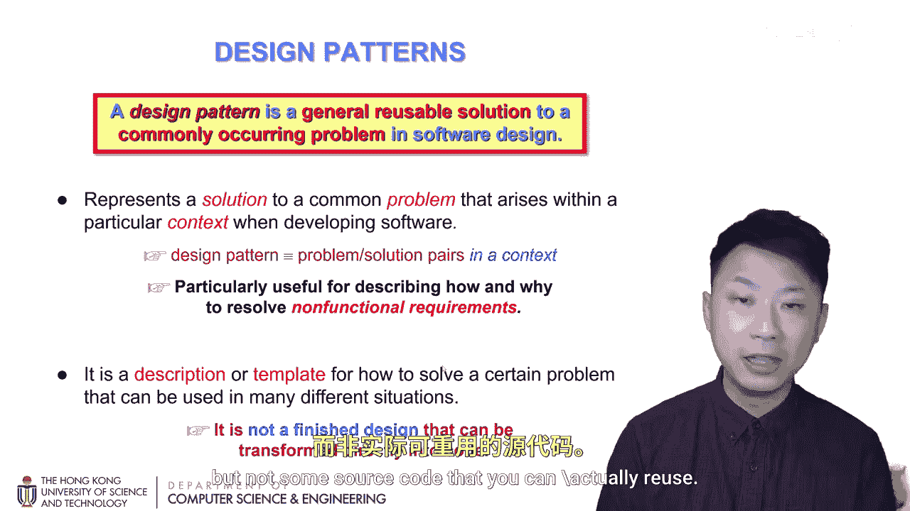
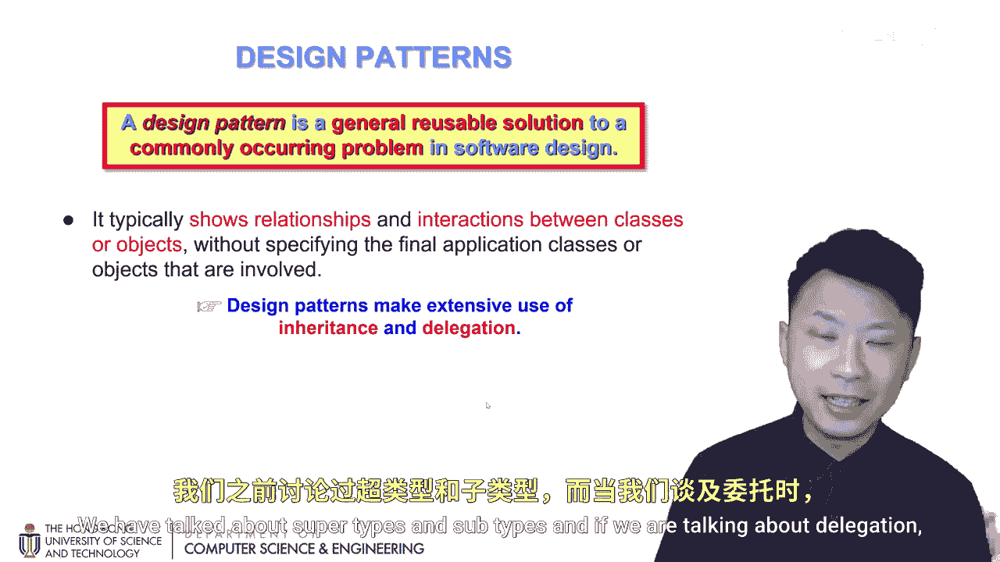
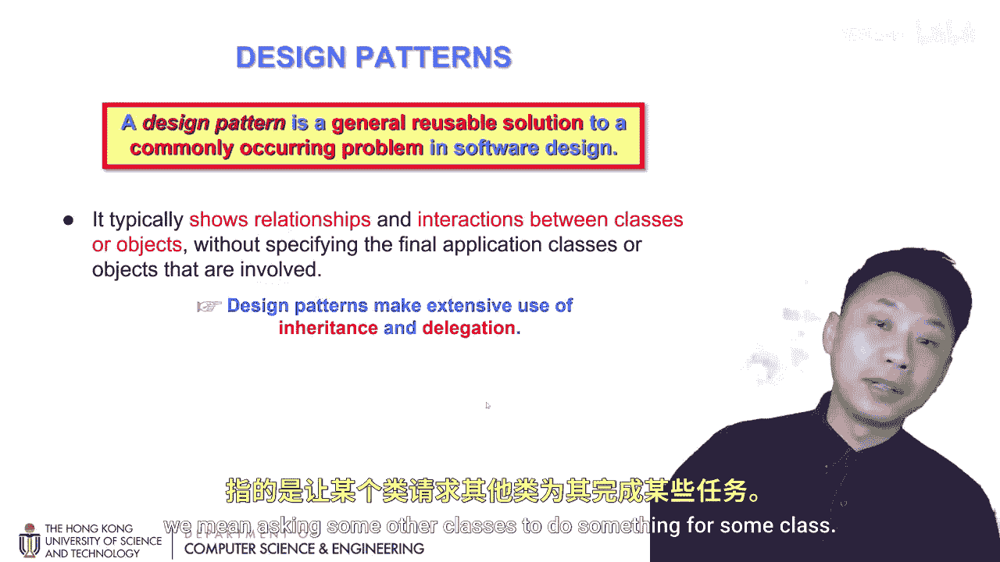
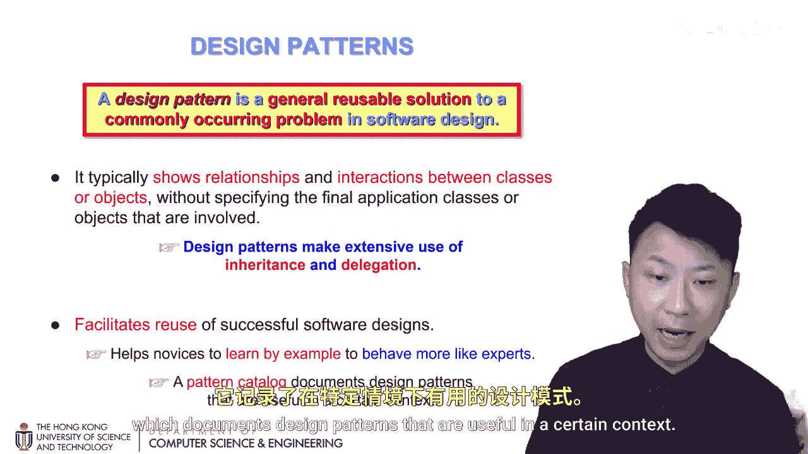
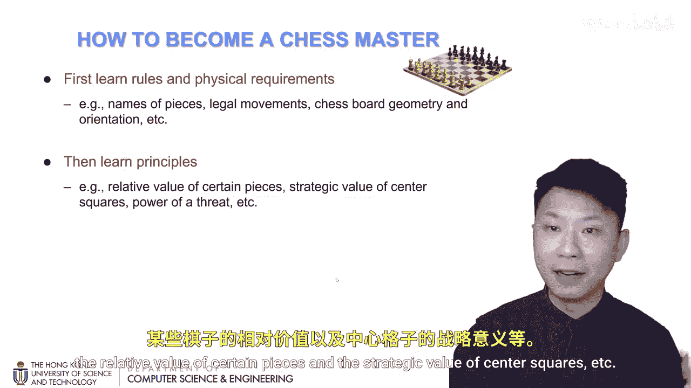
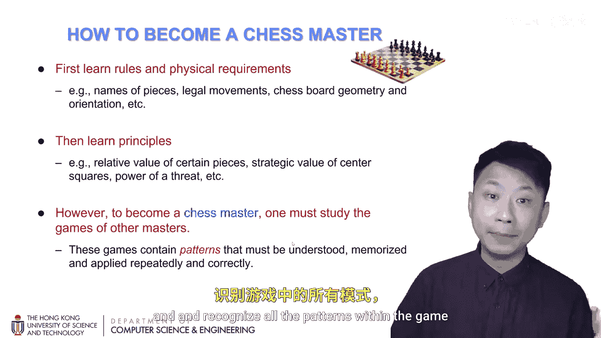
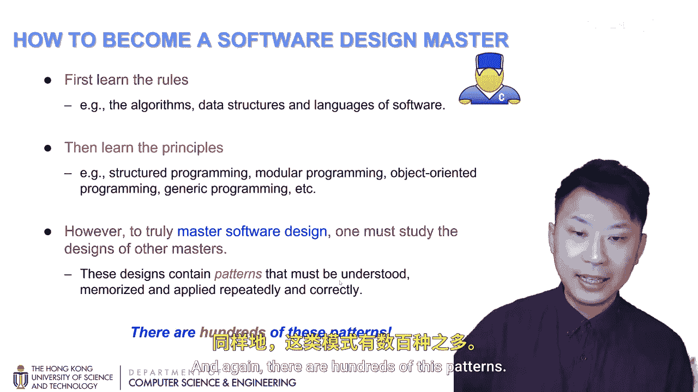

**软件工程：P47：设计模式入门 🧩**

在本节课中，我们将要学习**设计模式**。设计模式是软件工程中用于解决常见问题的可复用方案。理解设计模式能帮助我们构建更健壮、更易维护的软件系统。

---

### **什么是设计模式？**

上一节我们明确了本节课的主题。本节中，我们来看看设计模式的具体定义。

一个**设计模式**是针对软件设计中反复出现的问题的、通用的、可复用的解决方案。

它代表了在特定上下文环境下开发软件系统时，对某一常见问题的解决方案。当我们谈论设计模式时，我们谈论的是**特定上下文中的问题与解决方案对**。

设计模式对于描述**如何以及为何解决非功能性需求**特别有用。这意味着我们可以利用设计模式来应对一些非功能性需求，例如可扩展性、可维护性等。

但请注意，设计模式仅仅是一个**描述**或**模板**，它指导你如何解决一个能在多种情境下出现的问题，但它**不是一个可以直接转换成源代码的完整设计**。也就是说，你可以遵循这个模板来解决问题，但不能直接复用其代码。

---

### **如何描述设计模式？**

了解了设计模式的定义后，我们来看看如何描述一个设计模式。

当我们描述一个设计模式时，通常描述的是**类与对象之间的关系和交互**，而不会指定最终涉及的具体应用类或对象。我们通常使用**类图**来描述一个设计模式。

设计模式广泛使用了**继承**和**委托**。继承涉及超类型和子类型的关系。委托则是指让其他类为某个类完成特定任务。

---

### **为何要学习设计模式？**

既然设计模式不是现成的代码，我们为何要学习它呢？本节将探讨学习设计模式的价值。

如果我们能够复用一些成功的软件设计，这将有助于新程序员**通过实例学习**，并表现得更加像专家。有一个著名的**模式目录**，它记录了在特定上下文中非常有用的设计模式。

---

### **类比：如何成为国际象棋大师？**

为了更好地理解学习设计模式的过程，我们可以将其与成为国际象棋大师的过程进行类比。

要成为国际象棋大师：
1.  **学习基本规则和物理要求**：例如，棋子的名称、合法走法等。
2.  **学习原则**：例如，特定棋子的相对价值、中心格子的战略价值等。
3.  **研究大师的对局**：必须研究其他大师的棋局。这就像玩电子游戏，要成为专家，你必须研究其他高手是如何玩的。这些对局中包含必须被理解、记忆并反复正确应用的**模式**。

---

### **如何成为软件设计大师？**

将上述类比应用到软件设计领域，我们可以勾勒出成为软件设计大师的路径。

要成为软件设计大师：
1.  **学习基本规则**：例如，算法、数据结构、编程语言等。
2.  **学习原则**：例如，结构化编程、模块化编程、面向对象编程等。
3.  **研究大师的设计**：必须研究其他专家、大师的设计方案。同样，这其中存在着成百上千个可供学习的**模式**。

---

### **总结**

本节课中，我们一起学习了设计模式的核心概念。我们了解到设计模式是解决软件设计中常见问题的可复用模板，它通过描述类与对象的关系来提供解决方案，而非提供具体代码。学习设计模式，如同学习象棋或任何复杂技能，需要从基础规则、核心原则入手，并最终通过研究和复用大师们总结出的成功模式来提升自己的设计能力。掌握设计模式是迈向软件设计专家的重要一步。