# 048：策略模式 🦆

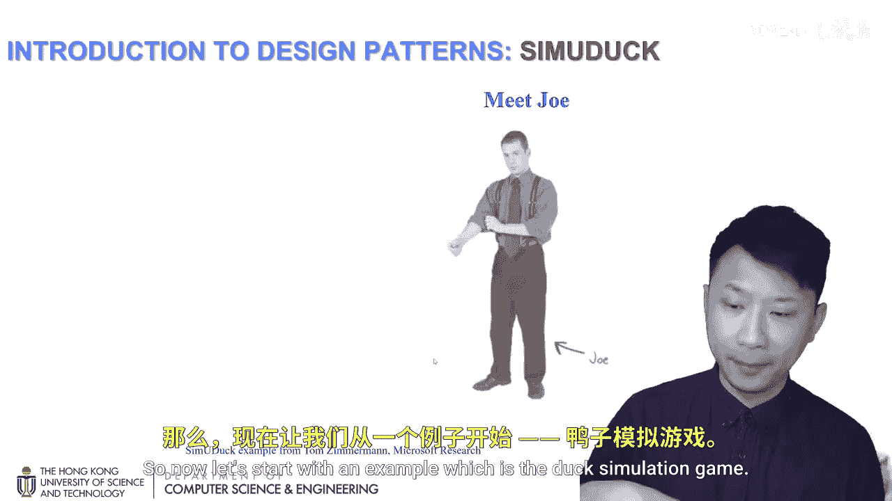

在本节课中，我们将通过一个鸭子模拟游戏的例子，学习一种重要的设计模式——策略模式。我们将探讨如何通过分离变化的部分来设计更灵活、更易维护的系统。

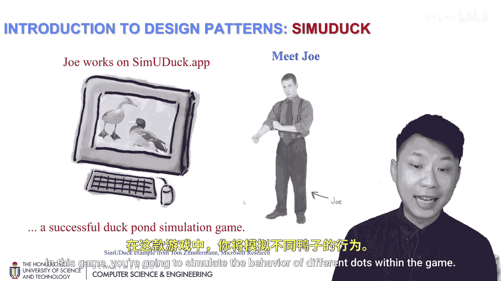

---

## 游戏示例：鸭子模拟

现在，让我们从一个例子开始，这个例子是鸭子模拟游戏。

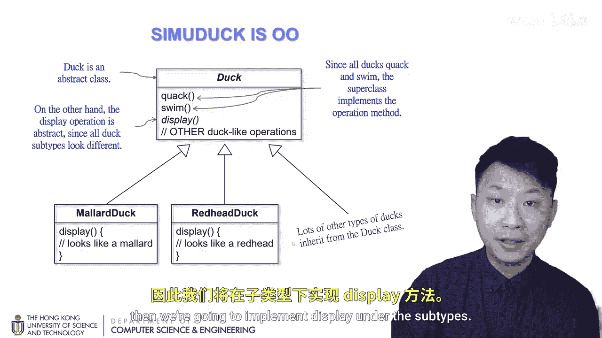

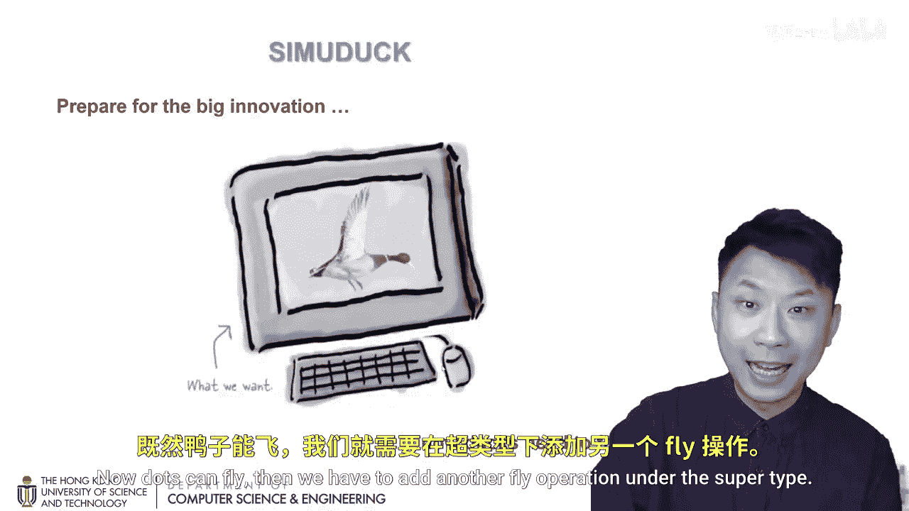

在这个游戏中，你需要模拟不同鸭子的行为。

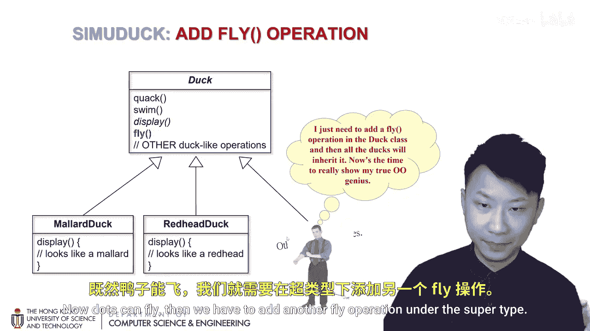

在游戏内部，我们打算使用继承，因为我们有鸭子类，并且游戏中有不同类型的鸭子。例如，绿头鸭和红头鸭。

鸭子是一个抽象类。所有鸭子都能叫和游泳，因此我们将在超类中实现这些操作。

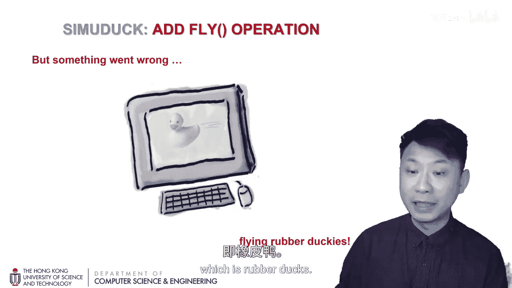

因为每种鸭子看起来都不同，所以我们将在子类中实现 `display` 方法。

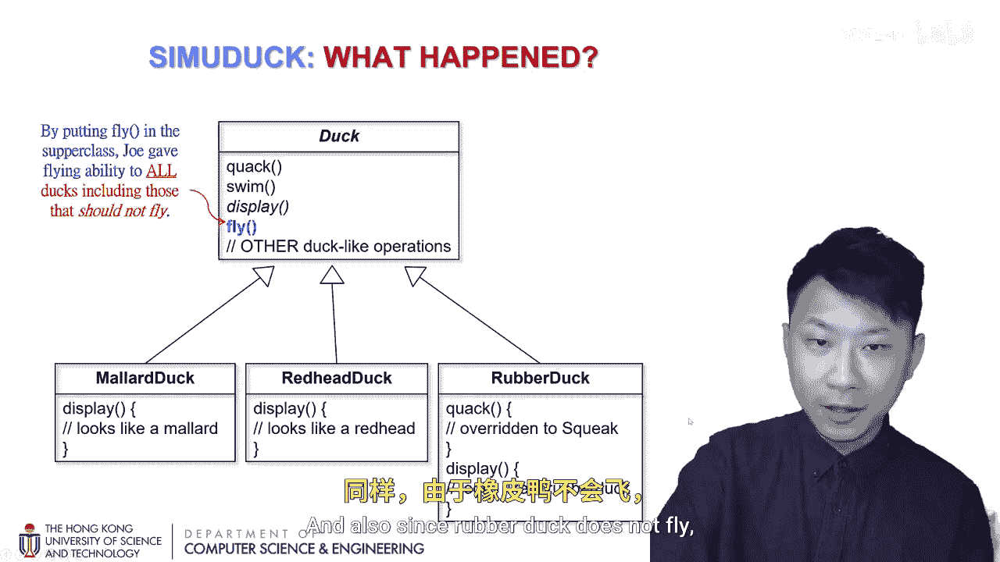

现在，我们为一次重大创新做准备：鸭子可以飞了。

于是，我们必须在超类中添加另一个 `fly` 操作。

然后，我们将在超类中实现这个 `fly` 操作。但随后出现了问题，因为后来我们需要添加另一种鸭子类型：橡皮鸭。

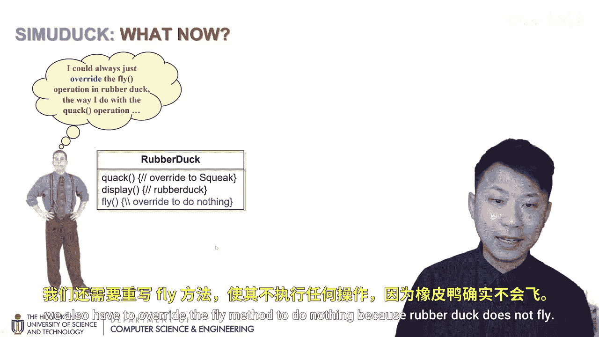

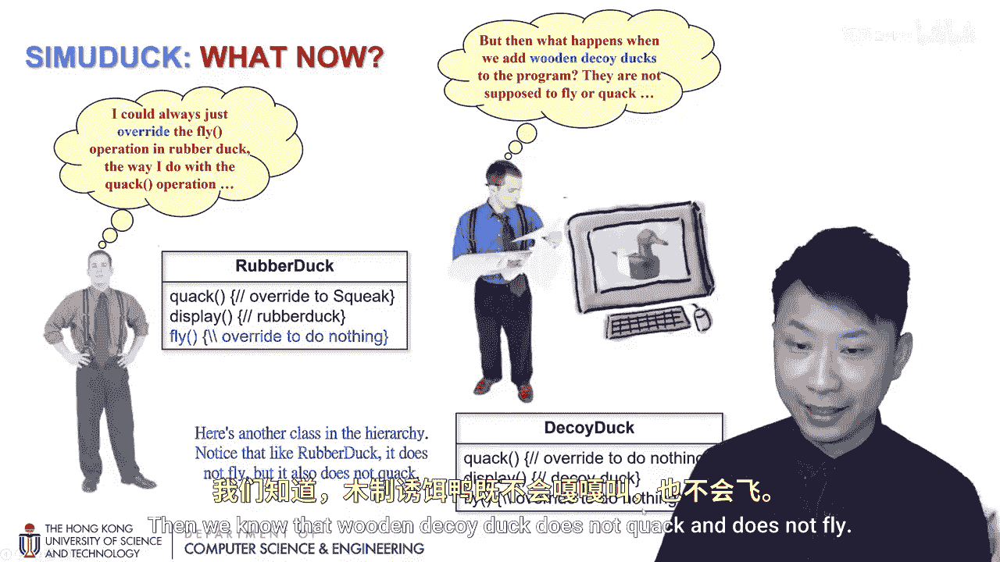

我们知道橡皮鸭不能飞。如果我们在超类中实现 `fly` 操作，它将被所有子类使用。

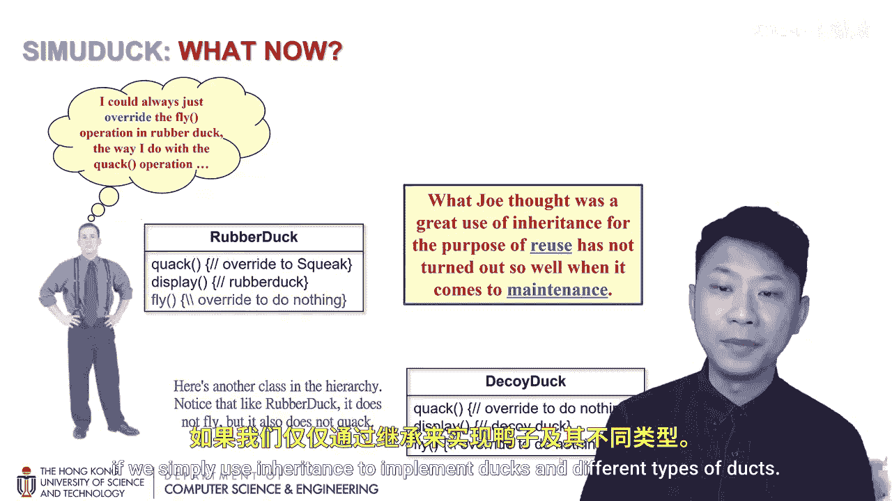

但现在，由于橡皮鸭不会呱呱叫，我们必须重写 `quack` 操作，使其发出吱吱声而不是呱呱叫。同时，因为橡皮鸭不能飞。

我们还必须重写 `fly` 方法，使其什么都不做，因为橡皮鸭不能飞。

但后来，我们计划再包含另一种鸭子类型：木头诱饵鸭。我们知道木头诱饵鸭不会叫也不会飞。

所以我们必须重写 `quack` 和 `fly` 方法，让它们什么都不做。最初，Joe 认为为了复用的目的使用继承会很棒，但最终结果并不理想，因为我们有不同类型的鸭子，它们有不同的行为，如果仅仅使用继承来实现鸭子和不同类型的鸭子，系统会变得难以维护。

---

## 继承的缺点

现在，思考一下使用继承来提供行为的缺点。

以下是可能的缺点列表：

*   **代码在子类间重复**：不，因为我们只需要在超类中定义一次（例如 `fly`），它就会被所有子类使用，所以我们不必在子类间重复代码。
*   **运行时行为改变困难**：是的，因为在游戏过程中，如果我们想改变行为（例如让橡皮鸭呱呱叫而不是吱吱叫），会很困难，因为我们在子类中硬编码了行为。
*   **我们可以让鸭子跳舞**：这是真的。我们可以在超类中包含另一个名为 `dance` 的操作。
*   **如何了解所有鸭子的行为**：是的，因为在我们的例子中，为了知道橡皮鸭不能呱呱叫（而是吱吱叫）以及橡皮鸭不能飞，我们必须实际进入子类查看源代码，并仔细检查那些被我们在子类中定义的操作所覆盖的方法，因此很难了解所有鸭子的行为。
*   **鸭子不能同时飞和叫**：鸭子可以同时飞和叫。我们可以简单地同时调用这两个操作。
*   **更改可能无意中影响其他鸭子**：是的，因为如果你在超类中更改某些内容，它会影响所有子类。

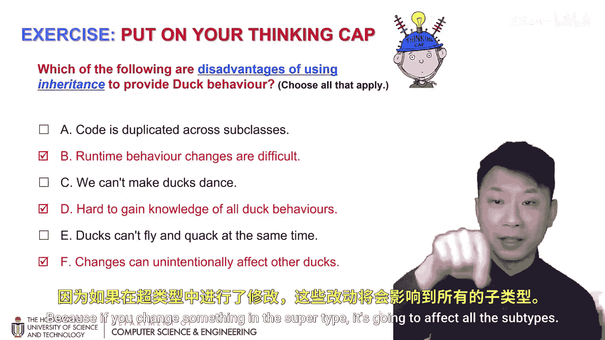

---

## 接口的局限性

如果我们使用接口来实现鸭子的行为会怎样？

我们有一个名为 `Flyable` 的接口，还有一个名为 `Quackable` 的接口，它们有抽象操作 `fly` 和 `quack`。这意味着我们将在实际实现类中实现这些操作。

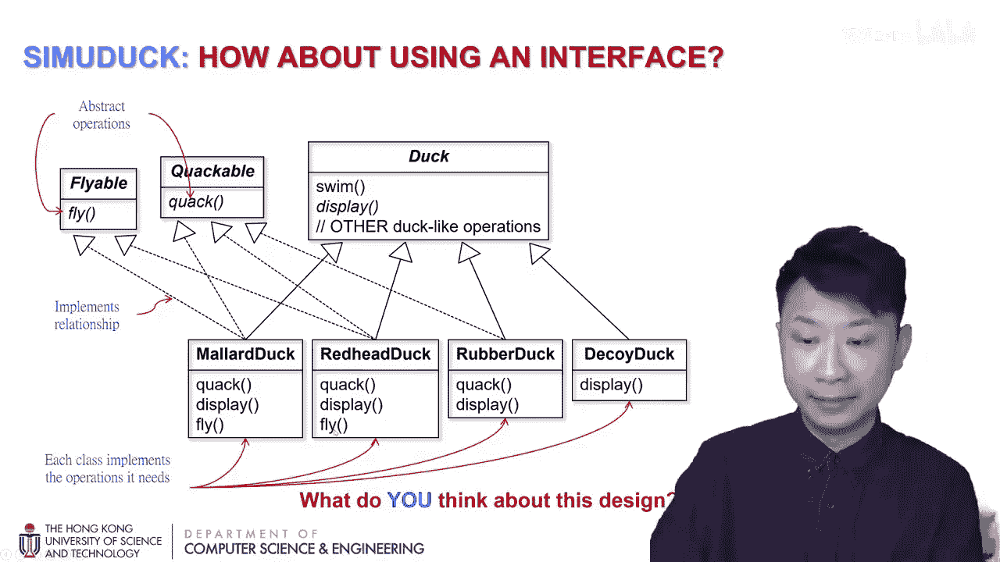

这是一个好的设计吗？不是，因为绿头鸭和红头鸭的 `fly` 操作完全相同。这意味着我们将在 `MallardDuck` 和 `RedheadDuck` 的实现中有重复的代码。所以这不是一个好主意。

原因是我们将会有重复的代码。

---

## 设计原则：分离变化的部分

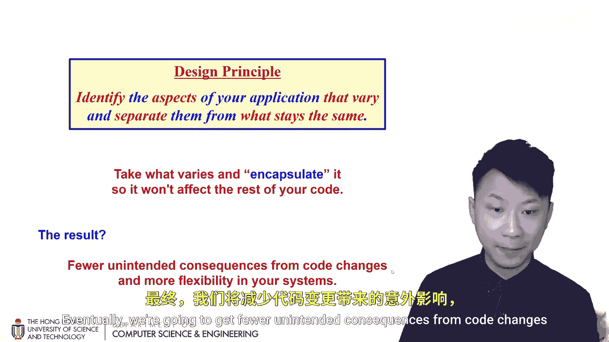

那么，如何想出一个更好的设计呢？我们将利用一个设计原则：**识别出应用中变化的部分，并将它们与保持不变的部分分离**。

我们要做的是，将变化的部分封装起来，这样它就不会影响代码的其余部分。如果我们利用这个设计原则，最终会达到什么效果？最终，代码更改带来的意外后果会更少，系统的灵活性也会更高。

现在，让我们回到鸭子模拟游戏。实际变化的部分是飞行行为和叫声行为。所以我们要把它们抽离出来，放到别的地方。现在，`Duck` 类仍然是所有鸭子的超类，但我们将把飞行行为和叫声行为抽离出来，放到别处。

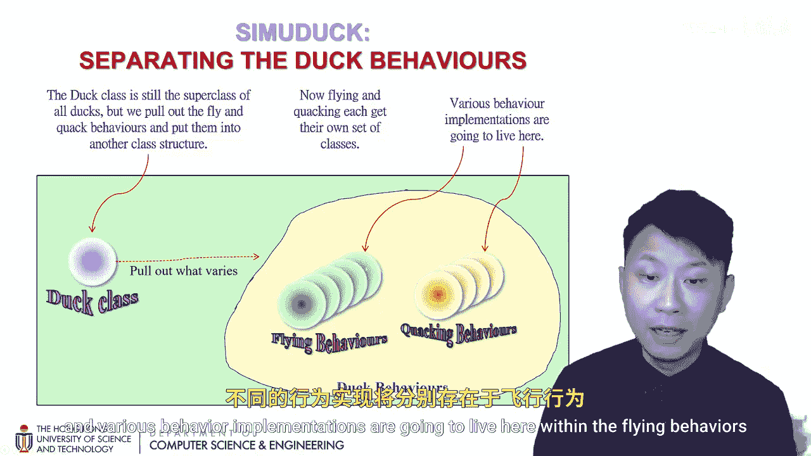

现在，飞行和叫声行为各自拥有自己的一组类，各种行为实现将存在于这些飞行行为和叫声行为类中。

---

## 设计原则：面向接口编程

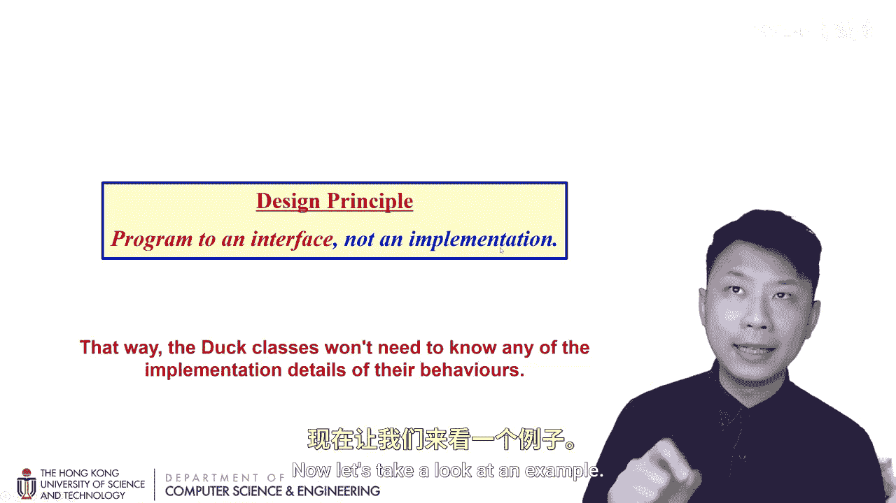

我们可以在鸭子模拟游戏中利用的另一个设计原则是：**面向接口编程，而不是面向实现编程**。通过这种方式，鸭子类不需要知道它们行为的任何实现细节。

那么，“面向接口编程，而不是面向实现编程”是什么意思呢？让我们看一个例子。

假设我们有超类 `Animal`，然后有具体的实现，例如 `Dog` 和 `Cat`。那么，面向一个典型的实现编程意味着我们将 `d` 初始化为一只 `Dog`，然后让这只狗叫。这意味着我们将变量 `d` 硬编码为 `Dog` 类型，这不灵活，因为以后如果我们想把 `d` 改成 `Cat`，就不可能了。

所以，更好的方式是面向接口或超类编程。这意味着我们将创建一个 `Animal` 类型的变量 `a`，然后将 `a` 初始化为一只 `Dog`，然后调用 `a` 的 `makeSound` 方法。这是一种更好的定义动物的方式，因为在游戏中，我们以后可以将 `a` 更改为另一种类型，例如 `Cat`。

与其在代码中硬编码子类型，我们应该在运行时分配具体的实现对象。这意味着我们可以创建一个 `Animal` 变量，然后使用一个操作来创建具体的动物。例如，如果我们想要动物是狗，那么这个操作将返回一只狗；如果我们想要动物是猫，那么这个操作将返回一只猫，然后将猫赋值给变量 `a`，最终我们可以调用动物的 `makeSound` 方法。

通过这样做，我们获得了更大的灵活性，因为我们可以在游戏期间创建任何类型的动物，并且我们可以根据创建的动物类型调用 `makeSound` 操作来发出相应的声音。

现在，我们将对鸭子的行为做同样的事情。

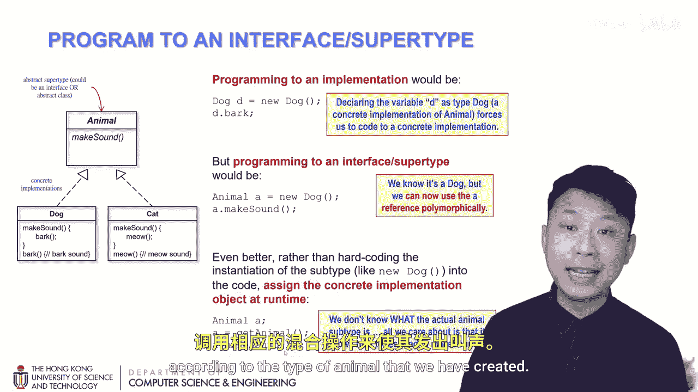

---

## 定义行为接口

现在，我们将有一个名为 `FlyBehavior` 的接口，然后我们将在其子类中有不同的飞行行为实现。例如，`FlyWithWings` 或 `FlyNoWay`。`FlyWithWings` 是为有翅膀的类型实现的飞行行为。`FlyNoWay` 是为那些不能飞的鸭子（例如橡皮鸭或木头诱饵鸭）实现的。

我们还将有一个 `QuackBehavior` 接口，然后我们将在其子类中实现具体的叫声行为，例如 `Quack`、`Squeak` 或 `Mute`。

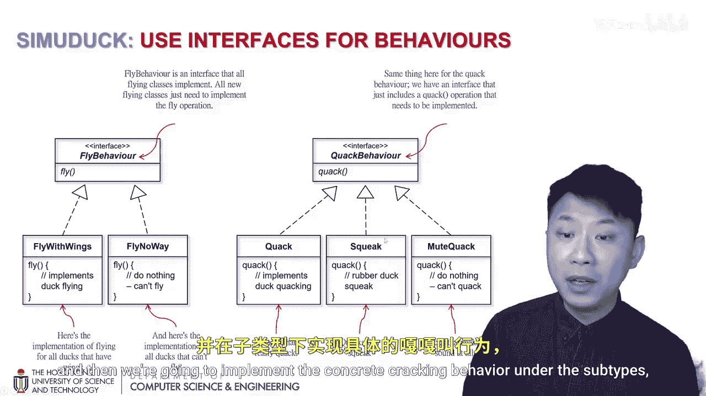

现在，通过使用这种设计，我们可以为不同类型的鸭子复用飞行和叫声行为，并且我们也可以轻松地向这两个接口添加新的行为。

因此，现在鸭子模拟游戏既具有复用的好处，同时又易于维护。

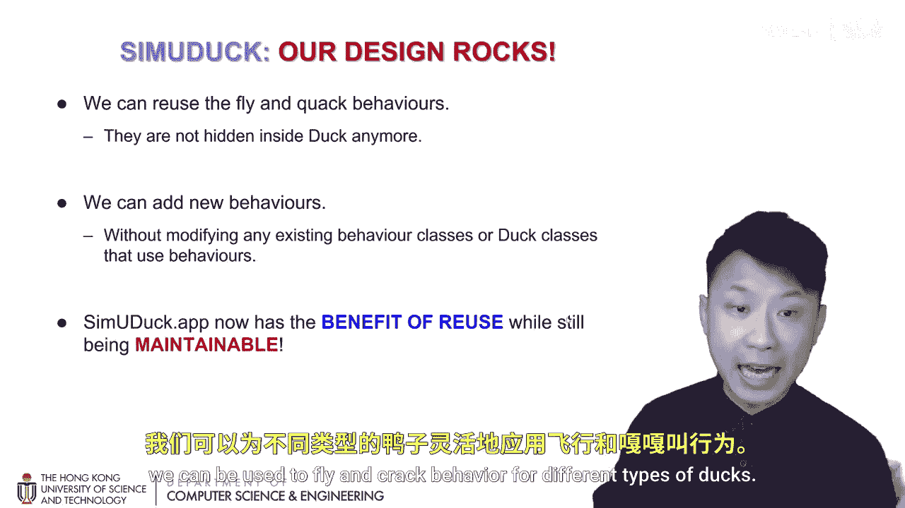
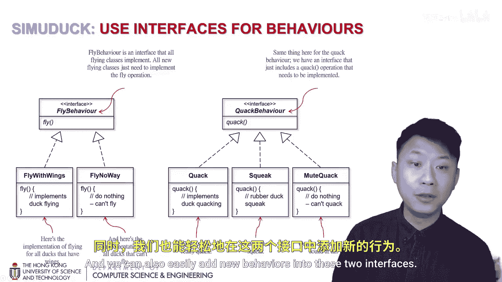

因为如果我们想要维护叫声行为和飞行行为，我们只需要修改 `FlyBehavior` 接口和 `QuackBehavior` 接口。

---

## 新设计的优势

现在，使用新设计，如果你需要在鸭子模拟游戏中添加火箭动力飞行，会怎么做？这会很容易，对吧？

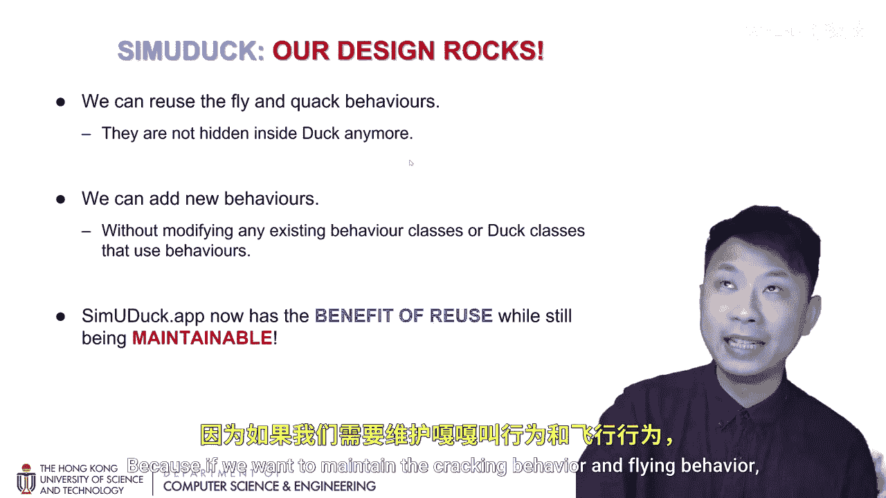
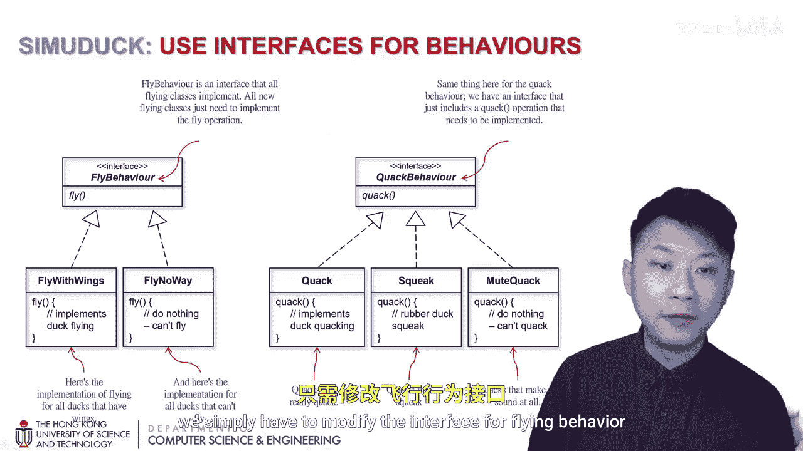

在 `FlyBehavior` 下，我们将有另一个实现，称为 `FlyRocketPowered`。

你能想到一个可能想使用叫声行为但不是鸭子的类吗？例如，在你的游戏中，你可能有一个鸭子呼叫器试图假装成鸭子，所以这个鸭子呼叫器对象可能会在游戏中使用叫声行为。

现在，我们还需要添加两个变量来跟踪每只鸭子的飞行行为和叫声行为，这些变量被声明为行为接口类型。

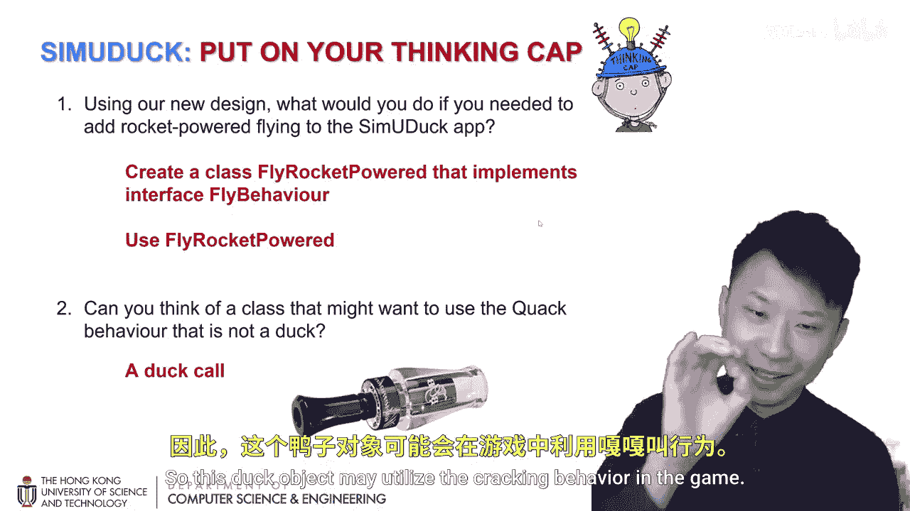

然后，我们将实现一些进一步的操作来执行叫和飞。

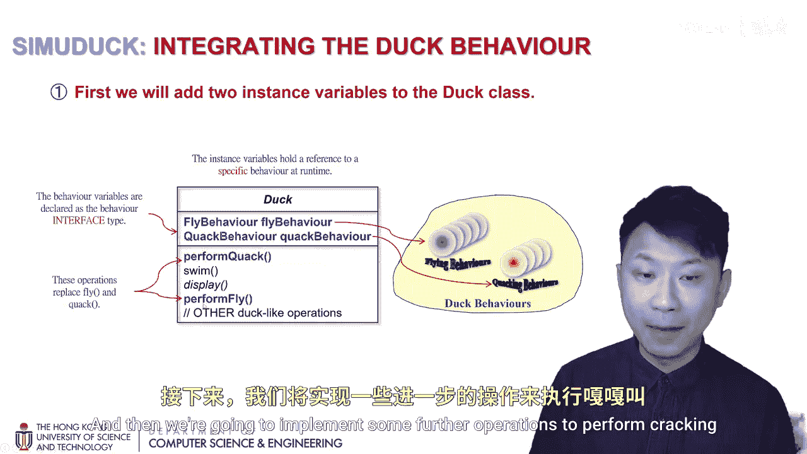

---

## 组合行为

现在，每只鸭子都有一个引用，指向实现了飞行行为接口和叫声行为接口的某个对象。当你尝试执行飞行和尝试执行叫时，你将调用这两个操作，并利用飞行行为来执行飞行，同时利用指定的叫声行为来执行叫。

例如，对于绿头鸭，叫声行为将是 `Quack`，飞行行为将是 `FlyWithWings`。

橡皮鸭呢？对于橡皮鸭，叫声行为应该是 `Squeak`，飞行行为应该是 `FlyNoWay`，因为橡皮鸭不能飞。

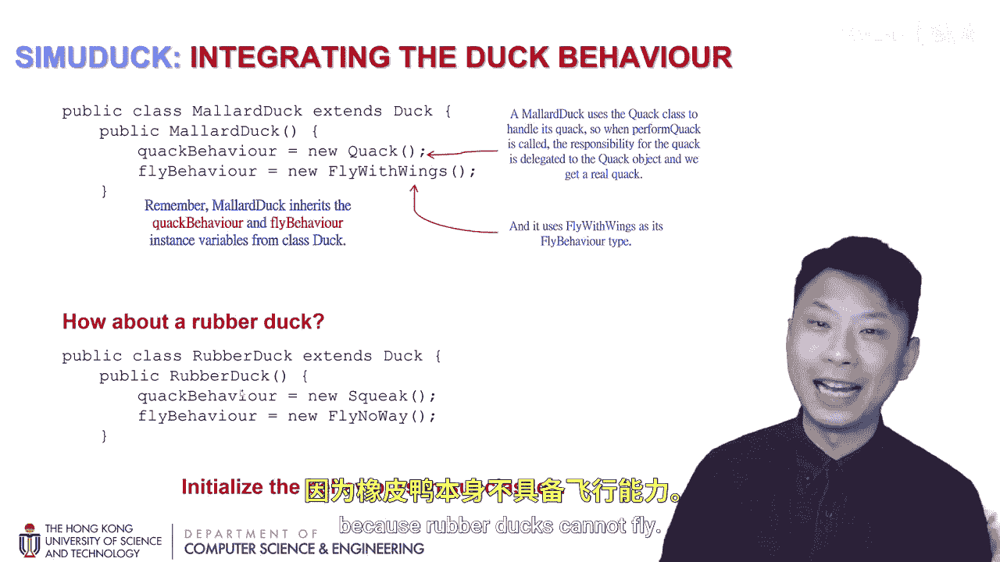

这就是整个图景。现在每只鸭子都将有一些飞行行为和叫声行为，我们将在子类中定义具体的叫声行为和飞行行为。例如，绿头鸭的叫声行为，我们将使用 `Quack` 这个具体实现；飞行行为，我们将使用 `FlyWithWings` 这个具体实现。

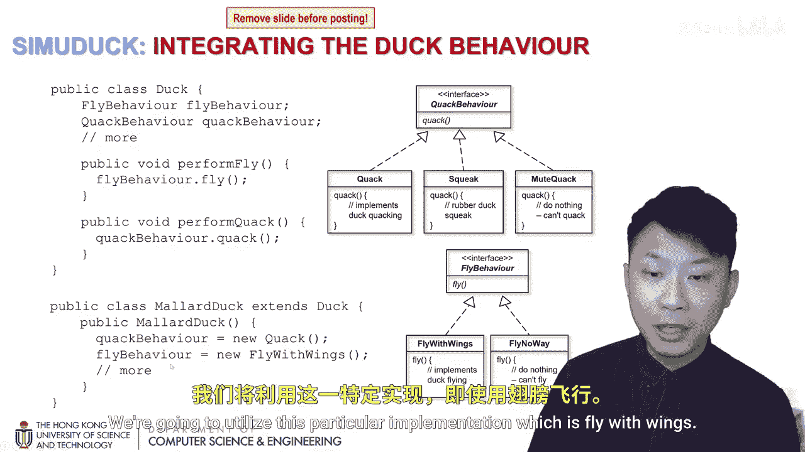

---

## 动态设置行为

为了让游戏更加灵活，我们将实现这两个操作：`setFlyBehavior` 和 `setQuackBehavior`，这样我们就可以在游戏运行时动态地改变飞行行为和叫声行为。

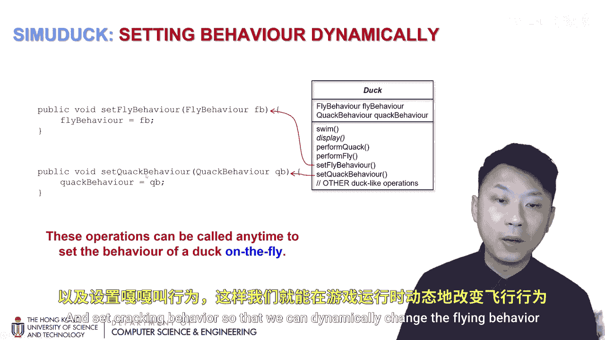

这就是整个图景。在超类 `Duck` 下，我们必须声明飞行行为和叫声行为，然后我们有不同类型的鸭子。接着，我们使用接口来定义飞行行为和叫声行为，在每个接口下，我们将有飞行行为的具体实现和叫声行为的具体实现。

现在你可以看到，飞行行为被封装在 `FlyBehavior` 这个接口中，叫声行为被封装在 `QuackBehavior` 这个接口中。然后在超类下，我们有不同类型的鸭子。所以我们说这里存在“是一个”的关系（超类和子类）。

在接口下，我们有不同的具体实现。在每只鸭子中，你可以看到每只鸭子都将有一些飞行行为和叫声行为，所以我们说每只鸭子“有一个”飞行行为和“有一个”叫声行为。

---

## 策略模式

现在，将每个接口下的一组行为视为一个算法家族。所以我们有不同的飞行算法和不同的叫声算法。这些行为或算法是可以互换的。同时，客户端（例如鸭子）将使用封装好的飞行和叫声算法家族。

封装意味着你不必确切知道我们如何实现飞行行为和叫声行为，你只需要在游戏中使用该行为即可。

这被称为**策略模式**，因为我们使用不同的策略或不同的算法来做某事。

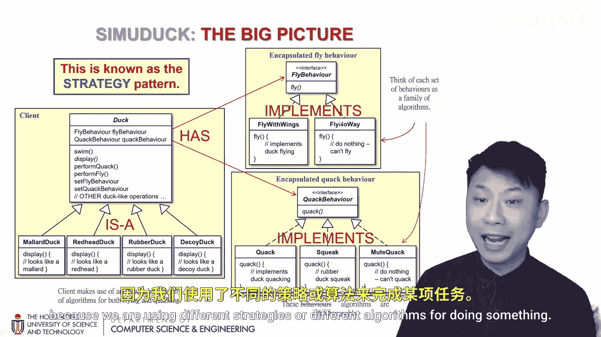

这是我们用于策略模式的类图。在策略模式中，我们有一个客户端（例如 `Duck`），然后每只鸭子都有一个引用（这个箭头表示“有一个”引用）指向鸭子可以用于飞行和叫的不同策略。然后，飞行和叫的策略是鸭子的一部分，或者说在鸭子内部，我们必须声明飞行行为和叫声行为。

现在我们说，这个客户端有一个指向策略对象的引用。这个策略类将为所有支持的算法声明一个公共接口，所以我们将在策略的不同实现下有不同的算法。然后这些是不同算法的具体实现。

这是我们在策略模式中利用的另一个设计原则：**我们倾向于使用“有一个”关系，而不是继承**。

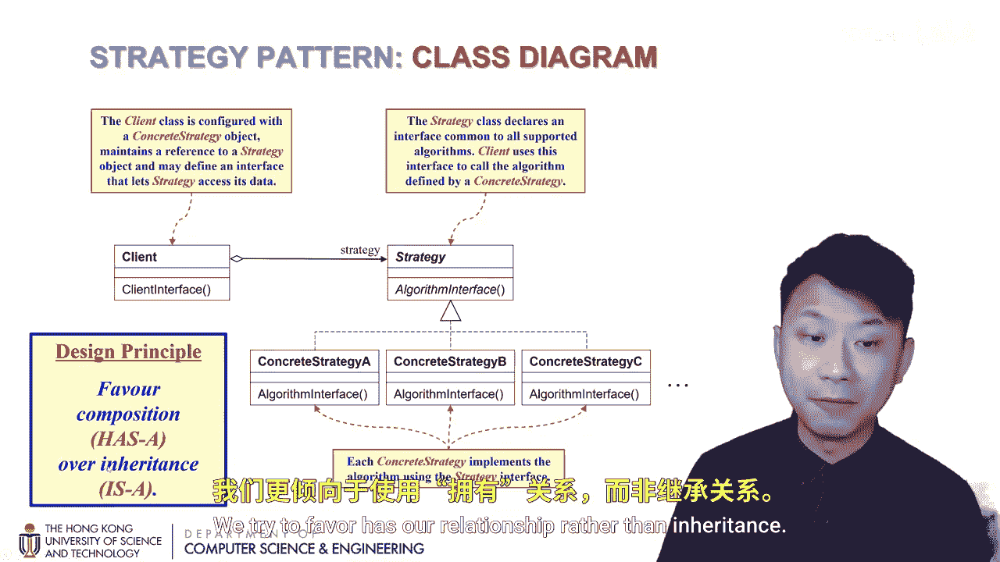

---

## “有一个”优于“是一个”

所以继承意味着我们有超类和子类。

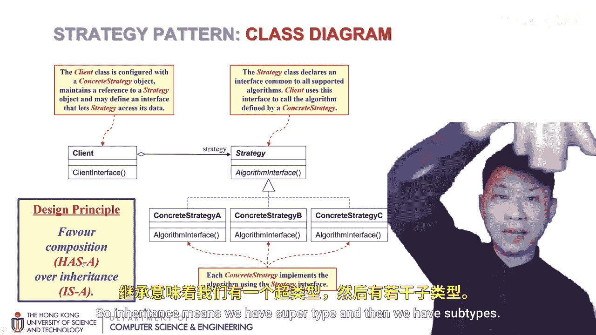

但“有一个”关系意味着每个客户端，它们将有不同的策略来做某事（例如飞行和叫）。所以在我们的类图中，我们倾向于这种水平线，即客户端将有不同的策略来做某事，而不是继承。

在鸭子模拟游戏中，我们也倾向于“有一个”关系，因为每只鸭子将有不同的飞行行为和不同的叫声行为。

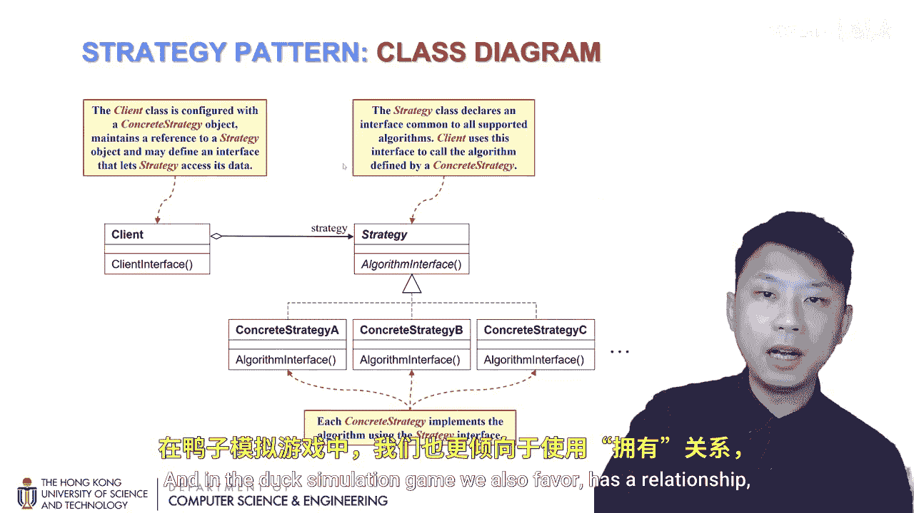
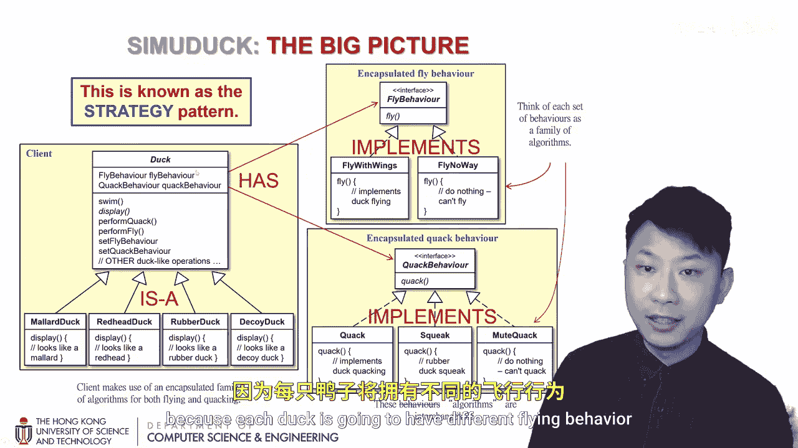

---

## 总结

在本节课中，我们一起学习了策略模式。我们从一个鸭子模拟游戏的例子开始，分析了单纯使用继承和接口带来的问题，如代码重复、维护困难、缺乏灵活性等。

接着，我们引入了两个关键的设计原则：
1.  **识别应用中变化的部分，并将其封装起来**。
2.  **面向接口编程，而不是面向实现编程**。

通过应用这些原则，我们将鸭子的飞行行为和叫声行为抽离出来，定义为独立的策略接口（`FlyBehavior`, `QuackBehavior`），并为其提供多种具体实现。鸭子类（客户端）通过“有一个”的关系组合这些行为，而不是通过继承硬编码行为。这种方式使得行为可以独立变化、轻松替换和复用，极大地提高了系统的灵活性和可维护性。

最后，我们看到了策略模式的正式类图，并理解了其核心思想：**定义算法家族，分别封装，让它们可以互相替换，使得算法的变化独立于使用算法的客户端**。