# 049：观察者模式 👀

## 概述

在本节课中，我们将要学习一种名为“观察者模式”的行为型设计模式。我们将了解它的核心思想、工作原理、类图结构以及其实现时可能遇到的复杂性。通过一个电子表格应用的例子，我们将清晰地理解观察者模式如何管理对象间的一对多依赖关系。

## 设计模式概述

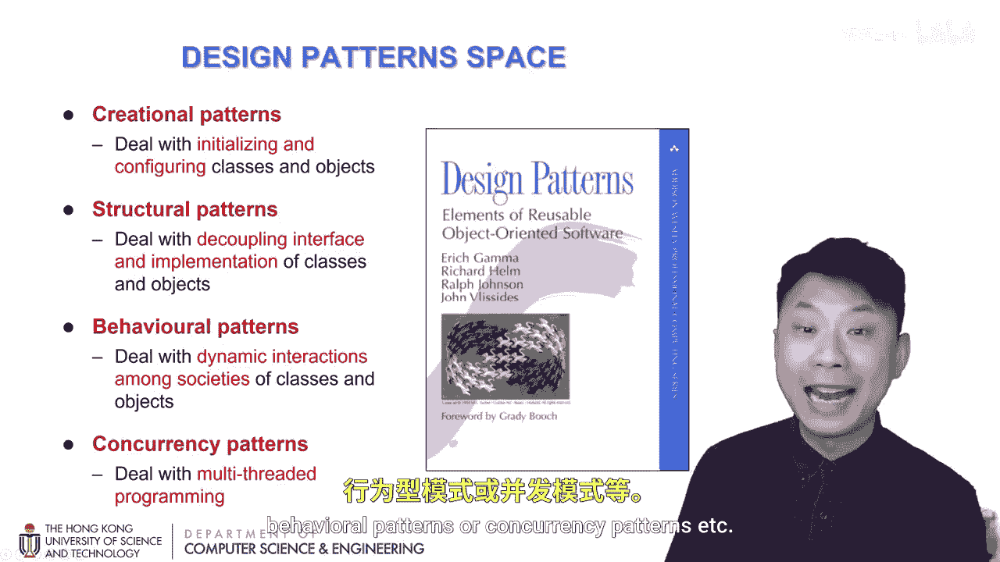

如果你想在软件工程项目中学习更多可用的不同设计模式，那么《设计模式》这本书是设计模式的圣经。

在这本设计模式圣经中，你可以学习到不同类型的设计模式，例如创建型模式、结构型模式、行为型模式或并发模式等。

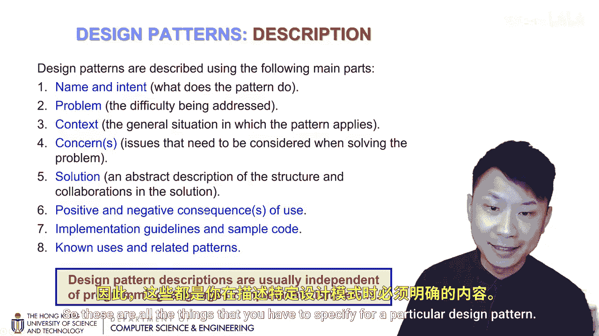

当我们描述一个设计模式时，通常使用类图来描述，但除了类图，我们还必须指定所有这些内容。

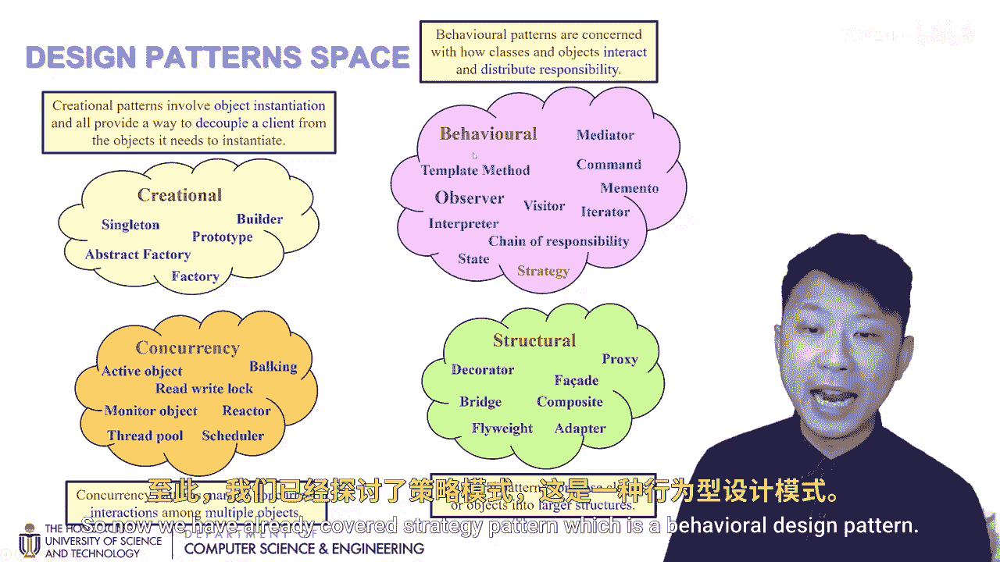

例如，设计模式的名称、试图解决的问题、上下文、关注点、解决方案等，这些都是为特定设计模式必须指定的内容。

到目前为止，我们已经介绍了策略模式，它是一种行为型设计模式。接下来我们将要介绍的是观察者模式。

## 观察者模式的核心思想

观察者模式背后的思想很简单。让我们来看一个例子。

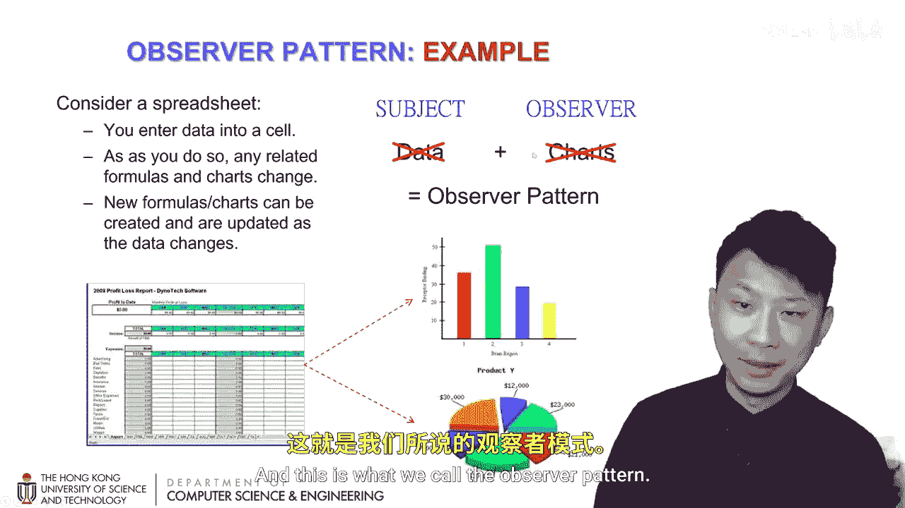

考虑一个电子表格应用程序。在这个应用程序下，你可能有一组数据，以及多个图表。你需要基于同一组数据绘制不同的图表。

但在观察者模式中，我们不称它们为数据和图表，我们称它们为一个单一的主题和多个观察者，这就是我们所说的观察者模式。

观察者模式是这样工作的。假设我们有一个单一的主题和多个观察者对象。

这些观察者对象订阅了这个主题，而对象D没有订阅这个主题。

我们假设，例如，主题可能管理一些数据。在这些观察者中，它们可能是一个电子表格应用中的图表。

一旦数据被更新，主题就会通知所有订阅了它的观察者去更新图表。

然后，所有的观察者对象都会收到关于更新的通知，并相应地更新图表。

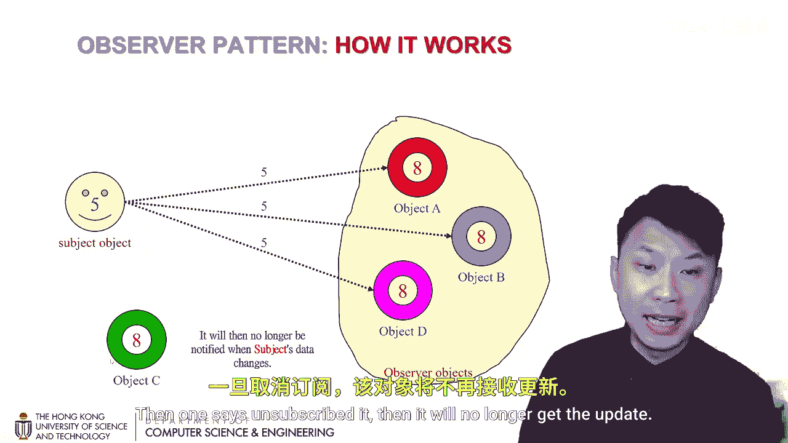

现在，对象D没有订阅这个主题。之后，它可能会订阅这个主题。

然后，它将成为这个主题的观察者对象集合中的一员。之后，当我们更新这个主题时，所有的观察者对象都会相应地更新。

你也可以在任何时候取消订阅一个特定的观察者对象。一旦取消订阅，它将不再获得更新。

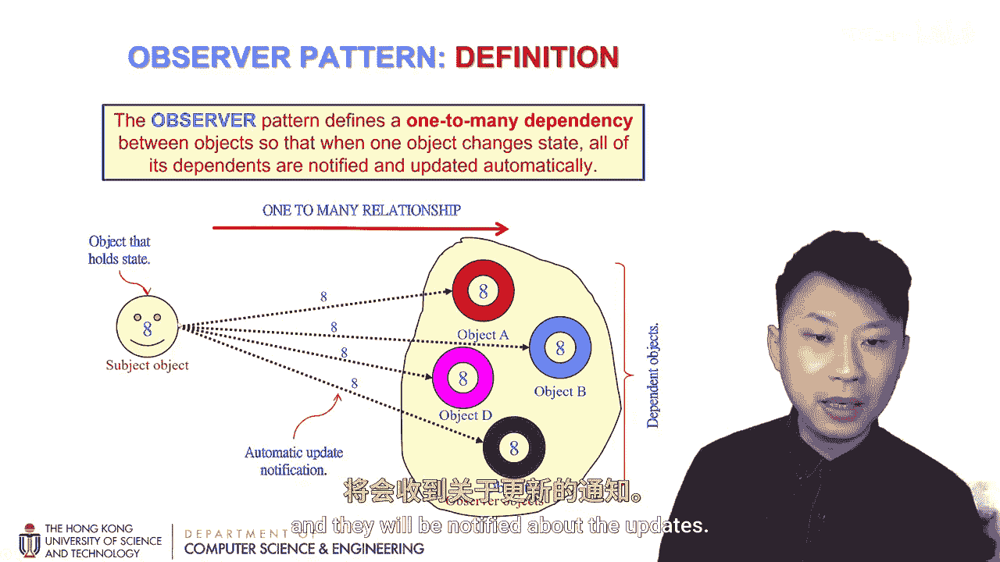

在观察者模式中，我们讨论的是一对多的依赖关系，因为我们有一个主题和多个观察者。一旦主题被更新，它将通知观察者对象更新自身。所以主题持有状态。

而这些是依赖对象。它们将收到关于更新的通知。

## 观察者模式的类图结构

这是我们用于观察者模式的类图。在观察者模式下，我们有主题以及主题的具体实现。

主题持有对观察者的引用，在观察者接口下，我们有观察者的不同具体实现。具体观察者持有对具体主题的引用。

现在，这个类定义了主题接口，然后每个主题可能有多个观察者。在所有观察者中，都有在这个观察者接口下的具体实现。

具体主题是主题接口下的一个实现。具体观察者是观察者接口下的实现。

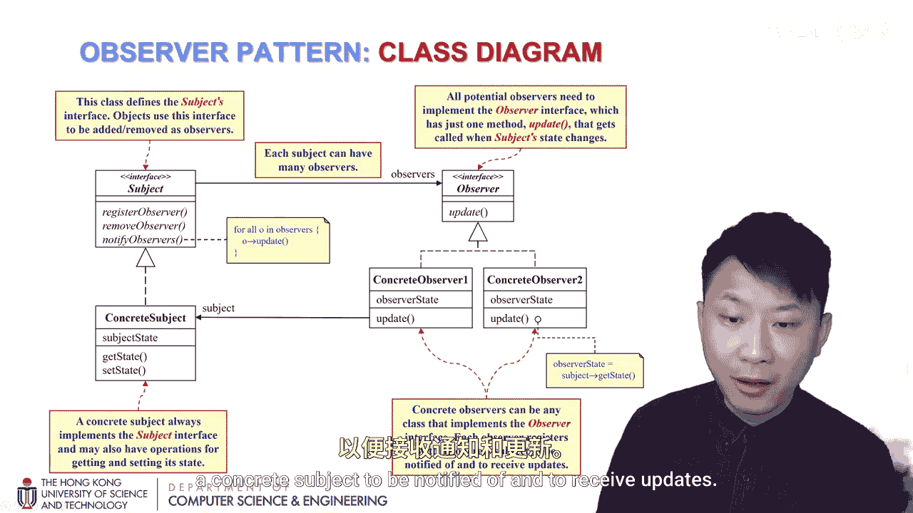

每个观察者都向一个具体主题注册，以接收通知和更新。

## 松耦合的设计原则

在观察者模式中，我们说我们有一对多的依赖关系，但我们仍然说主题和观察者是松耦合的，这是为什么？

仅仅是因为主题通过接口了解观察者。我们可以在任何时候在观察者接口下添加新的观察者。对主题或观察者的更改不会相互影响。

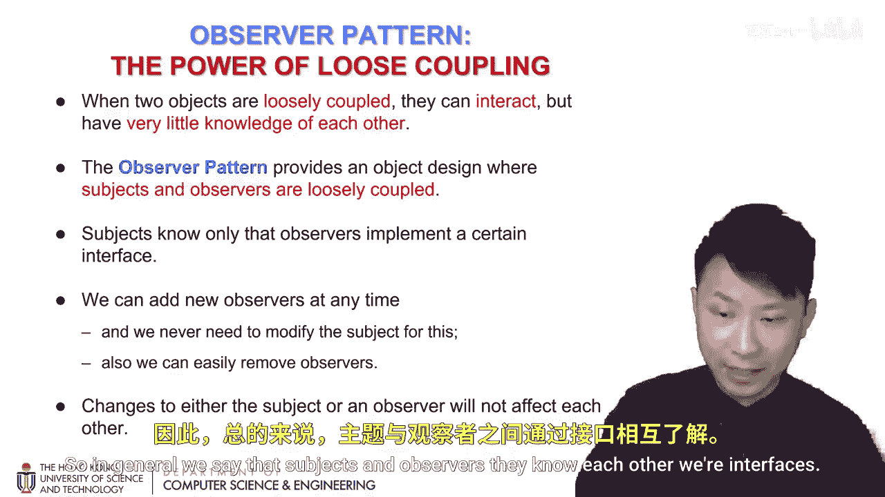

总的来说，我们说主题和观察者通过接口相互了解。

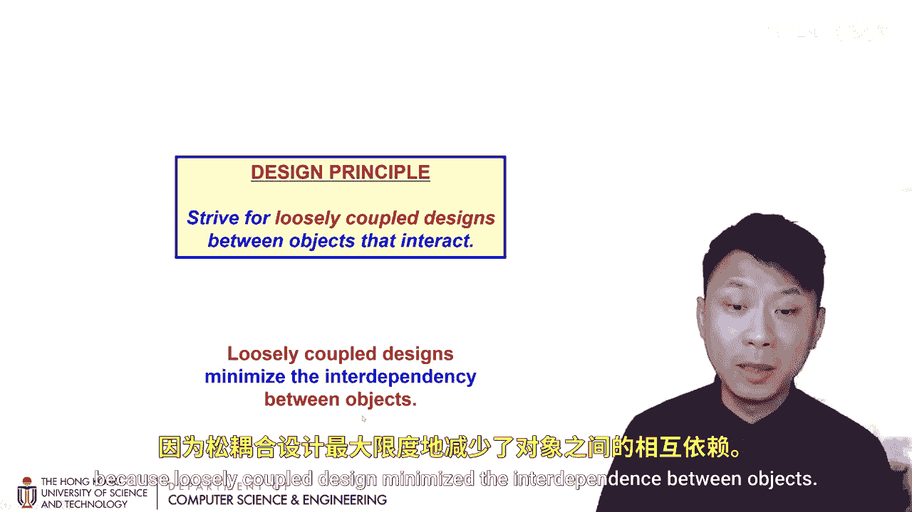

这就是为什么我们实现了这个设计原则。我们努力在交互的对象之间实现松耦合的设计。

这很好，因为松耦合的设计最小化了对象之间的相互依赖。

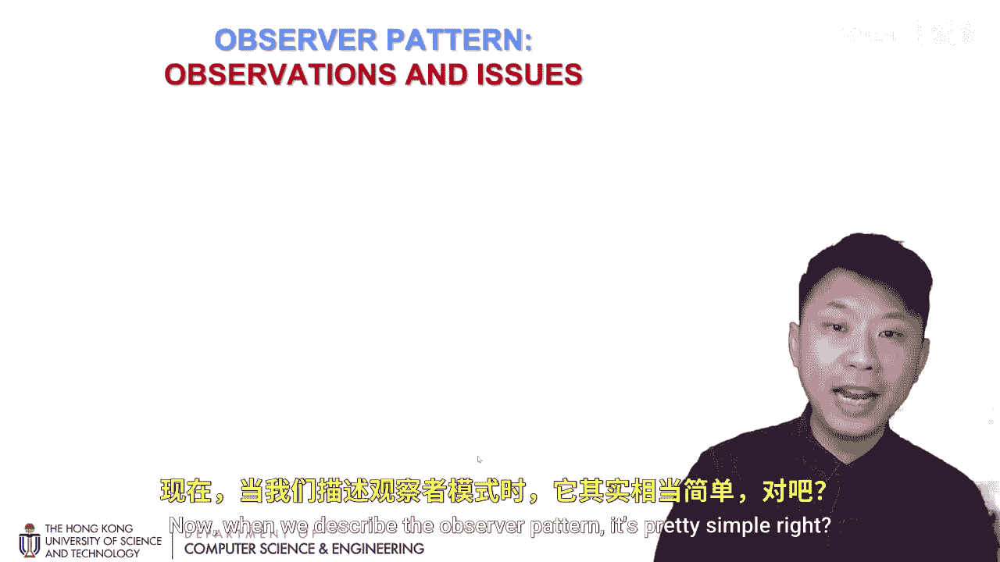

## 实现上的复杂性

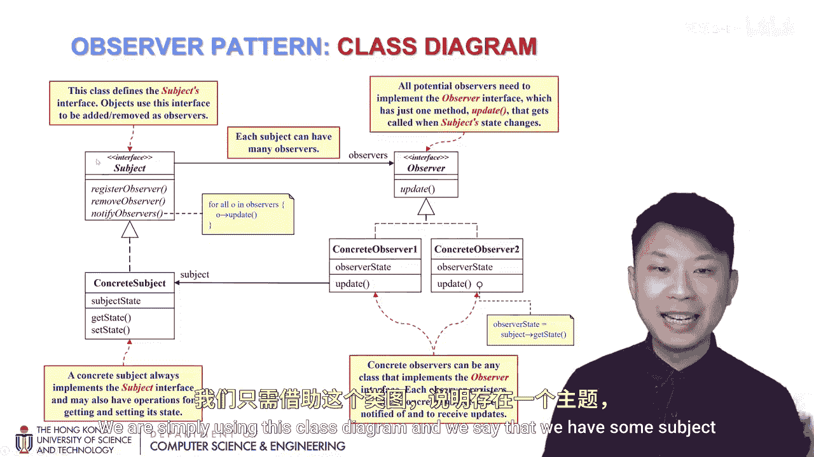

当我们描述观察者模式时，它相当简单，我们只是使用这个类图，并说我们有一个主题，然后主题将拥有多个观察者。

但现在当我们实现观察者模式时，它可能相当复杂。

因为观察者模式必须支持广播通信，以便主题更新所有观察者。我们还需要处理事件通知协议，例如，主题应该宣布哪些事件，是否每个事件都应该通知给每个观察者，主题是否应该定义不同种类的事件并允许观察者有选择地订阅，等等。

这就是为什么我们说，当我们描述观察者模式时有点简单，我们在类图中只是有一些主题和多个观察者。但当我们实现观察者模式时，它实际上可能相当复杂。

## 总结

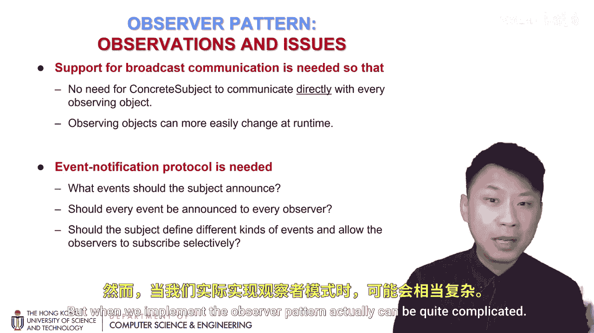

本节课中，我们一起学习了观察者模式。我们了解了它是一种用于管理对象间一对多依赖关系的行为型设计模式，其核心是主题与观察者通过接口进行松耦合的交互。我们通过类图分析了其结构，并认识到虽然其概念描述起来相对直接，但在实际实现中需要考虑广播通信和事件协议等复杂因素。掌握观察者模式有助于构建灵活、可维护的软件系统。