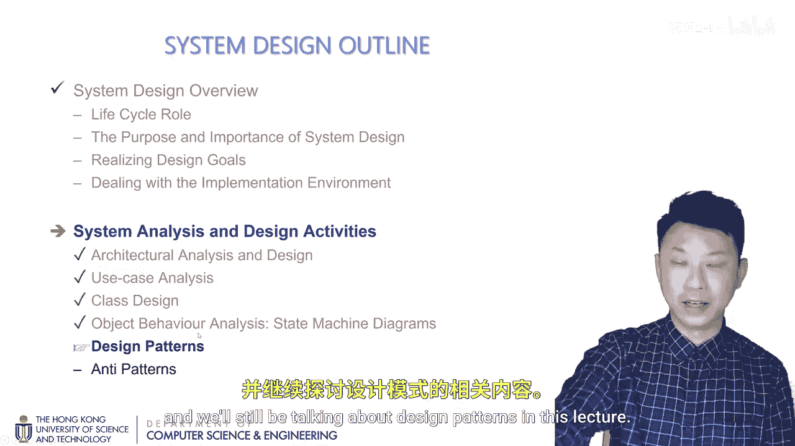
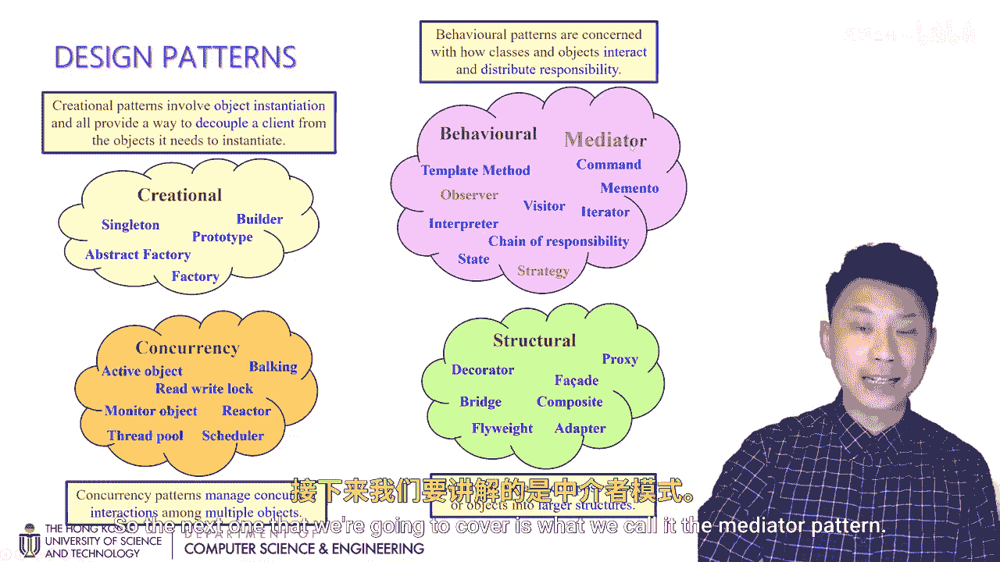
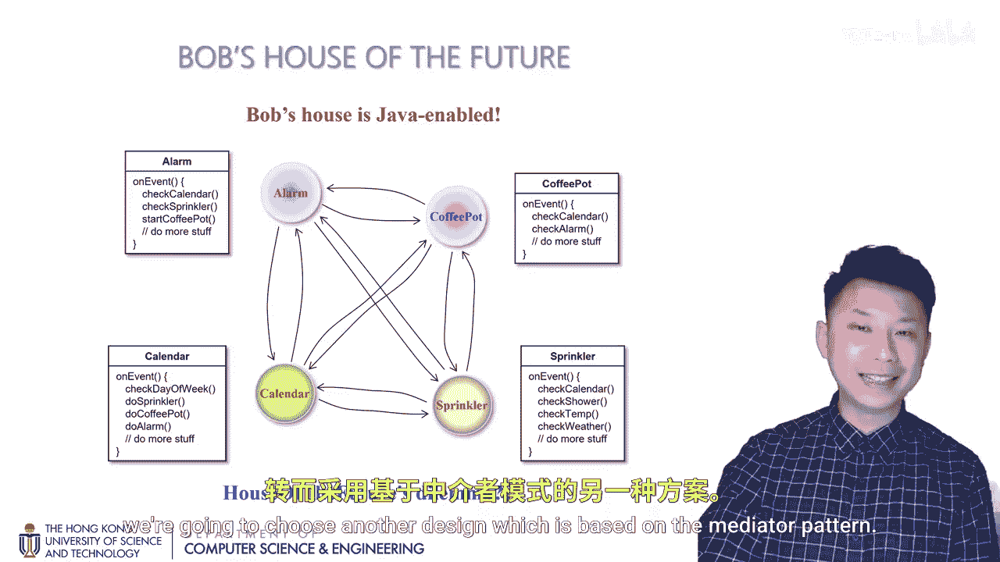
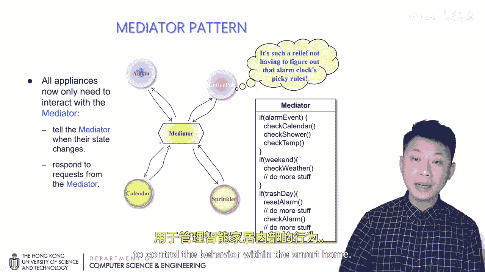
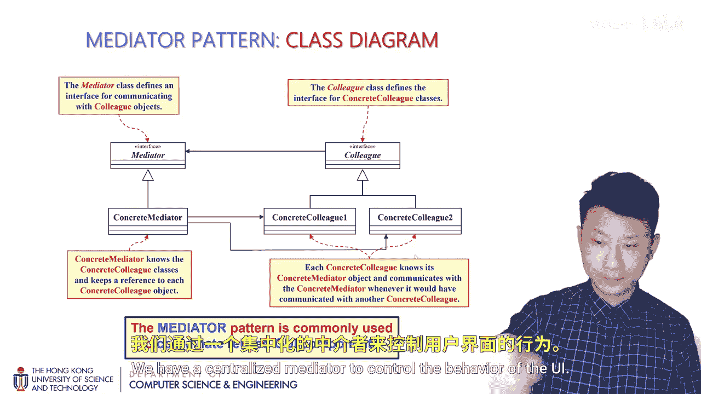
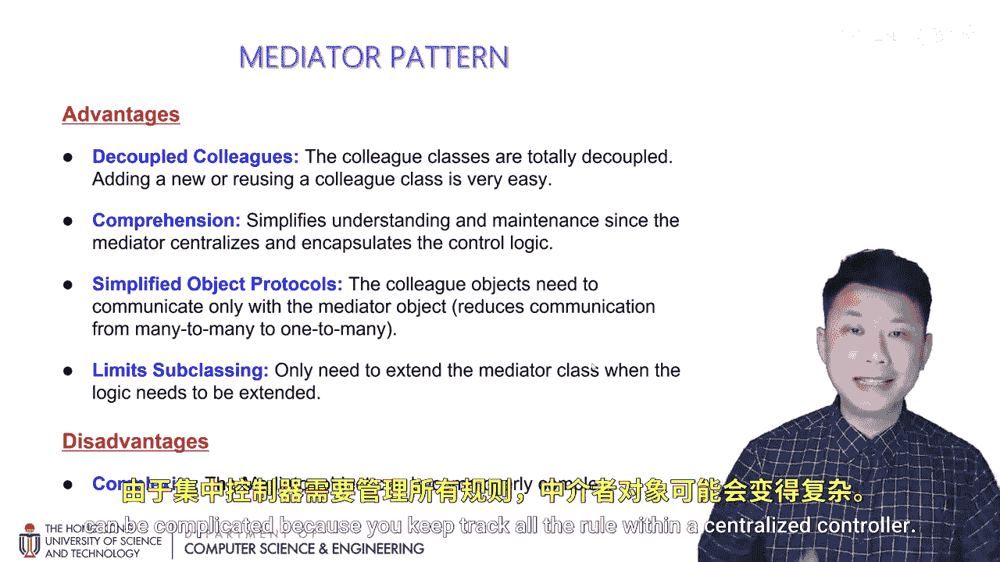

# 050：中介者模式 🧩





在本节课中，我们将介绍更多的设计模式。我们将继续探讨中介者模式。

上一节我们介绍了其他设计模式，本节中我们来看看中介者模式。


接下来要介绍的模式被称为中介者模式。


对于中介者模式，我们将使用以下示例。假设我们要为一个智能家居构建一个软件系统，在这个系统中会有不同的设备，例如闹钟、日历、洒水器和咖啡机。这是你可以在智能家居中实现的功能，例如，当闹钟响起时，它会通知咖啡机开始煮咖啡。洒水器会根据日历、温度和雷达等不同条件来决定是否开启。

那么，这种设计有什么问题呢？假设我们允许各个设备（同事类）直接相互通信。问题在于，每个设备都必须维护一套用于执行某些操作的规则。例如，闹钟需要检查日历、检查洒水器，并通知另一个设备（如咖啡机）开始煮咖啡。而咖啡机又需要维护另一套规则，例如检查日历、检查闹钟等。因此，在这种设计下，每个设备都必须维护一套规则。之后，当我们试图维护所有这些规则时会变得困难，因为我们无法确切知道规则存在于何处。例如，“开始煮咖啡”这个事件，我们不知道它存在于闹钟、日历还是洒水器中。因此，维护和跟踪房屋内的所有规则变得困难。

这就是为什么我们不采用这种设计，而是选择基于中介者模式的另一种设计。



这就是中介者模式。现在，我们不再让各个设备维护自己的规则，而是将所有规则集中在中介者中管理。这些设备不再直接相互交互，它们与中介者交互。然后，当中介者内部发生某些事件时，它会通知某些设备执行相应的操作。


你可以将这个中介者视为一个集中控制器，用于控制智能家居内的行为，并将所有规则集中在这个中介者中管理。



这是中介者模式的类图。我们有一个中介者接口，以及该接口的具体实现。我们还有不同的同事类（设备），以及同事类的具体实现。同事类持有对中介者接口的引用，而具体的中介者则持有对具体同事类的引用。


以下是核心概念的结构：
```java
// 中介者接口
interface Mediator {
    void notify(Colleague sender, String event);
}

// 同事类基类
abstract class Colleague {
    protected Mediator mediator;
    public Colleague(Mediator m) {
        this.mediator = m;
    }
}

// 具体同事类示例
class Alarm extends Colleague {
    // ... 具体实现
    public void ring() {
        mediator.notify(this, "alarmRang");
    }
}

// 具体中介者
class SmartHomeMediator implements Mediator {
    private Alarm alarm;
    private CoffeePot coffeePot;
    // ... 其他同事类引用

    @Override
    public void notify(Colleague sender, String event) {
        // 集中处理所有交互逻辑
        if (sender instanceof Alarm && event.equals("alarmRang")) {
            coffeePot.startBrewing();
        }
        // ... 其他规则
    }
}
```

中介者模式通常用于协调相关的图形用户界面组件。例如，当你在用户界面中选择一个特定选项时，可以启用界面中的某些部分。我们使用一个集中的中介者来控制用户界面的行为。




中介者模式的优点如下：

以下是中介者模式的主要优点：
*   **解耦同事类**：使用中介者模式后，同事类不再直接相互通信。
*   **集中控制**：我们将所有规则集中在一个中介者中管理。如果你想维护规则，只需进入中介者类进行更新。
*   **简化协议**：因为同事类无需直接相互通信。
*   **限制子类化**：当逻辑或规则需要扩展时，我们通常只需要扩展中介者类。

但中介者模式也有缺点：

以下是中介者模式的主要缺点：
*   **中介者对象可能变得复杂**：因为你将所有规则集中在一个控制器中，所以实现控制器本身可能会变得复杂。




本节课中我们一起学习了中介者模式。我们了解了其定义、通过智能家居示例分析了直接交互设计的问题、学习了中介者模式如何通过引入一个集中协调者来解耦对象间的复杂交互、查看了其标准类图结构，并总结了该模式的优缺点。中介者模式的核心思想是将多对多的复杂通信转化为一对多的集中管理，从而提高系统的可维护性和灵活性，但需注意避免中介者自身变得过于庞大复杂。