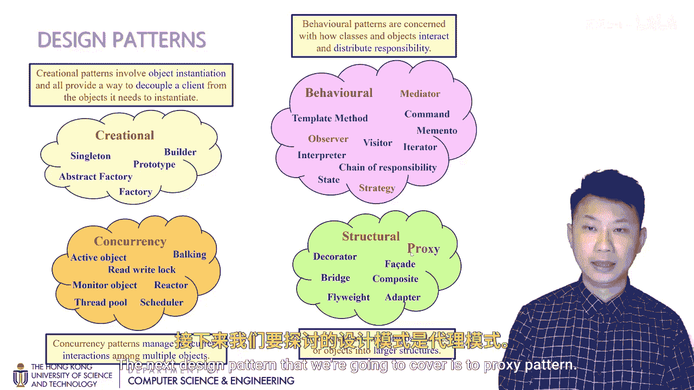
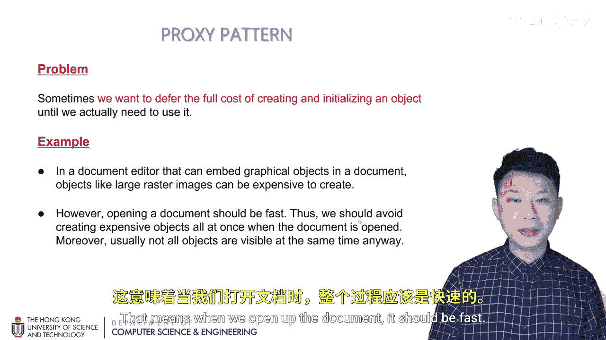
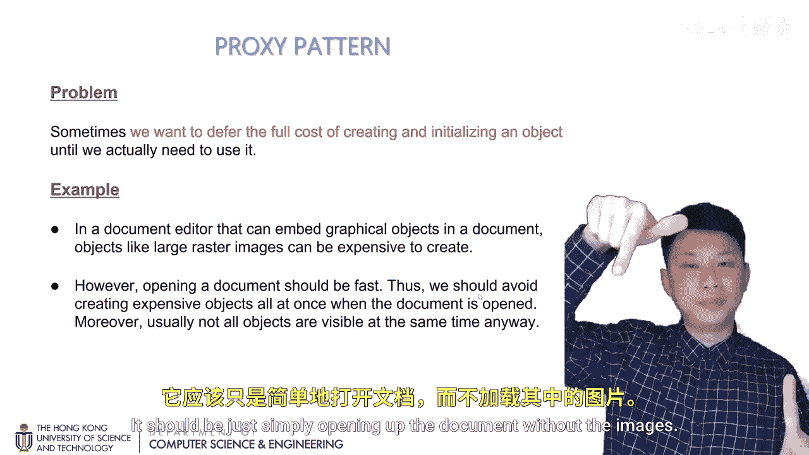
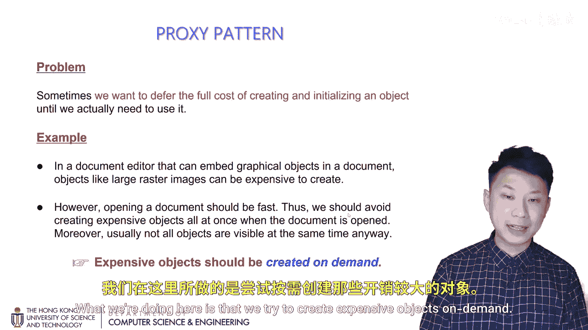
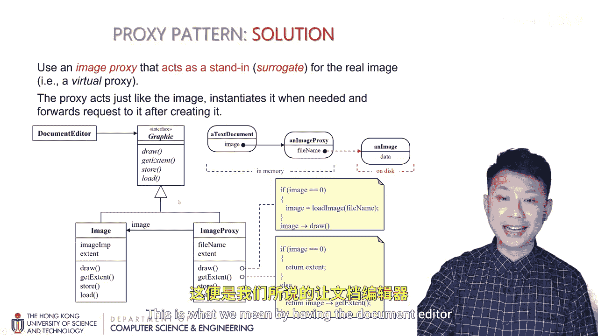
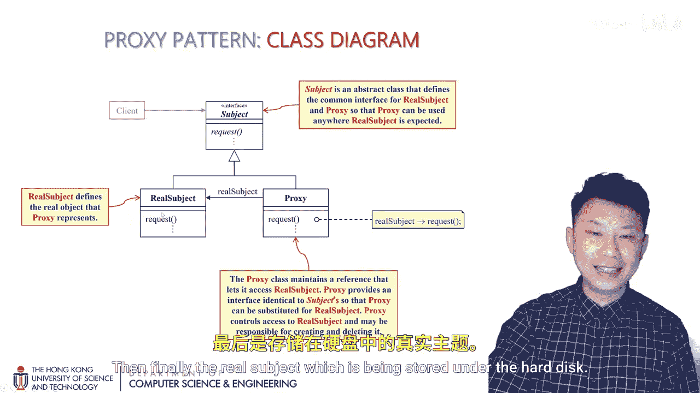

**软件工程：P51：代理模式** 🛡️

在本节课中，我们将要学习代理模式。代理模式是一种结构型设计模式，它允许我们延迟创建和初始化一个高成本对象，直到真正需要使用时才进行。

上一节我们介绍了其他设计模式，本节中我们来看看代理模式。代理模式旨在解决一个问题：我们希望推迟创建和初始化一个对象的全部成本，直到我们实际需要使用它时。

例如，假设一个网页中包含多媒体内容。我们不希望在打开网页时就立即加载并显示所有内容，而是等到用户需要查看时才去下载和加载。这就是“延迟创建和初始化对象的全部成本”的含义。在文档编辑器中，我们可能包含图片，但只在用户需要查看时才真正加载这些图片，从而保证打开文档的速度。

我们在这里所做的是尝试按需创建昂贵的对象。

以下是代理模式的一个应用示例。在文档编辑器中，我们有一个图像代理。这个图像代理负责访问存储在硬盘上的实际图像文件。

这可能是文档编辑器的一种设计。我们有一个图形接口。当你尝试获取图像时，必须通过图像代理来获取。然后，图像代理会帮助你从硬盘加载图像。

以下是如何实现图像代理的逻辑：
*   如果我们确实需要绘制图像，那么就从硬盘加载图像并绘制它。
*   但还有另一种选择，我们称之为“获取扩展”。我们只获取图像的尺寸，然后在文档中创建一个空框。如果图像尚未加载，我们只返回其尺寸（宽度和高度），以便在文档中创建一个占位空框。否则，我们返回实际的图像对象，以便在文档中显示真实图像。

这就是让文档编辑器通过代理来访问特定图像的含义。

这是代理模式使用的类图。我们有一个客户端（例如文档编辑器），一个主题接口。当我们尝试访问真实主题时，必须通过一个代理类。除非确实必要，否则我们不会真正获取真实主题。代理类实现了主题接口，最终的真实主题则存储在硬盘上。

本节课中我们一起学习了代理模式。代理模式的核心思想是通过一个代理对象来控制对另一个对象的访问，常用于实现延迟加载、访问控制、日志记录等功能。其关键结构是客户端通过代理接口与代理对象交互，而代理对象在必要时才创建或调用真实的对象。