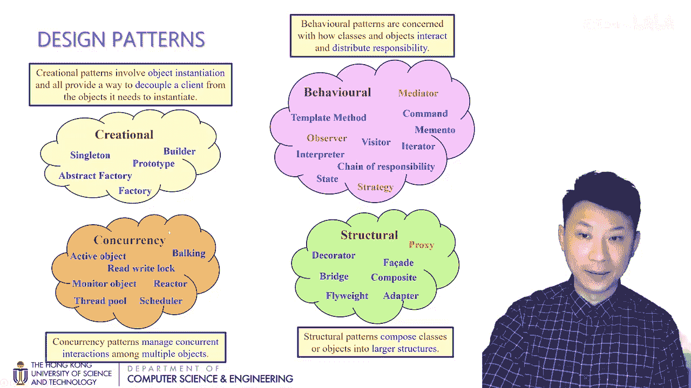
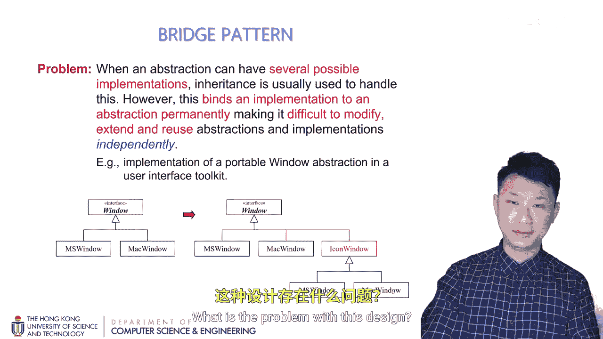
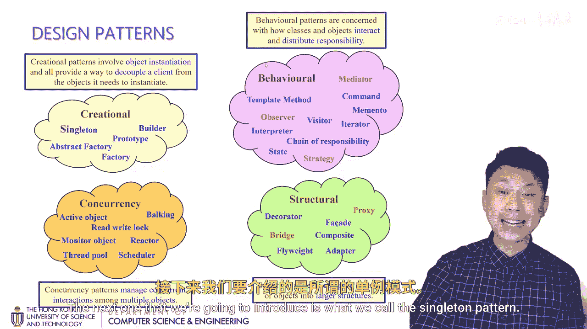
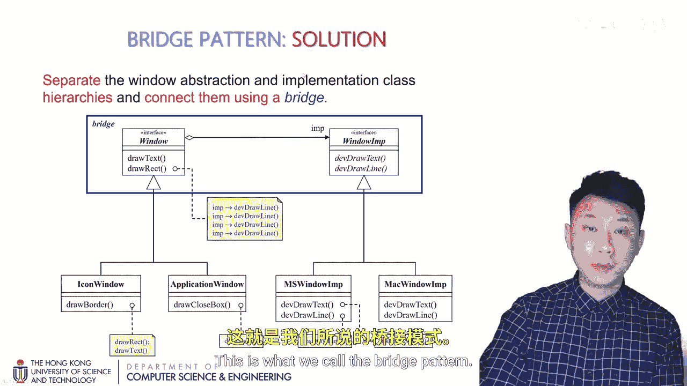
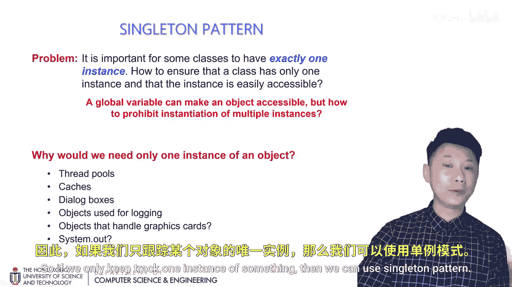
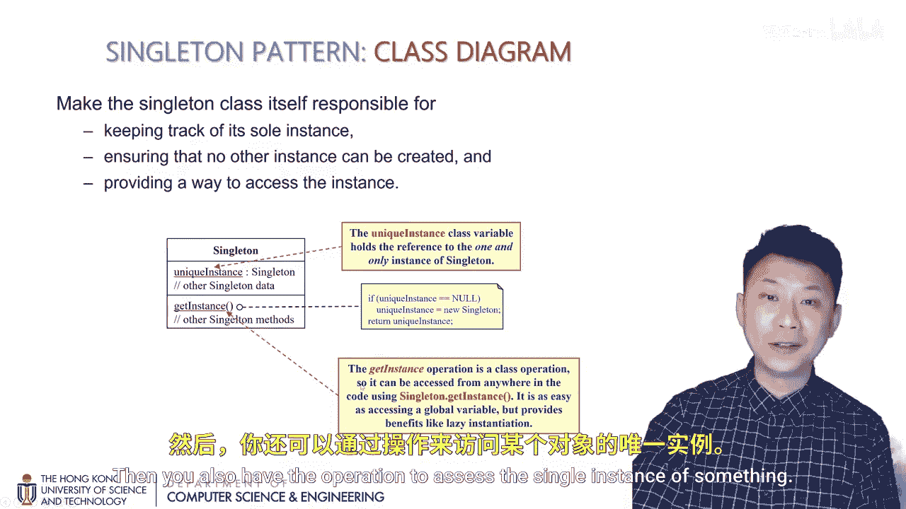

**软件工程：P52：桥接模式与单例模式**



在本节课中，我们将要学习两种设计模式：桥接模式和单例模式。桥接模式用于将抽象部分与实现部分分离，使它们可以独立变化。单例模式则确保一个类只有一个实例，并提供一个全局访问点。这两种模式在软件设计中都非常实用。

---

### **桥接模式**

上一节我们介绍了适配器模式，本节中我们来看看桥接模式。桥接模式的核心思想是将抽象与实现解耦，使它们可以独立地扩展。

假设我们有一个场景：需要处理不同类型的窗口（如图标窗口、应用窗口）在不同的操作系统（如Windows、Mac）上显示。如果为每种窗口类型和操作系统的组合都创建一个具体的实现类，会导致类的数量急剧膨胀，难以维护。


这就是桥接模式要解决的问题。它通过引入一个“实现”接口，将窗口的抽象类型（如`IconWindow`）与其具体的平台实现（如`WindowsImpl`）分离开来。



以下是桥接模式的结构：

*   **抽象部分**：定义抽象接口（如`Window`），并持有一个对实现部分接口的引用。
*   **扩充抽象**：扩展抽象接口，定义不同的具体抽象（如`IconWindow`, `ApplicationWindow`）。
*   **实现部分**：定义实现类的接口（如`WindowImpl`），提供底层操作。
*   **具体实现**：实现实现部分接口，提供平台特定的代码（如`WindowsImpl`, `MacImpl`）。


通过这种设计，当我们需要在Windows系统上绘制一个图标窗口时，`IconWindow`会调用其持有的`WindowImpl`引用，而这个引用指向的是`WindowsImpl`的具体实例。这样，窗口类型和操作系统实现就被“桥接”在了一起，彼此可以独立变化。

桥接模式的关键在于**分离**。它分离了抽象的层级（窗口类型）和实现的层级（操作系统），使得增加新的窗口类型或支持新的操作系统都变得更加容易，无需修改另一方。

---

### **单例模式**

了解了用于处理多维度变化的桥接模式后，我们来看一个目标完全相反的模式——单例模式。单例模式确保一个类只有一个实例，并提供一个全局访问点。

这个模式极其简单，但应用广泛。它的核心目的是**控制实例数量**。



为什么我们需要确保只有一个实例呢？以下是几个常见的例子：

*   线程池
*   缓存系统
*   对话框
*   日志记录器
*   数据库连接池

在这些场景中，多个实例可能导致资源冲突、状态不一致或资源浪费。单例模式通过封装其创建过程，确保任何地方访问到的都是同一个对象。






单例模式的类图非常简单。其核心实现通常包含以下部分：

*   **私有静态实例变量**：用于保存类的唯一实例。
*   **私有构造函数**：防止外部通过`new`关键字创建实例。
*   **公共静态访问方法**：提供获取该唯一实例的全局访问点。

一个典型的代码实现如下：

```java
public class Singleton {
    // 1. 私有静态变量，持有唯一实例
    private static Singleton instance;

    // 2. 私有构造函数，防止外部实例化
    private Singleton() {}

    // 3. 公共静态方法，提供全局访问点
    public static Singleton getInstance() {
        if (instance == null) {
            instance = new Singleton();
        }
        return instance;
    }
}
```


使用时，我们通过`Singleton.getInstance()`来获取这个唯一的实例，而不是直接创建它。

---

### **总结**

本节课中我们一起学习了两种重要的设计模式。

*   **桥接模式**：通过将抽象（如窗口类型）与实现（如操作系统）分离，使它们可以独立扩展。它使用组合关系（抽象持有实现的引用）来替代继承，解决了多维度变化导致的类爆炸问题。
*   **单例模式**：确保一个类只有一个实例，并提供一个访问它的全局节点。它常用于管理共享资源或控制全局状态，实现关键在于私有化构造函数并提供静态的实例获取方法。



理解这两种模式有助于我们在设计软件时，更好地管理对象的创建、结构和生命周期。