# 053：工厂模式 🏭

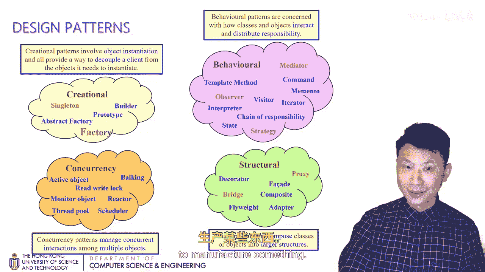

在本节课中，我们将要学习本课程涵盖的最后一个设计模式——工厂模式。顾名思义，工厂模式用于“制造”或“创建”对象。我们将通过一个披萨店的软件系统示例，来理解工厂模式如何帮助我们遵循重要的设计原则，构建更灵活、更易于维护的代码。

## 从问题出发：为何需要工厂模式？

上一节我们介绍了设计模式的基本概念，本节中我们来看看工厂模式要解决的具体问题。


假设我们使用继承体系，有一个超类型（Supertype）和多个子类型（Subtype）。在初始化对象时，我们必须指定具体的子类型。

例如，我们有一个 `Duck` 超类，以及 `MallardDuck`、`DecoyDuck`、`RubberDuck` 等子类。在不同的场景下，我们需要创建不同的鸭子对象：

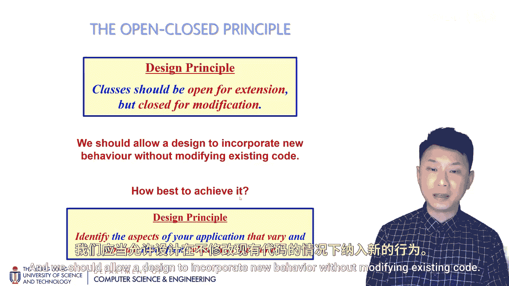

```java
if (场景 == “野餐”) {
    duck = new MallardDuck();
} else if (场景 == “狩猎”) {
    duck = new DecoyDuck();
} else if (场景 == “洗澡”) {
    duck = new RubberDuck();
}
```

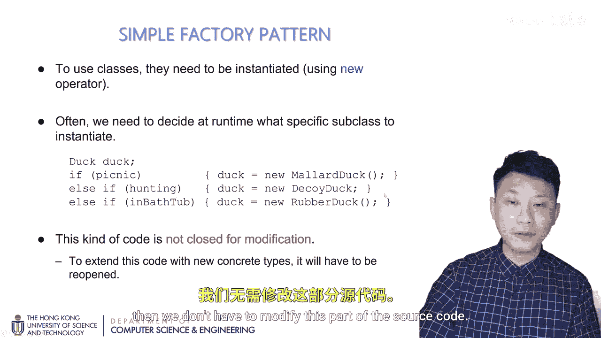

这种代码存在一个问题：它**对修改不封闭**。如果未来增加了新的场景或新的鸭子类型，就必须修改这段代码，添加新的 `if-else` 分支。这违反了**开闭原则**。

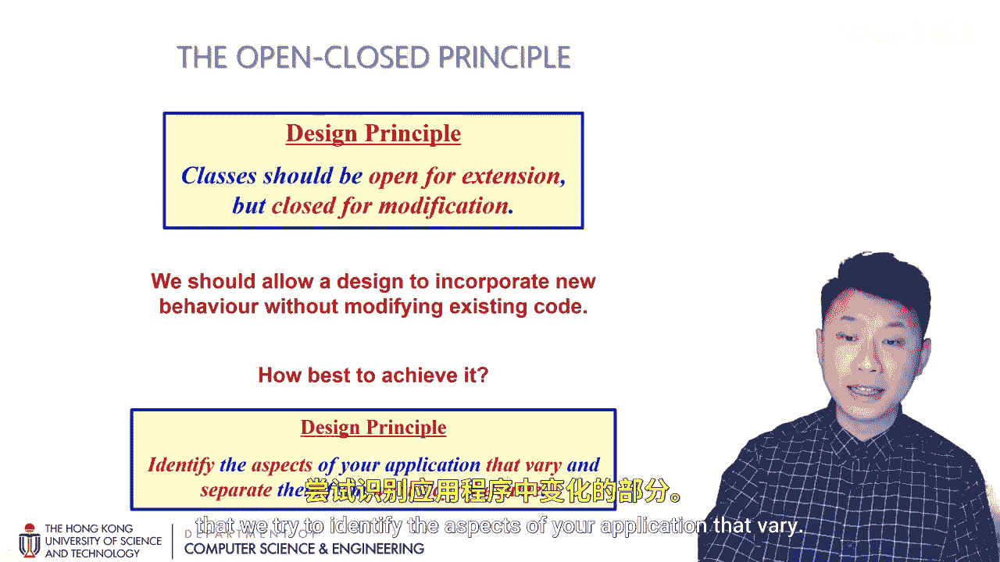

## 核心设计原则 ⚙️

在深入工厂模式之前，我们需要理解两个支撑该模式的核心设计原则。

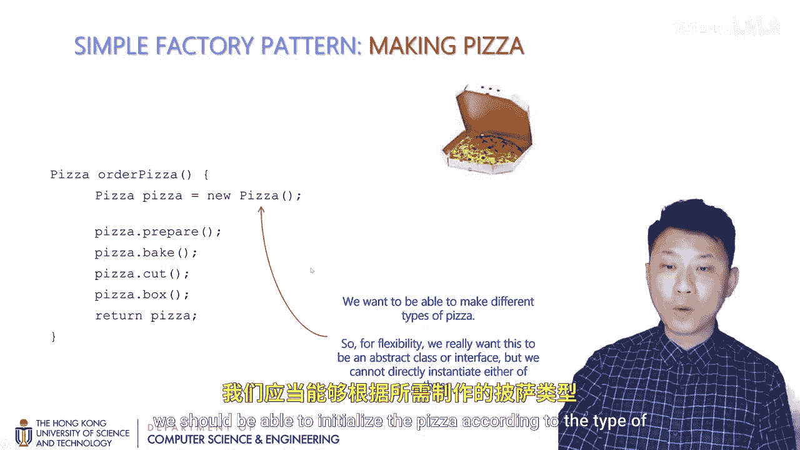

**开闭原则 (Open-Closed Principle)**：软件实体（类、模块、函数等）应该对扩展开放，但对修改关闭。这意味着，当需要添加新功能时，应通过扩展而非修改现有代码来实现。

**封装变化原则 (Encapsulate What Varies)**：识别出应用中会变化的部分，并将其与保持不变的部分分离。将变化的部分封装起来，以后可以独立修改或扩展，而不会影响其他部分。

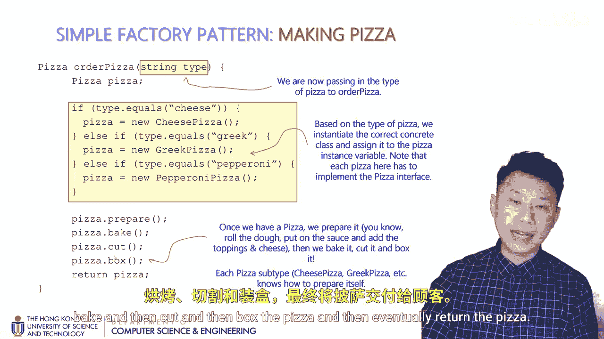

在披萨店的例子中，创建哪种具体披萨对象的逻辑是会变化的（可能增加或减少披萨种类），而制作披萨的步骤（准备、烘烤、切割、装盒）是相对稳定的。工厂模式正是将“创建对象”这个变化点封装起来。


## 披萨店示例：初始设计 🍕

让我们通过一个具体的披萨店订单系统来理解问题。

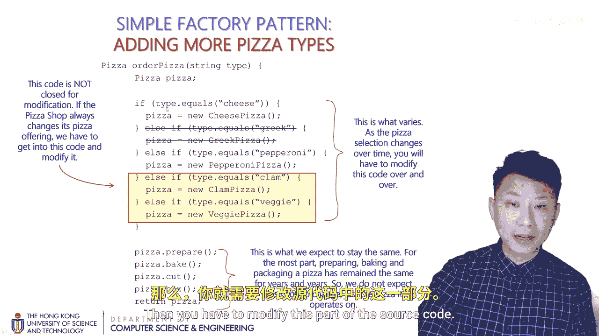

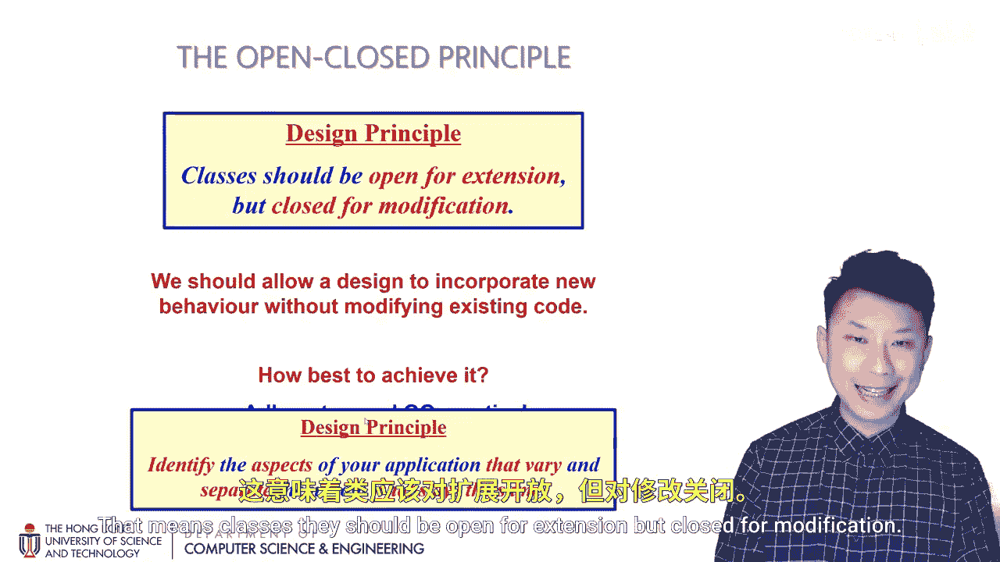

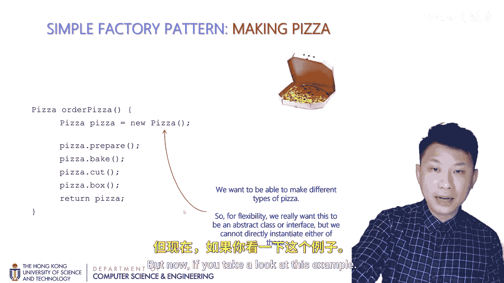

在 `PizzaStore` 类中，有一个 `orderPizza` 方法，其流程如下：

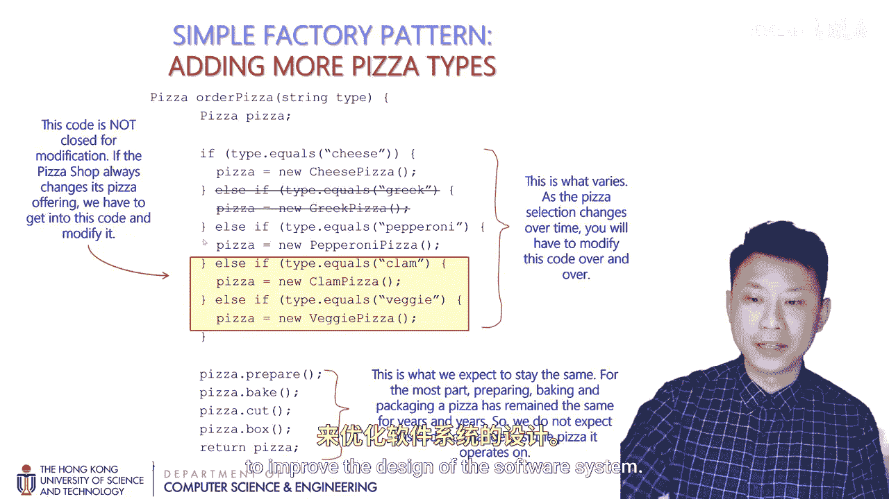

1.  根据订单类型创建披萨对象。
2.  准备披萨 (`prepare`)。
3.  烘烤披萨 (`bake`)。
4.  切割披萨 (`cut`)。
5.  装盒披萨 (`box`)。
6.  返回披萨。

初始的代码中，创建披萨对象的逻辑直接写在 `orderPizza` 方法里：

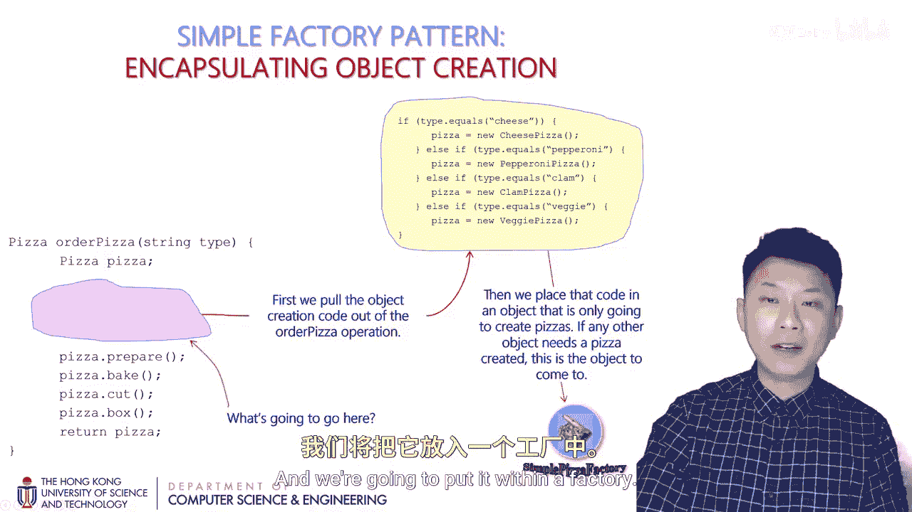

```java
Pizza pizza;
if (type.equals(“cheese”)) {
    pizza = new CheesePizza();
} else if (type.equals(“greek”)) {
    pizza = new GreekPizza();
} else if (type.equals(“pepperoni”)) {
    pizza = new PepperoniPizza();
}
// ... 后续制作步骤
```

这个设计的问题与之前的鸭子例子相同：如果菜单需要变动（例如下架希腊披萨，或新增海鲜披萨），我们必须打开并修改 `PizzaStore` 类的源代码。这违反了开闭原则。

## 引入工厂模式 🏗️

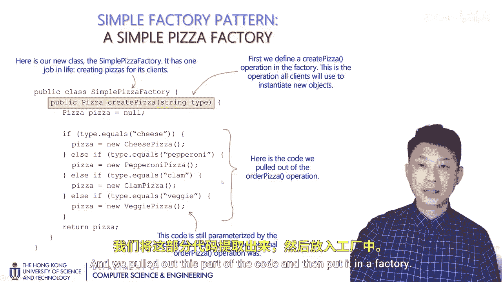

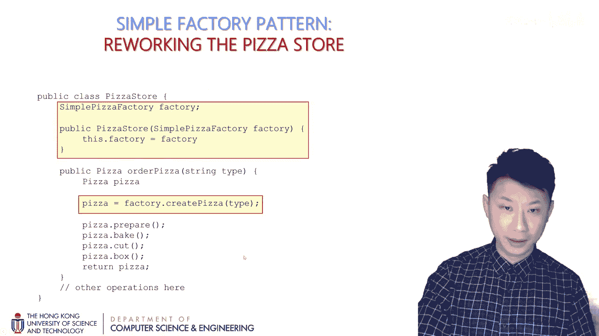

为了解决上述问题，我们将创建对象的职责抽取出来，封装到一个单独的类中，这个类就是“工厂”。

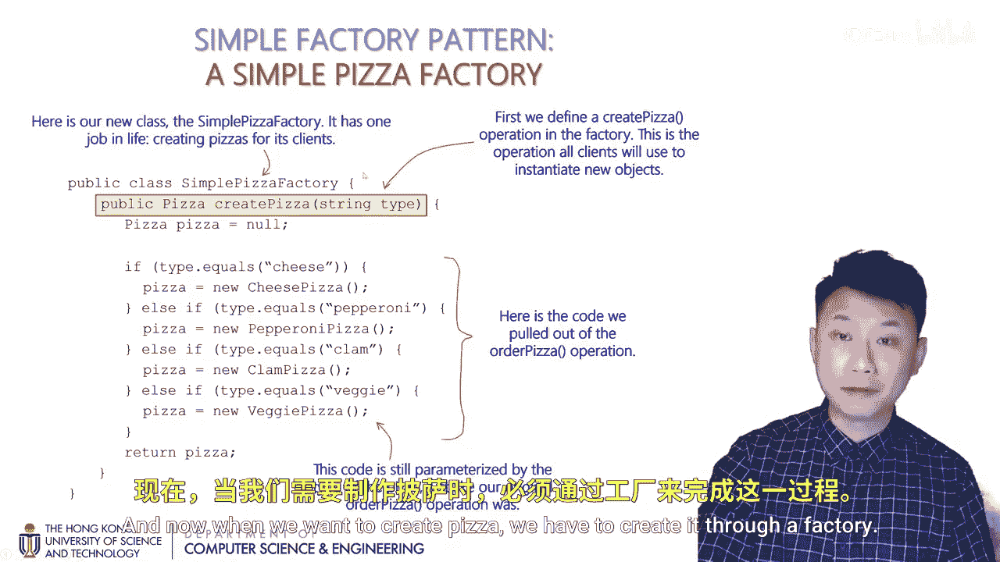

我们创建一个 `SimplePizzaFactory` 类，它专门负责根据类型创建披萨对象：

```java
public class SimplePizzaFactory {
    public Pizza createPizza(String type) {
        Pizza pizza = null;
        if (type.equals(“cheese”)) {
            pizza = new CheesePizza();
        } else if (type.equals(“greek”)) {
            pizza = new GreekPizza();
        } else if (type.equals(“pepperoni”)) {
            pizza = new PepperoniPizza();
        }
        return pizza;
    }
}
```

现在，`PizzaStore` 类持有一个 `SimplePizzaFactory` 的引用。当需要创建披萨时，它委托给工厂对象：

```java
public class PizzaStore {
    SimplePizzaFactory factory;

    public PizzaStore(SimplePizzaFactory factory) {
        this.factory = factory;
    }

    public Pizza orderPizza(String type) {
        Pizza pizza;
        // 委托工厂创建对象
        pizza = factory.createPizza(type);

        pizza.prepare();
        pizza.bake();
        pizza.cut();
        pizza.box();
        return pizza;
    }
}
```

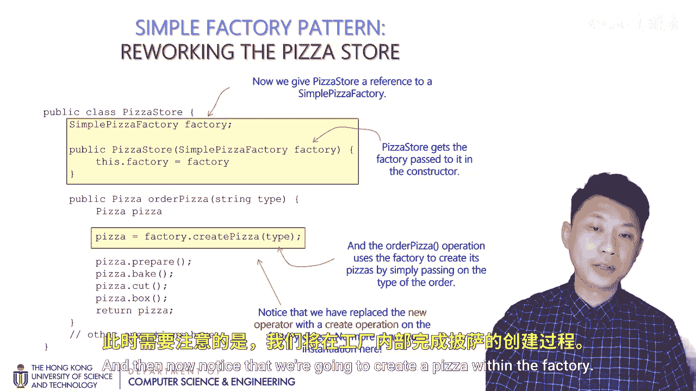

通过这种改造，披萨类型的变化被隔离在 `SimplePizzaFactory` 类中。未来修改菜单时，我们只需改动工厂类，而 `PizzaStore` 的核心订单流程保持不变，符合开闭原则。

## 工厂模式的类图 📐

以下是简单工厂模式（Simple Factory）的典型类图结构：

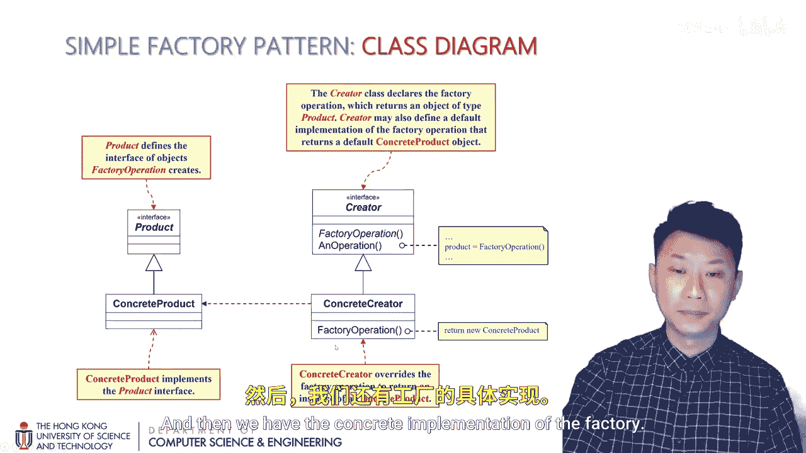

```
         <<Creator>>                   <<Product>>
        SimplePizzaFactory              Pizza
        +createPizza(type)              +prepare()
                                        +bake()
               |                        +cut()
               | uses                   +box()
               |
               |                --------------------------
               |                |           |           |
               |         CheesePizza   GreekPizza PepperoniPizza
               |         (Concrete Products)
```

*   **产品 (Product)**：`Pizza` 接口或抽象类，定义了产品的通用操作（`prepare`, `bake` 等）。
*   **具体产品 (Concrete Product)**：`CheesePizza`、`GreekPizza` 等，实现了 `Pizza` 接口。
*   **创建者/工厂 (Creator)**：`SimplePizzaFactory`，负责创建具体产品的对象。它包含一个如 `createPizza` 的工厂方法。

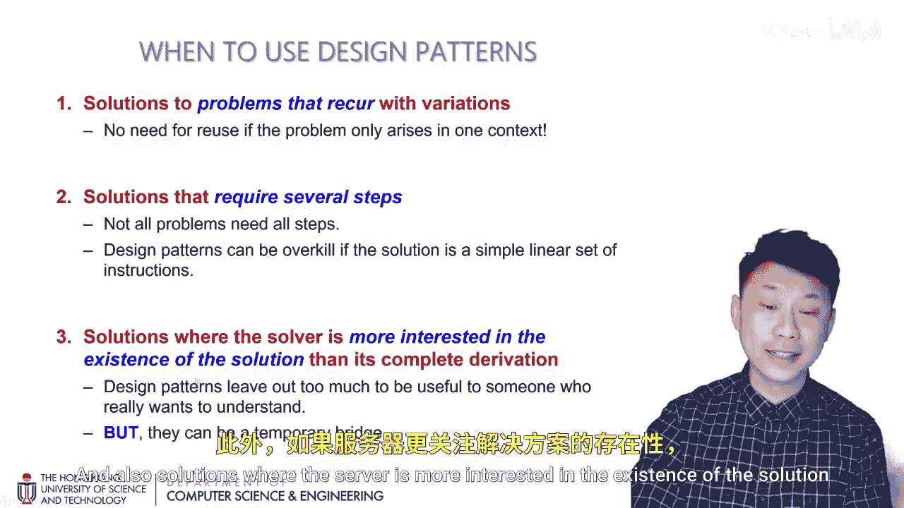

这个结构清晰地分离了“对象的创建”与“对象的使用”。

## 何时使用及优缺点 ⚖️

在学习了工厂模式的结构后，我们来探讨其适用场景和利弊。

**何时使用设计模式（包括工厂模式）？**
以下是适用设计模式的一些情况：
*   针对反复出现的、具有变化性的问题寻求解决方案。
*   解决方案需要多个步骤协作，而非简单的线性指令。
*   开发者更关注成熟解决方案的存在性，而非从头推导。

**使用设计模式（工厂模式）的优点：**
*   **促进大规模设计复用**：提供了经过验证的解决方案模板。
*   **捕获专家知识**：模式中蕴含了设计权衡和最佳实践，使新手也能写出专家级代码。
*   **改善开发沟通**：模式名称（如“工厂模式”）成为团队共享的词汇，提升了沟通效率。
*   **助力面向对象设计**：大多数模式使用类图描述，自然地引导开发者进行良好的面向对象设计。

**使用设计模式（工厂模式）的缺点：**
*   **非直接代码复用**：模式是设计蓝图，而非可直接拷贝粘贴的代码库。
*   **看似简单，实现复杂**：类图描述简洁，但实际实现时可能需要处理许多细节，变得复杂。
*   **可能导致“模式超载”**：团队可能花费过多时间寻找“完美”的模式，而忽略了简单直接的解决方案。
*   **验证依赖经验**：模式是否正确应用，更多地依赖同行评审和经验判断，而非自动化测试。
*   **集成过程人力密集**：将模式成功整合到开发流程中，需要专家的指导和团队的深入学习。

## 总结 📝

本节课中我们一起学习了工厂模式。我们从一段违反开闭原则的代码开始，分析了直接实例化对象带来的维护性问题。随后，我们引入了**开闭原则**和**封装变化原则**作为理论指导。

通过披萨店的案例，我们逐步演示了如何将变化的部分——**对象创建逻辑**——抽取出来，封装到一个独立的 `SimplePizzaFactory` 类中。这样，`PizzaStore` 类就只依赖于 `Pizza` 抽象和工厂接口，从而对具体的披萨类型变化关闭。

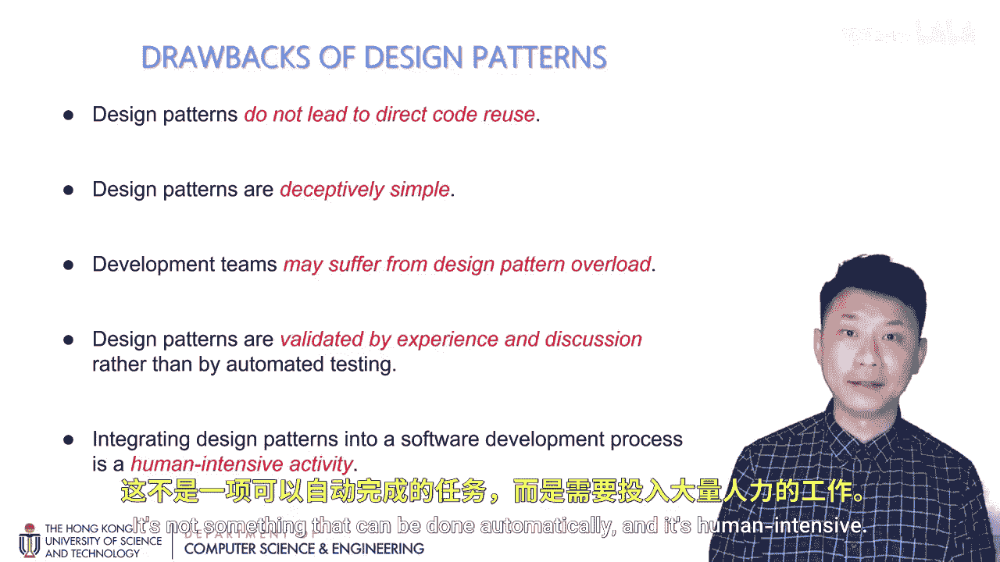

最后，我们讨论了工厂模式的类图结构，并分析了设计模式通用的适用场景、优点与缺点。记住，工厂模式的核心价值在于**将对象的创建与使用分离**，从而提高代码的灵活性、可维护性和可扩展性。