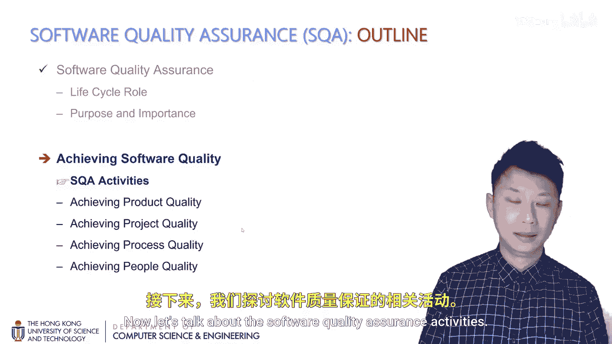
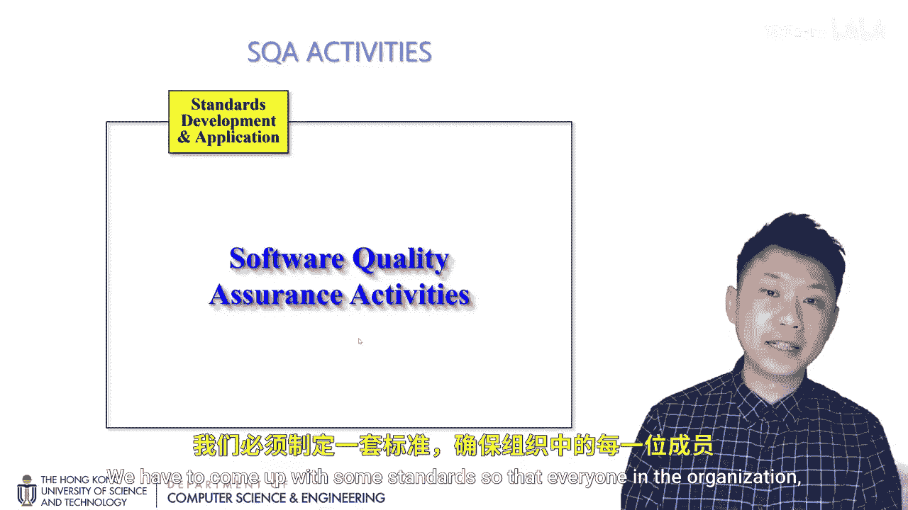
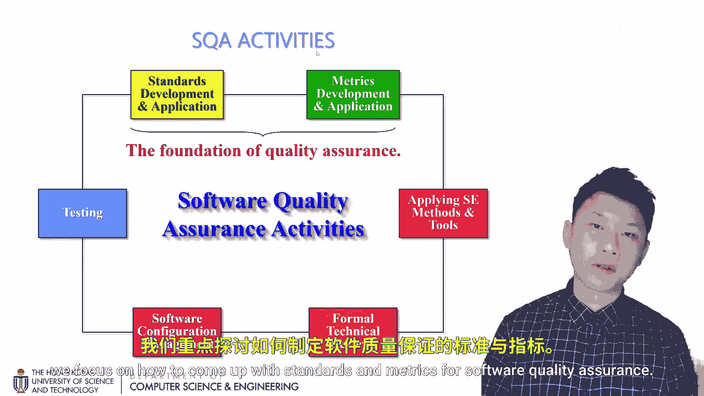
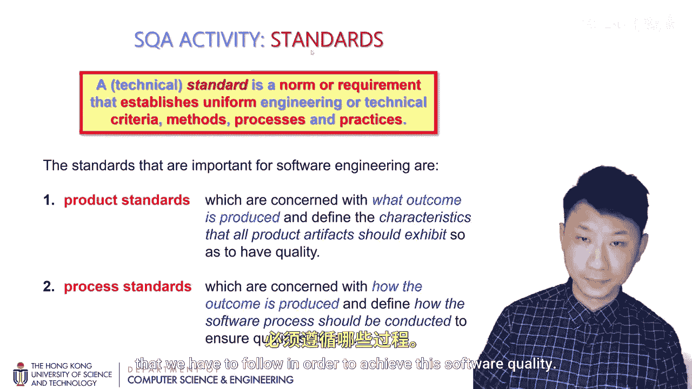
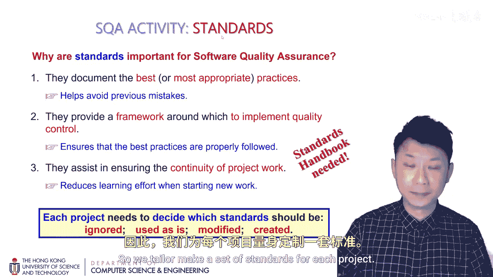
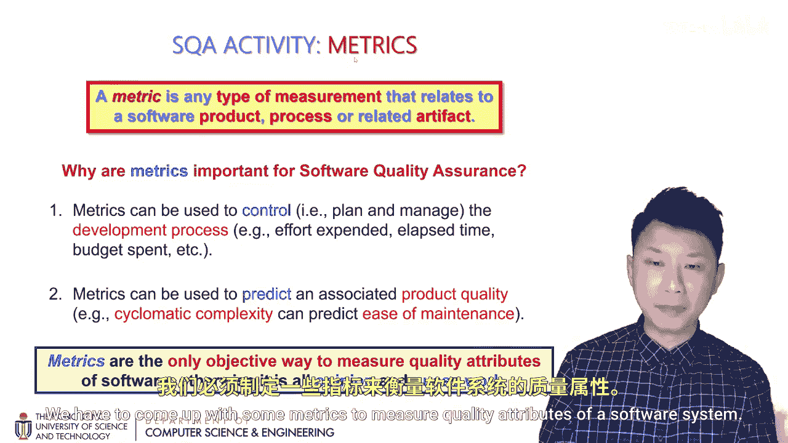

**软件工程：P56：软件质量保证活动** 📋

在本节课中，我们将要学习软件质量保证活动，即为了达成软件质量目标而必须执行的一系列工作。我们将重点探讨如何制定标准与度量指标。

---

为了确保软件质量，我们必须执行一系列活动。这些活动包括制定标准、定义度量指标、使用合适的工具、进行评审、实施配置管理以及充分的测试。本节课，我们将聚焦于如何为软件质量保证制定标准和度量指标。

### **什么是标准？**

上一节我们介绍了质量保证活动，本节中我们来看看其中的核心要素之一：标准。

标准是一种规范或要求，它建立了统一的工程或技术准则、方法、流程和实践。对于软件工程而言，重要的标准包括**产品标准**和**过程标准**。

以下是两类标准的定义：

*   **产品标准**：关注**产出什么**。它定义了所有产品工件（如需求文档、设计图、代码）应具备的特性，以确保其质量。其核心是产品本身。
    *   **公式/代码示例**：例如，代码标准可能规定 `函数长度 <= 50行` 或 `必须进行异常处理`。
*   **过程标准**：关注**如何产出**。它定义了应如何执行软件过程（如开发、测试、部署流程）以确保软件质量。其核心是遵循的流程。

### **为什么标准很重要？**

理解了标准的定义后，我们来看看它在质量保证中扮演的关键角色。

标准之所以重要，原因如下：
1.  它们记录了最佳或最合适的实践，帮助我们避免犯错。
2.  它们为实施质量控制提供了框架，确保项目内能正确遵循最佳实践。
3.  它们有助于保证项目工作的连续性。这意味着当我们启动新项目时，可以减少学习成本，可以复用之前项目的一些标准。

因此，组织通常需要一本**标准手册**来记录所有标准，并要求所有员工遵循。对于每个具体项目，我们需要决定哪些标准可以忽略、直接使用、修改或新建，即为每个项目量身定制一套标准。

### **什么是度量指标？**

在制定了标准之后，我们需要一种方法来衡量是否达到了这些标准，这就是度量指标的作用。

度量指标是与软件产品、过程或相关工件相关的任何类型的测量。

以下是度量指标重要性的原因：
1.  它们可用于**控制开发过程**。例如，帮助我们精确了解项目需要投入多少工作量、时间等资源。
2.  它们可用于**预测相关的产品质量**。例如，我们可以使用圈复杂度来预测软件系统的可维护性。

**公式/代码示例**：圈复杂度的简化计算公式为 `M = E - N + 2P`，其中E是控制流图中边的数量，N是节点数，P是连通分量数。圈复杂度高通常意味着逻辑复杂，系统更难维护。

这意味着我们不能仅凭猜测，而必须借助度量指标来量化软件系统的质量属性。

---

本节课中，我们一起学习了软件质量保证的两项核心活动：制定标准和定义度量指标。标准（包括产品标准和过程标准）为我们提供了统一的行动准则和最佳实践框架；而度量指标则为我们提供了量化的工具，用于控制过程和预测质量。它们是实现系统化、可衡量软件质量保证的基础。