# 058：实现项目、流程与人员质量 🎯

在本节课中，我们将学习如何实现软件项目、开发流程以及人员三个层面的质量。我们将探讨通过评审、配置管理、过程改进和人员能力提升等具体方法来保障软件质量。

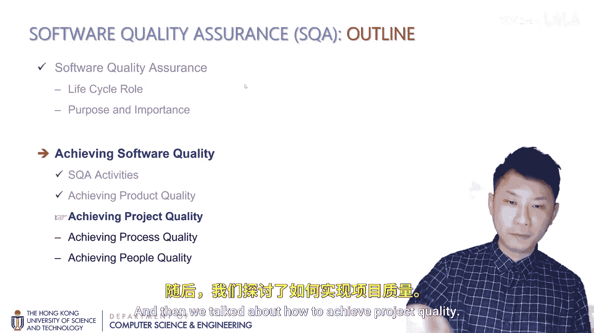

---

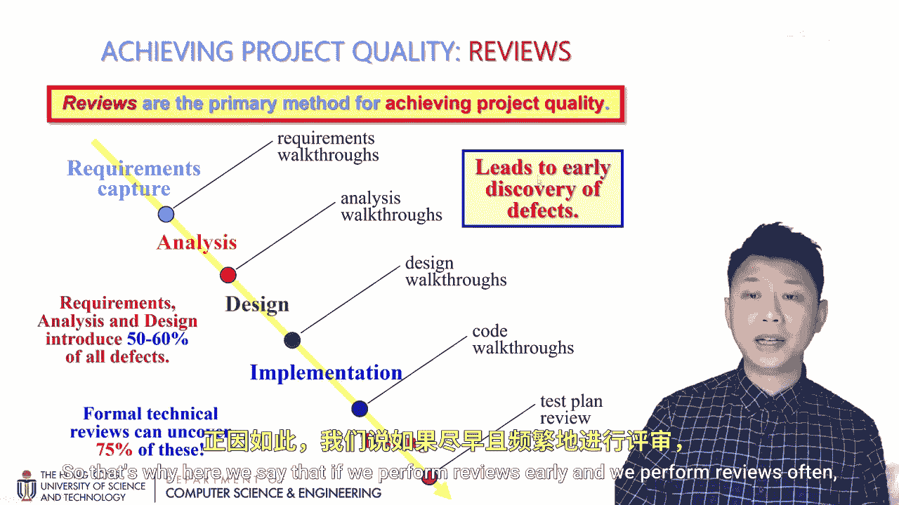

## 实现项目质量 🏗️

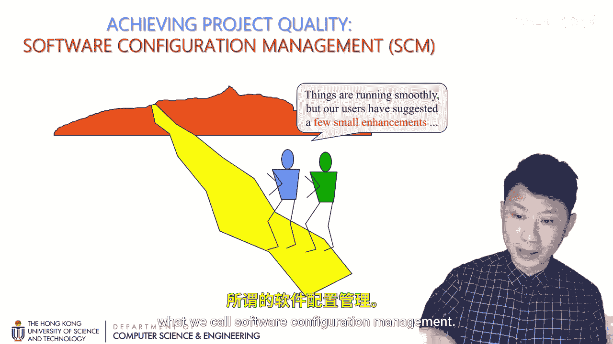

上一节我们讨论了质量的重要性，本节中我们来看看如何实现项目质量。实现项目质量的一个核心方法是定期执行评审。

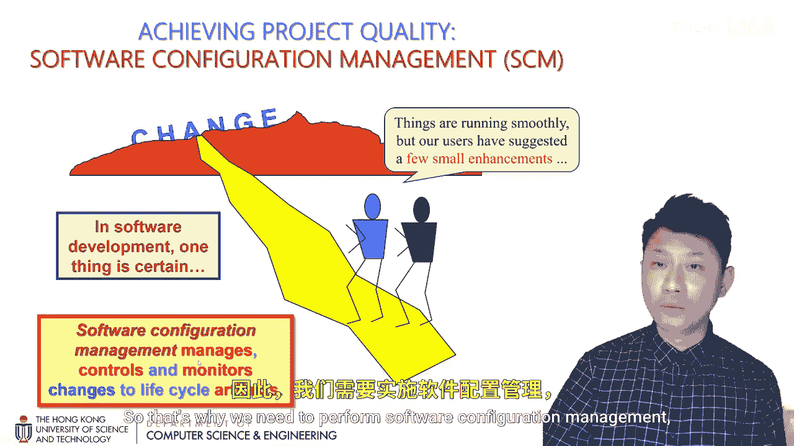

以下是实现项目质量的关键方法：

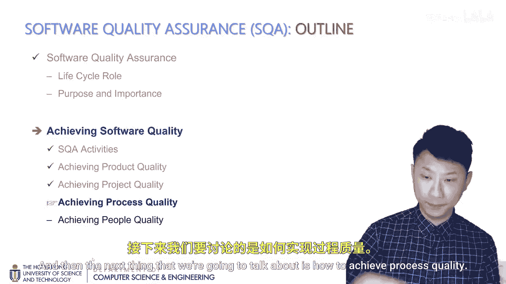

*   **执行定期评审**：我们不仅指代码评审，还包括对需求、分析和设计的评审。这些早期阶段通常引入了50%至60%的缺陷。通过执行正式的技术评审，可以揭示其中75%的缺陷。
    *   **核心公式**：`早期且频繁的评审 => 早期发现缺陷`
*   **实施软件配置管理**：因为项目中必然会发生变更。我们需要通过软件配置管理来管理、控制和监控项目中的所有变更。

---

## 实现流程质量 🔄

在讨论了项目质量后，我们接下来探讨如何实现流程质量。你可能会问，流程在软件开发中有多重要？

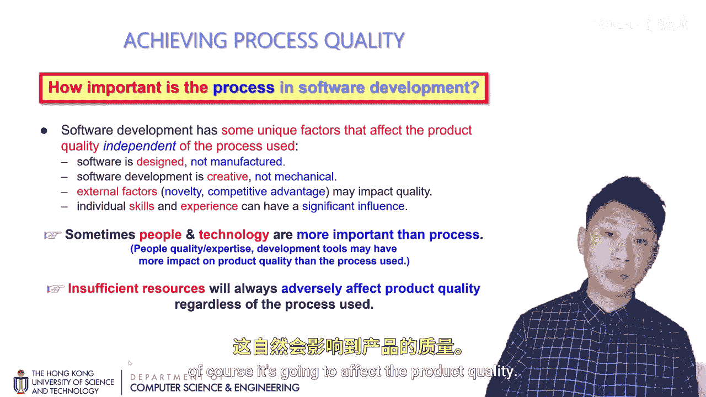

软件开发有一些独特因素，它们会影响产品质量，且与所用流程无关：
*   软件是设计出来的，而非制造出来的。
*   软件开发是创造性的，而非机械性的。
*   外部因素可能影响软件质量。
*   个人技能和经验对项目质量有显著影响。

因此，有时**人员和技术比流程更重要**。拥有优秀的人员和技术，项目成功的可能性也很大。此外，无论使用何种流程，资源不足（如时间或预算）总会影响产品质量。

一个详细的软件开发流程通常不可直接移植，因为它高度依赖于特定组织。例如，即使谷歌使用敏捷开发，其他公司照搬同一流程也未必成功。

有一个名为 **SEI CMM** 的指南，旨在帮助软件组织评估和改进其软件开发流程。它分为五个等级：

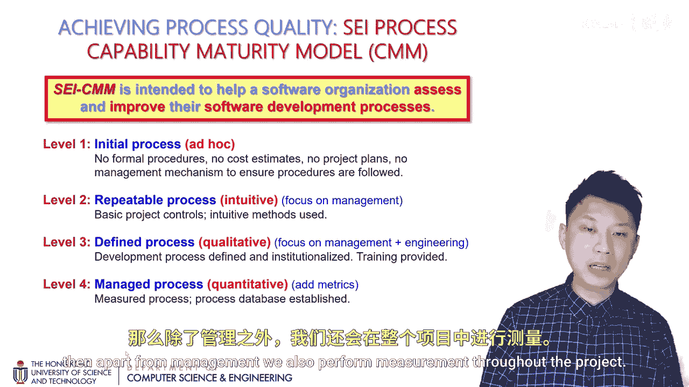

1.  **初始级**：无管理。
2.  **可重复级**：具备基本管理，例如跟踪项目时间和预算。
3.  **已定义级**：为项目定义了所有流程，并提供培训。
4.  **已管理级**：除了管理，还在整个项目中进行度量。
5.  **优化级**：在管理和度量的基础上，增加反馈机制以持续改进。

---

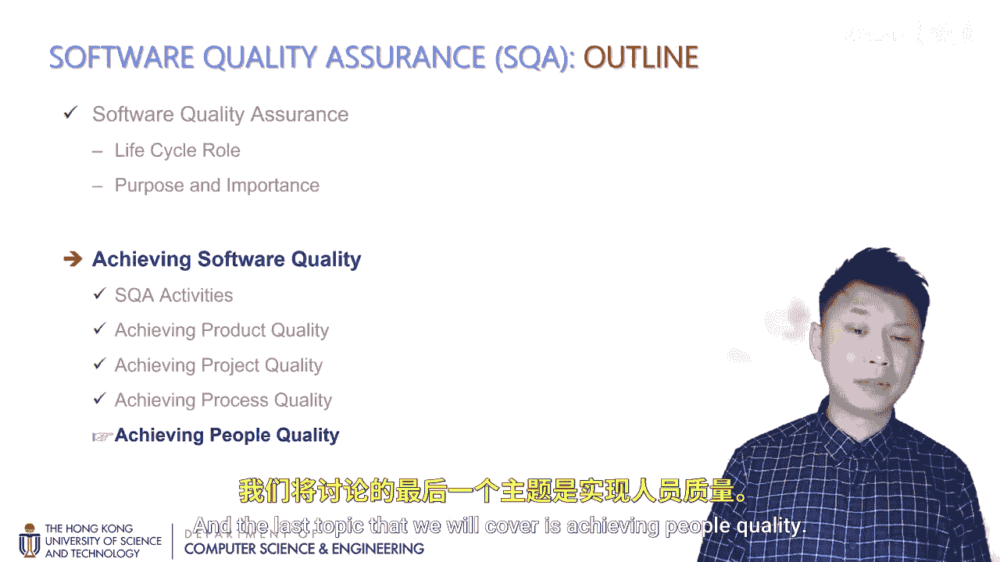

## 实现人员质量 👥

上一节我们介绍了流程质量模型，本节中我们来看看如何评估和提升人员质量。有一个名为 **PCMM** 的指南，旨在评估和改进组织内人员的知识和技能。

PCMM也分为五个等级：

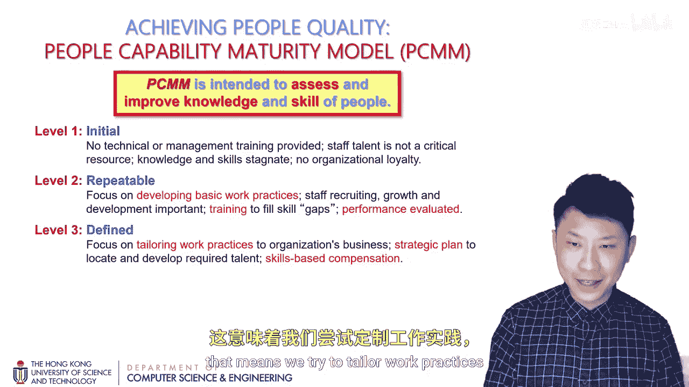

1.  **初始级**：不提供任何培训。
2.  **可管理级**：组织提供基本培训，例如针对特定编程语言的培训。
3.  **已定义级**：尝试定制工作实践，并有计划定位和发展所需人才。
4.  **已预测级**：关键词是**注重团队建设**。
5.  **优化级**：注重提升团队和个人技能，采用最佳实践。

当你日后在工业界工作时，应确保为达到**3级或以上**的组织工作，因为这意味着它们会为你提供培训，使你能在不同的项目中学习成长。

---

## 总结与关键要点 📝

本节课中我们一起学习了实现软件质量的多维度方法。以下是为实现质量需要做的事情总结：

*   **组织应有质量方针**：记录软件质量保证程序。
*   **项目应有质量计划**：明确项目最重要的质量属性及评估方法。
*   **组织应有定义明确的标准手册**：确保所有员工遵循。
*   **建立机制和流程**：监控对组织所有质量要求的符合性。
*   **定期执行评审**：确保不犯错误。
*   **持续监控所有度量指标**：用于突出软件中可能存在质量问题的异常部分。

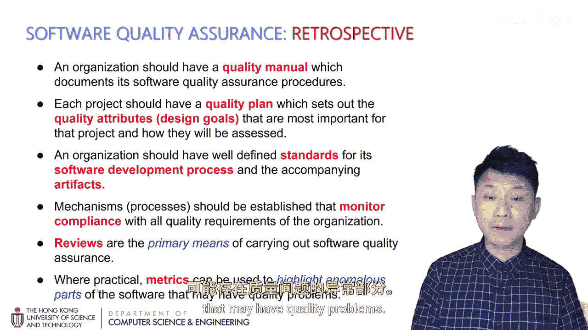

请注意，高质量的软件不会凭空出现。软件质量保证需要**融入**到软件开发流程中。开发高质量软件需要管理、标准、度量以及承诺。同时要认识到，测试是质量保证的重要组成部分，但并非获得高质量软件产品的全部，因为测试通常在项目后期进行。本节课我们重点讨论了如何在项目早期发现缺陷的各种方法。

---

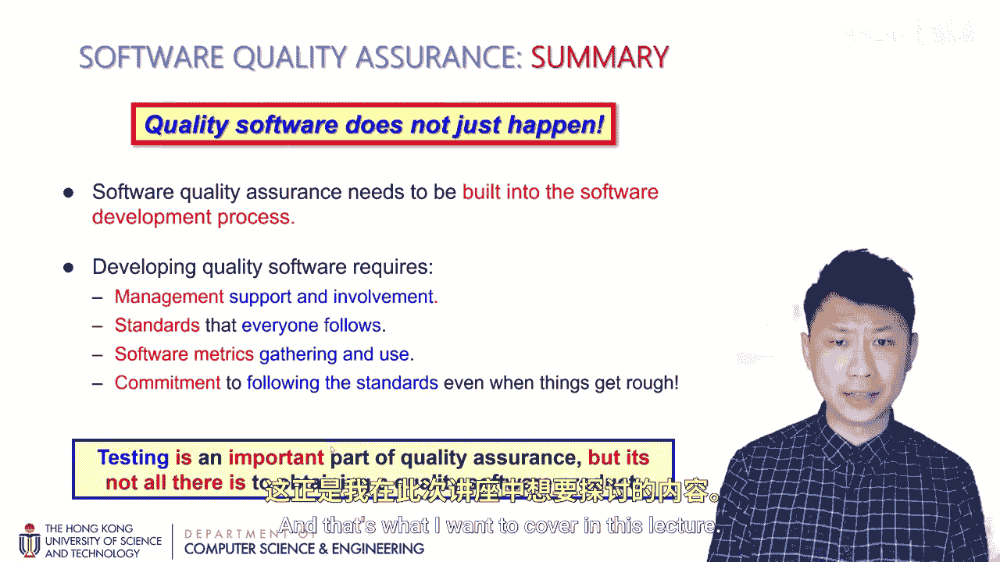

**本节课中，我们一起学习了通过评审、配置管理、流程改进（SEI CMM）和人员能力发展（PCMM）来实现项目、流程和人员三个层面的质量，并总结了构建全面质量保证体系的关键要素。**