# 061：项目跟踪与控制 🎯

在本节课中，我们将学习软件项目管理的核心环节——项目跟踪与控制。我们将探讨为何需要持续监控项目，以及如何通过有效的实践来确保项目按预算和进度进行。

## 概述

软件项目进度可能瞬息万变，因此需要对项目活动进行持续、一致且无干扰的监控。监控的主要目的是确保项目符合预算和进度计划。由于项目过程中必然会发生变更，因此应用软件配置管理（SCM）至关重要。

## 项目监控的必要性

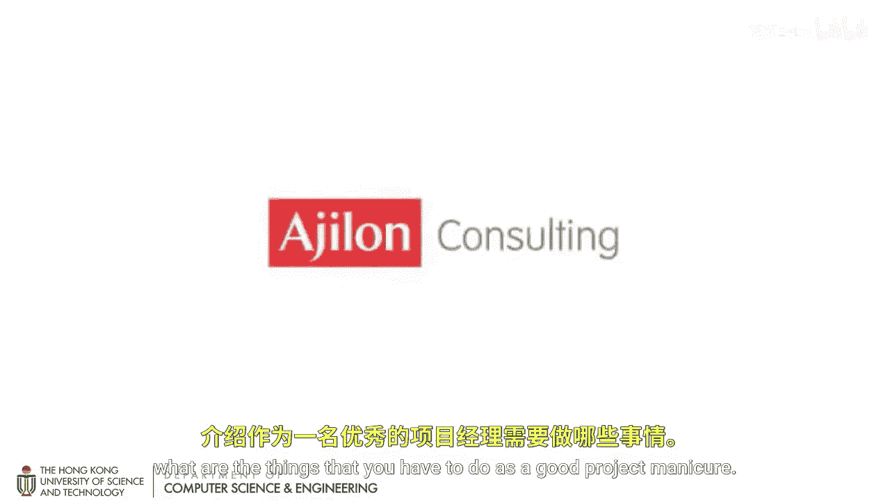

软件项目需要持续监控，因为其进度可能逐日变化。监控的主要目的是确保项目符合预算和进度计划。

## 关于人员与变更的要点

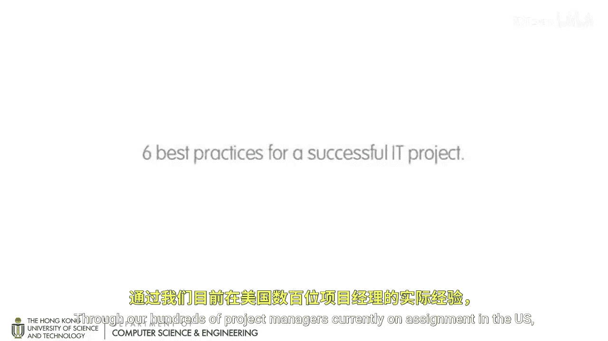

一个常见的误区是向进度落后的项目增加人力。这通常会使项目更加延误，因为需要额外的时间来培训新成员。因此，向落后项目增加人力往往会使其更加落后。

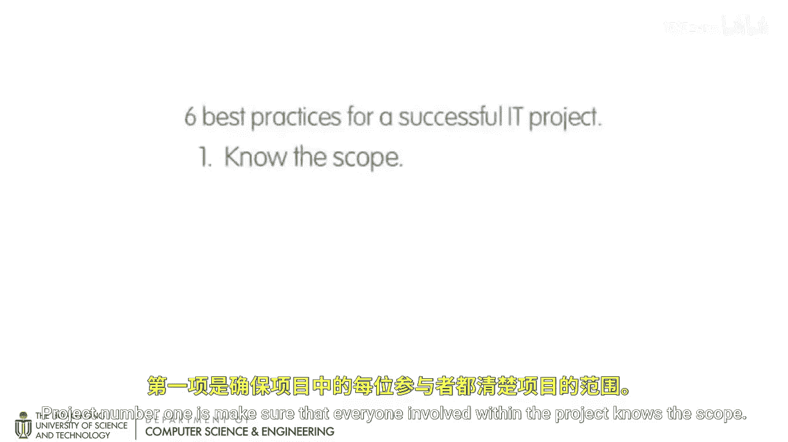

项目内部发生变更是必然的，这就是为什么应用**软件配置管理（SCM）** 非常重要。

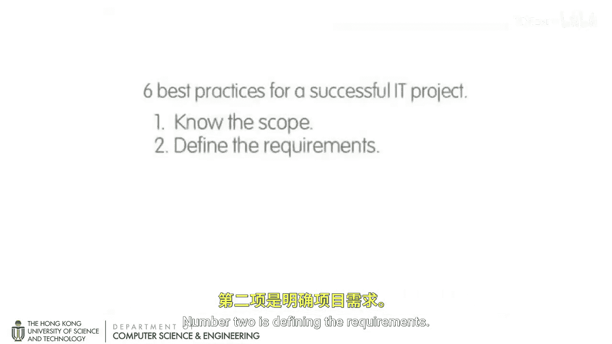

## 常规项目活动

以下是项目团队必须定期执行的活动：

*   **召开项目状态会议**：例如每日站会、周会或月会。
*   **进行项目评审**：定期进行，并评估每次评审的结果。
*   **检查里程碑**：确认是否按计划完成。
*   **比较预算**：定期将实际支出与计划预算进行比较。
*   **进行非正式沟通**：与项目成员进行非正式交流，以获得对进展的主观评估。

## 优秀项目经理的实践

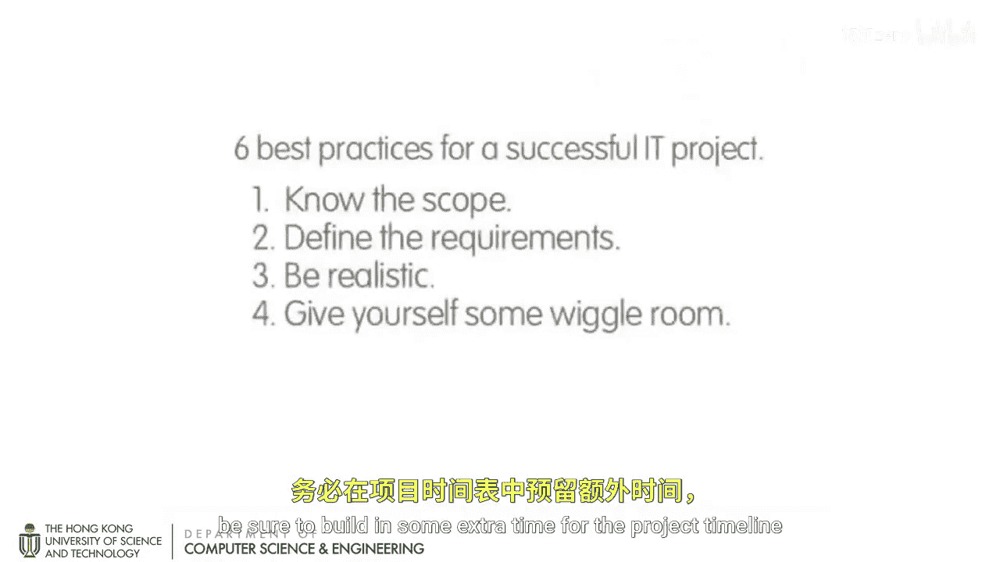

现在，让我们通过一段视频来了解一位优秀项目经理需要做哪些事情。视频来自Ash Long咨询公司的区域高级副总裁Matthew Paul，他总结了成功交付IT项目的六个最佳实践。

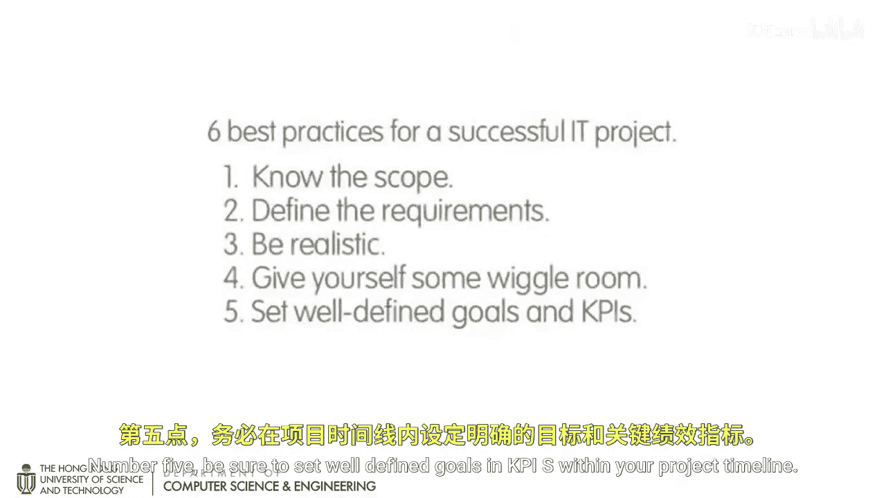

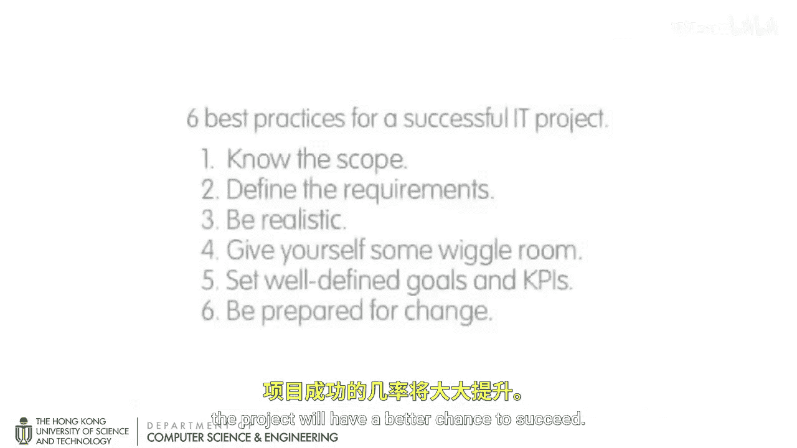

以下是确保IT项目成功的六个关键实践：

1.  **明确项目范围**：确保项目涉及的所有人都了解范围。范围应形成文档，以便在项目后续遇到问题时提供参考。明确哪些内容不在项目范围内同样重要。
2.  **定义需求**：在开始前，清晰定义业务需求和技术需求至关重要。没有明确定义的需求，项目成功的机会渺茫。
3.  **保持现实**：业务方总希望项目尽快交付并包含所有功能。作为项目经理，从第一次会议开始就设定正确的期望是必要的。
4.  **预留缓冲空间**：务必在项目时间线中预留额外时间，在预算中预留额外资源。项目总会遇到不可预见的情况，这些缓冲空间能帮助你仍在预算内按时交付项目。
5.  **设定明确的目标和KPI**：在项目时间线内设定定义明确的目标和关键绩效指标。如果我们能达成目标和KPI，项目成功的几率就会更大。
6.  **为变更做好准备**：我们知道随着项目推进，变更必然会发生。项目团队必须制定完善的变更管理流程，并确保每个人都完全清楚当变更发生时如何处理。

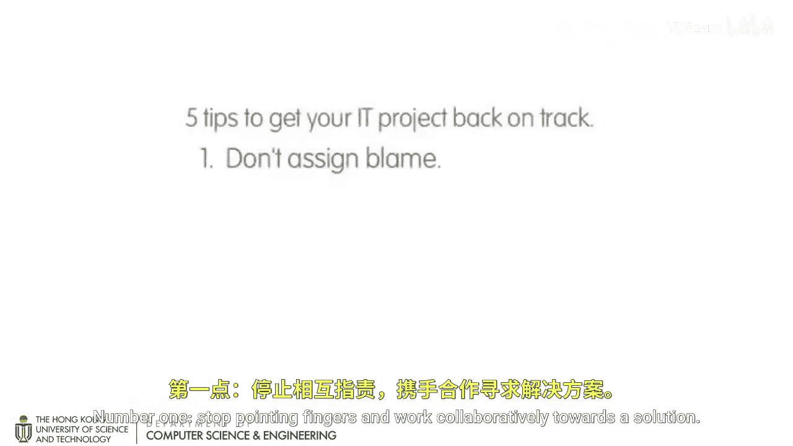

## 项目偏离轨道时的应对策略

如果你发现IT项目偏离了轨道，以下五个技巧可以帮助你重回正轨：

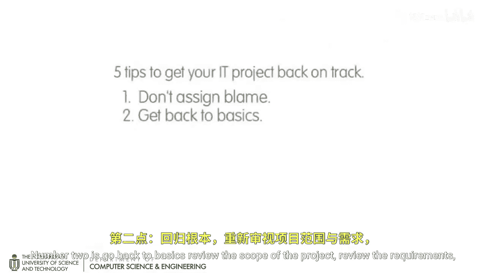

1.  **停止相互指责，协作寻找解决方案**：重点不在于我们如何陷入这个问题，而在于如何解决它。
2.  **回归基础**：重新审视项目范围，回顾需求，与利益相关者重新沟通，使项目重回正轨。
3.  **开放且频繁地沟通**：在交付IT项目时，沟通永远不嫌多。
4.  **确保拥有正确的资源**：不仅核心项目团队需要，最好还能在外部准备一些额外资源，以便在需要让项目重回正轨时能够随时介入。
5.  **进行自我评估**：作为IT项目经理，要不断问自己：我们是否有足够的资源来交付这个项目？我们是否有足够的资金？如果其中任何一个问题的答案是否定的，不要害怕：第一，将此情况告知业务方；第二，采取必要措施以确保拥有交付项目所需的正确资金和资源。

## 总结

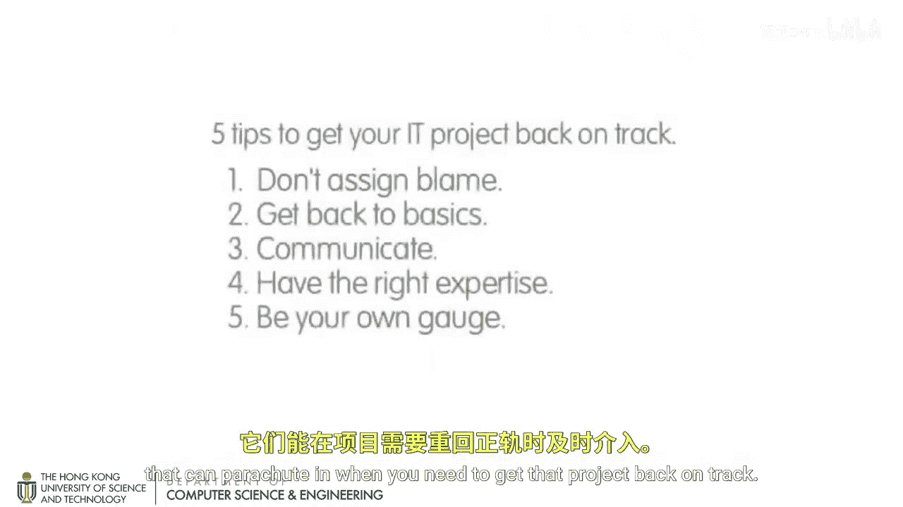

本节课中，我们一起学习了项目跟踪与控制的核心概念。我们了解到持续监控对于确保项目按预算和进度进行至关重要，也明白了为何向落后项目简单增加人力可能适得其反。通过视频案例，我们掌握了成功管理IT项目的六个最佳实践，以及在项目偏离轨道时的五个补救技巧。

最后，请记住：作为一名优秀的项目经理，你应该**管理流程，而不是被流程所管理**。

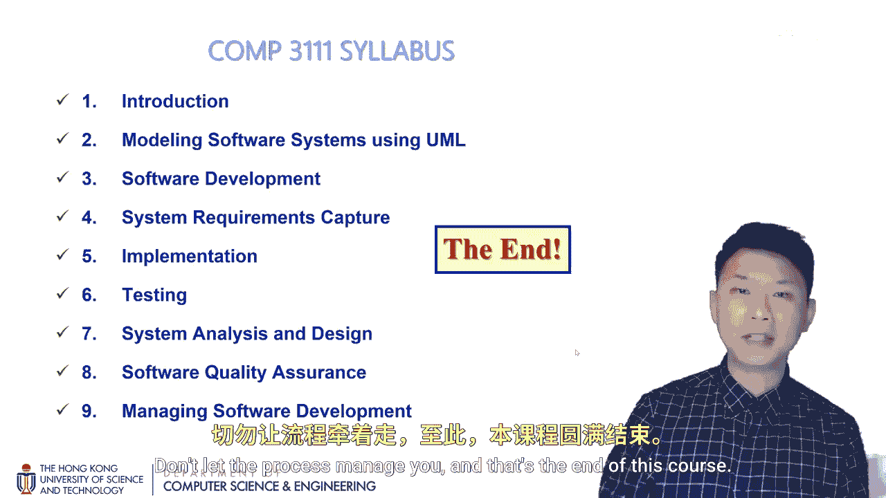

本课程到此结束。感谢学习。