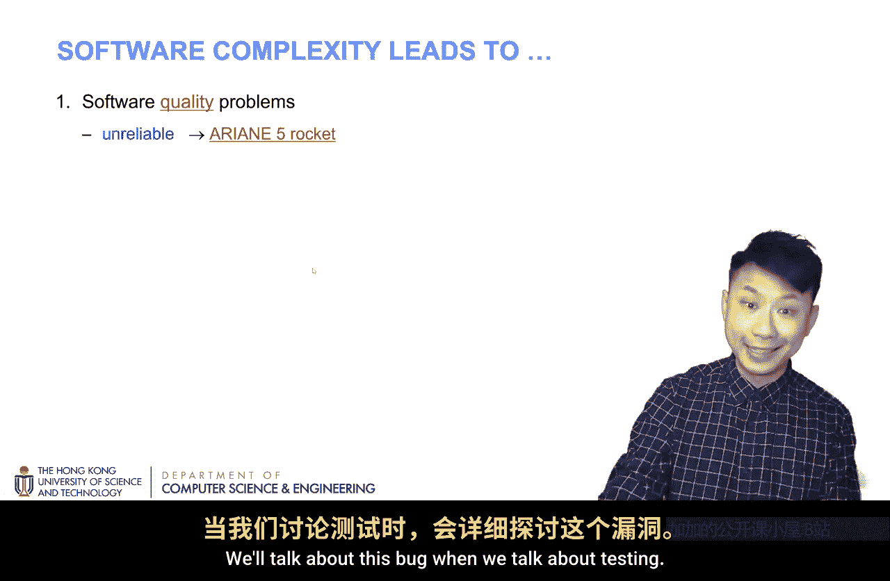
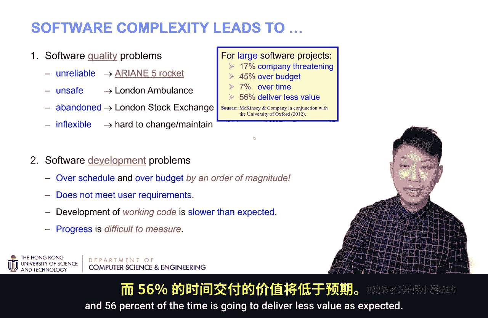

# 香港科技大学【中英⚡软件工程｜Software Engineering Specialization】 p01 P1 软件开发是复杂的 -BV1MMEjzoEhg_p1-

Hi， I'm Kenneth， I'm a professor from the Hong Kong University of Science and Technology。

 this course is about software engineering and in the first lecture it's going to be just an introduction to software engineering。

So these are the learning objectives of this lecture。After this lecture。

 you will appreciate that developing large software system is a complicated process。

And you will learn some techniques for dealing with the complexity of software development。

 and then finally， you will understand what is software engineering and why it is important in software development。

So software is complex to develop because if we are talking about a large software system。

 it has many lines of code， for example， for a Boeing 787， it has 14 million lines of code。

 if we are talking about Windows 7 we have like 140 million lines of code Windows 10 we have 150 million lines of code etc etc when we are talk about this kind of large software system it's not possible for us to implement a system from bottom up that means we implement a system like by line function by function but instead we have to plan out a lot before we start implementing the system。

So software complexity may come from application domain。

 the problem itself may be very complicated and the developers they are usually not domain experts。

 so for example， if I ask you to build a software system for a hospital to keep track patients information then you are an expert in programming but you are not an expert in the application domain that means the hospital then you may have to learn about the application domain before you can work on the system。

So software complexity may also come from communication among stakeholders。

 just because different stakeholders they may be using different vocabulary when they communicate。

 for example， your client may come to you and they ask you to build a system to store numbers。

 then you may have to clarify with your client， whether they want to store integer。

 whether they want to store real numbers or photo numbers。And the stakeholders。

 they may have different background knowledge and sometimes human languages are inherently abiigous。

 so that's why the complexity may come from communication itself。

And also management of large software development project is going to be complicated。

 so that's why we have to divide the project into pieces and then reassembled pieces。

And we need to coordinate with many different parts and also many different people。

And also coding itself is going to be complicated and creating useful software is going to be a complicated process。

 so software complexity may lead to software quality problems。For example。

 you may make your software system unbeliable， I'm going to show you a little video about this RN5 rocket and the entire rocket just brought up because a tiny mistake in the software system。

 a tiny bug in the software system and we'll talk about this bug when we talk about testing。

あ単しこでコ気にあるや。A final decision to go was taken。Said cease， sign。That话。Do we needて help。I妈。Pcoage。

玻面 so going。37 seconds into the launch， the onboard computers decided 501 was 90 degrees off course。

They made an automatic adjustment of the trajectory as the rocket was travelling at the speed of sound。

And you may also make your system unsafe。 for example， the London Aance system。

Which fell twice in 1992 and people died because of the failure in providing ambulance surface。

And abandoned。For example， people spend five years in developing this London Stock exchange system。

 and then eventually they have to abandon the system because it's not reliable。

And eventually you may also make your system inflexible。

 which is going to be hard to change and also hard to maintain。And also。

 software complexity may lead to software development problems。For example。

 your project may be over schedule over budget。And also it may not meet user requirements。

And development of working code is lower than expected， that means over schedule。

Pllgra is going to be difficult to matchsh it。And for a large software system。

 17% of the time they are facing company threateningtening。

 that means people say something bad about your company on， for example， the internet。

And 45% of time is going to be over budget， 7% of time is going to be over time。

 and 56% of the time is going to deliver less valued as expected。

