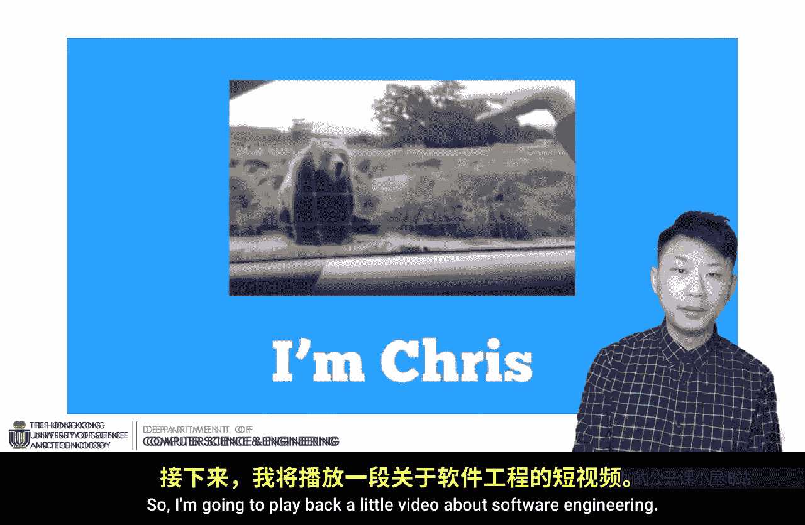
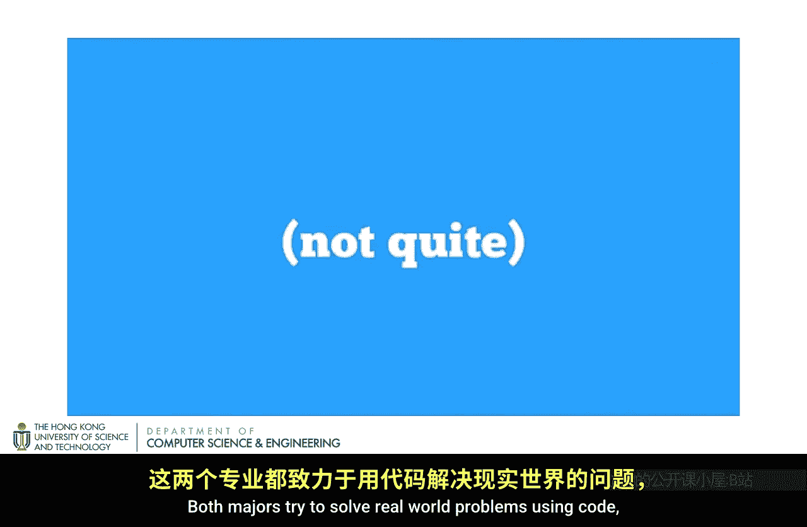
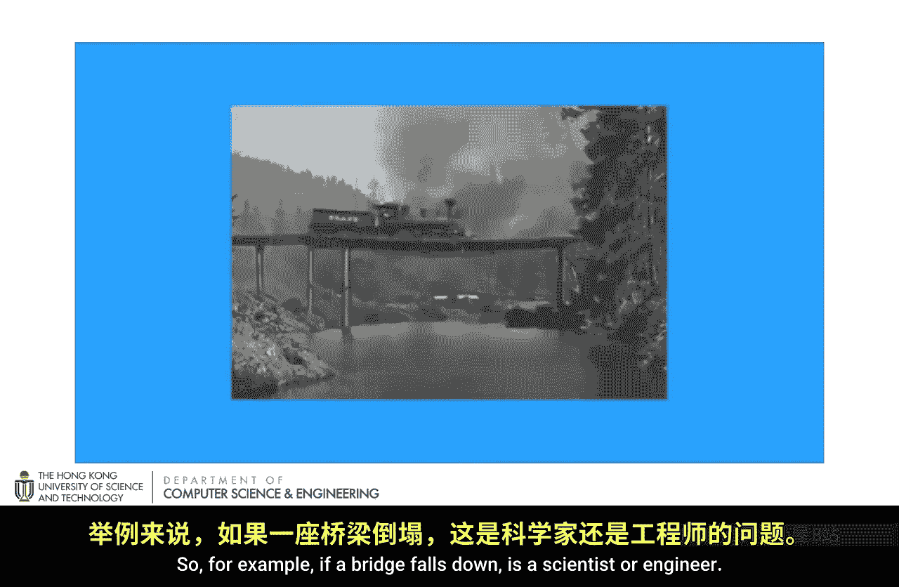
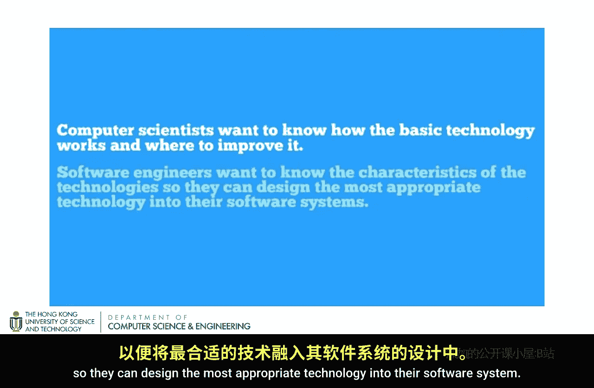
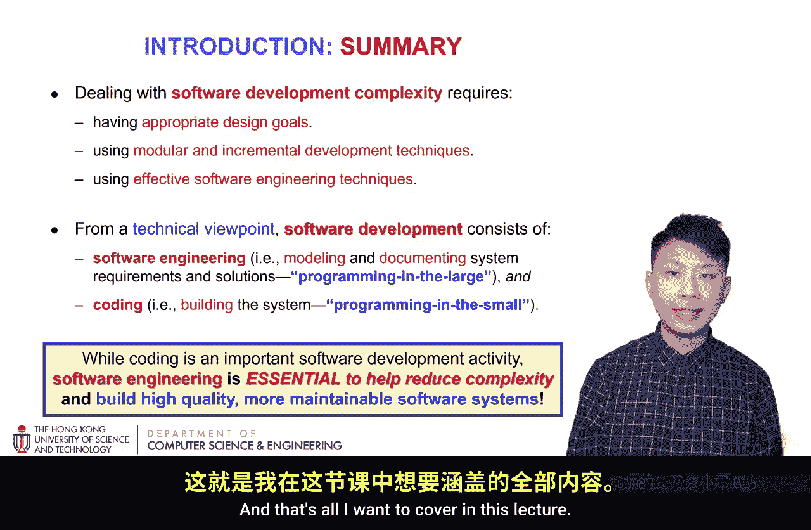

# 香港科技大学【中英⚡软件工程｜Software Engineering Specialization】 p03 P3 03_什么是软件工程 -BV1MMEjzoEhg_p3-

So what is software engineering anyway， so I'm going to play back a little video about software engineering。

My name is Chris County Corman， I work at Apple on iOS。

What is software engineering， We got four pictures of things here。 We have World of Warcraft。

 We have Calla duty 4 and an airplane， and we have the New York Stock Exchange。

 But what do they hell have in common。 So hopefully it won't be too much of a reach to think that all of them have a code in common。

 And a lot of it。 just for a little bit of a frame of reference of Boeing 747 has more lines of code than it does Part。

 including nuts and bolts。

I was really blown away by when I heard this， how much lines of code， specifically of Boeing 7。

47 has 4 million lines of code in it。 And most games that you play today day have about 6 million lines of code in them。

 just for reference。So these are really huge software systems that really can't be thought of at like one line or one class at a time。

 The software engineer needs to think about the design at different levels from one line of code all the way up to the entire system。

So let's think about scheduling that for just a moment。

 If I can write one source line of code per minute， there's 60 minutes in an hour。

And there's 40 hours in an average work week。 That gives me 2400 source lines of code per week per software engineer。

So we take that， and we multiply that by the usual 50 work weeks per year。

 That means every software engineer can crank out 120000 source lines of code per year。

Pulling that all together， If I have 2 million lines of code estimated in a project with the amount of code I can crank out from each engineer。

 I need the very least 17 software engineers to get this on the software shelves for the holiday season。

You get a feeling that these things need to be planned out a lot and also that you have to work in teams。

Then also， writing one line of code per minute， on average， believe it or not。

 is actually a pretty hot shot in the software industry。And actually， it really is。

Mainly because so much of your job as a software engineer is so much more than coding。

 Let's talk about one company may have heard about Amazon dot com。It's one website。

 Its relatively large and pretty complex Soft team was gonna go to one small software upgrade。

Pretty easy。But the upgrade didn't go out so hot and had a cause a 90 minute outage。

 So is that priceless。Not exactly。Estimated a cost Amazon was $2。8 million in lost revenue。

 That's not just revenue that they， they lost from customers where they could have come back later and bought this product later。

 Now， this was actually。$2。8 million at Amazon lost because the website was down。

 The customer needed something then， and they lost that $2。8 million。 So somebody got fired。

 The system wasn't safety critical， but it is financial critical。

 So this team needed a better understanding of the process for developing a critical system and how to bring an upgrade online without taking down the system。

In this case， Amazon would have benefited from a better defined software development process。

As a software engineer， you have to answer a lot of questions。 One question is。

 how much code do you have to write。But there are a lot of other questions that remain， too。

 How can I help the customer What's required to solve the customer's problem。

 How will the user interact with the system。What operating system， language。

 hardware is going to be used。 What is the overall software system structure and how do different components interact with each other。

 How do I organize my team， So we're all effective。

 And can we finish the game in time to have it on shelves for holiday shopping。

The real common trend here is that you have to talk to a lot of people to make this happen。

You have to interact with customers who are asking for the system， people who will use the system。

 domain experts， Bank， ats， security， medical scientists。

 engineers from other engineering disciplines。 and even most closely with other engineers on the project。

 Another big underlying theme here is communication。 Soft engineering is a very social activity。

 You don't sit in a cube and write code in a corner。 You're always working with people。

 And it's a very people driven field。But that doesn't mean that software engineers don't get their hands dirty writing programs using the latest technologies and techniques。

 We live and breathe that， as well。And also， it's important to note that it's not just project management and communication。

 but it's also not about coding either。By now， you might be seeing that software engineering doesn't exactly equal C。

 S。Both majors try to solve real world problems using code。

 but how they go about that is very different。

So， for example， if a bridge falls down， is it the scientist or engineer's fault。

Well， not so much the scientist， more of the engineer。Scientists build things to learn something new。

 and engineers learn things to design and build quality products。

 Scientists want to achieve scientific breakthroughs。 Engineers want to avoid engineering failures。

Computer scientists want to understand the algorithms and the foundations of computing theory。

 Where as software engineers want to learn and design the principles of best practices for building quality software systems。

And lastly， computer scientists want to know the basic technology works and how to improve it or software engineers want to know the characteristics of technology so they can design the most appropriate technology into their software system。

 So what is software engineering， If you take a look at thegipedier or some references online。

 Are you going to get different definitions。

So notice that software engineering is a disciplined development ethic。

 so that means we try to develop something in a disciplined way instead of like your programming assignment right you simply open up the sourceco and then type in something is's at hot okay it's not disciplined Okay so that's why software engineering we are talk about something disciplined。

Okay。And then it requires some in quality。 So we try to achieve some quality in the product。

 in the final product。And try to solve some real user problem， okay in some application domain。

And then it requires a team effort because you have to work in a team。And finally。

 it's going to be multi version。 Okay， it's not one off。 Okay， unlike， again。

 unlike your programm assignment is one off。 Okay， in software engineering or in a large software project。

 it's not complete just one off。 So that's why we need software configuration management to keep track different versions of the software that we have developed。

So software engineering involves a modeling activity。

 So we have to capture all the user requirements， and then we have to build a model。

 And there are two models that we have to build。 One is what we call the requirements model。

 We try to capture all the requirements from。Our users or from our client。Okay。

Then we have to build a solution model， which is the actual model that we're going to use for implementation。

Okay， and then we have to match the requirement model with the solution model。

And it's a problem solving activity。 we try to look for the most appropriate solution in the presence of change。

 and that's why it's not algorithmic， it's systematic。

And it's a knowledge acquisition activity notice that this knowledge acquisition activity is not a linear process you learn while you are developing the project and sometimes you may have to unlearn because you have learn something wrong okay and in the worst case you may even have to need to start over again because you are totally wrong then you have to start again。

Okay。And it's a rationale management activity because our assumptions and solutions may change from time time because of bugs or technology and we may need to revisit decisions from time time and that's why it's important that we document all the things within the project because it's important to remember why we make the decisions or why we make these choices and we can remember。

All the decisions and all the choices that we have made in the project within the documentation that we have in the project so that's why it's important that we document everything within the project。

So this is what we have covered in this lecture to deal with the software development complexity。

 we have to choose the most appropriate design goals。

 usually two or three of them at the first beginning of the project。

 and then we try to utilize modularity and also incremental development techniques。

That means we try to chunk the large software system into many smaller pieces and we try to handle a small piece at a time。

And also we have to use effective software engineering techniques。

From a technical point of view there are two things that we have to do within a software engineering project first thing is software engineering that means we have to build models we have to document the system and keep track all the requirements and all the solutions that we have come up with within the project and this is what we mean by programming in the large and also another thing that we have to do is of course coding okay building the system and this is what we mean by programming in the small coding。

And notice that while coding is an important software development activity。

 software engineering is also essential because it's can help reduce the complexity of the project。

 and eventually helps achieve higher quality and also more maintainable software systems。

And that's all I want to cover in this lecture。

