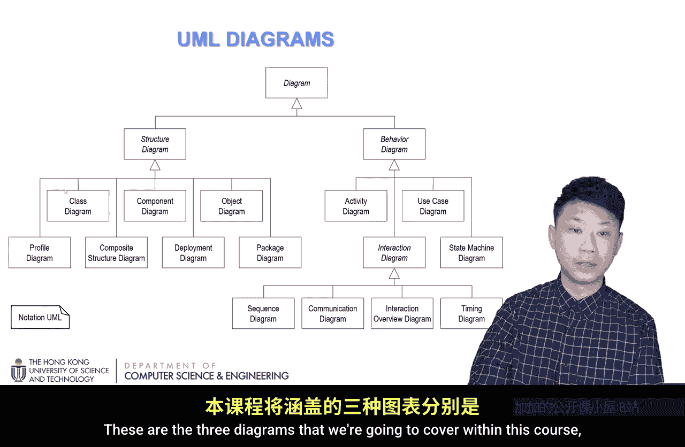
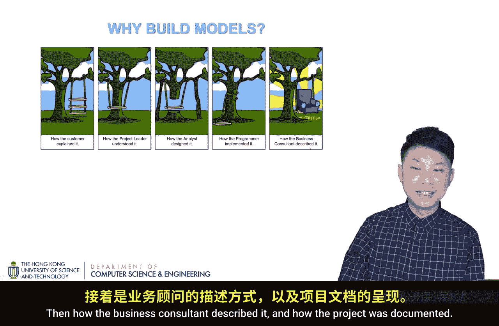
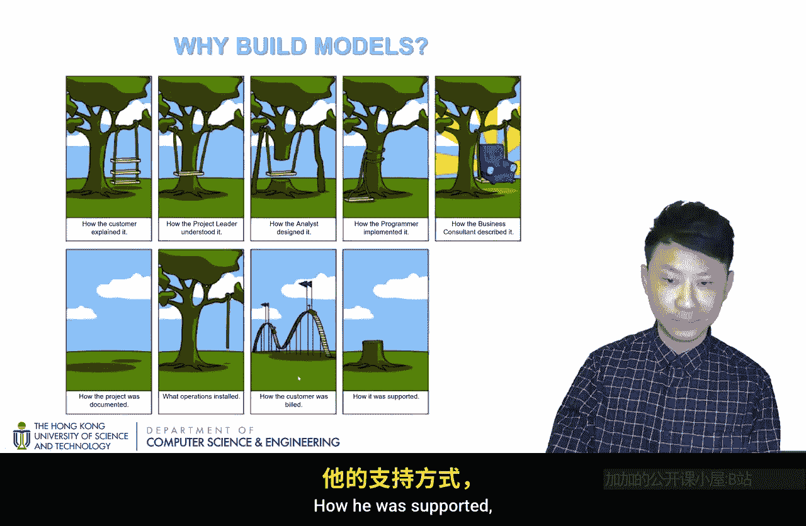
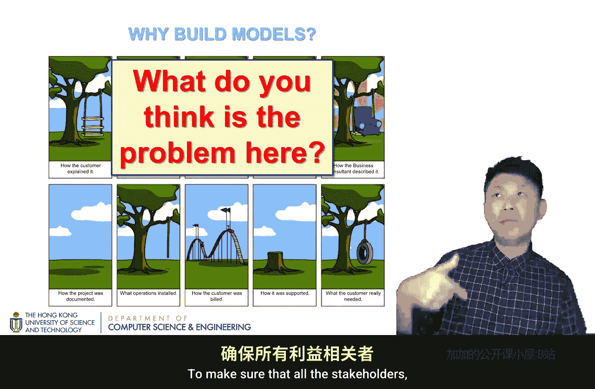
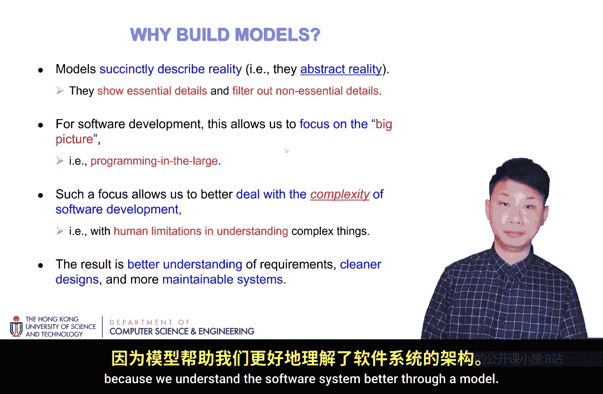
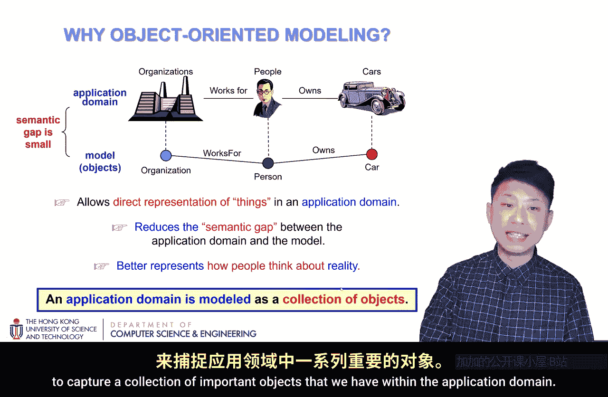
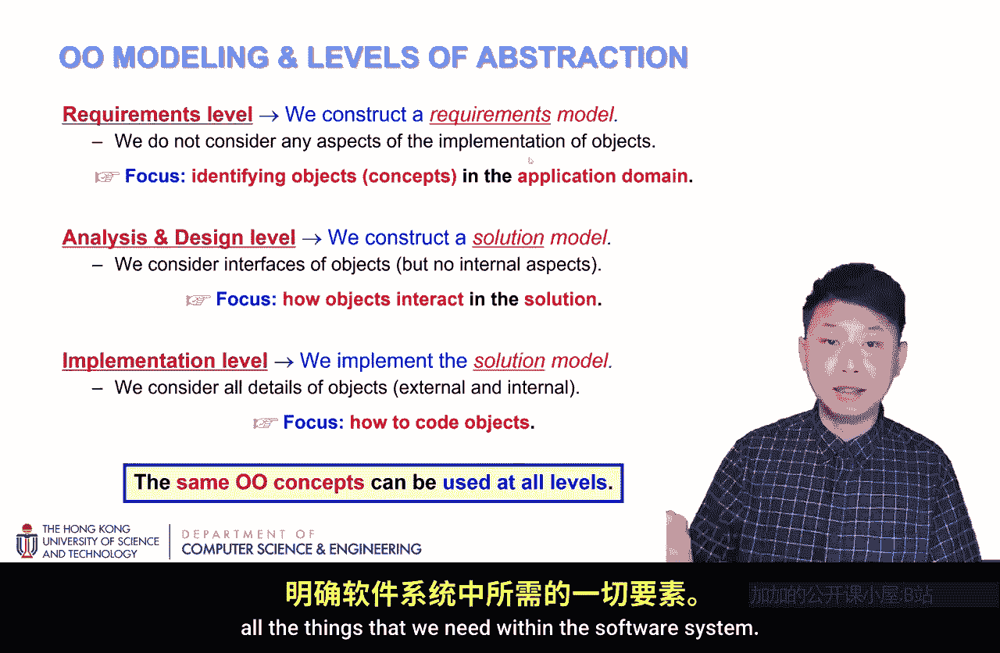

# 香港科技大学【中英⚡软件工程｜Software Engineering Specialization】 p04 P4 01_建模入门 -BV1MMEjzoEhg_p4-

Hi， this is the second lecture of the course In the second lecture。

 I will talk about how we can use UMl to build a model to capture all the data requirements within an application domain。

In particular， I will talk about how we can draw a class diagram to capture or to keep track all the important objects that we have within the software system。

So these are all the learning objectives of this lecture After this lecture。

 you will understand what is UML and how the UML can be used to model software systems。

And you will also appreciate that the E Ml is a modeling language。

 a language that we can use to build a model to represent a system。

 but not a software development methodology。And finally。

 you will understand the basic components that we can use to draw a class diagram， for example。

 classes， associations and generalization。And these are all the topics that we're going to cover in this lecture first I'm going to give an overview about UML。

 then we're going to talk about different components that we can use in drawing class diagram。

 for example， classes， associations， association classes， generalization， etc， etc。

 and also how we can apply additional constraints on top of the class diagram。So first。

 we will start with the overview of UML。So what is Yma。

 Yo is a general purpose visual modeling language for systems。

 That means we try to draw a diagram to represent the system that we're going to build。

And it incorporates the best practices in O modeling techniques because we are talking about trying to capture a set of important objects within the software system。

And is software development methodology or process neutral because it's not a software development methodology。

And it's an industry standard O0 model language for modeling systems。

 It's very suitable for O0 because in UMl， we are trying to capture a set of important objects within the model。

 And if we are talking about a set of objects， right。

 then it's going to be very suitable for O programming。Okay。

 but it also can be used for non or systems。So the basic idea of VML is that we try to represent the system using a collection of objects。

A collection of important objects that exist within the software system。

And this is the structure of UML within and UML， we have different building blocks。 Okay。

 we have different building blocks that we can use for drawing the model， for example。

 the important things that we have within the model。

 different relationships and different diagrams that we can use to model the system。Okay。

 and also we have some common mechanisms。For example。

 we can provide additional textual descriptions within the model。

 and also we can include additional aments， for example。

 you try to draw some additional thanks or additional aments right in the diagram。

And also some common derisions， some extra definition that you can provide to force you to think about the world in a certain way。

And also extensibility mechanisms for you to extend the model。

And we can build a model from different perspectives， for example， from the use case， viewU。

 logical view implementation view， process view or deployment view。And in this lecture。

 I'm going to talk about the building blocks that we can use for drawing class diagram and within UML。

 there are different diagrams that we can draw Okay in this lecture。

 we will talk about class diagram。In some of the upcoming lectures。

 we will talk about use case diagram and also stay machine diagram with in class diagram。

 we are trying to capture all the data requirements within a software system。

 so we try to capture all the data requirements in a form of a collection of objects and their relationships。

And if we are talking about the use case diagram， we try to capture all the functionalities provided by the system。

And finally， if we are talking about the same machine diagram。

 we are talking about trying to capture all the states or the possible states that we can have within an object。

Okay， and this are the free diagrams that we're going to cover within this course， the class diagram。

 use case diagram， and also steam machine diagram。

So why do we build models， Let's study this example， which is pretty interesting。 Okay。

 so this may be how the customer explain about the project。

And then this may be how the project leader understand it。This may be how the analyst decided it。

So maybe how the program are implemented aid。And then how the business consultant described it and how the project was documented。

 no documentation at all。 Okay， what operations installed， Okay how the customer was built。

But he was supported。And what the customer really needs right maybe it's going to be just something simple Okay so what's the problem here。

 The problem here is utterly communication just because different stakeholders they may have different ideas in their mind so that's why at the very beginning of the project we need to build a model so that when we communicate we can communicate using the model and to make sure that all the stakeholders they're going to have the same idea in their mind by just take a look at the model。

So why do we build models， Let me just talk about another example， for example。

 let's say when we build an airplane。Okay， why do we want to build an airplane。

 the model of an airplane before we actually build a plane？

Because you know that the plane itself is going to be very complicated。

 so that's why we're gonna skip some of the complicated details within the plane and then we're gonna to build a simpler model and this is what we call abstraction we try to skip details and we build a model which is going to be simpler but still right somehow from the model you can visualize all the details within the plane and then we can use the plane that model the model of the plane to communicate with different stakeholders within the project and that's why we need a model because we need a model to communicate with different people that we have within the project。

So the models that we're going to build is going to describe reality。 so， for example。

 the model of the airplane is going to somehow describe the actual airplane。

 But here we are talk about abstraction。 We try to skip details。 within the model of the plane。

 we try to show the essential details that we need for communication and we try to filter out the nonesential details。

 maybe right， just because the airplane itself is going to be very complicated。

 So we're gonna to skip some of the complicated things within the airplane in the model。

So for software development， this allows us to focus on the big picture。

 that means all the important objects that we have within the software system。

 and this is what mean by programming inlarge。Okay。So by。Focusing on the big picture。

 it allows us to better deal with the complexity of software development because the software itself right Soco implementation itself is going to be very complicated。

 So that's why instead of talking about the sourceco Okay we build a model okay to capture all the important objects that we have within the software system Okay and this is going to help us deal with the complexity within a software project。

And the result of a model is that were going to better understand all the requirements within the project。

 cleaner design， and also more maintainable software systems because we understand the software system better through a model。

So why objects areiented modeling just because it's kind of natural to represent things using objects for example。

 in the application domain we have organizations， we have people and then we have cars and then people they work for different organizations and also they own different cars okay then its kind of natural to map all these things right within the application domain as different objects that we have in the model。

Okay， so within the model， we have organization， we have person， and we have car。

 and then we connect them together using relationships。OkaySo for example。

 person they work for organization and person they work for。

And we connect them together using associations， for example。

 person they works for organization in person， they own different cars。Okay。

So it's kind of natural to represent things， right within the application domain using objects and it's going to reduce the semantic gap between the application domain and also the model because it kind of natural to map things as different objects。

And also better represent how people think about reality。And so that's why in this lecture。

 we're going to talk about how we can use a class diagram to capture a collection of important objects that we have within the application domain。

So if you are talking about O O modeling， there are different models that we can build。 Okay。

 we can build a model to capture all the requirements within the software system。 So in this model。

 we simply try to identify all the important objects。

All the important things or all the important objects or all the important concepts that we want to keep track with in the software system。

Okay， so then we also can come up with a solution model Okay。

 so somehow we go through an access and design and then we build a solution model and that model is going to be the model that we're going to use for implementation Okay。

 so that means when we implement。These are the objects that we're going to implement with in the software system。

Okay， and also implementation level， okay now eventually we're going to implement the solution model。

 and turn the solution model into a set of sourceco。Or a A， A A set off of Co objects。

Okay so the same all concepts can be used at all levels So in this course right we are going to focus on two models。

 One is the requirement model to capture all the data requirements all the important objects that we need within a software system and also how we design how we actually design the solution model that we can use for implementation so in this lecture in this lecture we focus on requirement model so again。

 just keep in mind that if we are talking about the requirement model。

 it has nothing to deal with implementation Okay so just given the application domain。

We try to capture all the important objects within the application domain mean， that's it。

Has nothing to do with implementation， if we are talking about implementation。

 we are talking about the solution model。OkaySo model is the one that we use for implementation。

 but not requirement model requirement model is going to be simple okay we know that these are the things that exist within the application domain。

 so we try to capture all these things within a requirement model。Okay， okay。

 and the requirement model is going to help us understand all the requirements or the things that we need。

 okay within the software system。

