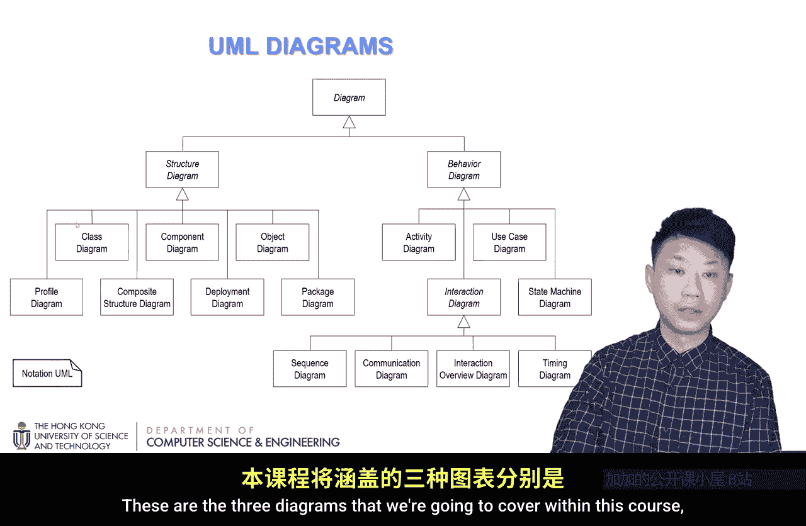
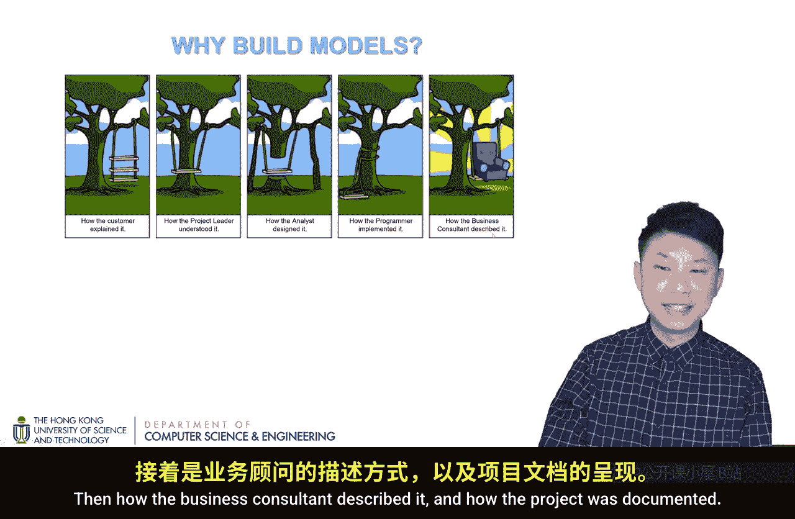
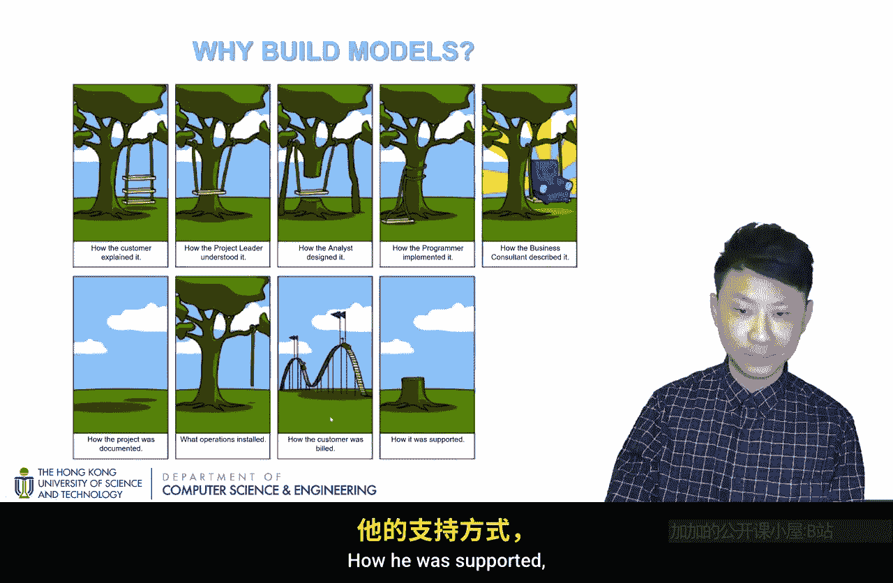
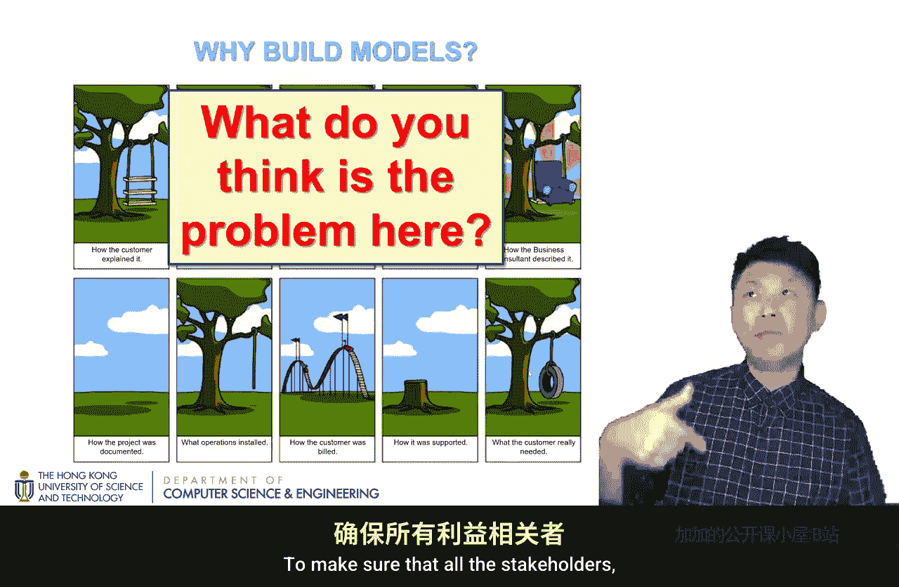
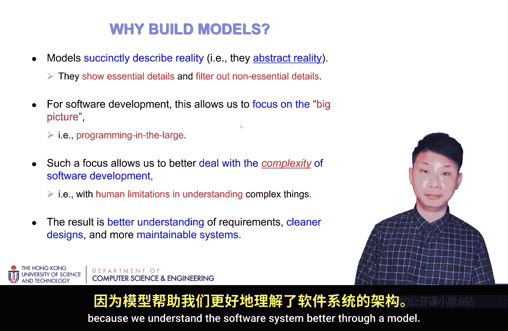
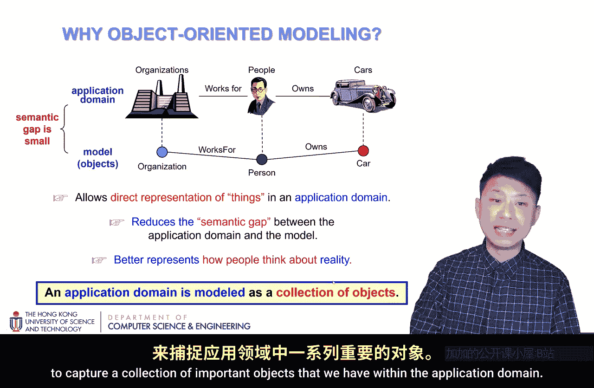
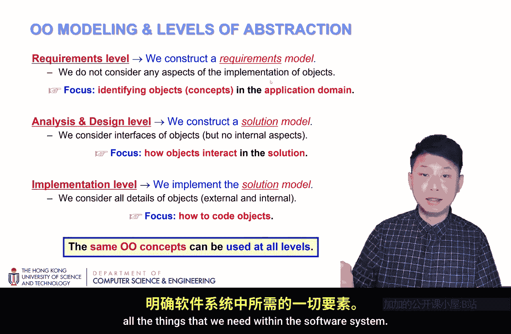

# 软件工程建模入门：P4-01：UML与类图基础 🎯

在本节课中，我们将学习如何使用统一建模语言（UML）来构建模型，以捕获应用领域内的所有数据需求。具体来说，我们将重点学习如何绘制类图，以记录或跟踪软件系统中所有重要的对象。

## 概述 📋

UML是一种通用的可视化建模语言，用于表示系统。它结合了面向对象建模技术的最佳实践，并且与软件开发方法论或过程无关。UML是建模系统的行业标准面向对象建模语言，非常适合面向对象编程，但也可用于非面向对象系统。

UML的基本思想是使用一组对象来表示系统，这些对象是软件系统中存在的重要对象的集合。

## 为什么需要建模？🤔

让我们通过一个例子来理解建模的重要性。客户对项目的描述、项目负责人的理解、分析师的设计、程序员的实现、业务顾问的说明以及最终交付给客户的产品，这些环节之间可能存在巨大的理解偏差。问题的核心在于沟通不畅，因为不同的利益相关者可能在脑海中有着不同的想法。

因此，在项目初期构建一个模型至关重要。通过模型进行沟通，可以确保所有利益相关者对项目有统一的理解。

再以建造飞机为例。在真正制造飞机之前，我们会先构建一个飞机模型。因为飞机本身非常复杂，通过模型我们可以**抽象**掉一些复杂的细节，构建一个更简单但仍能体现飞机关键特征的表示。这个模型用于与项目中的不同人员进行沟通。

对于软件开发而言，建模允许我们关注“大局”，即软件系统中所有重要的对象，这被称为“大规模编程”。通过关注大局，我们能更好地处理软件开发的复杂性，因为源代码级别的实现本身可能非常复杂。建模的结果是能更好地理解项目需求，获得更清晰的设计，以及更易于维护的软件系统。

## 为什么选择面向对象建模？🎯

使用对象来建模事物是很自然的。例如，在应用领域中，我们有组织、人员和汽车。人员为不同的组织工作，并且拥有不同的汽车。很自然地将应用领域中的这些事物映射为模型中的不同对象。

在模型中，我们有“组织”、“人员”和“汽车”等类，并通过关系将它们连接起来。例如，人员为组织工作，人员拥有汽车。我们使用**关联**来连接它们。

这种表示方式减少了应用领域与模型之间的语义差距，因为它自然地反映了人们对现实世界的思考方式。因此，本节课我们将学习如何使用类图来捕获应用领域中重要对象的集合。

## 面向对象建模的不同层次 🏗️

在面向对象建模中，我们可以构建不同层次的模型：
1.  **需求模型**：用于捕获软件系统中的所有需求。在这个模型中，我们试图识别所有需要跟踪的重要事物、对象或概念。
2.  **解决方案模型**：通过分析和设计，我们构建一个用于实现的解决方案模型。这个模型中的对象将最终在软件系统中实现。
3.  **实现级别**：最终，我们将解决方案模型实现为一组源代码或代码对象。

相同的核心概念可以应用于所有层次。在本课程中，我们将重点关注两个模型：用于捕获数据需求的需求模型，以及用于指导实现的解决方案模型。本节课我们专注于**需求模型**。

请记住，需求模型与实现无关。它只是根据应用领域，捕获其中存在的重要对象，帮助我们理解软件系统需要处理哪些事物。

## UML的结构与图表类型 🧩

UML包含不同的构建块，例如模型中的重要事物、不同关系以及用于建模系统的各种图表。此外，它还有一些通用机制，如提供额外的文本描述、注释以及扩展机制。

我们可以从不同视角构建模型，例如用例视图、逻辑视图、实现视图、进程视图或部署视图。

在本课程中，我们将主要介绍三种UML图表：
*   **类图**：用于捕获软件系统中的所有数据需求，以对象及其关系的集合形式呈现。
*   **用例图**：用于捕获系统提供的所有功能。
*   **状态机图**：用于捕获对象可能具有的所有状态。

本节课，我们将深入探讨类图的基本组件。

## 类图的基本组件 🔧

上一节我们介绍了UML的概览和建模的重要性，本节中我们来看看绘制类图所需的核心组件。

以下是绘制类图时需要理解的基本元素：

1.  **类**
    *   类是对象的蓝图，描述了具有相同属性、操作、关系和语义的一组对象。
    *   在UML中，类用一个矩形表示，通常分为三栏：类名、属性和操作。
    *   例如，一个 `Person` 类可能具有 `name`（属性）和 `workFor`（操作或关联）。

2.  **关联**
    *   关联描述了类之间的结构关系，表明类的对象之间以某种方式连接。
    *   用连接两个类的实线表示。
    *   关联可以具有多重性（例如，1， *， 0..1），以说明一个类的多少个对象可以与另一个类的一个对象相关联。
    *   例如，`Person` 类和 `Company` 类之间可以存在“worksFor”关联。

3.  **关联类**
    *   有时，关联本身可能具有需要记录的属性或操作。这时可以使用关联类。
    *   关联类通过虚线连接到关联线上。
    *   例如，`Person` 和 `Project` 之间的“Assignment”关联可能具有 `startDate` 和 `role` 属性，这些属性可以放在名为 `Assignment` 的关联类中。

4.  **泛化**
    *   泛化是一种特殊/一般关系，其中子类（特殊类）继承父类（一般类）的结构和行为。
    *   用带空心箭头的实线表示，箭头指向父类。
    *   例如，`Student` 类和 `Teacher` 类可以泛化自 `Person` 类。

5.  **约束**
    *   除了图形元素，我们还可以在类图上应用额外的文本约束，以指定更精确的规则。
    *   约束通常写在花括号 `{}` 内。
    *   例如，可以为 `BankAccount` 类的 `balance` 属性添加约束 `{balance >= 0}`。

## 总结 📝

本节课中，我们一起学习了UML建模的基础知识。我们了解了UML是一种用于系统建模的可视化语言，它通过**抽象**帮助我们关注软件系统中的重要对象，从而改善沟通、处理复杂性并更好地理解需求。

我们重点探讨了**类图**，它是用于捕获数据需求的核心UML图表。我们学习了类图的基本组件，包括**类**、**关联**、**关联类**、**泛化**以及如何应用**约束**。记住，在本阶段构建的需求模型旨在描述应用领域中存在什么，而非如何实现它。

掌握这些基础组件是进行有效面向对象建模的第一步，它将为后续学习更复杂的建模概念和图表打下坚实的基础。