# 香港科技大学【中英⚡软件工程｜Software Engineering Specialization】 p05 P5 02_UML类图 -BV1MMEjzoEhg_p5-

So now let's talk about how to draw a class diagram using classes， association， association classes。

 and generalization， etctera， etc。So now let's first talk about class okay now let's say we want to build a software system for a bank and we know that within a bank。

 we have different bank accounts okay then this may be different instances of the accounts that we have within the bank For example。

 we have F's account， Sam account， EVS account， etca。

 etc and this are all the properties right within each account， each individual account for example。

 for F's account we keep track the account number， the balance and then we have some operation to check the balance to deposit money into the account to withdraw money from the account or to pay interest into a particular account etca。

 etc。

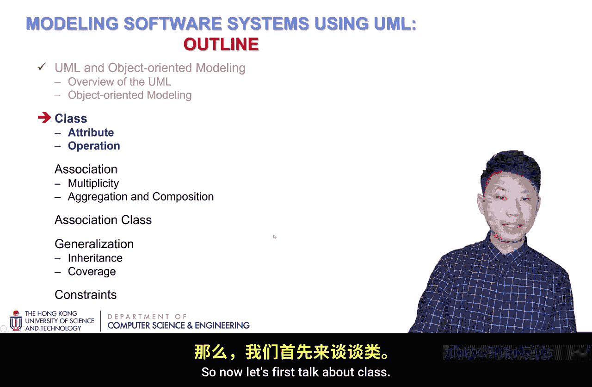

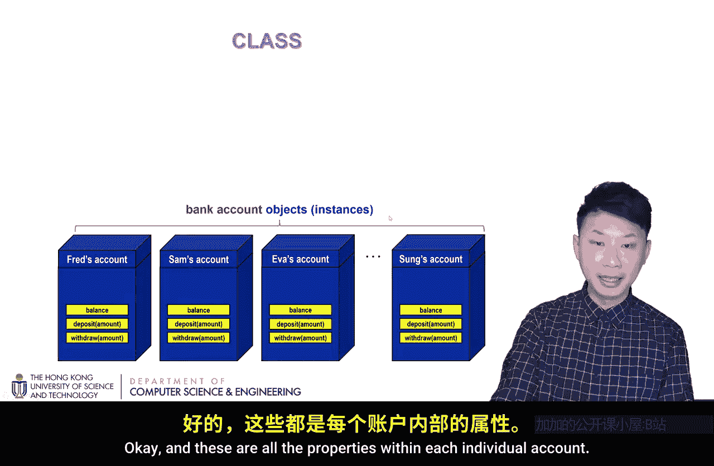

Okay， now instead of referring to these different accounts right weve the application domain again again right because we have so many accounts。

 that's why we're going to do classification okay we're going to group all these accounts together as a single class called account。

Then within the model， whenever we refer to the accounts， right。

 we simply say that we have account okay within the software system。Okay。

 so here we are doing classification， okay we try to classify all these instances as a single class。

😊，Okay， I can't。Okay。So for each class， you have to specify the class name， the E builds。

And also the operations that we can perform within the class。

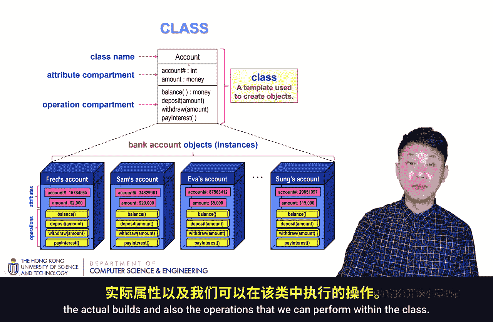

So a class is going to describe a collection of objects that have common semantics， attributes。

 operations and relationships。

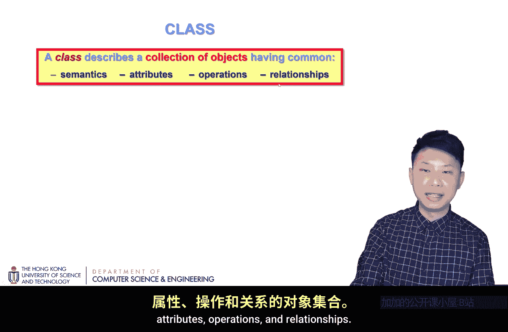

For example， now we can see that this account right， they all have the same attributes。

 they all have the same operations， so that's why we classify them together as a single class call account。

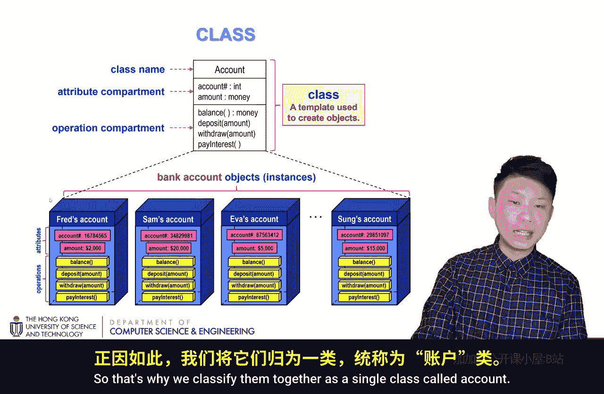

And that's why we say that a class is a classifier。Okay。

 and a particular object is going to be an instance。

 and we try to classify all these instances together as a single class。诶。

And a class is a factory for creating objects， so we can use a class right to create different accounts within the application domain。

 the bank。In a good class should capture one and only one abstraction。Okay。

 so that means a good class should capture only one important thing within the application domain。

So a good class should capture one and only one abstraction。

 so that means a good class should only capture one important thing within the application domain。

 Okay， you should not mix up like multiple things together and put it as a very general class within the software system no。

He。And a classash should be named it using appropriate vocabulary of the application domain。Okay。

 so that it's going to be meaningful and also traceable and also your diagram is going to be easy to read because you're using meaningful vocabularies。

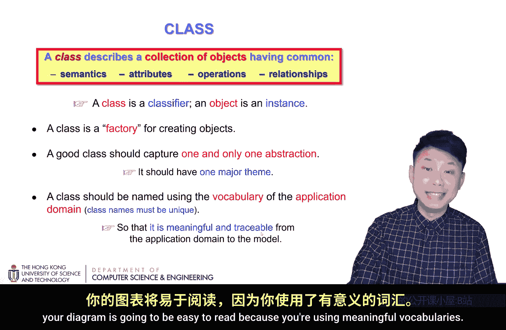

AndWithin a class， you have to define all the attributes that we have within the object。

 within the class。So you have to provide names okay， to deche belts， the tight。Visibility。

 initial value， multiplicity， whether we can have like multiple values within that attribute。

Changegeability， etc cetera， etc cetera， and notice that name and type they are required for UML modeling for visibility。

 initial value， multiplicity and changeability， you may skip them in your UML model but name and type they are mandatory just like this right account is going to be an integer and then among we are talking about money。

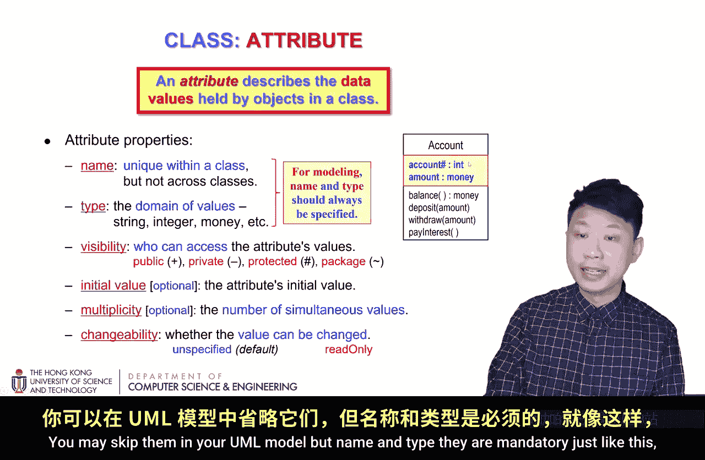

So another thing that we need to specify with in a class is what we call operation。

Operation describes a function or transformation that may apply to or buy objects within the class Okay。

 so we have talked about some operations that we can perform within the class。Okay。

 so for each operation we have to specify the operation signature， the name， parameter name。

 result type， etc cetera， etc cetera， for modeling， all this should be specified。Okay， for example。

 the name of the operation is going to be deposit and then the parameter that we need to input into this operation is going to be amount。

OkayAnd then we also need to specify what's going to be returned by this particular operation。Okay。

And also， we need to specify the visibility of the operations within the class。For example。

 whether it's proper， private， protected or package， if it's proper。

 then that means that operation is going to be available to all the other objects within the system。

 if it's private， then that means it's going to be just within that particular object。Okay。

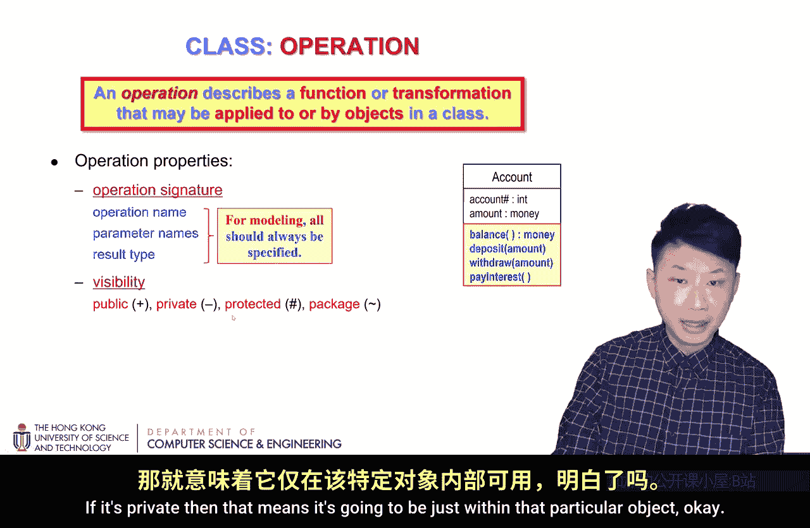

Now if it's protected， that means it's going to be within the object and also all the subtits。

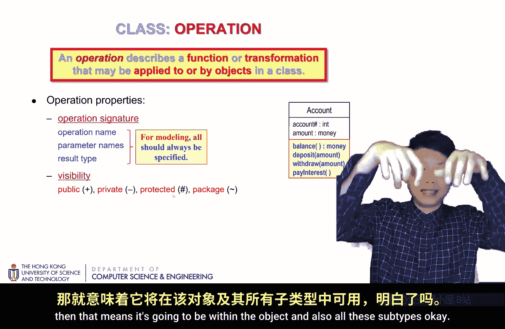

Okay， when we talk about inheritance right you will know what is like supert and subts okay。

 then if it's protected that means it's going to be available to the object itself and also all the subtits or within a particular package。

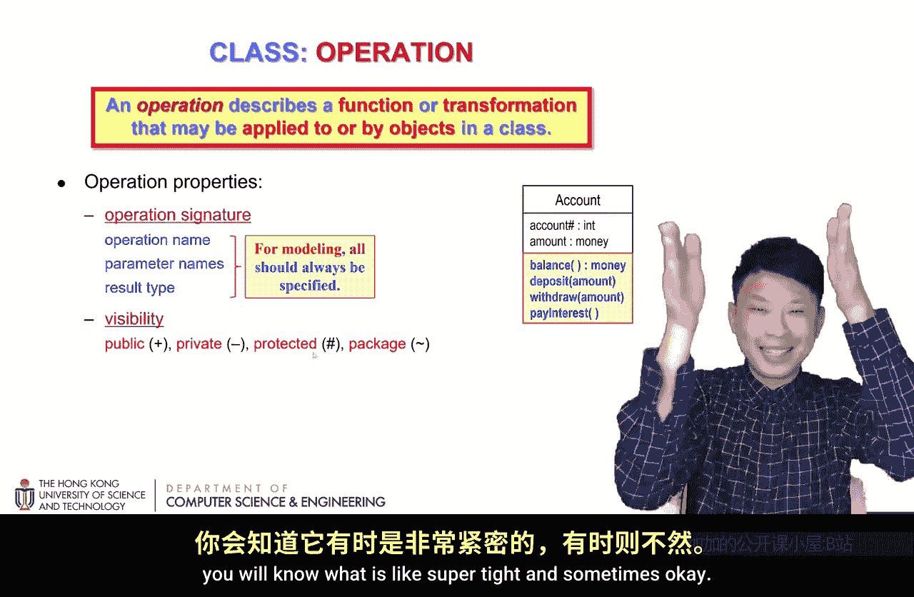

Okay。So an operation instance is called a method because there are many different possible ways to implement the same operation。

 so a particular implementation， a particular instance of an operation。

 a particular implementation of that operation is what we call a method。Okay， in general。

 you just say we have an operation， but a particular implementation is going to be called a method。

And we say that an operation can have several methods because there are different possible ways to implement the same operation。

 So that's why here we say that there may be multiple or several methods for implementing the same operation。

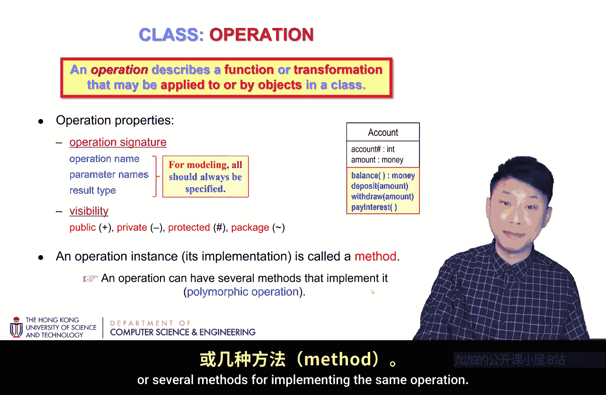

So why do we use classes to model systems again， just because kind of natural to represent a system using classes and objects。

 Okay， especially for O0 system， so now by representing the system as a collection of object。 Okay。

 it's going to help。So by representing the system as they collect and opt。

So by representing the system as a collection of objects and representing them as a set of classes。

 it's going to help us understand what are the important things that we have within the system and also specifying the system。

ok。And again， choosing the appropriate classes is an important design decision。

It's going to help promote modularity within the development So that means there are different ways to come up with the classes and we don't have a single correct way to come up with the classes for modeling the system。

So modularity means， right， we try to chunk a large software system into small pieces。

 and then we can handle the small pieces one at a time。

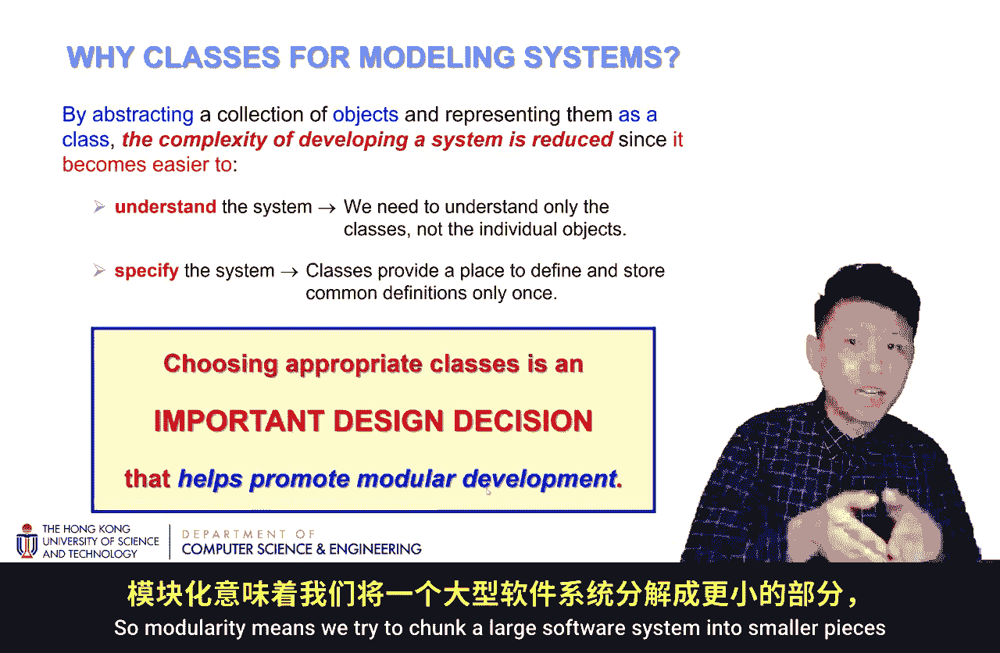

Okay， so if the piece right is too general， too large。

 then we lose the advantage of modularity when we build a system。

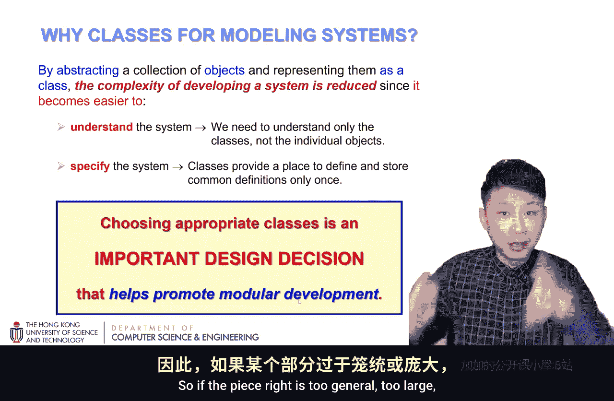