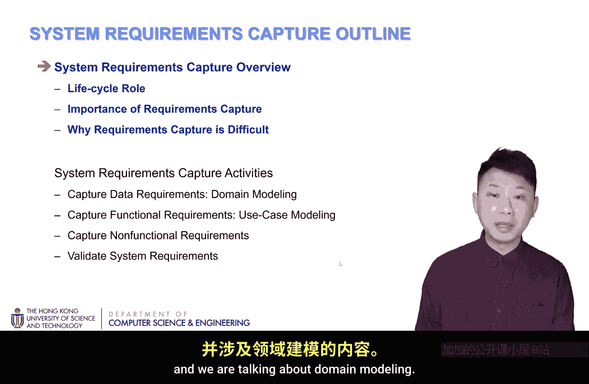
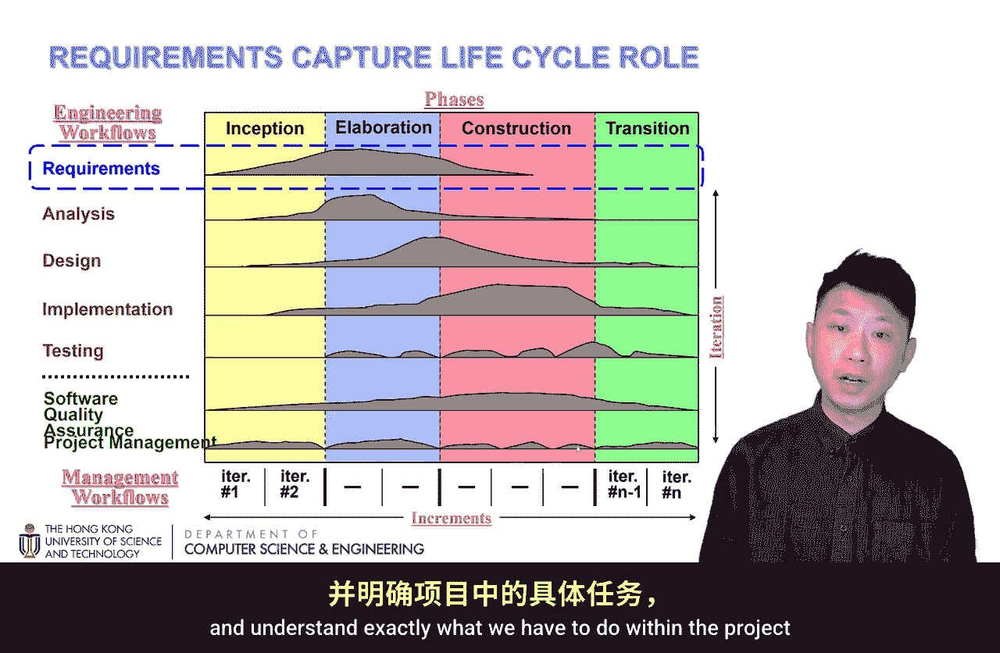
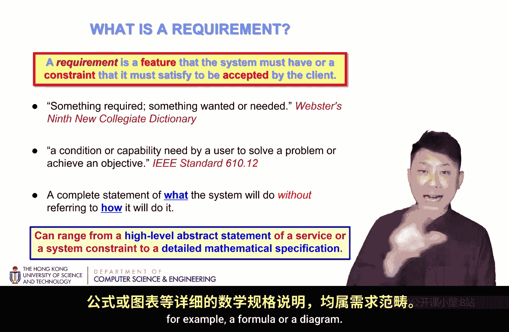
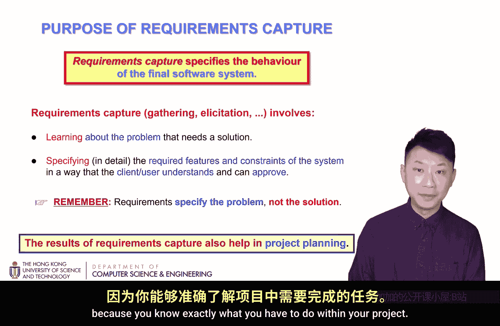
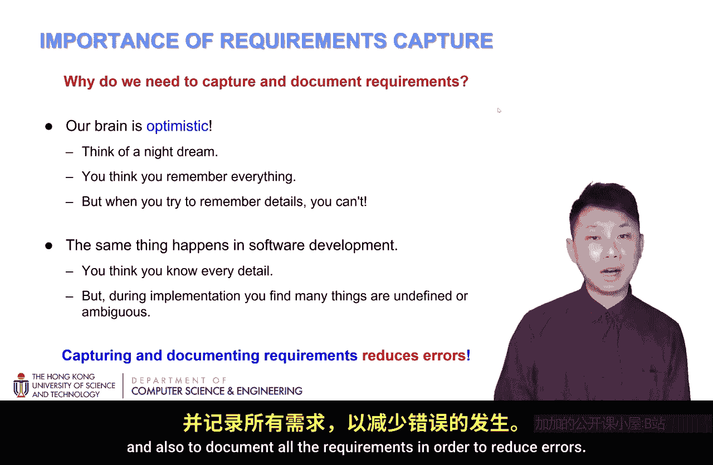
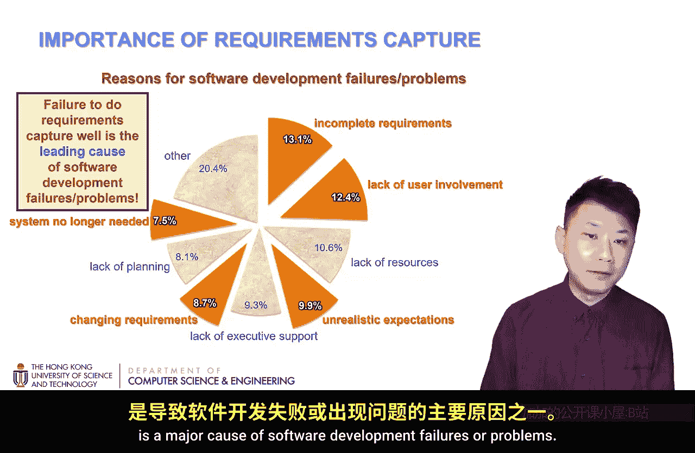
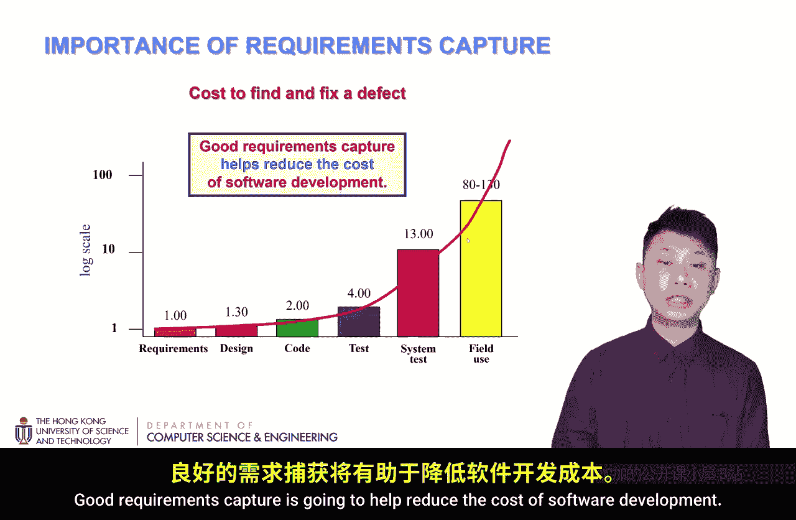
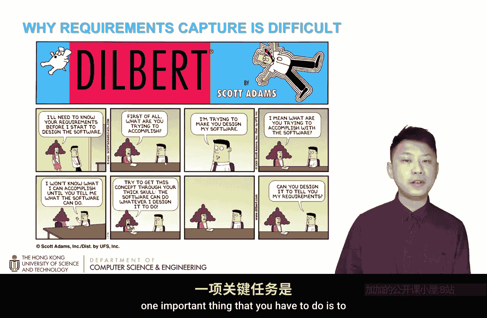
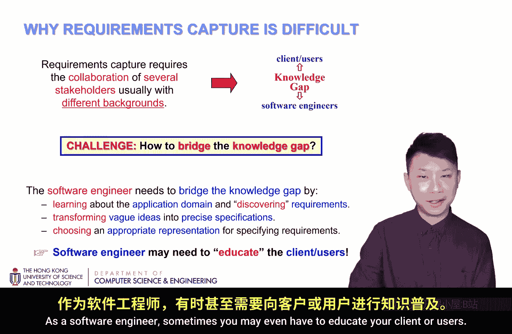
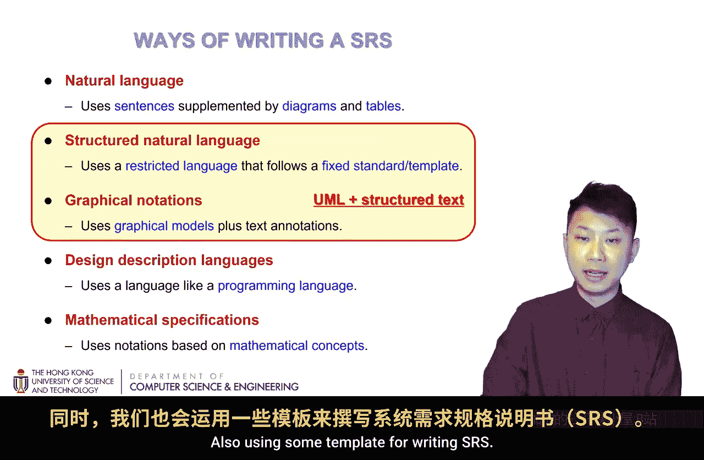

# 香港科技大学【中英⚡软件工程｜Software Engineering Specialization】 p10 P10 01_系统需求捕获入门 -BV1MMEjzoEhg_p10-

In the last lecture， we have mentioned that no matter which software development process that you're using for your project。

 there are five important activities that you have to perform within your project and they are requirements capture。

 analysis， design， implementation and testing。In this lecture。

 we focus on system requirements capture。And these are the learning objectives of this lecture After this lecture you will understand what these requirements capture and its role in software development process。

And you will also understand why requirements capture is both important and difficult。

And you will also know the major activities that take place during requirements capture。

And you will also learn how to use UML to model a system's data and also functional requirements using class diagram and also use case diagram。

And finally， you will understand the importance of validating system requirements。

So this lecture is going to be an overview about system requirements capture。

 and we will also talk about how to use class diagram to capture all the data requirements of a software system。

 and we are talking about domain modeling。

So in requirements capture we focus on inception and elaboration That means we try to collect all the requirements from our client and also from our application domain and then double check whether the project is feasible or not if it's feasible。

 then we go ahead and do the project if it's not feasible。

 then we may have to stop okay and tell our client that the project is not feasible and we have to stop。

So that's why we do it at the very beginning of the project because we have to get all the requirements and understand exactly what we have to do within the project before we proceed to construction and also transition。

So what is the requirement， if you go to the internet。

 you may find different definitions from different dictionary or from Wikipedia。In this course。

 we define a requirements as a feature that the system must have or a constraint that you have to satisfy in order for your software system to be accepted by your client。

And a requirement can be ranged from a high level abstract statement of a surface， for example。

 a prom statement， or a system constraint to a detailed mathematical specification in terms of。

 for example， a formula or a diagram。

And there are different types of requirements， some of them are written mainly for clients。

 for example user requirements， and they are specified in natural language。

 possibly with diagrams of the surfaces the system provides and its operational constraints and if we are talk about statements in natural language again we are talked about a problem statement and possibly you may include some diagrams in your statement and that's mainly written for our clients and also we have system requirements which is a structural document setting out detailed description of the system functionalities。

 surfaces and also operational constraints and it defines what should be implemented and is being treated as part of a contract between the client and the developer and is written for different stakeholders for example your clients and also developers so one major purpose of requirements captured is that is going specified the behavior。

of the final software system so in requirements capture。

 we have to learn about the problem that needs a solution and also specify the requires features and also constraints of the system in a way that both the client and also the user can understand and also can approve。

Remember that when we try to capture order requirements， we try to specify the problem。

 but not the solution， not the design that we're going to use for implementation。

 we are just trying to capture order requirements， that's it。😡。

And the result of requirements capture is going to help in project planning because you know exactly what you have to do within your project。

 then it's going to help you plan。

Or plan out your project。So some of you may ask， why do we need to capture and also document requirements。

 Why do we have to come up with all the documentation before we actually go ahead and perform implementation。

The reason is that our brain is optimistic so think about night dream okay on the next day you think that you remember everything right but after a few days right you forget about all the details。

And the same thing is going to happen in software development you may think that you remember every single detail in your project。

 but during development or during implementation you may find that you forget many important things or many important details within your project and that's why you need to come up with some documentation to capture and also to document all the requirements in order to reduce errors。

And believe me or not， many of the software projects they fail because of incomplete requirements or lack of user involvement just because you don't know exactly what you have to do within your project。

 you don't understand what are the requirements within the project and that may lead to project failure and that's why I say here that failure to do requirements capture well at the beginning of the project is a major cause of software development failures or problems。

 And this is a little diagram showing the cost for fixing some defects at different stage of your project and you can see that if you fix a defect early。

 It's gonna to be cheap。

If you fix it late in your project is going to be very costly and that's why we want to capture all the requirements correctly right at the beginning of the project because we don't want to fix some defects that are related to requirements late into project which is going be costly and good requirements capture is going to help reduce the cost of software development and why requirements capture is so difficult just because from this little story。

 you can see that sometimes even the client they don't know exactly what they want so as a software engineer。

 one important thing that you have to do is to convert the vague requirements from the client into something that's more precise and something that you can use for development and notice that requirements capture requires the collaboration of several stakeholders usually from different backgrounds。

And just because you have so many stakeholders within your project。

 then you have to fill out the knowledge gap between different stakeholders。

And the challenge here is how to bridge the knowledge gap。

And there are a few things that you have to do as a software engineer first thing is that you have to learn about the application domain and also discover all the requirements from the application domain and then you have to transform the vague ideas from your client into something that's going to be more precise and also choosing an appropriate representation for specifying requirements in this course we're going to use class diagram and also use case diagram to represent requirements and as a software engineer sometimes you may even have to educate your client or users and for system requirements capture we have to build different models for example we have to build a domain model to capture all the data requirements we also have to build a use case model to capture all the functional requirements and also you have to capture all the nonfunction requirements and then eventually validate all the system requirements in this lecture we focus on domain modeling。

We're going to use a class diagram to capture all the data requirements again。

 at this stage we focus on simply capturing requirements and we ignore the implementation details。

So what we're going to do is that given a problem statement。

 we try to capture all the requirements from the pro statement and then come up with a class diagram to represent all the important things that we need to keep track within the software system。

So that's what we mean by data requirements， all the important things that we have to keep track with in the software system and these are the activities that we have to perform when we capture requirements first we have to understand the application domain and then identify user needs。

After that， you have to determine the potential risk of developing the system。

And then you have to capture the system requirements in terms of a domain model， a use case model。

 and also nonfunction requirements。And then finally。

 you have to make sure that the system requirements that you have captured。

 they are correct and also complete。Correct means you have captured all the requirements correctly and complete means you have captured all the importing requirements。

 And in this course， we focus on capturing the system requirements。

 and it's important that you come up with a system requirements specification right at the beginning of the project。

And the system requirements specification SRS documents the system requirements and is an official statement of what is required of the software system。

 and it should include both a definition of user requirements and also specification of system requirements using different models。

And notice that it's not a design document Okay again。

 the models we are not using it for implementation okay。

 we just specify what the system should do if don't think about how we actually implement those features。

And even though many agile methods， they may argue that producing an SRS is a waste of time。Okay。

 because requirements they may change quickly。However， even if you are using agile methods。

 for example Scm okay still you have to capture requirements in terms of a product backlog。

 so that's why it's still important that you learn how to capture all the requirements from the application domain。

 so there are different ways of writing a SRS。You may use natural language right in terms of a pros statement。

Or structure natural language using a template。Or using graphical notations， okay？

Or using some design description language， something like personal code。

Or mathematical specifications。In this course， we focus on drawing diagrams。

 so that's why we say graphical notations and also using some template for writing SRS。

