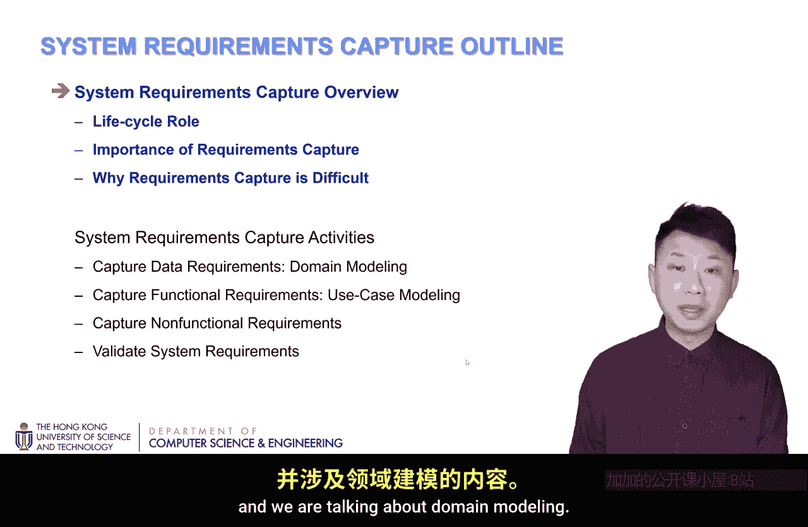
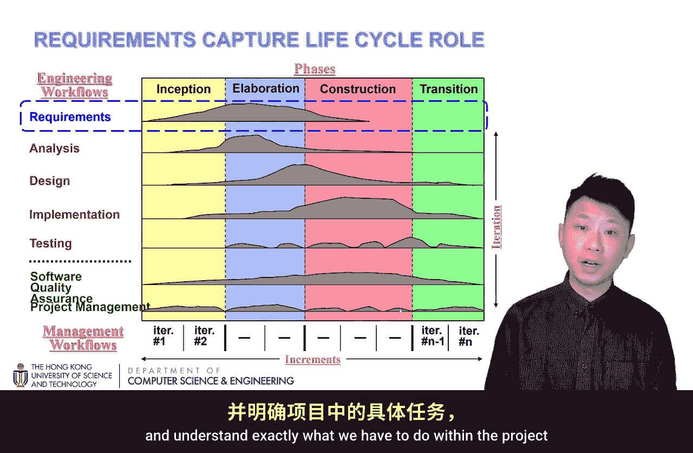
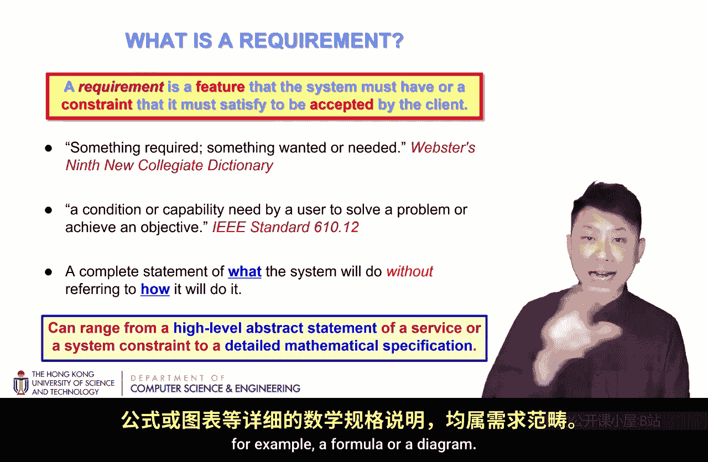
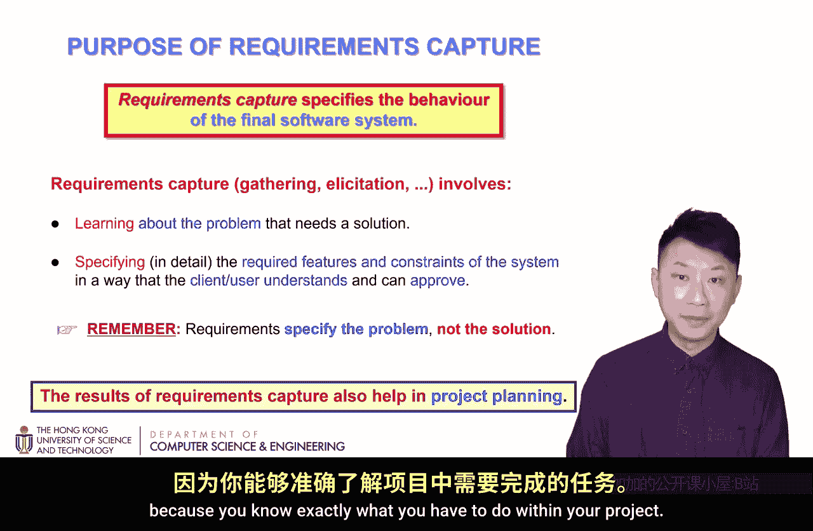
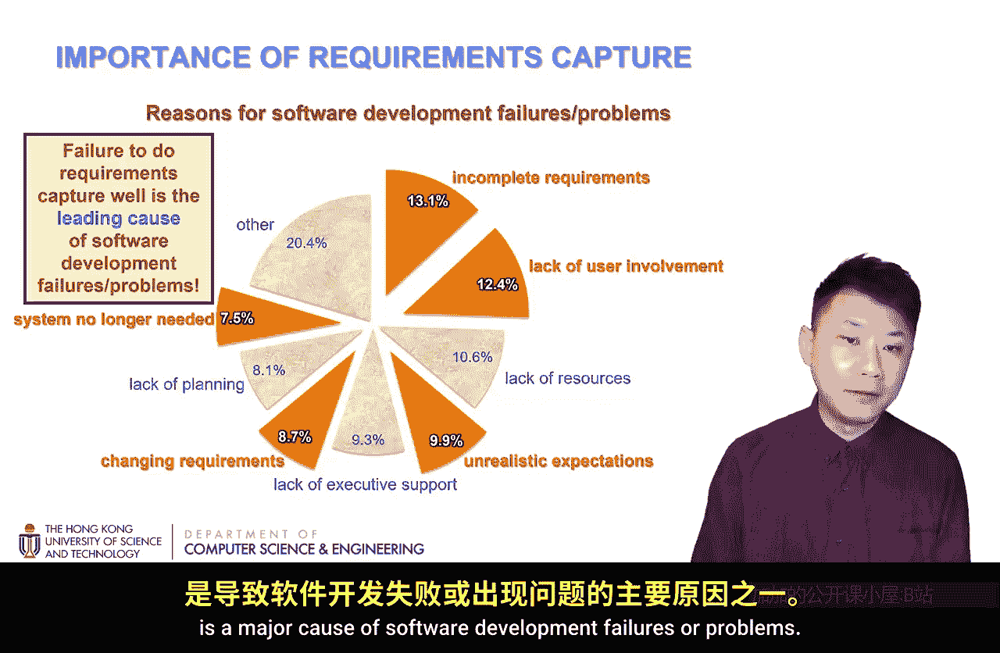
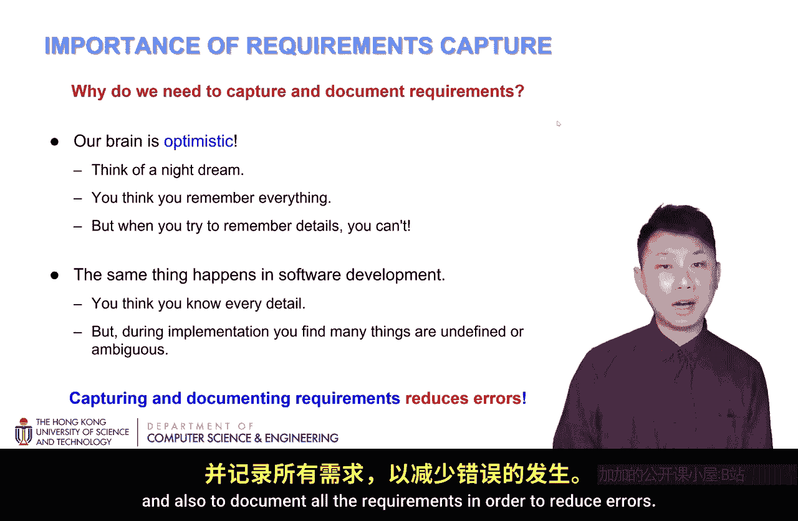
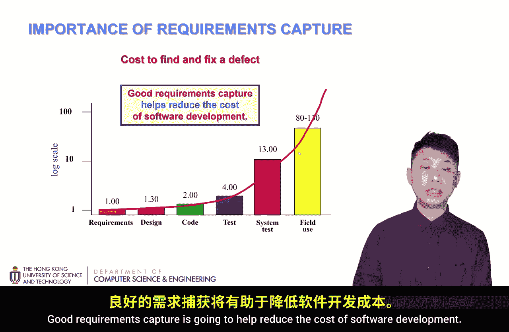
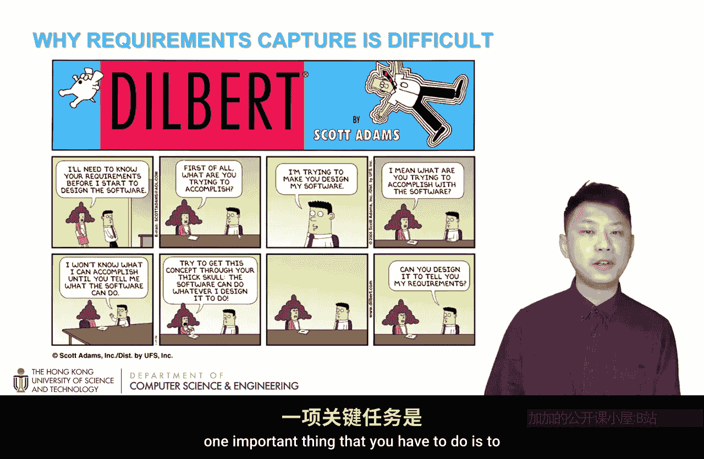
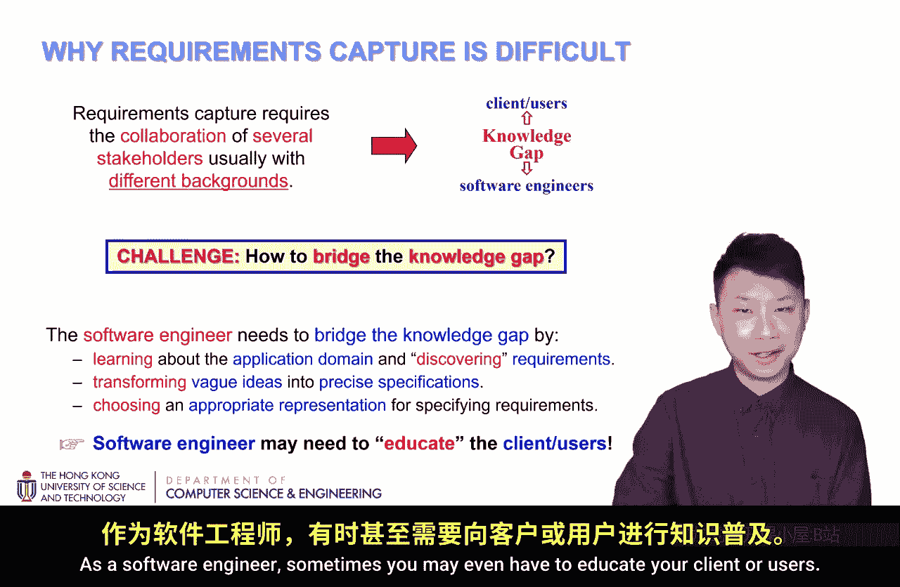
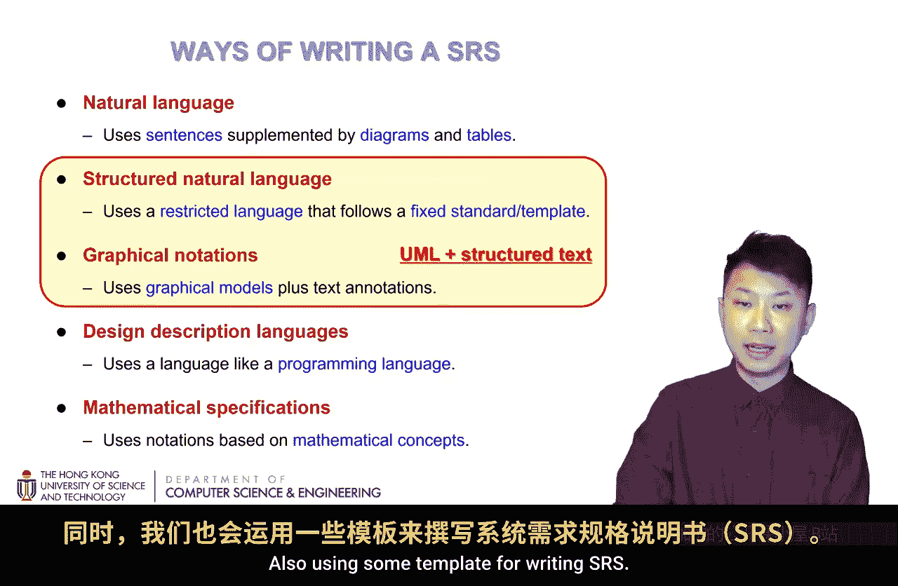

# 软件工程：P10：系统需求捕获入门 🎯

在本节课中，我们将要学习系统需求捕获的基础知识。需求捕获是软件开发过程中的首要活动，它决定了项目的方向和最终成果。我们将探讨需求的定义、重要性、挑战，并学习如何使用UML类图来捕获系统的数据需求。

## 什么是需求？📝

上一节我们提到了软件开发中的五个核心活动。本节中，我们来看看其中第一个活动——需求捕获。

在软件工程中，我们将**需求**定义为：系统必须具备的功能特性，或是为了获得客户认可而必须满足的约束条件。需求的范围很广，可以是从高层次的抽象陈述（例如问题陈述或系统约束），到使用公式或图表等形式表达的详细数学规范。

需求主要分为两类：
*   **用户需求**：主要为客户编写，使用自然语言描述，可能辅以图表来说明系统提供的服务和操作约束。
*   **系统需求**：一份结构化文档，详细描述系统的功能、服务和操作约束。它定义了应该实现什么，通常被视为客户与开发者之间合同的一部分，面向客户和开发者等不同利益相关者。

需求捕获的一个主要目的是明确最终软件系统的行为。在这个过程中，我们需要理解待解决的问题，并以客户和用户都能理解并认可的方式，明确系统所需的特性和约束。

**请注意**：在需求捕获阶段，我们旨在**明确问题，而非提供解决方案或设计**。我们只是尝试捕获并记录需求。

需求捕获的结果将有助于项目规划，因为一旦你确切知道项目中需要完成什么，就能更好地制定计划。

## 为什么需求捕获既重要又困难？🤔

上一节我们定义了需求，本节中我们来探讨为什么需要正式地捕获和记录需求。

原因在于人脑的记忆并不可靠。你可能认为在项目初期记得所有细节，但在开发或实施过程中，往往会忘记许多重要的内容。因此，我们需要通过文档来捕获和记录所有需求，以减少错误。

许多软件项目的失败正是源于需求不完整或缺乏用户参与。如果在项目初期未能做好需求捕获，这将成为软件开发失败或出现问题的主要原因。下图展示了在项目不同阶段修复缺陷的成本对比，你可以看到，早期修复缺陷的成本较低，而后期修复则非常昂贵。

正因如此，我们希望能在项目一开始就正确捕获所有需求，以避免在项目后期修复与需求相关的缺陷，从而降低成本。良好的需求捕获有助于降低软件开发成本。

那么，为什么需求捕获如此困难呢？有时甚至连客户自己也不完全清楚他们想要什么。因此，作为软件工程师，一项重要任务就是将客户模糊的需求转化为更精确、可用于开发的内容。

需求捕获通常需要来自不同背景的多个利益相关者协作。挑战在于如何弥合不同利益相关者之间的知识鸿沟。

## 需求捕获的主要活动 🛠️

了解了需求捕获的挑战后，本节中我们来看看在捕获需求时需要执行哪些主要活动。

作为软件工程师，你需要完成以下几件事：
1.  学习应用领域知识，并从中发现所有需求。
2.  将客户模糊的想法转化为更精确的表述。
3.  选择合适的形式来表述需求（在本课程中，我们将使用类图和用例图）。
4.  有时甚至需要教育客户或用户。

对于系统需求捕获，我们需要构建不同的模型：
*   构建**领域模型**以捕获所有数据需求。
*   构建**用例模型**以捕获所有功能需求。
*   捕获所有**非功能性需求**。
*   最终**验证**所有系统需求。

在本讲座中，我们重点介绍领域建模。

## 使用类图进行领域建模 📊

上一节我们概述了需求捕获的活动，本节中我们聚焦于如何使用类图进行领域建模，以捕获数据需求。

我们将使用**类图**来捕获所有数据需求。在这个阶段，我们只专注于捕获需求，而忽略实现细节。

具体做法是：给定一个问题陈述，我们尝试从中提取所有需求，然后绘制一个类图来表示在软件系统中需要跟踪记录的所有重要事物。这就是我们所说的**数据需求**——即必须在软件系统中跟踪记录的所有重要信息。

以下是捕获需求时需要执行的活动：
1.  理解应用领域。
2.  识别用户需求。
3.  确定开发系统的潜在风险。
4.  通过领域模型、用例模型和非功能性需求来捕获系统需求。
5.  确保捕获的系统需求是正确且完整的。

在本课程中，我们专注于捕获系统需求。在项目初期制定一份**系统需求规格说明**非常重要。

**系统需求规格说明** 文档记录了系统需求，是关于软件系统需要做什么的正式声明。它应该包括用户需求的定义，以及使用不同模型（如类图、用例图）对系统需求的规范说明。

**请注意**：SRS不是设计文档。我们使用的模型并非用于实现，我们只是指定系统应该做什么，而不考虑如何实际实现这些功能。

尽管许多敏捷方法可能认为编写详细的SRS是浪费时间，因为需求可能变化很快。然而，即使你使用敏捷方法（例如Scrum），你仍然需要通过产品待办事项列表等形式来捕获需求。因此，学习如何从应用领域捕获所有需求仍然很重要。

编写SRS有不同的方式：
*   使用自然语言（如问题陈述）。
*   使用模板的结构化自然语言。
*   使用图形化符号（如UML图）。
*   使用设计描述语言（如伪代码）。
*   使用数学规范。

在本课程中，我们专注于绘制图表（图形化符号）以及使用模板来编写SRS。

## 总结 📚

本节课中，我们一起学习了系统需求捕获的基础知识。我们明确了需求的定义及其在软件开发过程中的核心作用，理解了需求捕获为何既至关重要又充满挑战。我们还介绍了需求捕获的主要活动，并重点学习了如何使用UML类图进行领域建模，以捕获系统的数据需求。记住，良好的开端是成功的一半，在项目初期投入精力做好需求捕获，将为后续的开发工作奠定坚实的基础，并有效降低项目风险和成本。