# 香港科技大学【中英⚡软件工程｜Software Engineering Specialization】 p11 P11 02_领域建模-评估类 -BV1MMEjzoEhg_p11-

And now we're going to start with domain modeling。 Again。

 we are talking about capturing data requirements using a class diagram。

 and we try to capture all the important objects that we need to keep track within the software system。

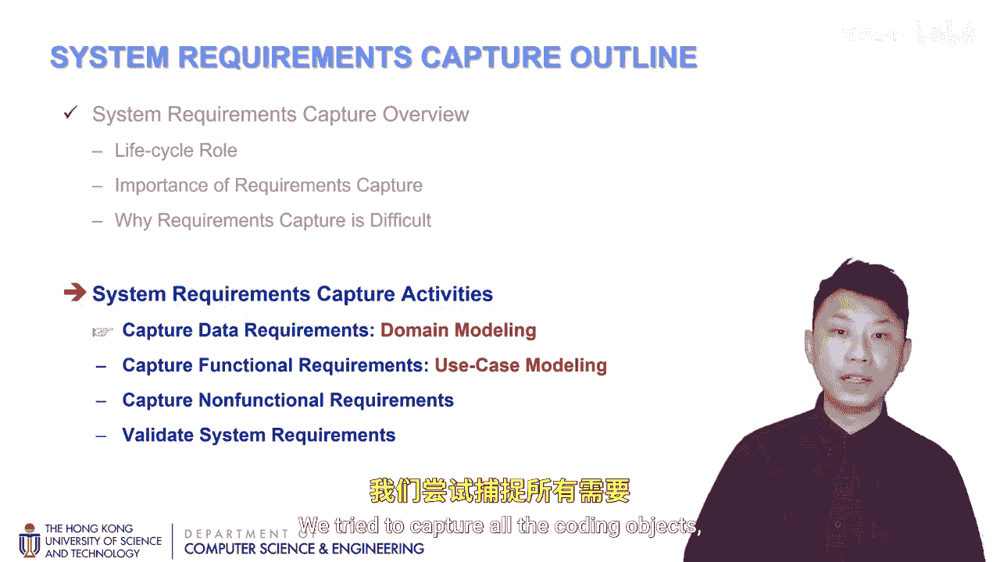

So for domain modeling as mentioned before， right when we talk about class diagram。

 we try to capture the most important classes in their associations。And the classes and associations。

 they can be fined from user requirements from the prompt statement provided by your client。

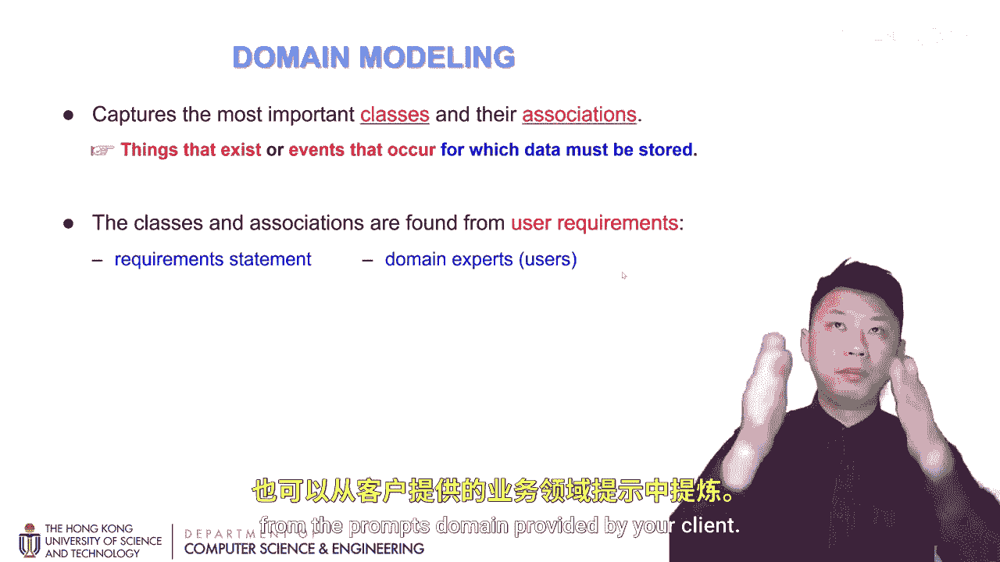

And notice that the classes can be business objects， can be view world objects or concepts。

 or even events。And we describe them using a class diagram。

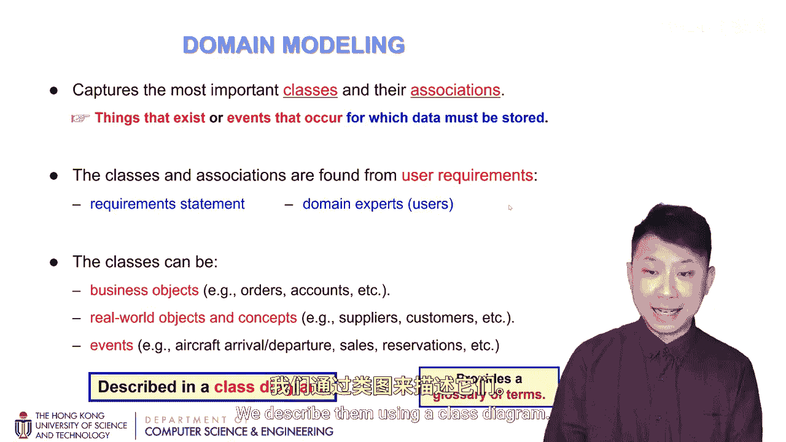

And notice that classes， they usually appear as nuuns and non phrases。

 So the first thing that you should do when you see the pro statement is that you try to extract all the nuuns and all the nonun phrases from the pro statement。

 And they are the potential classes in your class diagram。 And notice that associations。

 they usually appear as verbs or verb phrases。 So again。

 you try to extract all verbs and verb phrases from your pro statement and they are potential associations within your class diagram。

 And after you extract all the nunguns and verbs。 you try to put them in singular form and also active voices for easy reading。

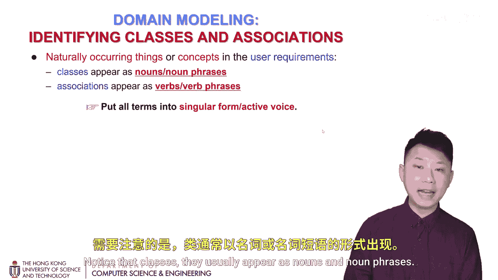

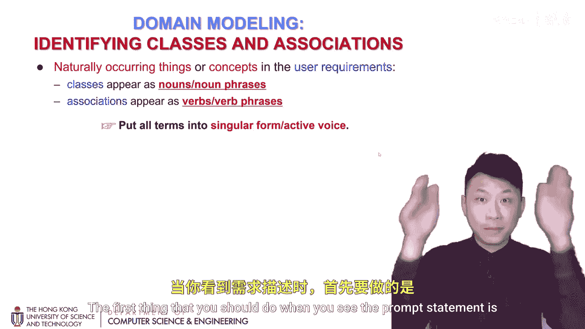

And notice that you only identify relevant classes in associations， if they are not relevant。

 you may ignore them， and again we try to keep track all the objects that persist or that you want to keep track within the system。

So we only try to keep track those classes and associations that we need to keep track and those that will persist within the software system and notice that the decomposition of user requirements into classes and associations depends on judgment and experience and the nature of the problem。

 usually we don't have a single correct answer in domain modeling that means we don't have a single correct model given a pro statement。

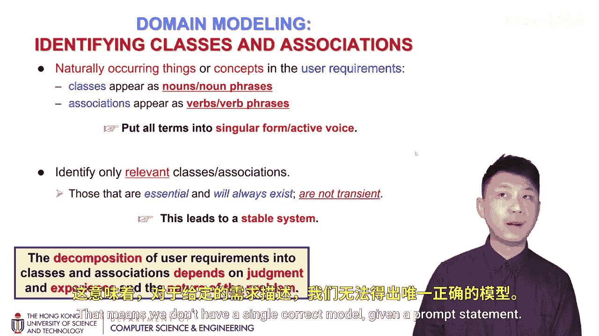

There may be multiple correct answers。

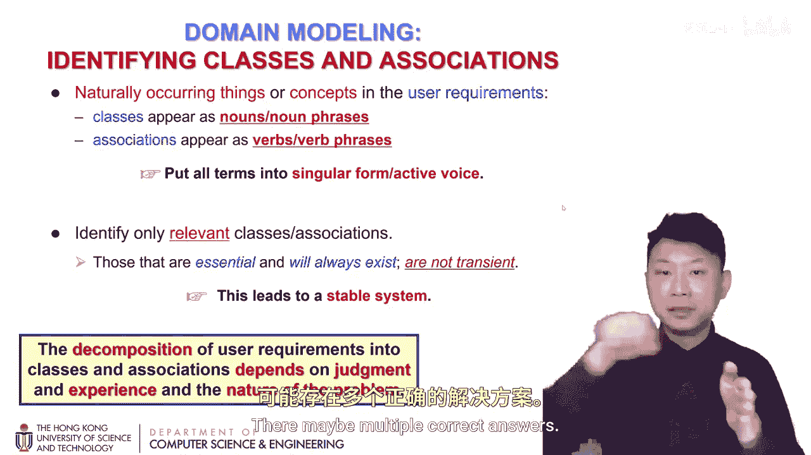

And choosing one or the other model is gonna be just a design choice based on your own judgment and also your own experience。

 Again， that's why I say there is usually no one single correct decomposition。

 So after you identify all the classes and associations from the pro statement。

 then you have to identify attributes。 notice that attributes， they usually appear as nas。

 fall by process phrases， For example， password of students， students address， etc cetera。

 etc cetera。 and they are potential attributes within the software system and also maybe adjectives with eliminated values。

 For example， four term PhD degree， etc cetera， etc ce。

 and you only need to identify attributes that directly related to the application domain。

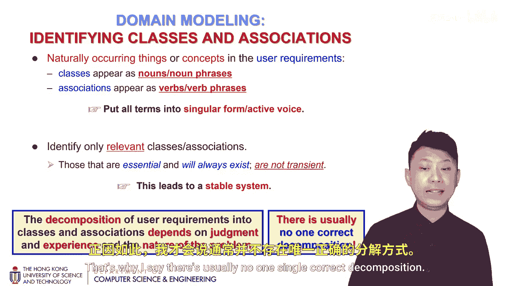

So notice that most of the attributes， you may not get them from the pro statement。

In that case right you may have to talk to domain experts and they may be able to tell you exactly what are the attributes that you need within the software system So when we talk about identifying classes。

 we have said that we try to ignore those irrelevant classes and these are the rules that you can use to ignore irrelevant classes。

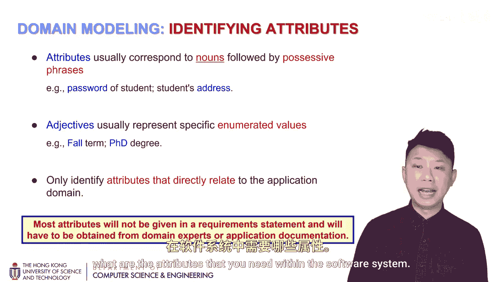

If some of the classes， they are irrelevant to the domain model， you eliminate them。

If some of the classes they are vague， okay， you may ignore them， for example。

 in the problem statement you see that you see a statement saying that in the system we try to store information。

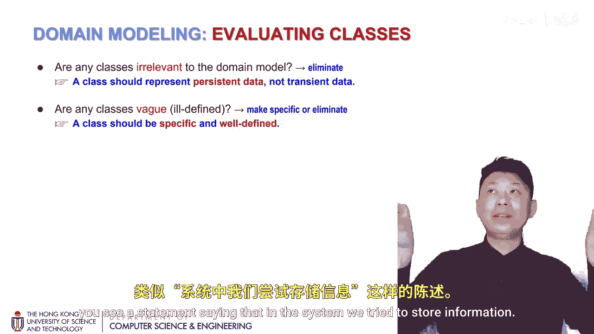

OkayIn is kind of vague， then you have to either ignore it or you have to make it more specific if some of the classes they have redundant you try to keep the most descriptive one for example。

 classes and course they may represent the same thing， then you just keep one of them。

If some of the classes， they are really attributes then you make them attributes。

 but not classes if some of the class name describe a row， okay。

 then you make it a row name under an association but not a class。If some of the classes。

 they are operation action or even functionality， you eliminate them。And if some of the classes。

 they describe implementation constructs， for example， in your prompt statement。

 you have a sentence saying that we have to build a system， Notice that system is a na。

 but system is the system that you're going to build Okay。

 you don't put a system on your class diagram。

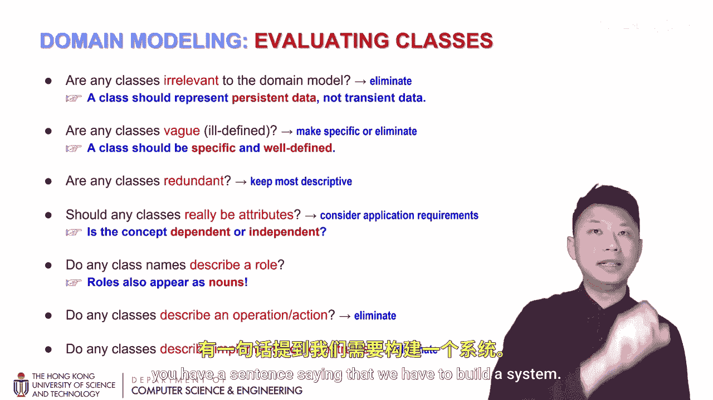

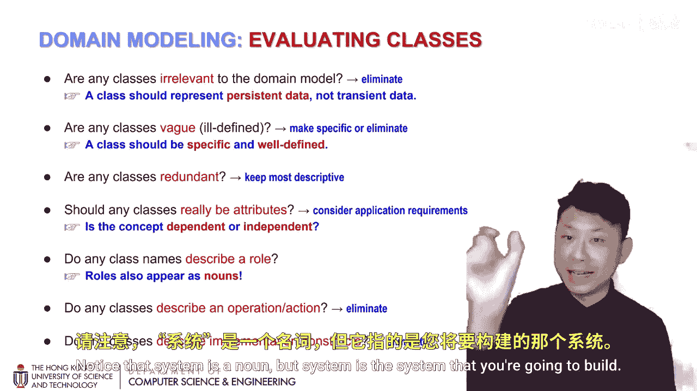

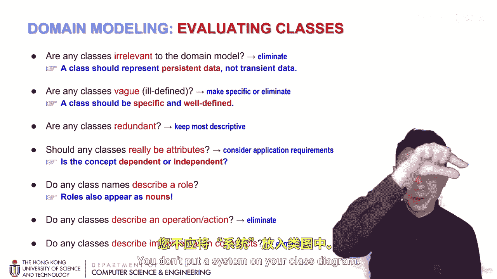

So you have to eliminate， for example， system okay from the pro statement。

 which is implementation constructs， that means something that you have to implement。

 you don't include them in your class diagram。

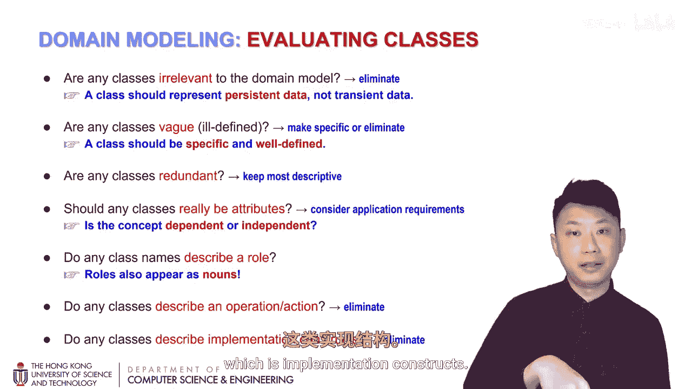