# 软件工程：P11：领域建模-评估类 🧱

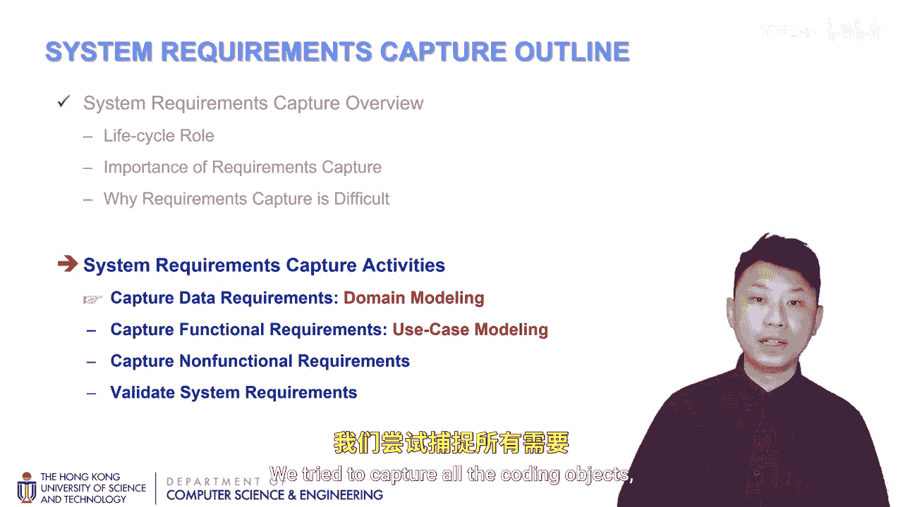

在本节课中，我们将学习领域建模的核心步骤，特别是如何从问题陈述中识别和评估类。我们将了解如何提取潜在类、关联和属性，并学习过滤无关信息以构建一个清晰、准确的类图。

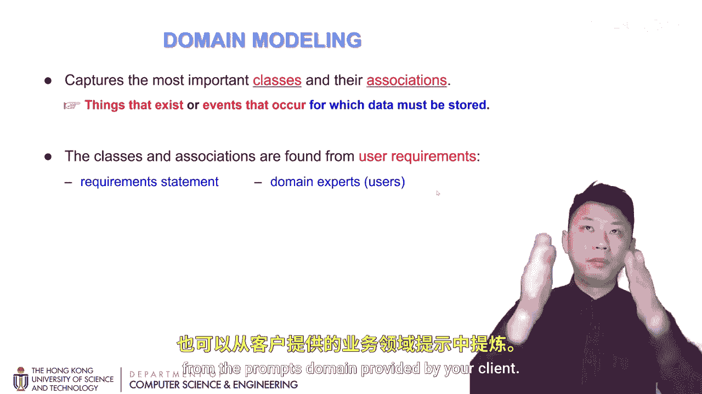

上一节我们介绍了领域建模的基本概念，本节中我们来看看如何具体地从问题陈述中识别和评估类。

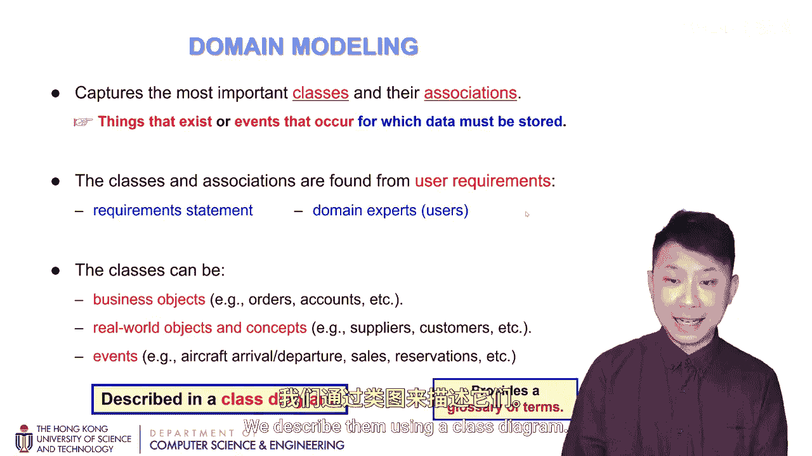

## 识别潜在类与关联

领域建模的目标是使用类图捕获数据需求，并追踪软件系统中需要记录的所有重要对象。

类图旨在捕获最重要的类及其关联。这些类和关联可以从客户提供的问题陈述中提炼出来。

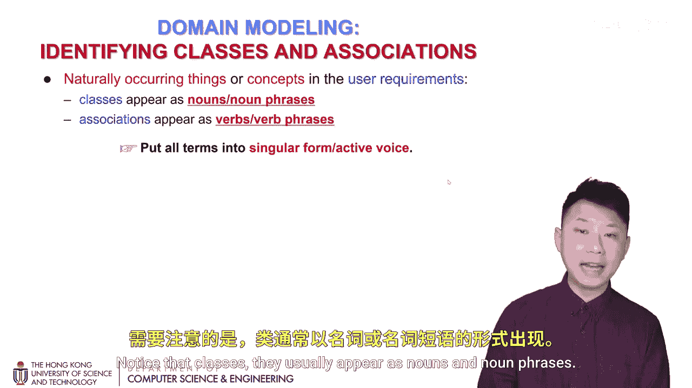

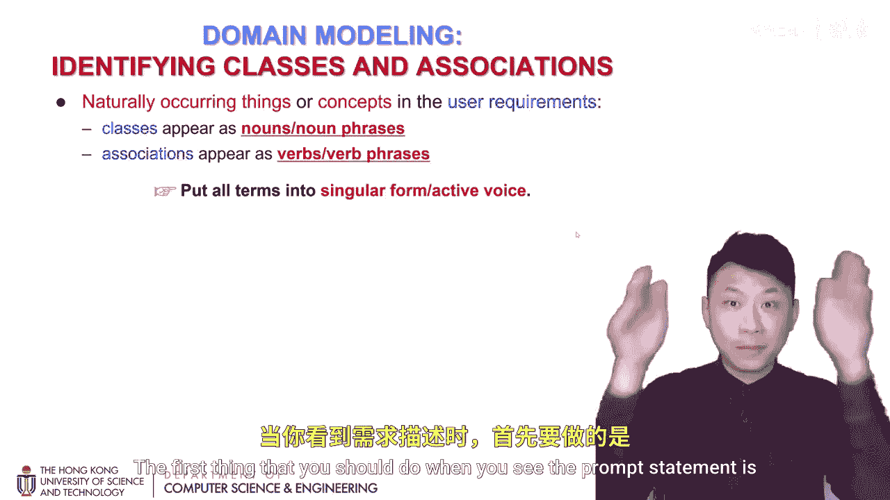

请注意，类可以是业务对象、现实世界对象、概念，甚至是事件。我们使用类图来描述它们。

类通常以名词或名词短语的形式出现。因此，看到问题陈述后，你应做的第一件事是提取其中所有的名词和名词短语。它们是类图中的潜在类。

关联通常以动词或动词短语的形式出现。同样，你需要提取问题陈述中所有的动词和动词短语，它们是类图中潜在的关联。

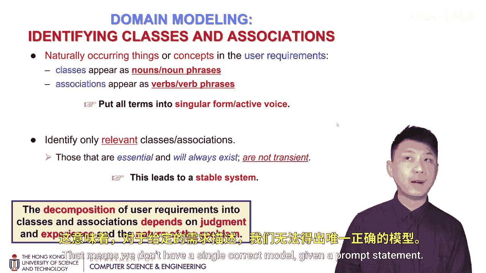

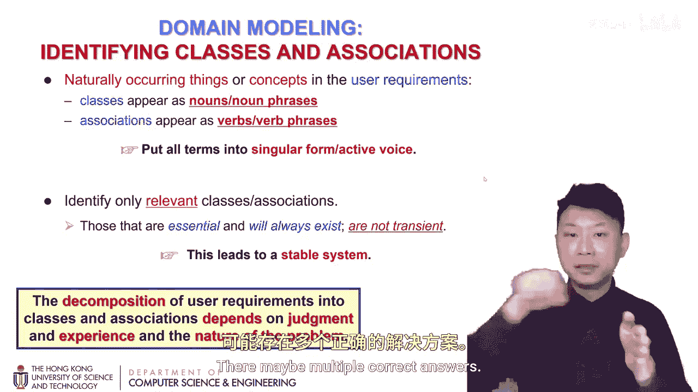

提取所有名词和动词后，应将其转换为单数形式和主动语态，以便于阅读。

## 评估类的相关性

我们只识别相关的类和关联。如果不相关，可以忽略它们。我们只追踪那些需要在系统中持久化或记录的对象。

将用户需求分解为类和关联取决于判断、经验和问题的性质。在领域建模中，通常没有唯一正确的答案。这意味着对于同一个问题陈述，可能没有唯一正确的模型。

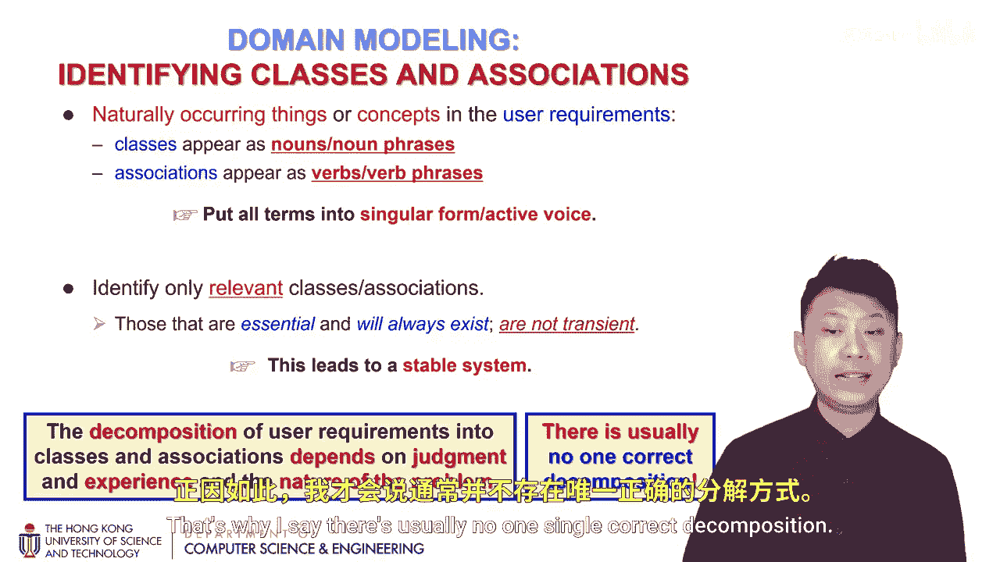

可能存在多个正确答案。选择哪一种模型将只是基于你个人判断和经验的设计选择。这就是为什么通常没有唯一正确的分解方式。

## 识别属性

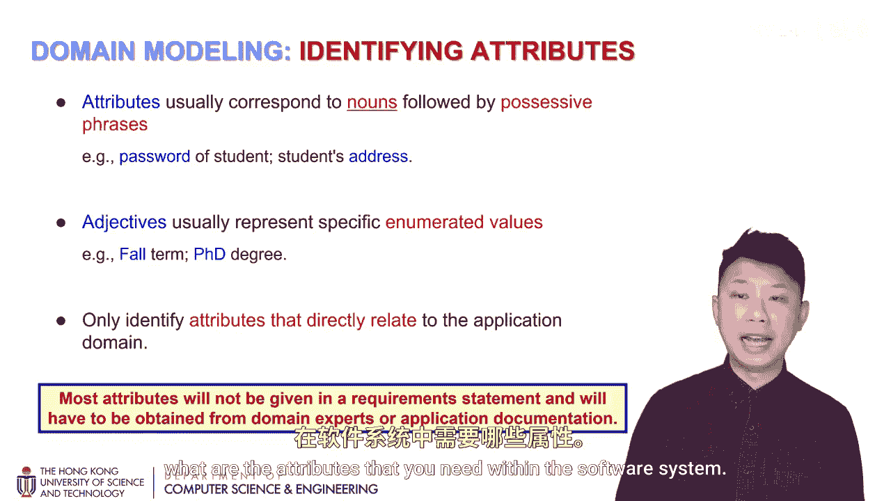

识别出所有类和关联后，接下来需要识别属性。属性通常以名词后接介词短语的形式出现，例如“学生的密码”、“学生的地址”等。它们也可能是带有枚举值的形容词，例如“四年制博士学位”。

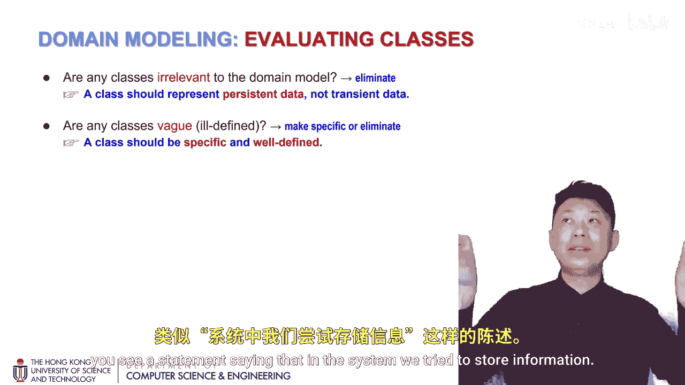

你只需要识别与应用程序域直接相关的属性。

请注意，大多数属性可能无法直接从问题陈述中获得。在这种情况下，你可能需要与领域专家交流，他们能告诉你软件系统中具体需要哪些属性。

## 过滤无关类的规则

以下是用于忽略无关类的一些规则：

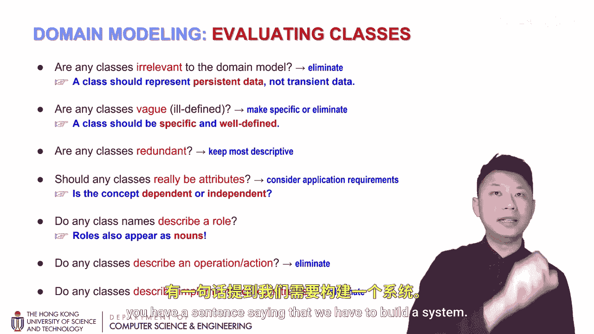

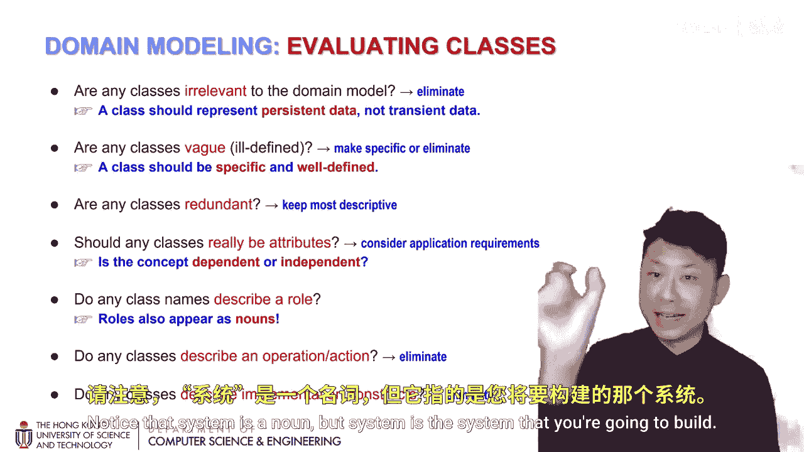

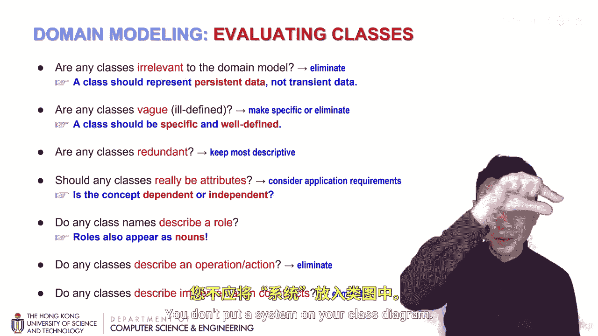

*   **无关类**：如果某些类与领域模型无关，则消除它们。
*   **模糊类**：如果某些类定义模糊，可以忽略它们，或使其更具体。例如，问题陈述中出现“在系统中我们尝试存储信息”，这里的“信息”比较模糊。
*   **冗余类**：如果某些类含义冗余，则保留描述性最强的一个。例如，“班级”和“课程”可能指代同一事物，则只保留一个。
*   **实为属性的类**：如果某些类名实际上是属性，则将其设为属性而非类。
*   **实为关联角色的类**：如果某些类名描述的是一个角色，则将其设为关联下的角色名，而非独立的类。
*   **操作或功能**：如果某些类描述的是操作、动作或功能，则消除它们。
*   **实现构造**：如果某些类描述的是实现构造，则消除它们。例如，问题陈述中的“系统”一词，它是你要构建的系统本身，不应出现在类图中。

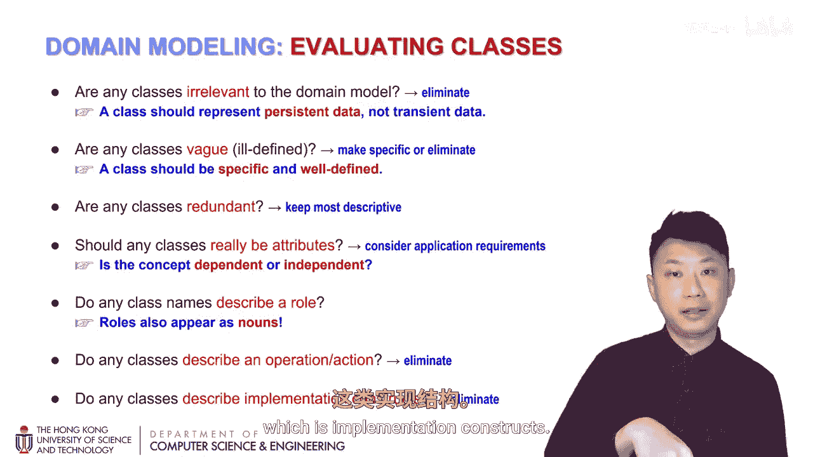

本节课中，我们一起学习了如何从问题陈述中系统地识别和评估类、关联与属性。我们掌握了提取关键信息的方法，并了解了过滤无关类的具体规则。记住，领域建模是一个需要结合领域知识和设计判断的过程，其目标是为软件系统构建一个清晰、准确的数据结构蓝图。