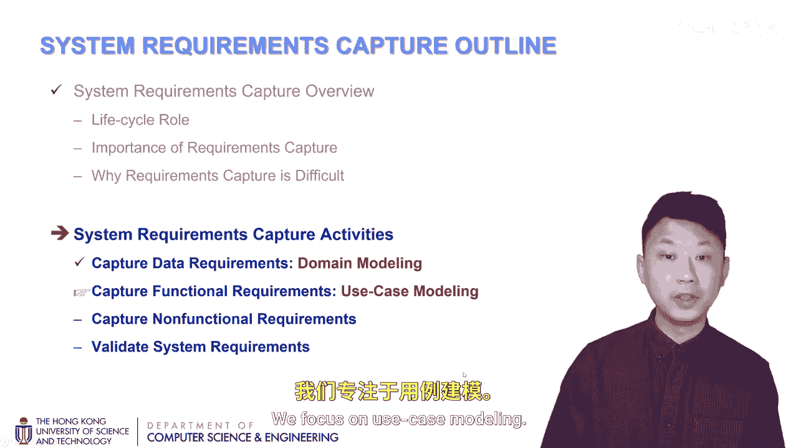
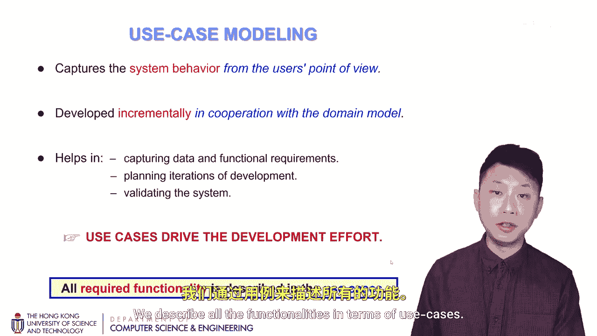
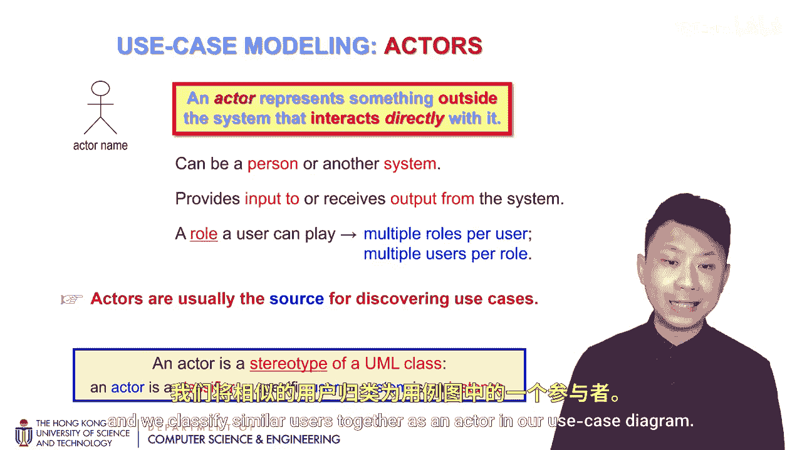
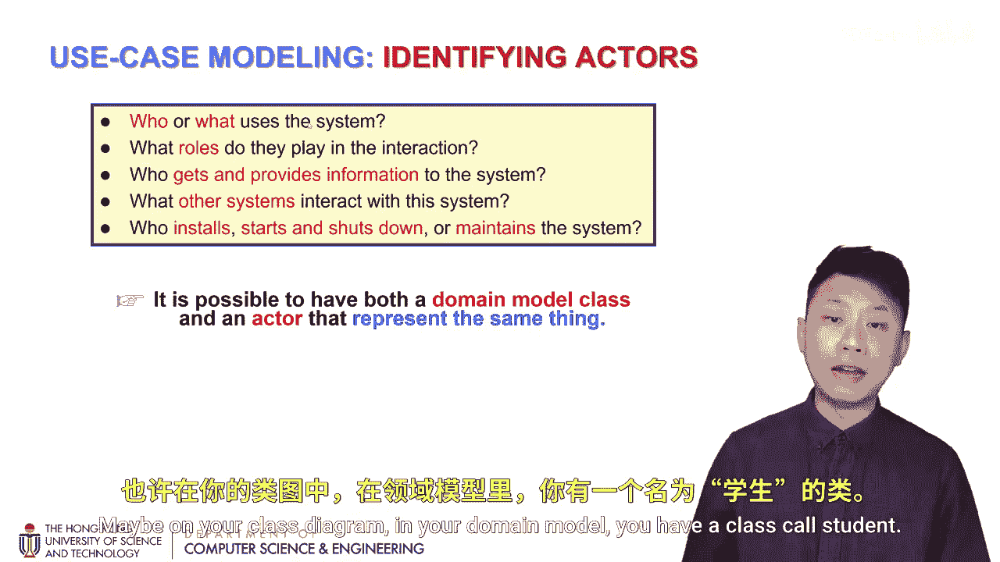
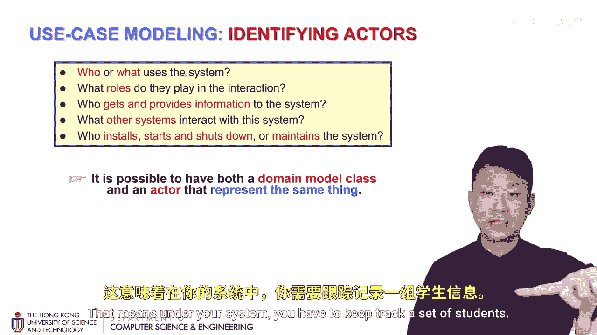
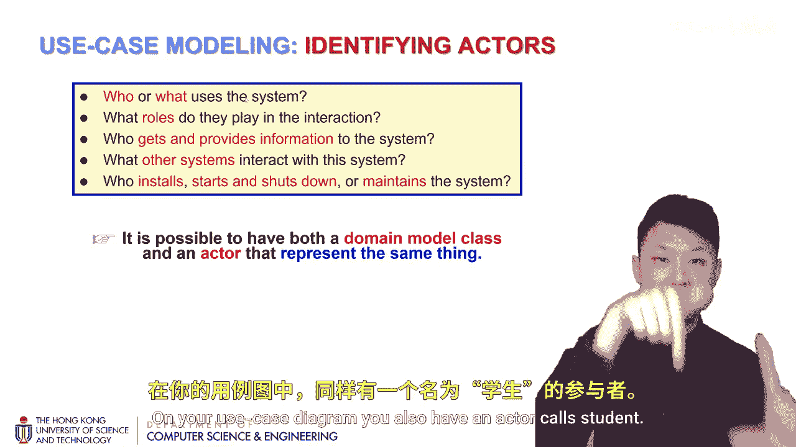
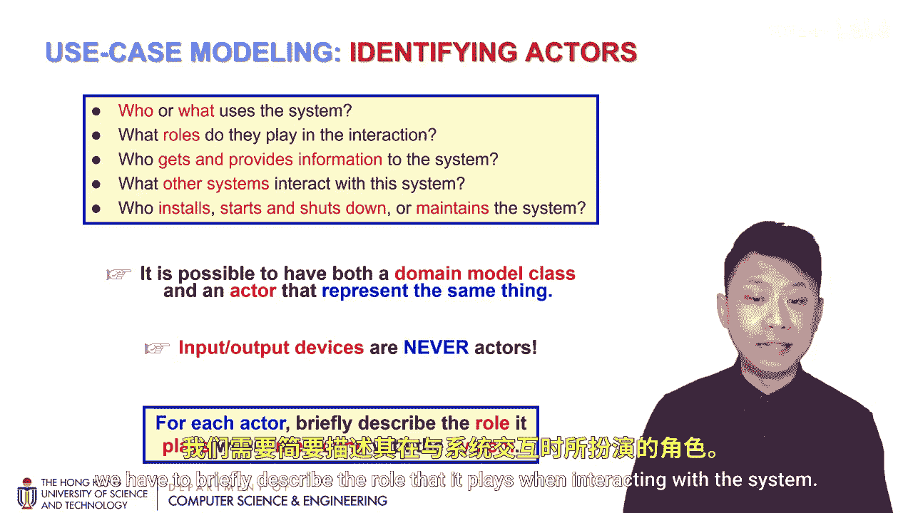
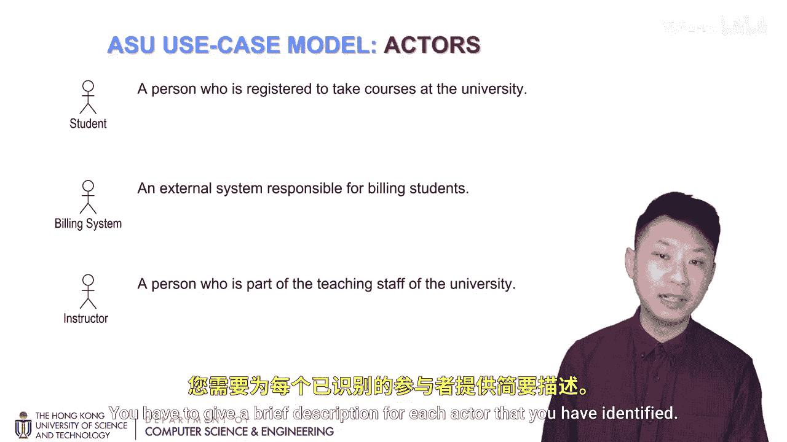
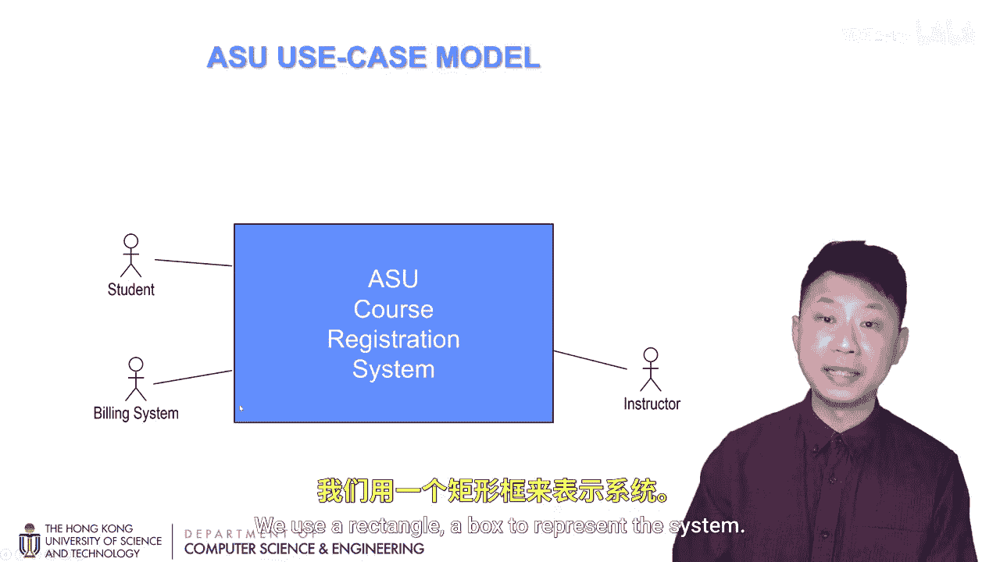

# 香港科技大学【中英⚡软件工程｜Software Engineering Specialization】 p13 P13 01_用例建模-参与者 -BV1MMEjzoEhg_p13-

Hi， in this lecture， we're going to talk about how to build a use case model to capture all the functional requirements of a software system。

And we focus on use case modeling in use case modeling。

 we try to capture the system behavior from the user's point of view and is developed incrementally in cooperation with the domain model。

And this help in capturing data and functional requirements。

 we try to capture all the functionalities of a office system and also planning iterations of development and finally helps validating the system。

And notice that use cases they drive the development effort。

 we developed the software system based on all the functionalities that we captured in the use case model。

 and we describe all the functionalities in terms of use cases and the first thing that you have to include in your use case diagram are actors。

An actor represents something outside the system that interacts directly with the system。

 and we use this notation to denote an actor in our use case diagram。

And an actor can be a person or another system， it provides input to or receive output from the system and it specifies a role that a user can play within the system and notice that we may have multiple rows per user or multiple users per row that means a user can do multiple things on the system and also different users they can do the same thing on the system。

And actors， they are usually the source for discovering use cases to discover functionalities on your software system。

And an actor is a stereotype of a UL class。 and notice that we may have many users on a software system and we classify similar users together as an actor in our use case diagram。

 So how to identify actors。 These are some of the questions that you can ask yourself before identifying actors。

 Okay， you can think about who or what is going to use the system。

What roles do they play in the interaction， Who gets and provides information to the system。

 What other the systems interact with the system who installs。

 starts and shuts down or maintains the system， etctera， et cetera。

And notice that it's possible to have both a domain class and also an actor that represent the same thing。

 maybe on your class diagram in your domain model， you have a class called student okay that means under your system。

 you have to keep a set of students。

And on your use case diagram， you also have an actor called student because students。

 they are actually the users who is going to use your system to do something。

Okay， so that's why it's possible that you have student under your class diagram and you also have student under your use case diagram。

And notice that input output devices， they are never actors。 For example， your keyboard， your mouse。

 your printers， they are never actors。嗯。And for each actor。

 we have to briefly describe the role that it plays when interacting with the system。

And let's take a look at this example， let's say we want to build a cost registration system for a university called ASU。

Then we are given this problem， statement。Then from the prompt statement。

 we have to identify all the actors or the potential users who is going to interact with the system。

And if we read the pro statement closely， we can actually identify that we have students。

 we have instructors， and also we have another building system as actors in this particular software system。

And we have to give a brief description for the actors that we have identified it from the prompts statement for example。

 a student is a person who is going to register courses at the university。

 building system is going to be an external system responsible for building students。

 instructor is a person who's part of the teaching staff of the university etc， etc。

 so you have to give a brief description for each actor that you have identified it from the prompt statement and we're going to say that this actors they're going to interact with the ASU course registration system。

And we use a rectangle， a box to represent the system。

 and then we have different use cases within the box within the system。

