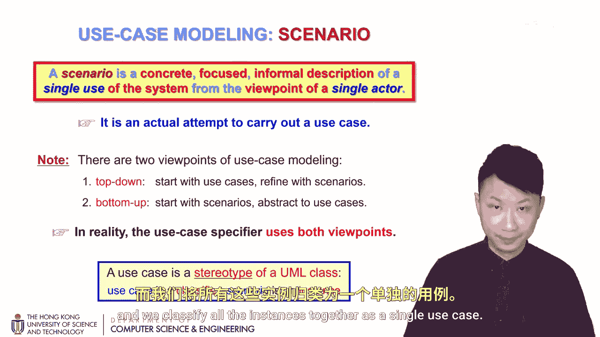
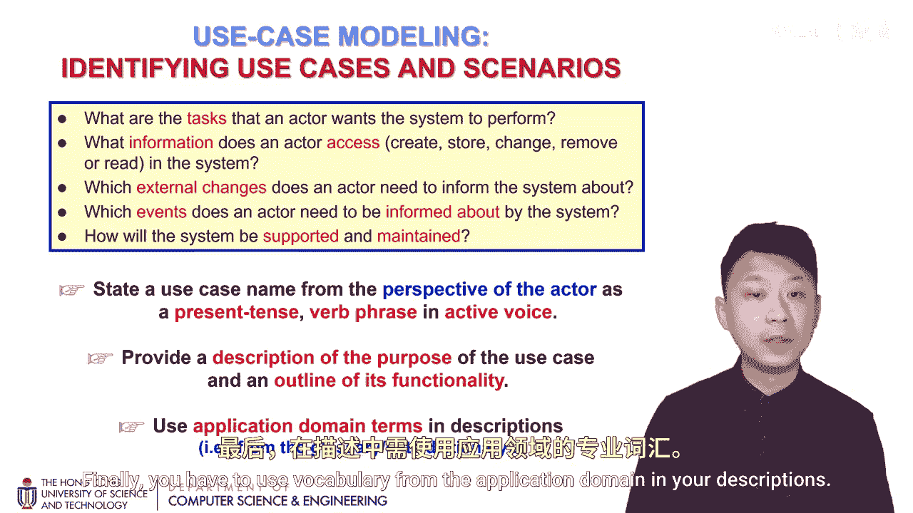

# 香港科技大学【中英⚡软件工程｜Software Engineering Specialization】 p14 P14 02_用例 -BV1MMEjzoEhg_p14-

And the next thing that you have to specify in your use case diagram are use cases。

 a use case is a specific way of using the system by performing some part of its functionality that means a use case actually a function provided by your system。

And we use this notation in oval to represent a use case。

And the UK describes the interaction that takes place between an actor and the system and what the system must do from the actor's perspective。

And then we try to describe it as a complete sequence of events and actions。

And is always initiated by an actor， is started by an actor。Initially。

 we only consider normal sequence of events and actions。

We ignore alternative or exceptional cases when we draw our use case diagram。

But we can include all the exceptional cases and alternative events in our use case specifications。

 but not in our use case diagram。In use case modeling， a scenario is a concrete， focused。

 informal description of a single use of the system from the viewpoint of a single actor from a single user。

And it's an actual attempt to carry out a use case。 For example。

 Kenne of is using the system to do something。 Okay。

 a particular actor is going to use the system to do something。

And notice that there are two viewpoints of use case modeling。

 we can either do it top down that means we start with the more general use cases and then we find them into more precise scenarios for each single individual user。

Or we can do it bottom of them is we start with the individual cases about like how individual users can interact with the system。

 then we abstract them into more general use cases。In reality。

 were going to come up with all the use cases using both viewpoints。

 right using both top down and also bottom up。And notice that the use case is a stereotype of a UML class。

 The scenario is an instance。 the more detailed story from a single user is actually an instance。

 and we classify all the instances together as a single use case。

So how to identify use cases and scenarios for a software system。

 these are the questions that you have to think about， for example。

 what are the tasks that an actor wants to perform on the system。

What information does an actor assess in the system？

Which external changes does an actor need to inform the system upon？

And which events does an actor needs to be informed about by the system。

And how will the system be supported and also maintained？For each use case。

 you have to give a use case name from the perspective of an actor and using a present tense word phrase in active voices for easy reading。

And also you have to provide a description of the purpose of the use case and outline of its functionality。

And finally， you have to use vocabulary from the a domain in your descriptions。

