# 香港科技大学【中英⚡软件工程｜Software Engineering Specialization】 p15 P15 03_用例建模示例 -BV1MMEjzoEhg_p15-

So now let's go back to the AsU use case model and we try to identify all the functionalities from the prompt statement by studying the prompt statement sentence by sentence and the first functionality that we're going to get from the first sentence is students is going to request for cost catalog and notice that cost catalog is simply a list of cost offerings available on the cost registration system so that's why we're going refine the functionality as student is going to browse cost offerings on the system。

And someone is going to prepare cost catalog for the students。

 so we're going to say that we have the functionality right someone is going to prepare cost offerings on the cost restoration system。

For the second sentence， we're going to get the functionality that someone is going to prepare cost offerings on the system。

 so as the functionality is the same as the one that we have obtained from the first sentence。

And in the first sentence， we can see that students， they can select cost offering。

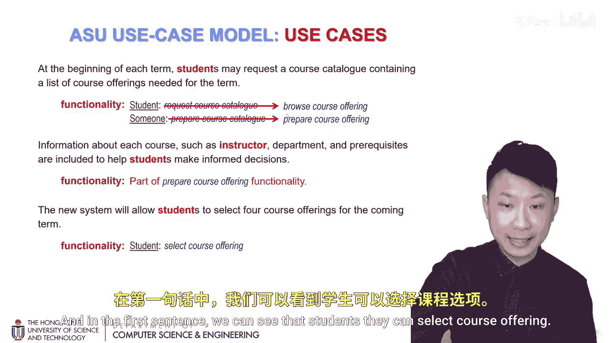

And in the fourth sentence we can see that student they can indicate two alternative choices on the system。

 so we can say that student they select alternative choices。

 but notice that those alternative choices they are still causess。

 so that's why we're going to refine it as student again is going to select two alternative choices to alternative course offerings on the system。

And then someone is going to cancel cost ovory。And then in the next sentence。

 we don't get any functionality， then in the next sentence we see that someone is going to cancel cost offering。

And it's the same as the one that we have captured before。

 so we don't have any new functionality in this statement。

And then in this sentence we get one functionality。

 which is like the building system is going to receive building information from the system。

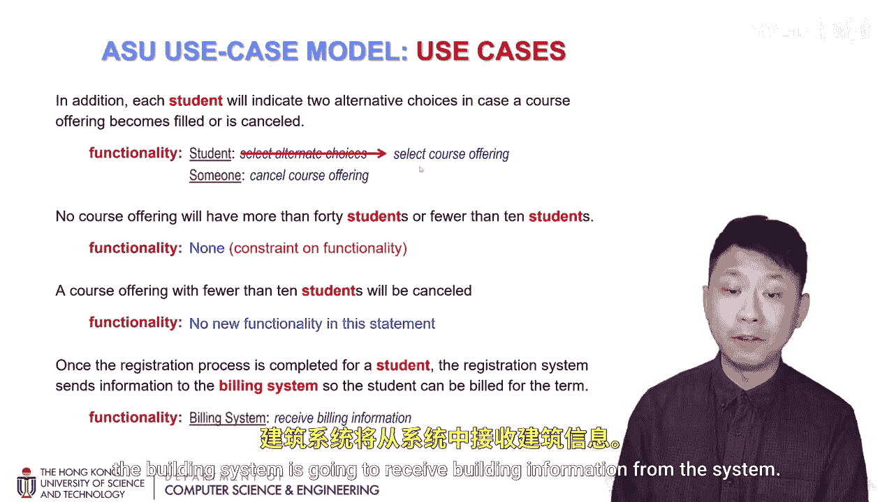

And then another functionality that we can get from this sentence is that instructor is going to select courses to teach and also instructor is going to request for enrollment list。

And then in the next sentence， we're going to see that a student is going to change their schedule okay and eventually a schedule is going to be just a set of cost offerings。

 so that's why we we find it and say that a student is going to change cost offerings。

And then in this sentence， we're going to get the functionality that student can actually add cost offering。

And also drop cost offering。

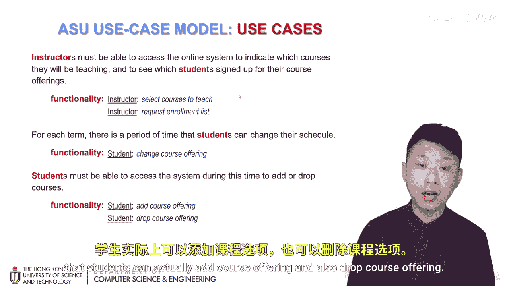

And now from the pro statement we can see that someone is going to prepare cost offerings and also someone is going to cancel cost offerings on the system。

 so that's why you may talk to the domain experts and then the domain expert is going to tell you that an amin or a registrar okay is going to maintain all the cost information on the system so that's why we discover in other actor for this particular application domain okay which is the registrar and then this are all the functionalities that we have captured from the pro statement。

Now， are we done？We just simply draw a use case diagram with all these functionalities， yes or no。

I will say no because you have so many functionalities in your use case diagram and eventually going to have many ovals in your use case diagram。

 which is going to make your diagram very difficult to read What's wrong here。Okay。

 so notice that when we try to come up with a use case。

 what is a good use case a good use case is typically represent a major piece of functionality that is complete from beginning to the end。

 so it has to be complete story from the beginning to the end so think about it this。

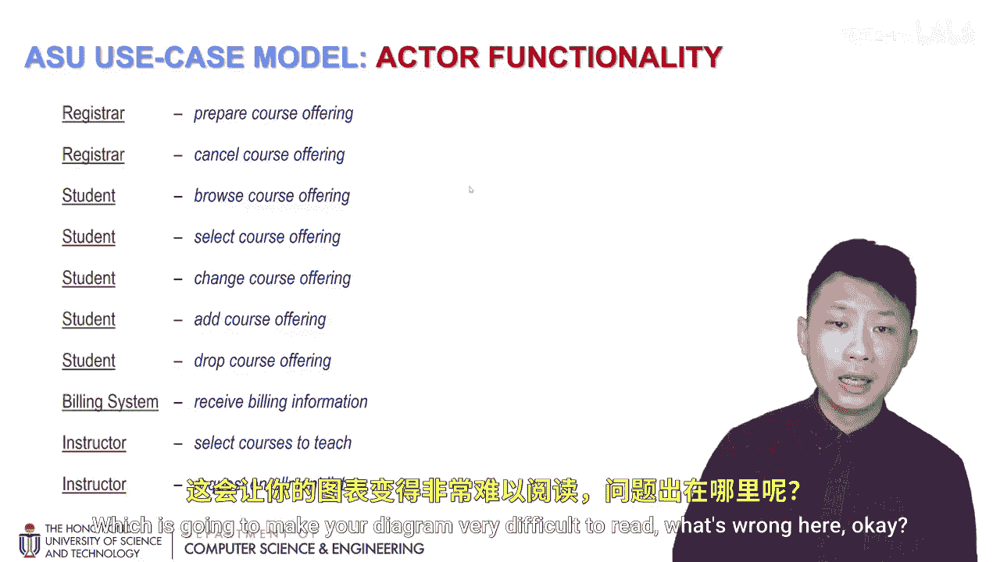

Good use cases。No， they are not good use cases because they are only part of the story。

 They are not a complete story。 We have to make it more complete。

 So student is selecting cost offering， adding cost offering， browsing cost offering。

 dropping cost offering， and also changing their cost offerings because they are doing what。

They are trying to。Register for causes so that's why we have to group all these functionalities here and then make it more complete and we're going to simply have one single use case saying that student is going to register for courses on the system and by using just one single story instead of five partial stories you're going to make your use case diagram more readable and more simple and also easy to read。

So that's why whenever possible try to make your use case as complete as possible and that's why we have to follow this rules。

 it's better to have longer and more extensive use cases as smaller or partial ones。😡。

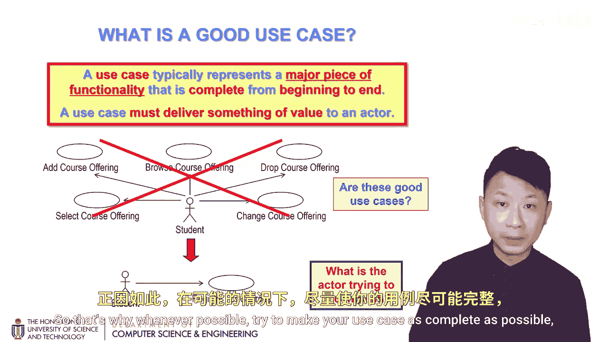

Okay， and we want real and complete complete use cases， not several subcases of a use case。

 not the puzzle stories， we want a more complete story so now let's try to group the functionalities together and make them more complete。

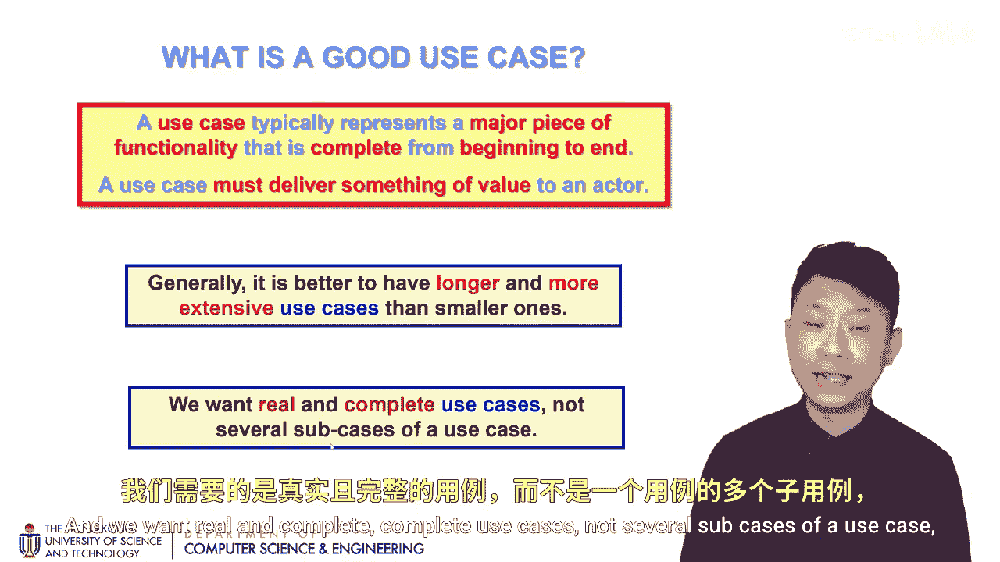

These two functionalities we can group them together because register they are going to prepare cost offering and also they are going to cancel cost offering what they are doing is actually maintain cost information on the system。

And then student， they register for courses。And notice that select cost offering and change cost offering。

 they are already covered by a cost offering and drop cost offering。

 So that's why we can even delete them because they are already covered by a cost offering and drop cost offering。

And then instructor they're going to select course to teach and then instructor they're going to request for enrollment list and these are all the functionalities provided by the system and finally this is the use case diagram that we draw for the ASU application domain register they are going to maintain cost information instructor they're going to select courses to teach and also request for enrollment list。

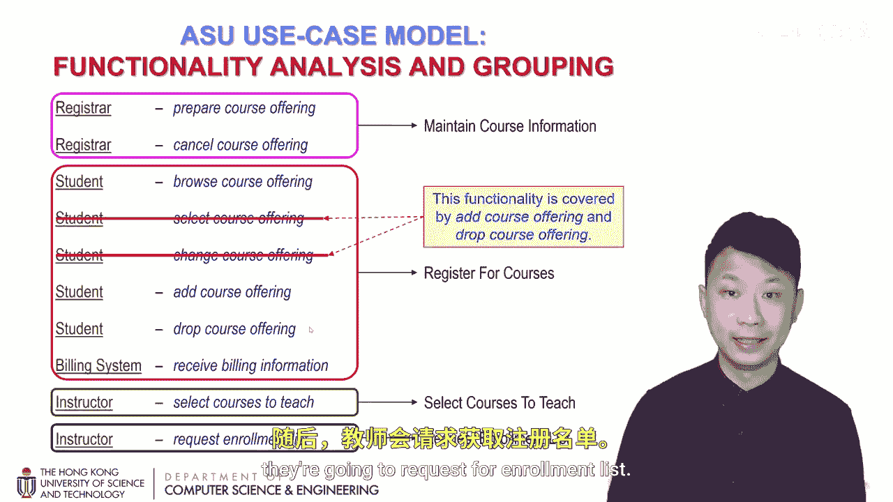

And a student， they are going to register for courses and then now we have a link here。

 we don't have an arrow and arrow means students will start this use case okay。

 this use case is initiated by student。But now we have a link。

 a line between register for causess and the building system。

 because within the Reg for causess use case， eventually you're going to receive building information。

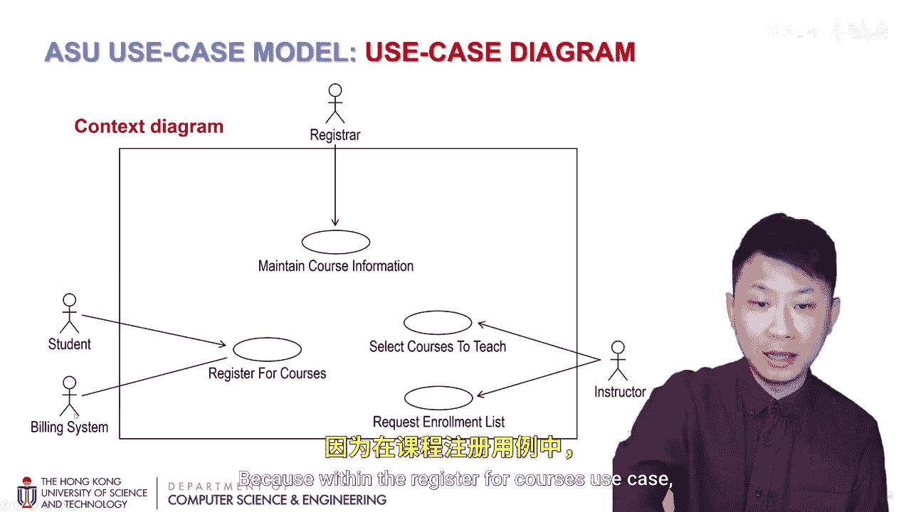

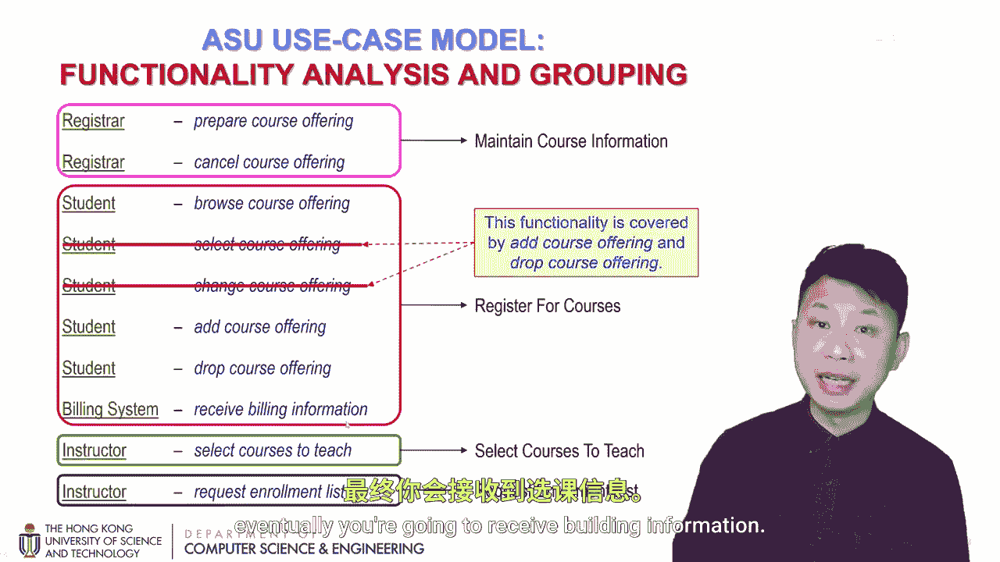

So so that's why we have a line here that means you're going to receive some information from this use case this use case is not started by the building system。

So this use case is not started by the building system。

 it's started by the student because we have an arrow going from the student to the use case。

We have a line between building system and register for causes because the building system is going to receive some information from this use case so that's why we have a line here and the line denote that there will be some communication between the building system and the use case and notice that we don't have anarrow that means this use case is not started by building system is actually started by student and then for each use case that you came up with you have to come up with a use case specification and we will talk in more details about how to write use case specifications in the next lecture and notice that in use case modeling you can also use generalization and you can perform generalization on actors or perform generalization on use cases for example。

 employee we generalize into two types of employees right Salcark or manager or we can also generalize for example。

 the use case one the user。

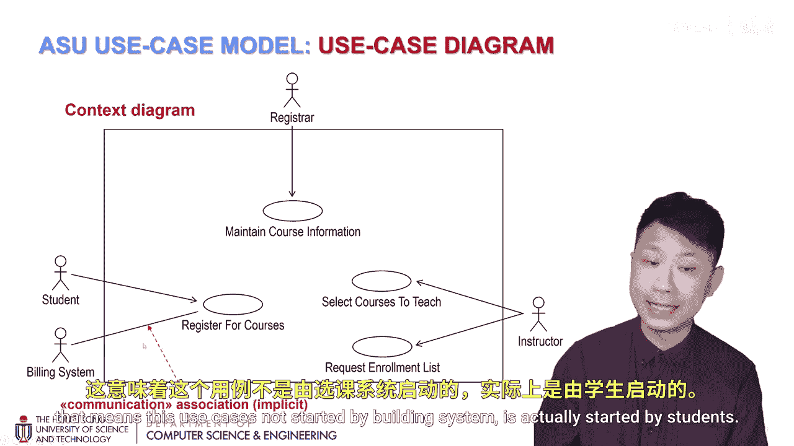

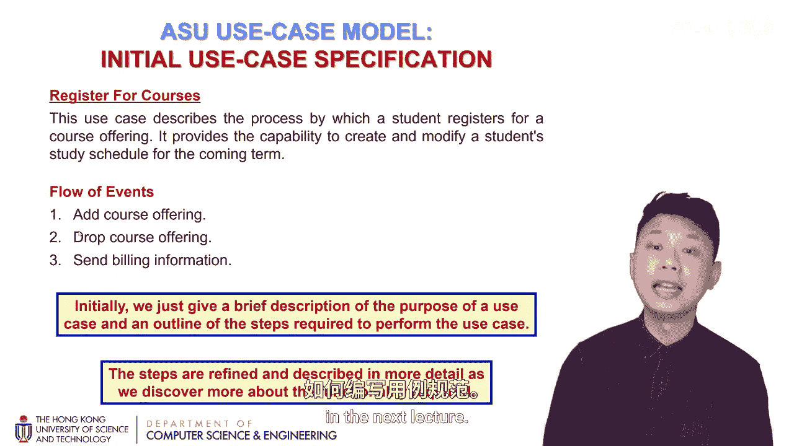

Into two types one is checking password， another is scanning fingerprint。

But try not to use use case generalization in your project。

 there is no need to do so because even with job generalization on use cases you can still get the correct answer and it's often used incorrectly so that's why I suggest you guys to try to avoid using generalization on use cases for your project but of course you can still use generalization on actors and that's all I want to cover in this lecture。

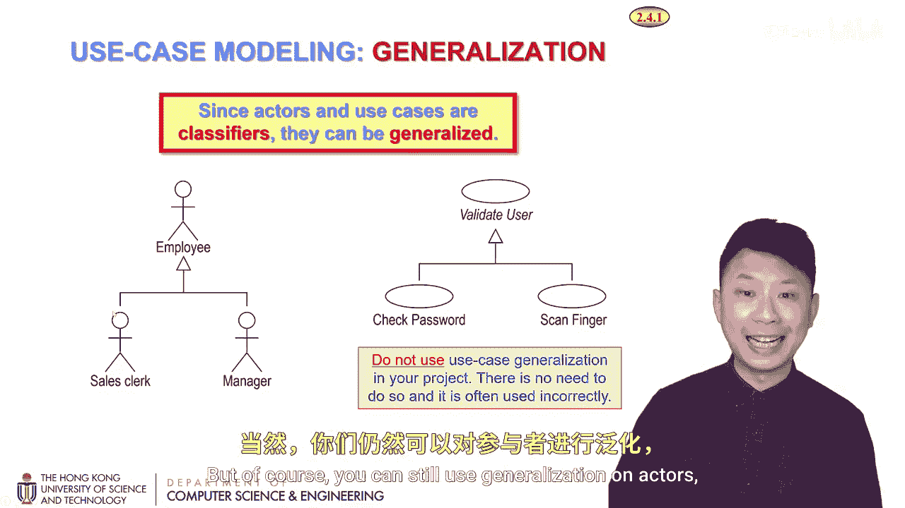