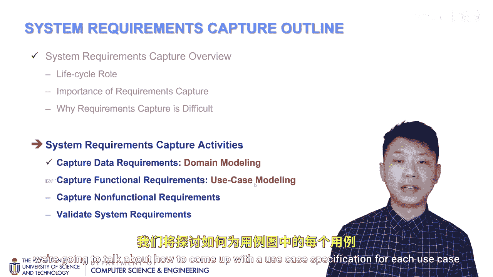
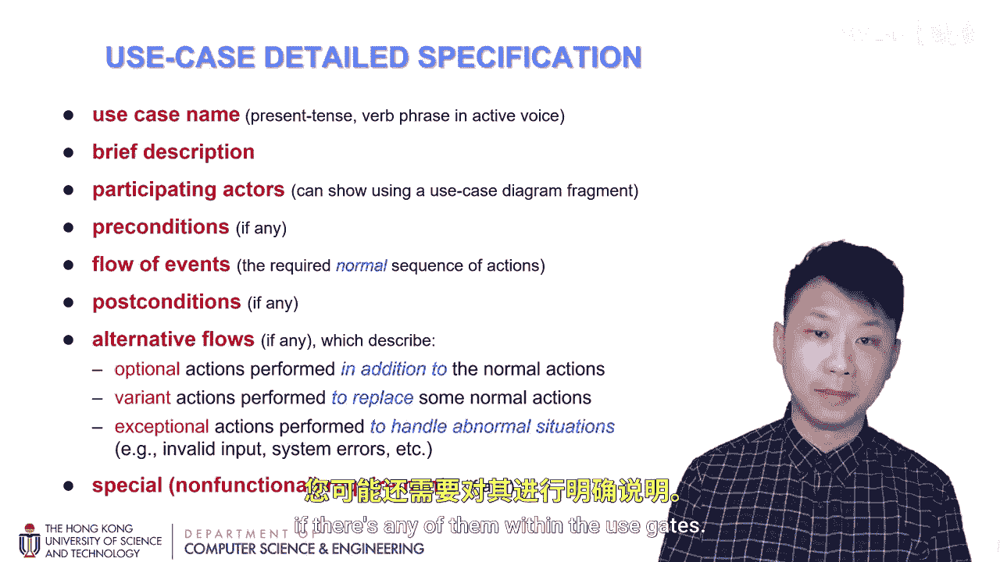
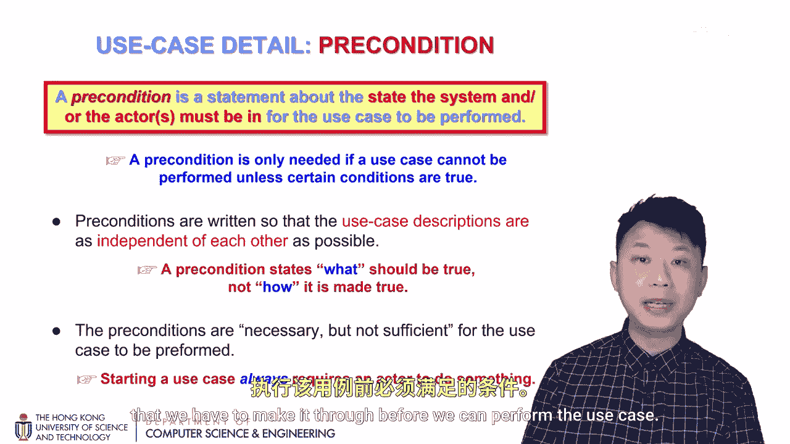
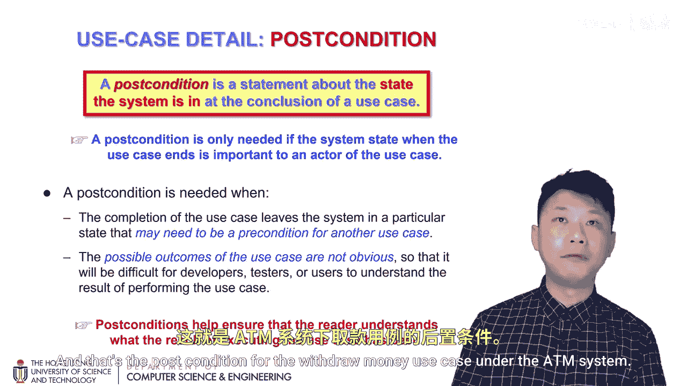
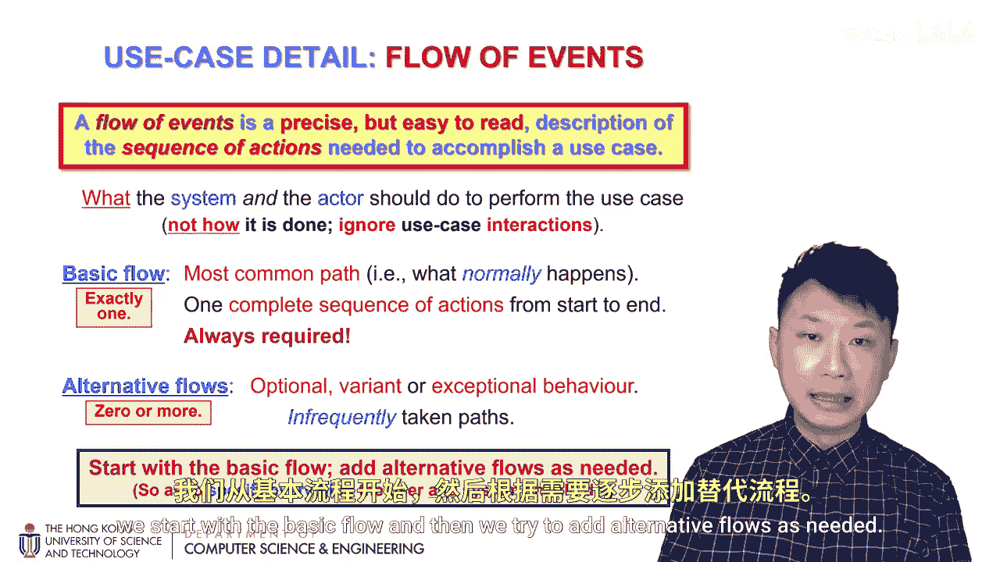
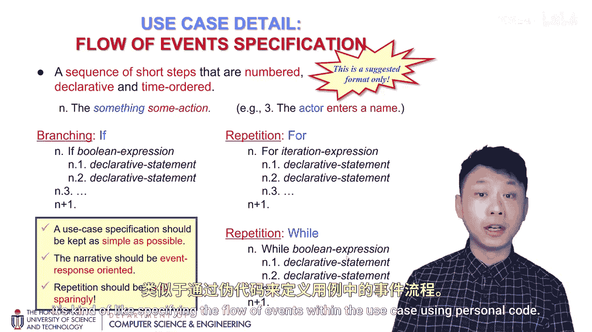
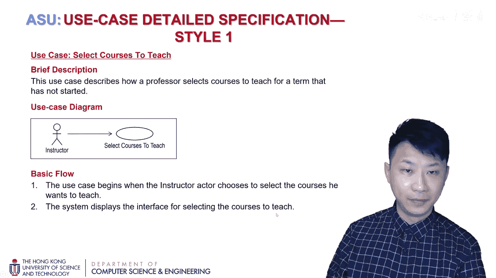
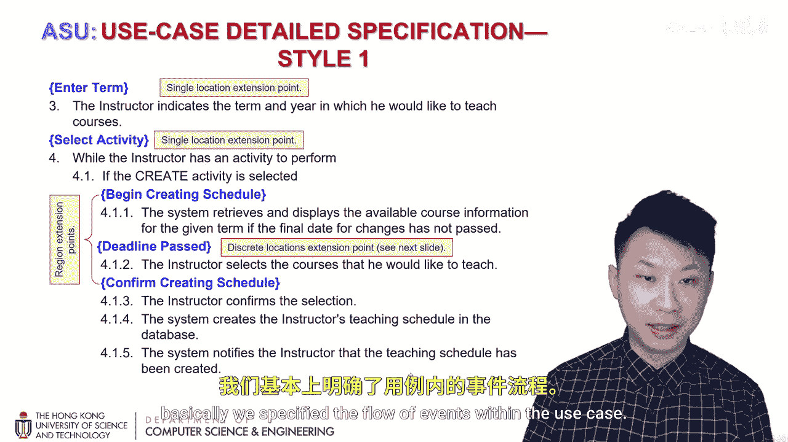

# 香港科技大学【中英⚡软件工程｜Software Engineering Specialization】 p16 P16 01_用例规范 -BV1MMEjzoEhg_p16-

Hi， in this lecture， we're going to talk about how we can write a use case specification to specify the flow of events within a use case。

 I have provided some examples of use case specifications on the costware page。

 You can always refer to those examples when you come up with your own use case specification。

So in this lecture we are going to talk about use case modeling in particular we're going to talk about how to come up with a use case specification for each use case that we come up with in the use case diagram。

So these are the things that you have to include in a use case specification。

 you have to give a use case name， a brief description for your use case。

 and also the participating actors， the preconditions， the flow of events， post conditionsd。

 alternative flows to specify optional exceptional or alternative behavior within your use case。

 and also you may need to specify nonfunctional requirements if there is any of them within the use case。

So a precondition is a statement about the state that the system and or the actor must be in for the use case to be performed。

So some condition that you need to achieve before you can execute the use gate and a precondition is only needed if a use case cannot be performed unless certain conditions are achieved。

So preconditions are written so that the use case descriptions are as independent of each other as possible。

 so we consider each use case independent to each other when we come up with the use case specifications。

And a precondition states what should be true， but not how to make it true within a use case specification。

 So preconditions are necessary， but not sufficient for the use case to be performed。

So starting a use case always requires an actor to perform something within the system As an example。

 let's say we are implementing an ATM system for a bank。

Then let's say we want to withdraw money from the ATM and withdraw money is actually a use case on the system。

Then in order to perform withdraw money from the ATM， the use case。

 we have to make sure that the balance has to be bigger than or equals to 100 before you can withdraw money from the ATM and that's a precondition that we have to specify within the use case specification because that's the condition that we have to make it through before we can perform the use case and a post condition is a statement about the state that the system is in at the conclusion of a use case a post condition is only needed if the system state when the use case and is important to an actor of the use gate。

So A's condition is needed when the completion of the use case leaves the system in a particular state that may need to be a precondition for N other use case。

And also the possible outcomes of the use case are not obvious。

 so you want the other stakeholders to somehow understand what are the conditions that we have achieved as the outcomes of the use case。

Then we have to specify post condition。And post conditions helps ensure that the reader or different stakeholders。

 they will understand what the result of executing the use case has been。Using the same ATM example。

 let's say after the user withdraw money from the system。

 then the balance has to be still not negative after the withdrawal and that's the postcon for the withdraw money use case under the ATM system and a flow of events is a precise but easy to read description of the sequence of actions needed to accomplish within the use case。

 so we have to specify what the system and the actor should perform within the use gates。

So you have to specify the basic flow within a use case that means what's going to normally happen within the use case and also you have to specify the alternative flows。

 that means the optional variant or exceptional behavior within the use case and within a use case specification we start with the basic flow and then we try to add alternative flows as needed and this are the kind of statements that we can use in a basic flow for example。

 we can use conditional statement if if something happen then we do something or a follow loop。

Okay， for some condition that we try to achieve， then we try to repeat doing something。

Or a while loop。 when we try to specify the basic flow。

 it's kind of like specifying the flow of events within the use case using Pur code。

So this is an example use case specification for the use case Sla courses to teach under the ASEU course registration system and then when you write the use case specification。

 you have to give a brief description for the use case For example。

 this use case describes how a professors lack costs to teach for a term that has not studied and then you also have to specify the part of the use case diagram that you refer to in this particular use case specification。

And then in the basic flow you just specify the flow of events that's going to happen within the use case for example。

 the use case begins with the instructor actor chooses to select the courses he wants to teach on the system and then the system display the interface the for selecting courses to teach。

And the instructor indicates the term and year in which he would like to teach courses。

When the instructor has activity to perform， for example。

 if we choose to create activity on the system， then the system will retrieve and display the available cost information for the given term in the final date for changes has not passed etc。

 etc， so in this use case specification basically we specified the flow of events within the use case。

