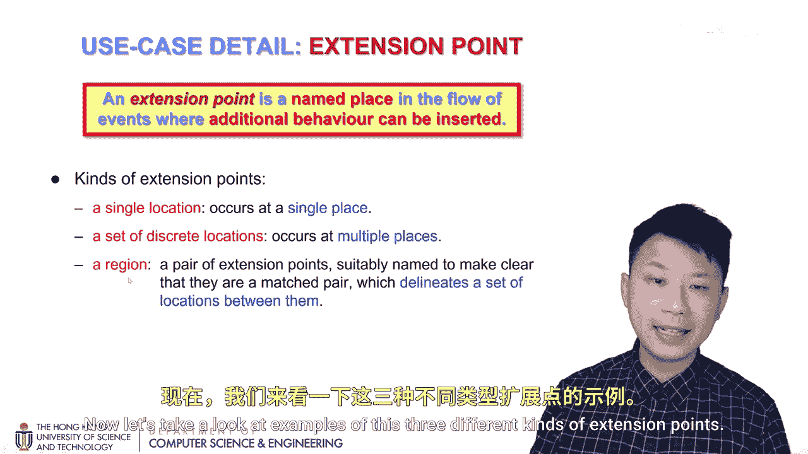
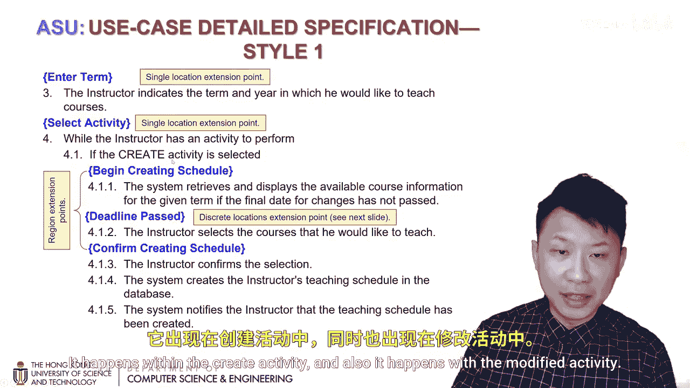
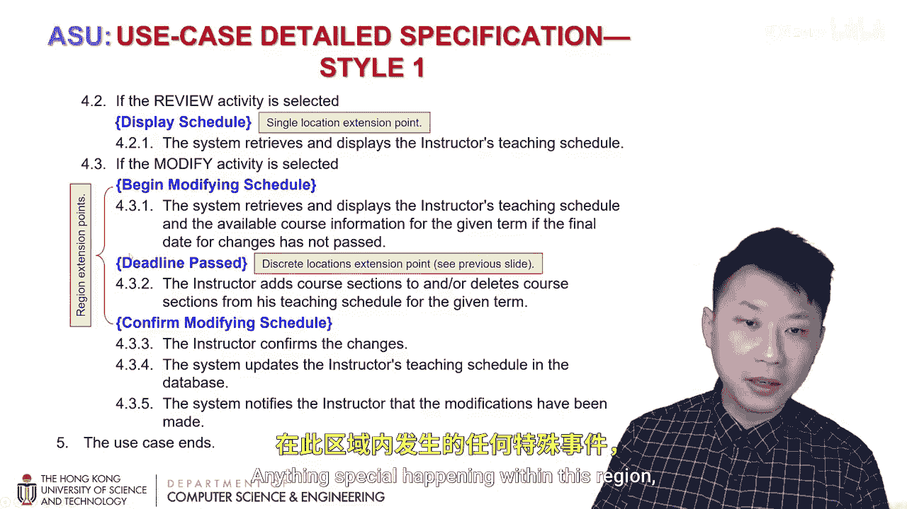
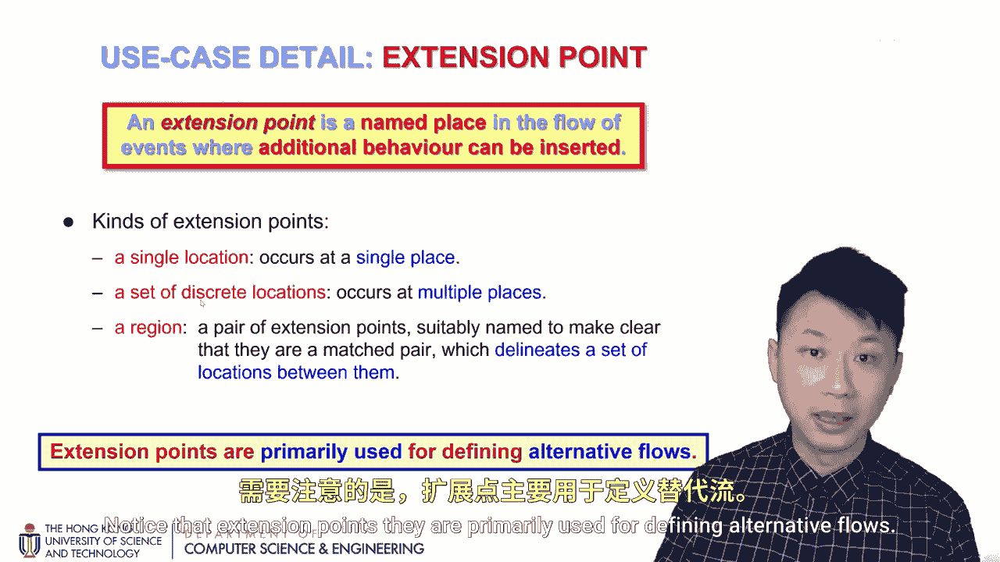
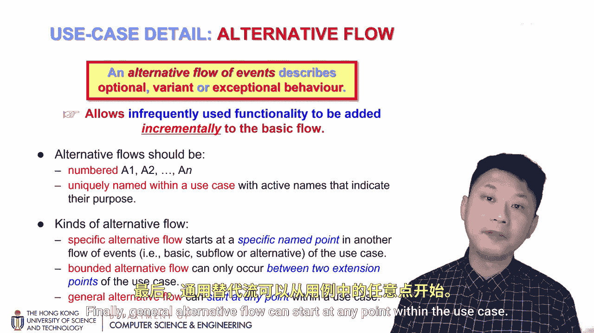
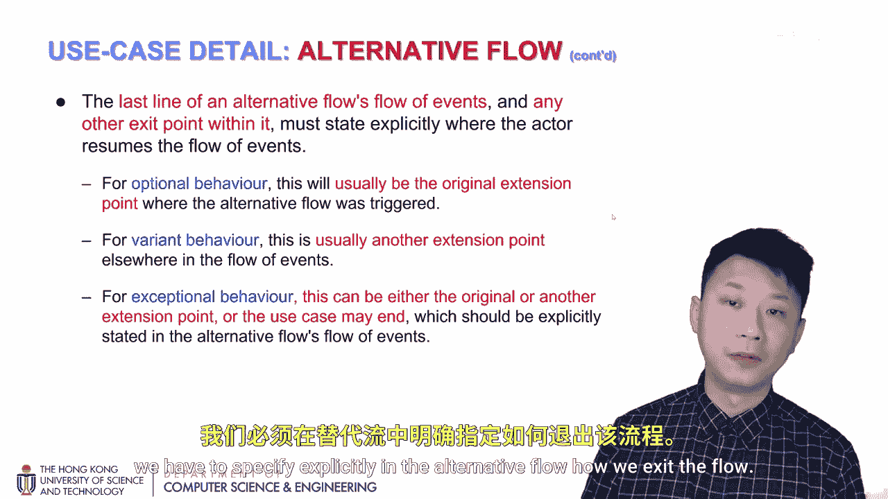
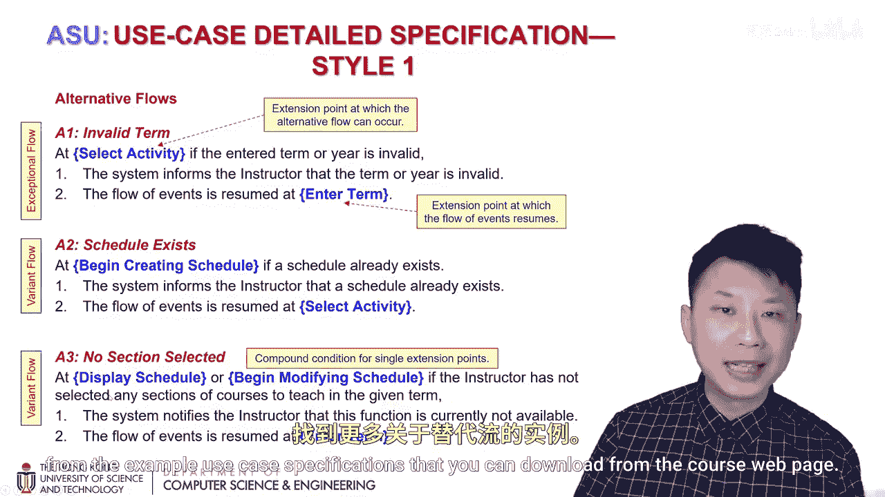

# 香港科技大学【中英⚡软件工程｜Software Engineering Specialization】 p17 P17 02_扩展点与备选流 -BV1MMEjzoEhg_p17-

We can also specify extension point in our UC case specification。

 an extension point is a named place that means a label in the flow of events where additional behavior can be inserted and usually we are talk about exceptional or alternative behavior。

And there are three kinds of extension points that we can add to our use case specification the first one is called a single location extension point second one is extension point that happens at a set of different discrete locations and then the last one is。

And then the last one is a region extension point。So now let's take a look at examples of this three different kinds of extension points。

So if you are talking about a single location extension point。

 this is one example and notice that this label only happened once within the use case specification and that's why we say that is's a single location extension point because it's only happened once within the use case specification。

And we see that this labeled that line passed is an extension point that happens at different discrete locations。

And notice that this label happens more than once within the use case specification。

 it happens within the create activity and also it happens within modified activity since it happens more than once within the use case specification we say that is a discrete location extension point and finally we may also define region extension points and this is an example of a region extension point and we define this region starting from begin modifying schedule and also ends with confirm modifying schedule this region we specify as a region extension point so anything special happening within this region we can always refer to this region extension point and notice that extension points they are primarily used for defining alternative flows alternative or optional behavior within the use case specification So what is alternative flow in alternative flow we try to define an alternative flow of events that describes optional。

or exceptional behavior。 And it allows infrequly used functionality to be added incrementally to the basic flow。

 So alternative flows should be numbered as a 1 a2 up to an。

 And there are three kinds of alternative flow that we can specify within a use case specification。

 a specific alternative flow starts as a specific name point in another flow of events of the use gates in a bandit alternative flow can only occur between two extension points of the use gates。

 And finally， general alternative flow can start at any point within the use gates。

 And the first line of an alternative flow has the following forms for a specific alternative flow。

 we say that at some extension point as some location within the use case specification。

 when something happen， we're gonna to do something。

Or at a particular location at a particular extension point if something happened。

 we do something so this is how we define a specific alternative flow at a specific location and notice that specific alternative flow depends on some events or some condition occurring within the use case specification So when something happened we do something for bandit alternative flow is going to happen at any point between two extension points and for general alternative flow is going to happen at any time in the flow of events so notice that the last line of an alternative flow is going to specify the exit point of the flow so somehow you have to stay explicitly where the actor resumes the flow of events after you exit the alternative flow So for optional behavior usually we resume at the original extension point for worry and behavior usually we resume at another extension point for exceptional behavior it may be either the original extension point。

or another extension point or the use case may even end for exceptional behavior。

 we have to specify explicitly in the alternative flow how we exit the flow so this is one example of exceptional flow for example。

 at this location select activity at this label select activity if the instructor entered the wrong term or year then the system is going to inform the instructor that the term or the year is invalid then we're gonna resume the flow of events at enter term so that means we have to reenter term and year again until we enter something that is going to be correct and then this is an example ofvariing flow。

So begin creating schedule at this extension point if a schedule already exists。

 then we have to show a pop up， maybe to inform the instructor that a schedule already exists。

Then the flow up events is going to resume at select activity at another extension point so on and so forth and you will find more examples about alternative flow from the example use case specifications that you can download from the Coware page。

