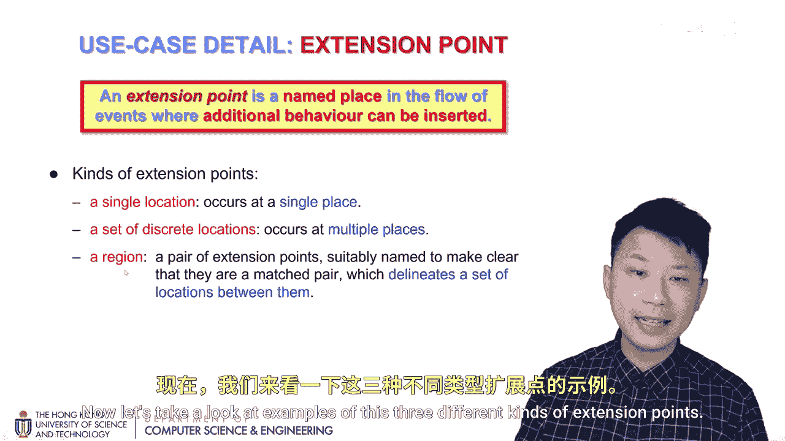
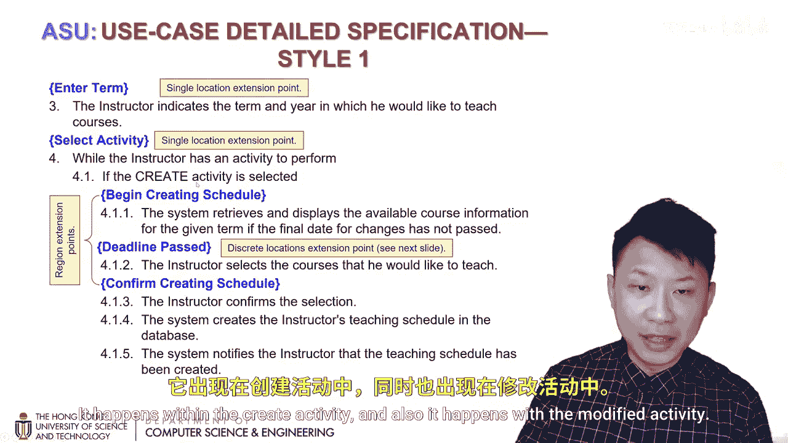
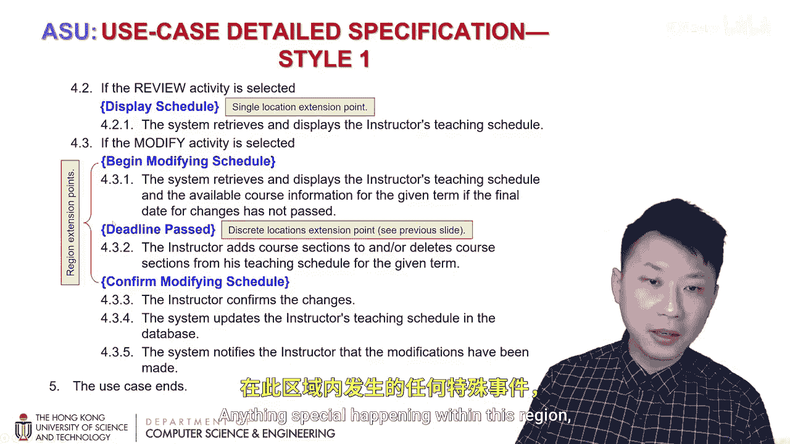
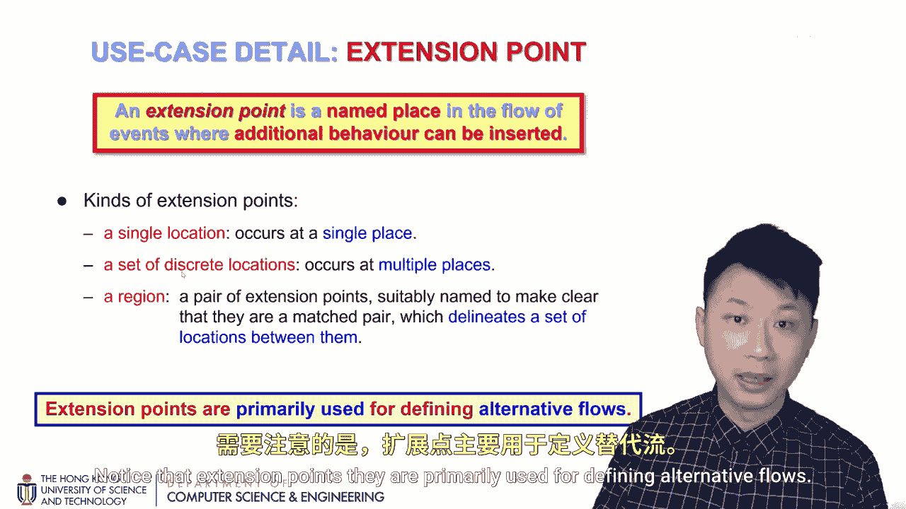
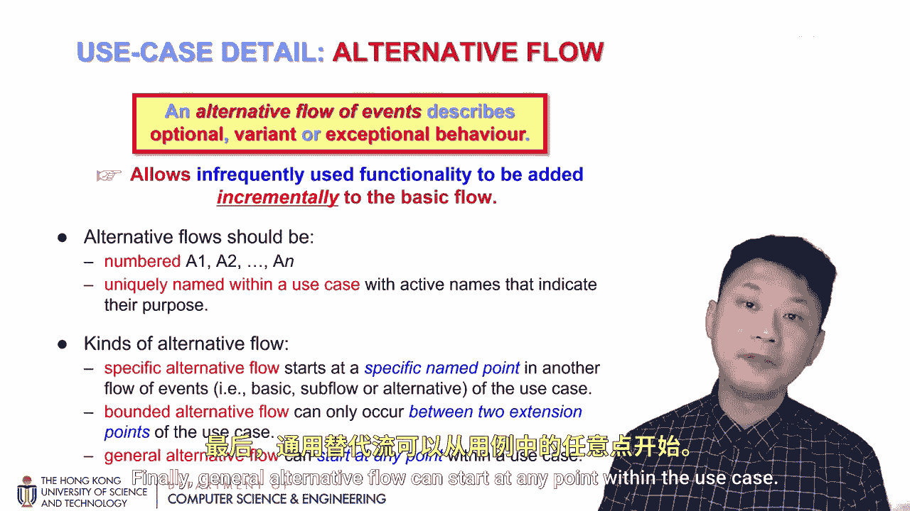
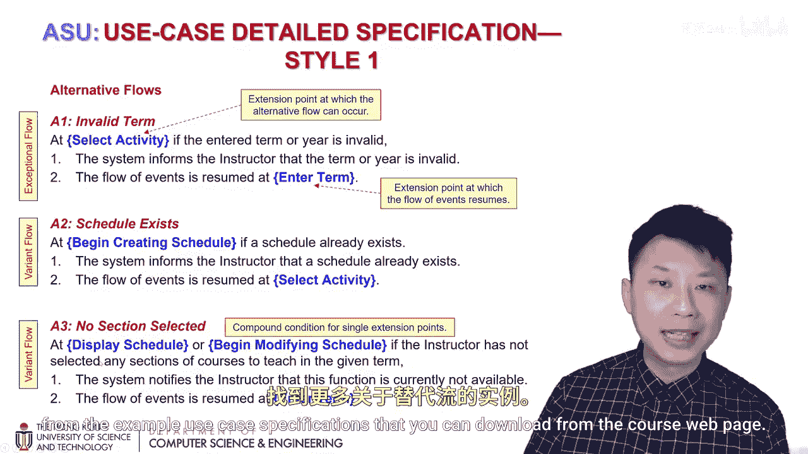

# 软件工程：P17：扩展点与备选流 📝

在本节课中，我们将学习如何在用例规格说明中定义和使用扩展点，以及如何利用扩展点来组织备选流。扩展点是描述可选或异常行为的关键机制，有助于清晰地构建复杂的用例流程。

## 扩展点的定义与作用

我们可以在用例规格说明中指定扩展点。

扩展点是一个命名的位置，相当于事件流中的一个标签，用于标记可以插入额外行为的地方。通常，我们讨论的是异常或备选行为。

扩展点主要有三种类型，我们可以将它们添加到用例规格说明中。第一种称为**单点扩展点**；第二种是发生在**一组不同离散位置**的扩展点；最后一种是**区域扩展点**。

现在，让我们通过示例来了解这三种不同类型的扩展点。

## 三种扩展点类型详解

以下是三种扩展点的具体说明。

*   **单点扩展点**：这种标签在用例规格说明中只出现一次，因此称为单点扩展点。
*   **离散位置扩展点**：这种标签在用例规格说明中出现多次，例如在“创建活动”和“修改活动”中都有出现。因为它出现在多个离散位置，所以称为离散位置扩展点。
*   **区域扩展点**：我们定义一个区域，例如从“开始修改日程”到“确认修改日程”。这个区域被指定为一个区域扩展点，任何在此区域内发生的特殊行为都可以引用这个区域扩展点。

需要注意的是，扩展点主要用于在用例规格说明中定义备选流，即可选或异常行为。

## 备选流的概念与类型

那么，什么是备选流？在备选流中，我们尝试定义一个描述可选或异常行为的事件流。它允许将不常用的功能增量式地添加到基本流中。

备选流应编号为A1、A2，直至An。

我们可以在用例规格说明中指定三种备选流。

*   **特定备选流**：在用例事件流的某个特定命名点开始。
*   **限定备选流**：只能在用例的两个扩展点之间发生。
*   **通用备选流**：可以在用例内的任何点开始。

## 备选流的格式与退出点

备选流的第一行有以下形式。

对于特定备选流，我们这样表述：在用例规格说明中的某个扩展点（某个位置），当某事发生时，我们将做某事。或者，在某个特定扩展点，如果某事发生，我们做某事。这就是我们在特定位置定义特定备选流的方式。请注意，特定备选流依赖于用例规格说明中发生的某些事件或条件。

限定备选流将发生在两个扩展点之间的任何位置。

通用备选流将发生在事件流中的任何时间。

请注意，备选流的最后一行将指定该流的退出点。你必须明确说明在退出备选流后，参与者从何处恢复事件流。

对于可选行为，通常我们在原始扩展点恢复。对于异常行为，通常我们在另一个扩展点恢复。对于异常行为，可能是原始扩展点、另一个扩展点，甚至用例可能结束。对于异常行为，我们必须在备选流中明确指定如何退出该流。

## 备选流示例分析

这是一个异常流的例子。

例如，在“选择活动”这个标签位置，如果讲师输入了错误的学期或年份，系统将通知讲师学期或年份无效。然后，我们将在“输入学期”处恢复事件流。这意味着我们必须重新输入学期和年份，直到输入正确为止。

这是一个可选流的例子。

在“开始创建日程”这个扩展点，如果日程已存在，则显示一个弹出窗口，通知讲师日程已存在。然后，事件流将在另一个扩展点“选择活动”处恢复，依此类推。

你可以在课程页面下载的示例用例规格说明中找到更多关于备选流的例子。

## 总结

本节课中，我们一起学习了用例规格说明中的扩展点与备选流。我们了解了扩展点的三种类型（单点、离散位置、区域）及其作用，掌握了三种备选流（特定、限定、通用）的定义方式、书写格式以及关键的退出点指定方法。通过清晰的扩展点和结构化的备选流，我们可以更有效地描述复杂的系统行为，使用例规格说明更具条理性和可维护性。