# 香港科技大学【中英⚡软件工程｜Software Engineering Specialization】 p18 P18 03_子流程 -BV1MMEjzoEhg_p18-

And you can also create subflow in your use case specification。

 A subflow is a segment of events within your use case specification that has a clear purpose and is atomic。

 And since that segment of events， they have a clear purpose。

 then we can extract them and put them in a subflow and by using subflow we can improve the readability of a use case specification。

 an excessive nesting of subflows should be avoided。

 that means you should not put one subflow within another one within another one because by doing so you will make your use case specification very difficult to read。

 So subflow should be numbered as S1 S to up to S and。

And you also have to give a name to your subflow， so notice that a subflow is not a separate use case。

 it's just part of the use case right a segment of the use case that is meaningful and has a clear purpose so we extract those events within that segment and put them in a subflow。

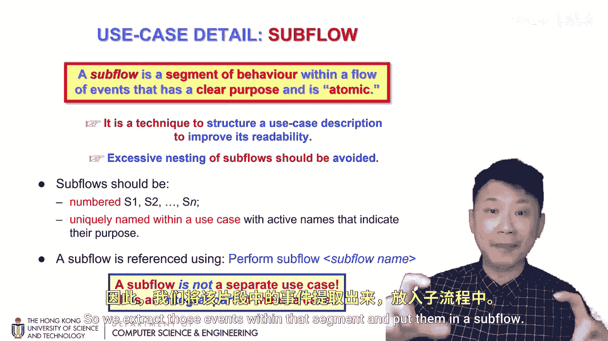

And in style number two， we are writing use case specification brief S。

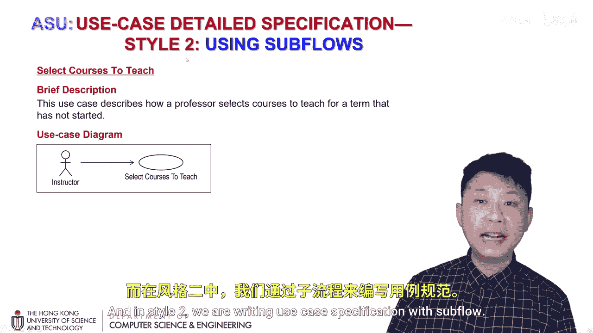

So now you can see that in the flow of events we have two subflows。

 one is called create schedule and another one is called Mo schedule The flow of events within create schedule will be placed under the subflow for create schedule and you can see that these are the things that we do for creating schedule and then the segment of events for modifying schedule will be placed under the subflow modify schedule and now you can see that the basic flow is more easy to read because its simpler and if you want to know the details within create schedule and modify schedule you can always go into the subflow and see the flow of events within the subflow so some of you may ask when we write a use case specification how much detail is enough。

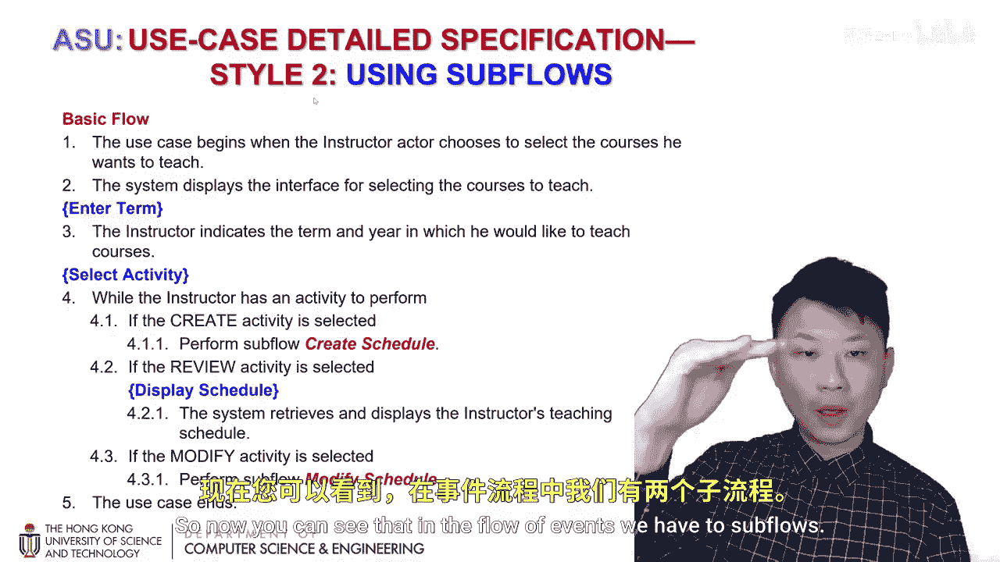

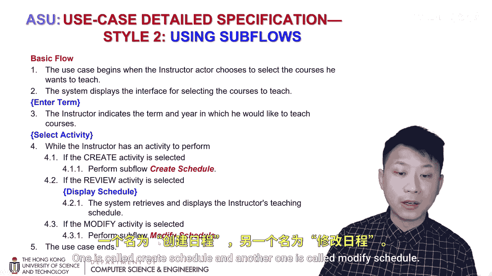

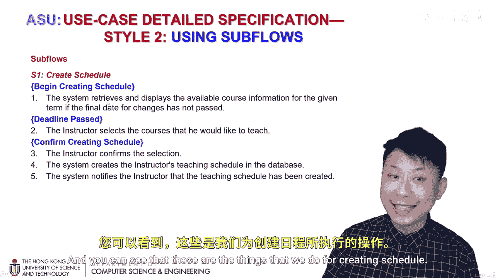

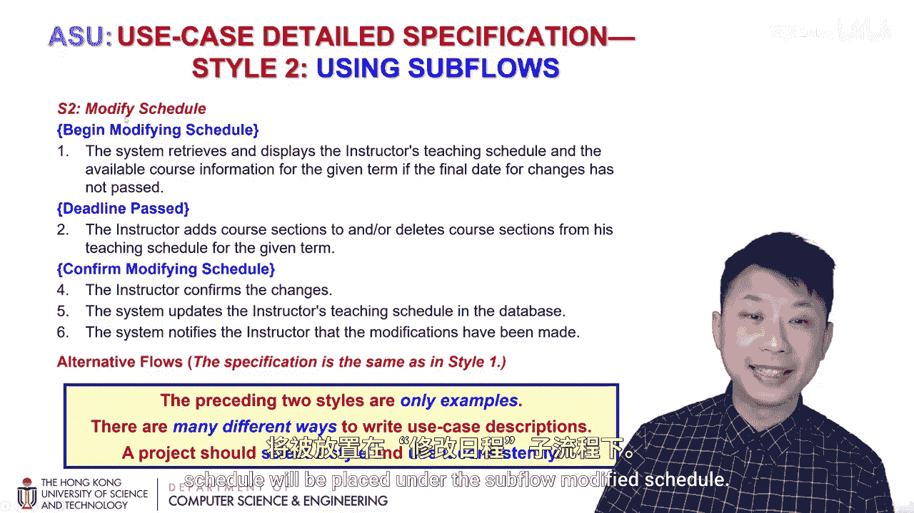

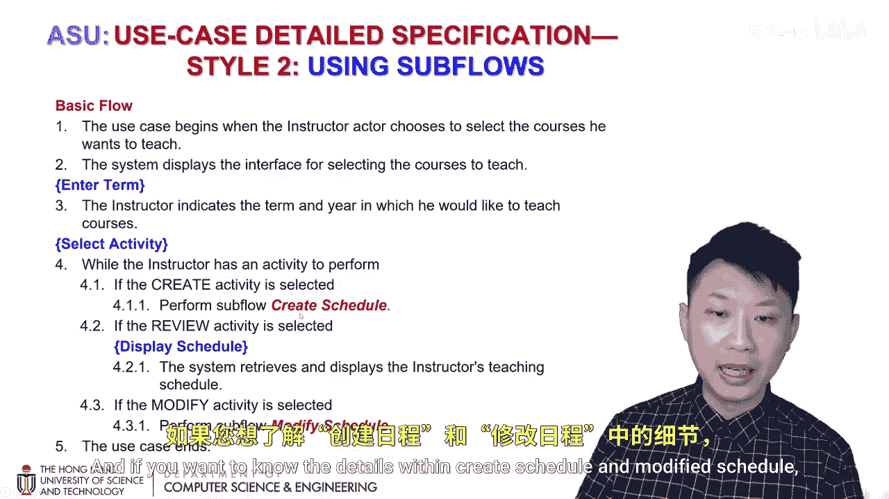

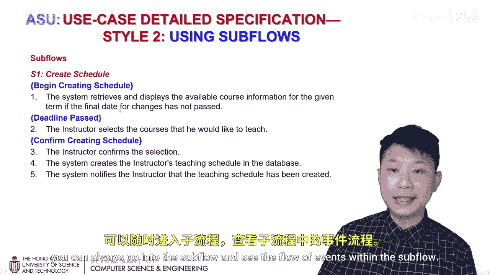

And the rule of thumb is that there should be enough details so that all the stakeholders they understand what's happening within the use case and the basic flow should unambiguously describe the required behavior and you should keep asking yourself what does this mean until all the ambiquiities have been resolved and notice that use cases they do not directly communicate with each other we assume that use cases intended to be independent of other use cases why because we want our use case specification to be easy to read and also easy to understand if somehow one use cases is related to another use gate then when I'm reading one of the use case specification I may have to later on refer to another use case specification if that other use case specification depend on another use case then I have to read another one to make it simple and make sure that all the stakeholders they can easily understand our use case specification we have the assumption that each use case is intended to be independent of。

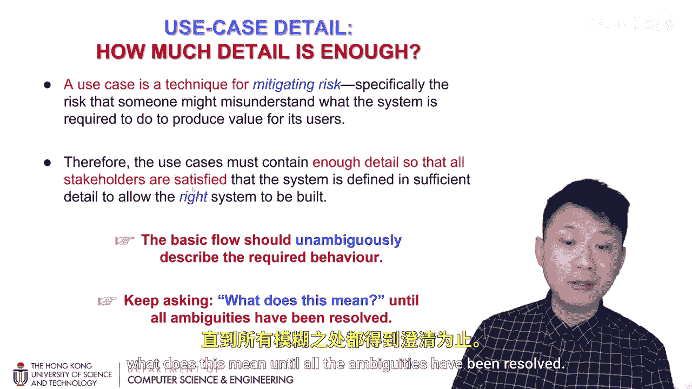

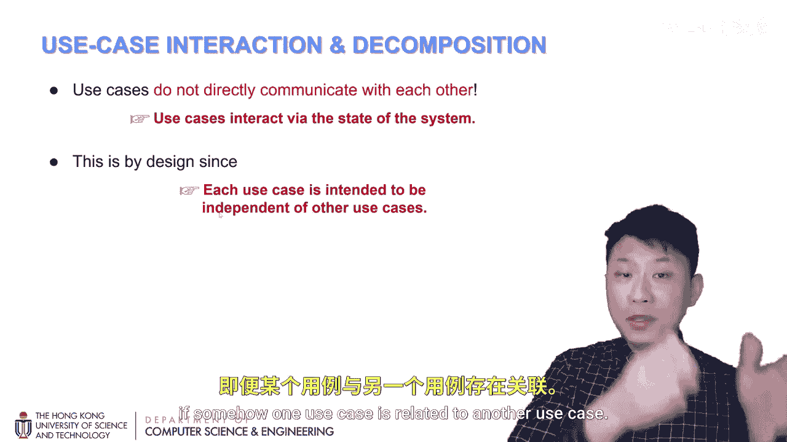

Other use cases So that's why when you come up with your use cases try not to decompose the system behavior into two small use cases。

 for example， select products， enter order information and a shipping information enter payment information and then confirm order so they are too small again they are simply part of the story but not the entire story since they are just part of the story very likely the small use cases they will depend on each other so to avoid that we have to make it a more complete story so we have to group them together and then we may just have one single but larger use case which is like placing order so when you come up with use cases。

 you have to think about whether those small use cases they are really independent to each other and also think about would you ever do just one thing without doing the others if you have to do other things together anyway they why don't you group them together as a larger use case and that's all I want to cover in this lecture。

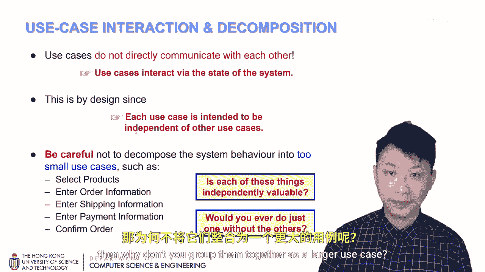