# 软件工程：P18：子流程与用例详述规范 📝

在本节课中，我们将学习如何在用例规格说明中创建和使用子流程，以提升文档的可读性。同时，我们也将探讨如何确定用例描述的详细程度，并理解保持用例独立性的重要性。

## 子流程的概念与作用

上一节我们介绍了用例规格说明的基本结构，本节中我们来看看如何通过子流程来优化其组织。

你可以在用例规格说明中创建子流程。子流程是**用例规格说明内部具有明确目的且不可再分的事件片段**。由于该事件片段具有明确目的，我们可以将其提取出来，放入一个子流程中。通过使用子流程，我们可以**提高用例规格说明的可读性**。

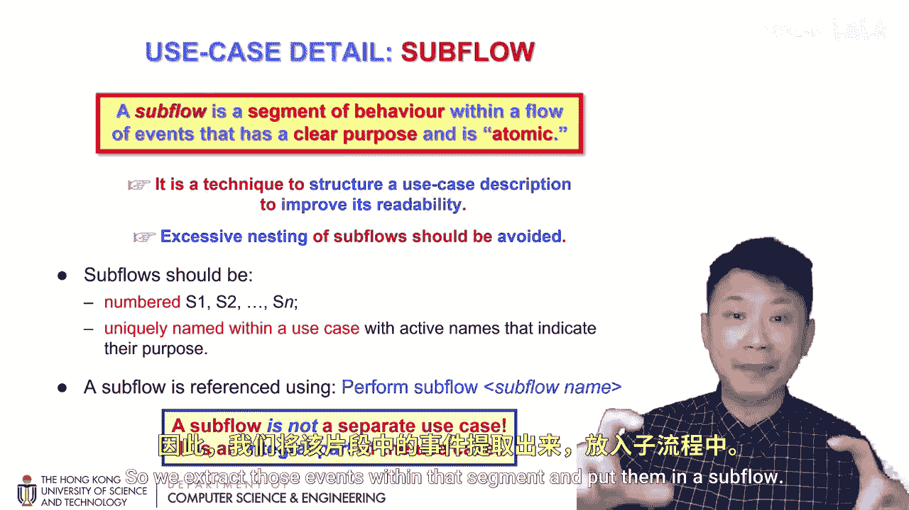

## 子流程的使用规范

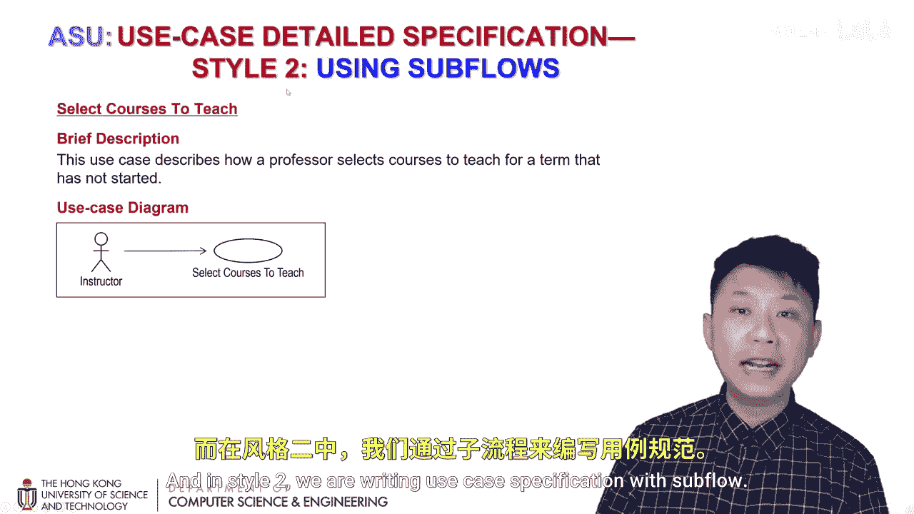

以下是关于子流程编号和命名的具体规范：

*   子流程应编号为 **S1、S2……Sn**。
*   你必须为子流程命名。请注意，**子流程并非独立的用例**，它只是用例中有意义且目的明确的一部分。我们将该片段内的事件提取出来，放入子流程中。

## 子流程应用示例

为了更直观地理解，让我们看一个具体的例子。在第二种风格的用例规格说明（简要式）中，我们可以看到子流程的应用。

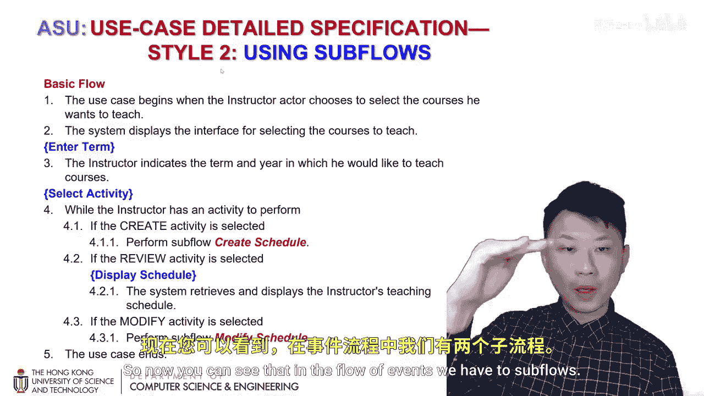

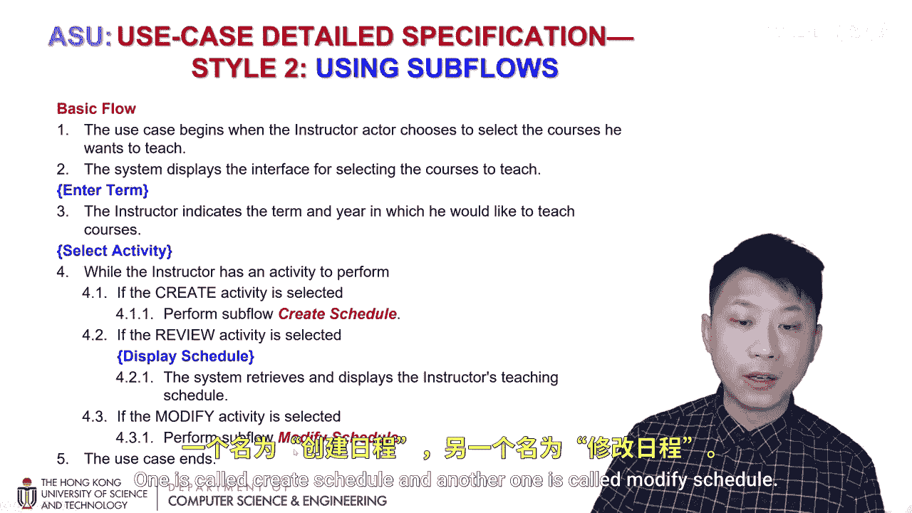

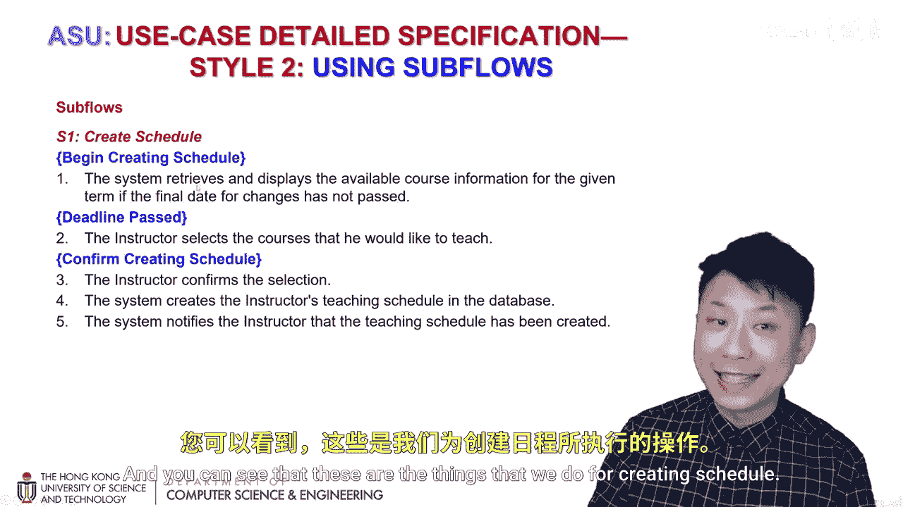

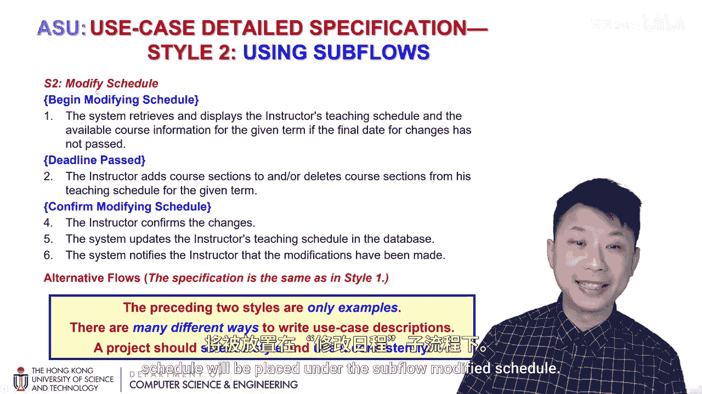

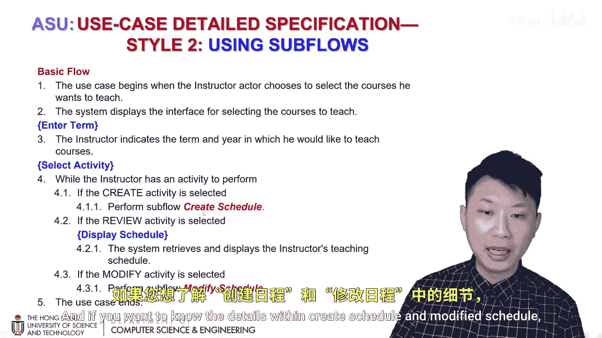

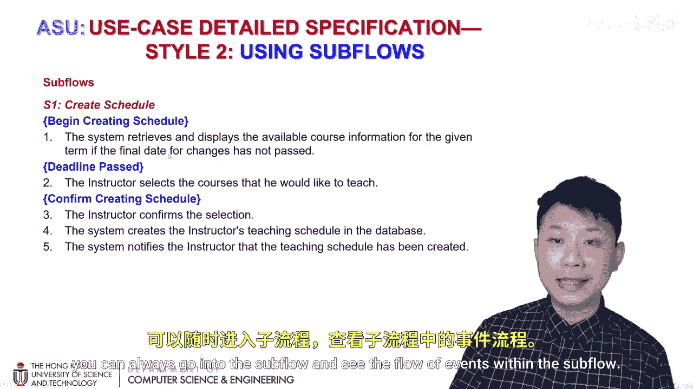

现在你可以看到，在事件流中我们有两个子流程：一个叫“创建日程”，另一个叫“修改日程”。“创建日程”内的事件流将被放置在“创建日程”子流程下，这些是我们为创建日程所做的事情。同样，“修改日程”的事件片段则放在“修改日程”子流程下。

这样一来，基本流变得更加易于阅读，因为它更简洁。如果你想了解“创建日程”和“修改日程”的细节，可以随时进入相应的子流程查看其内部的事件流。

## 用例描述的详细程度

在编写用例规格说明时，一个常见的问题是：需要描述多少细节才足够？

经验法则是：**细节应足够让所有利益相关者理解用例内发生的事情**。基本流应**明确无误地描述所需的行为**。你应该不断问自己“这意味着什么”，直到所有歧义都被消除。

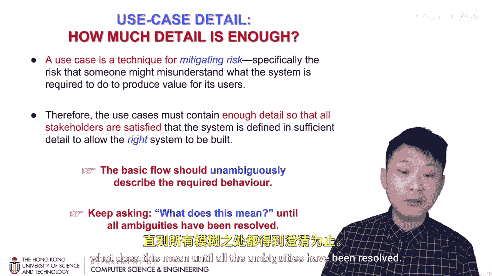

## 用例的独立性原则

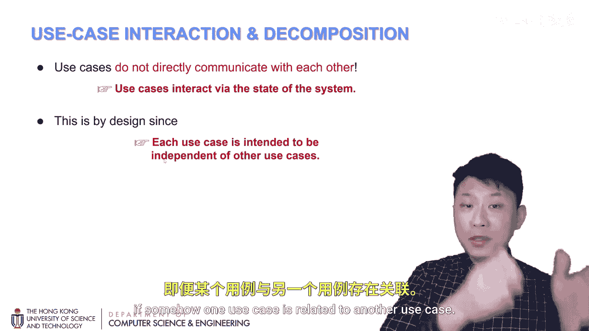

请注意，用例之间**不直接相互通信**。我们假设用例旨在独立于其他用例。这是因为我们希望用例规格说明易于阅读和理解。如果某个用例以某种方式与另一个用例相关，那么当我在阅读其中一个用例规格说明时，可能稍后需要参考另一个。如果另一个用例又依赖于其他用例，我就需要阅读更多。为了简化并确保所有利益相关者都能轻松理解我们的用例规格说明，我们假设**每个用例都旨在独立于其他用例**。

因此，当你构思用例时，**尽量不要将系统行为分解成过小的用例**。例如，“选择产品”、“输入订单和配送信息”、“输入支付信息”、“确认订单”，这些都太小了。它们只是故事的一部分，而非完整的故事。由于它们只是故事的一部分，这些小型用例很可能相互依赖。

为了避免这种情况，我们必须使其成为一个更完整的故事。因此，我们需要将它们组合在一起，最终可能只有一个更大但更完整的用例，例如“下订单”。当你构思用例时，必须思考这些小用例是否真的彼此独立，并思考你是否会只做其中一件事而不做其他事。如果你无论如何都需要一起做其他事情，那么为什么不将它们组合成一个更大的用例呢？

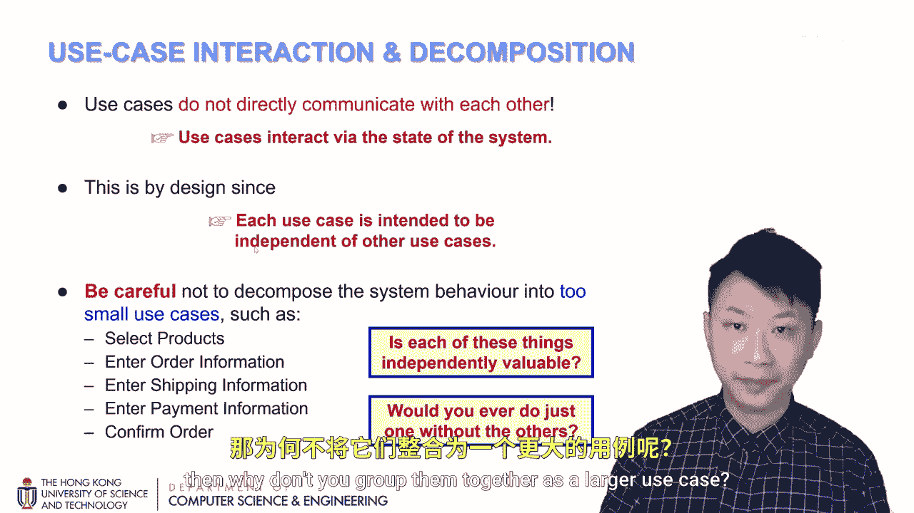

本节课中我们一起学习了子流程的创建与使用规范，了解了通过子流程可以提升用例文档的可读性。我们还掌握了确定用例描述详细程度的经验法则，并深刻理解了保持用例独立性的重要原则，这有助于我们构建出清晰、完整且易于理解的用例规格说明。