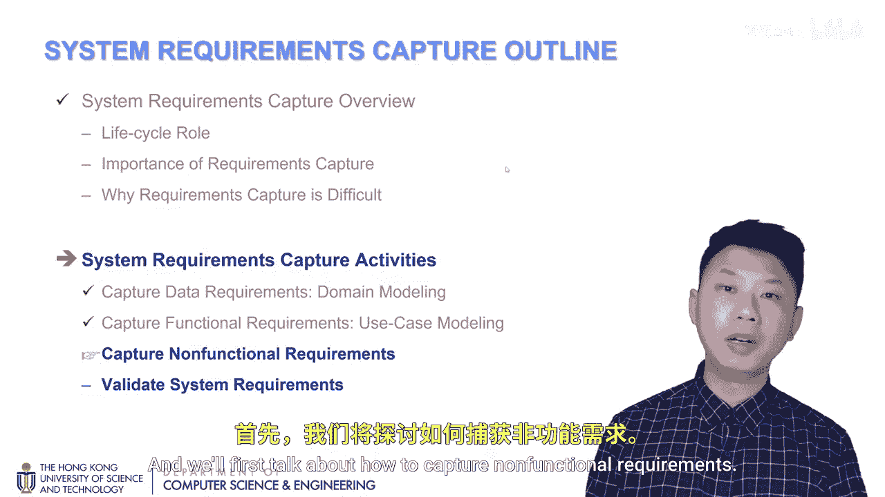
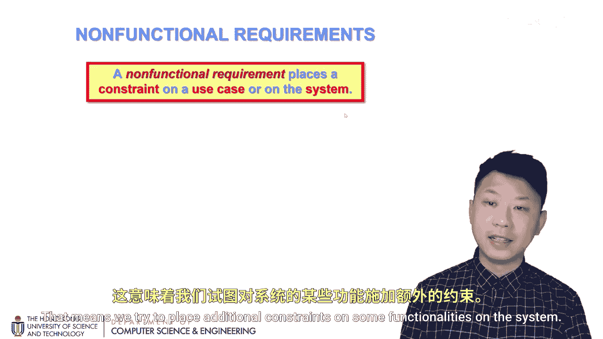
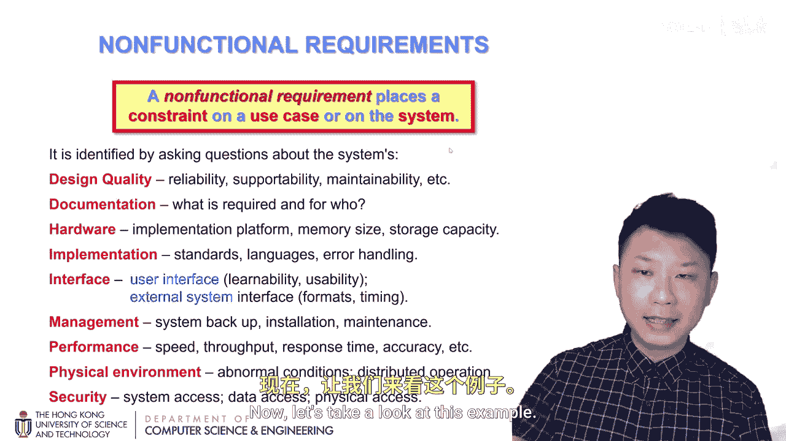
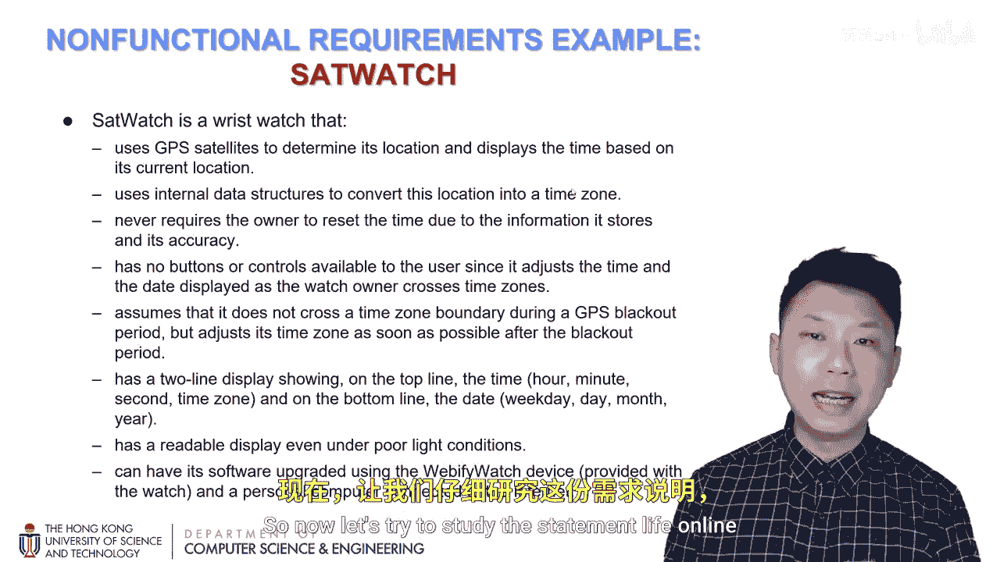
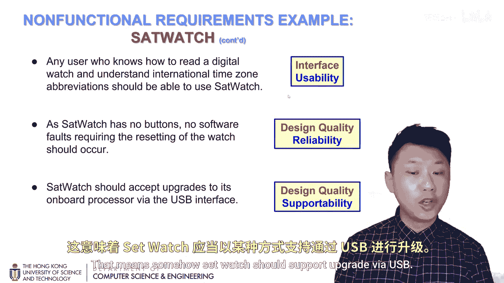
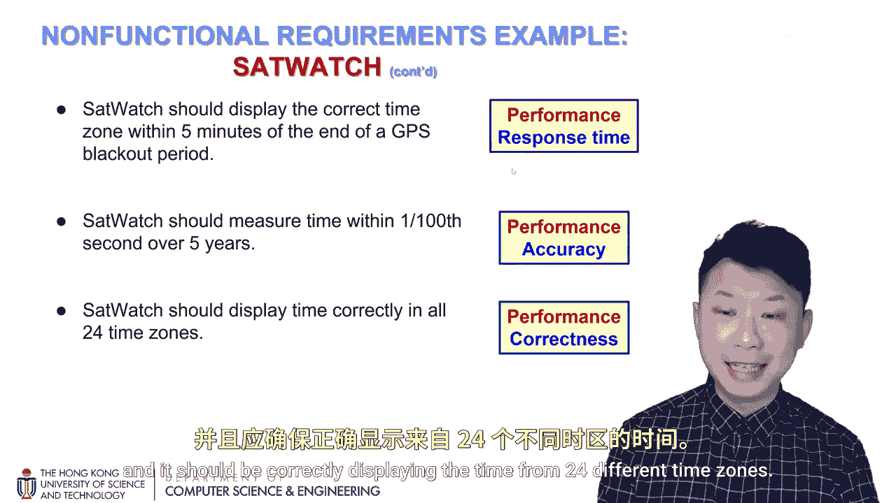
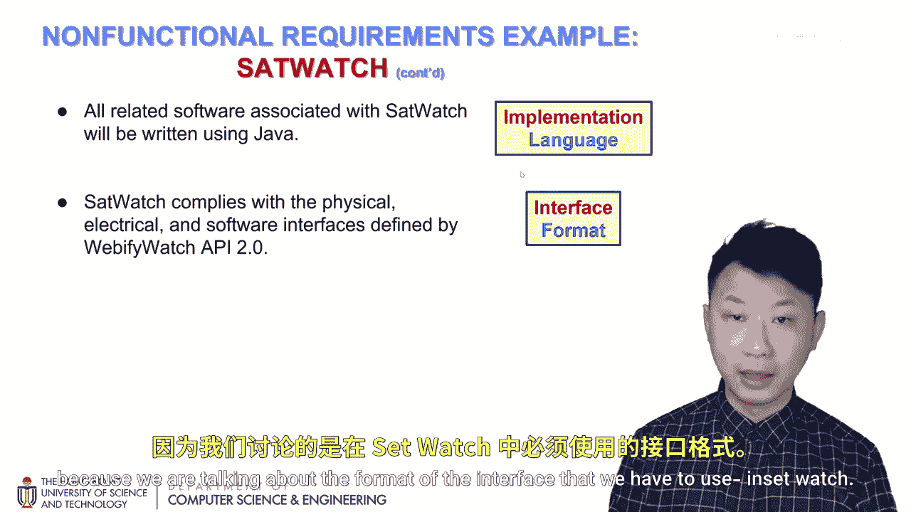
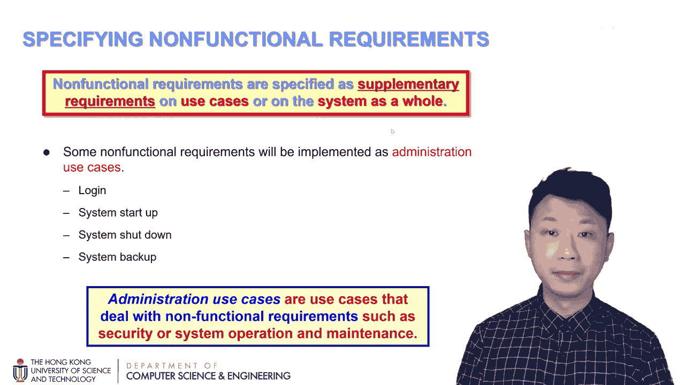

# 香港科技大学【中英⚡软件工程｜Software Engineering Specialization】 p19 P19 01_非功能性需求 -BV1MMEjzoEhg_p19-

Hi， in this lecture， we will talk about how to capture non functional requirements and also how to validate system requirements。

And we will first talk about how to capture non functionalal requirements。

So what are non functionalal requirements， basically a non functionalal requirement places a constraint on a use case on the system that means we try to place additional constraints on some functionalities on the system。

And these constraints may be related to design quality， for example， reliability。

 supportportability or maintainability or documentation。 what documentation is required and for who。

Hotware， for example， the implementation platform， memory size， stories， capacity， etctera。

 etc ceter。And implementation， for example， standards， language and also error handling。

Or interfaces， for example， things related to user interface or external system。Management。

 for example， system backup， installation or maintenance。Performance， for example， speed， throughput。

 response time or accuracy。Or physical environment， for example。

 abnormal conditions or distributed operation if we are talking about a distributed system。

And also security， for example， system SS， data S or fiscal assess。 Now。

 let's take a look at this example。

And in this example， we try to specify the non functionalal requirements for set watch。

 a satellite watch。And this is the prome statement for set watch。

So now let's try to study this statement line by line and try to identify all the non functionalal requirements。

In the first statement， we say that any user who knows how to read a digital watch and understand international time shown abbres should be able to use set watch。

 So what type of non functional requirement is it。related to interface and also usability。

 because we say that a user who knows how to read a digital watch should be able to use a set watch。

In an other statement， we say that as Swatch has no better no software fault requiring the reseting of the watch should occur。

So what type of nonfunctional requirement is it？It's related to design quality， reliability。

 it should be very reliable。And in the next statement。

 we say that a setwatch should accept upgrades to its onboard processor via USB ins。

 So what type of nonfunctional requirement is it。This one is related to design quality supportportability。

 That means somehow set watch should support upgrade via USB。

An assetet watch should display the correct time song within five minutes of the end of a GPS blackout period。

 So what type of long functional requirement is it。This one is related to response time okay。

 the correct time should be shown within five minutes。

And setwatch should measure time within one of 100th second over five years。

 so what type of a non functionalal requirement is it？This one is related to accuracy， Okay。

 should be very accurate with in one of  a00 a second。

And set watch should display time correctly in all 24 time zones。

So this one is related to performance and it should be correctly displaying the time from 24 different time zones。

And then all related software associated with SWtch will be written using Java。

So this one is about implementation and we are talking about the programming language that we're going to use for the software system。

加法。And Swatch complies with the physical， electrical and also software interfaces defined by Webpify Watch API 2。

0。And this one is related to interface because we are talking about the format of the interface that we have to use in Swach。

So for nonfunctional requirements， we can either specify the supplementary requirements on top of the use cases that we have defined or on top of the system as a whole and notice that some of the nonfunctional requirements will be implemented as administration use cases。

 for example， lock in system startup system shutdown or system backup and are for security and we can specify them as administration use cases and administration use cases are use cases that deal with nonfunctional requirements。

 for example， security or system operation or maintenance。

And we can specify those nonfunctional requirements using administration use cases。

