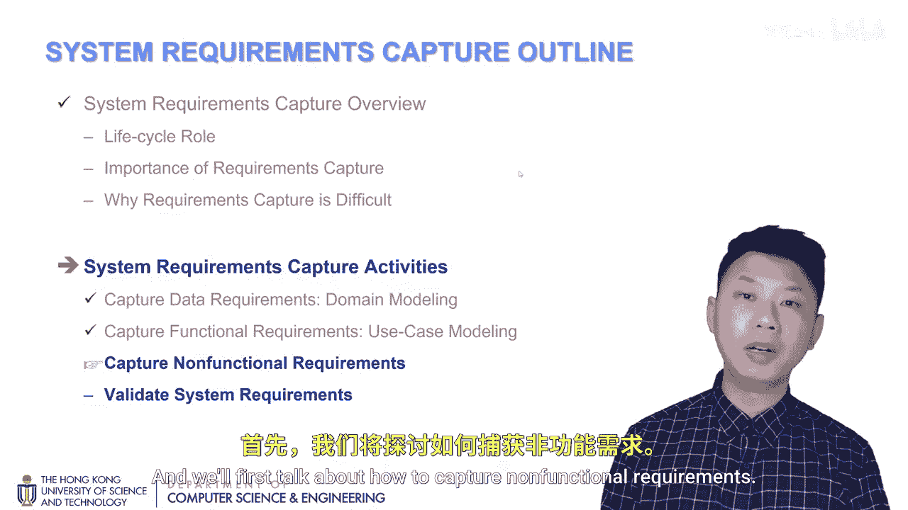
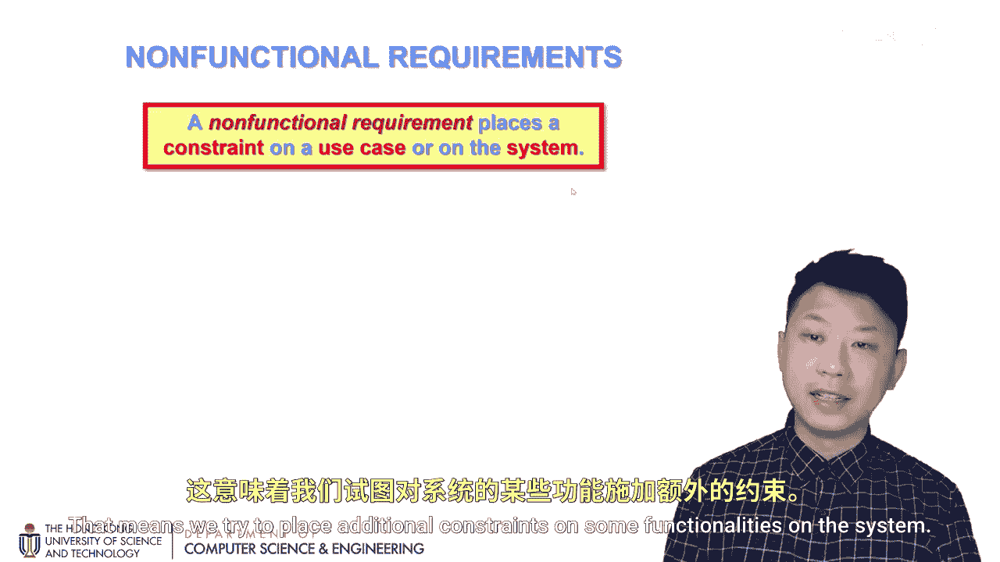
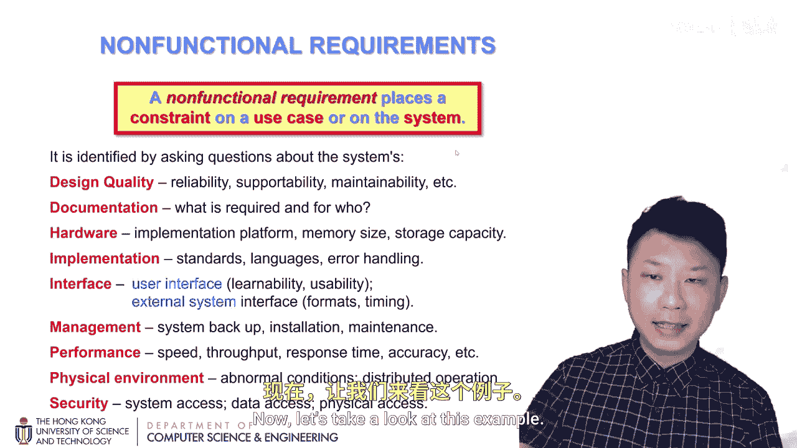
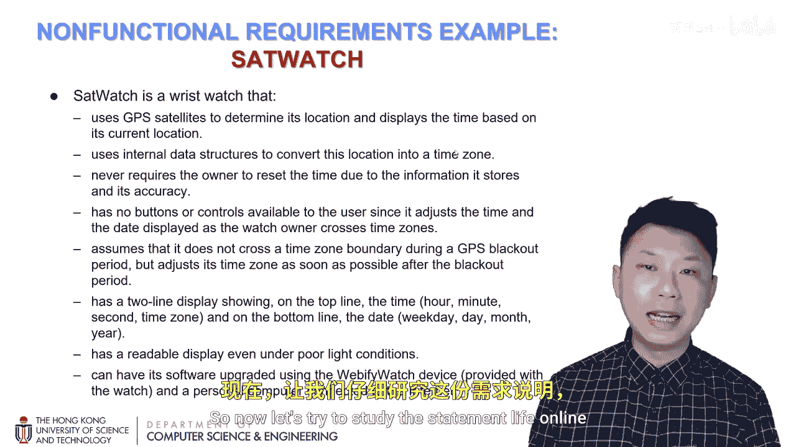
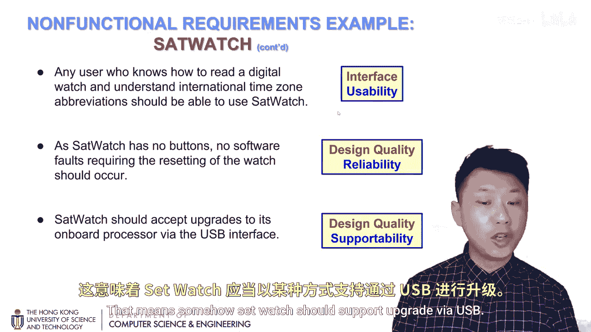
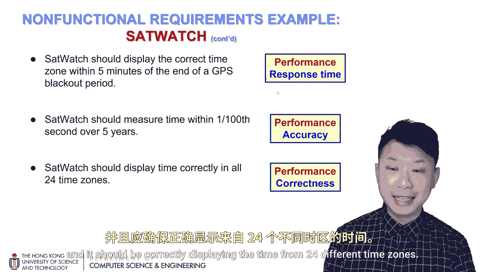
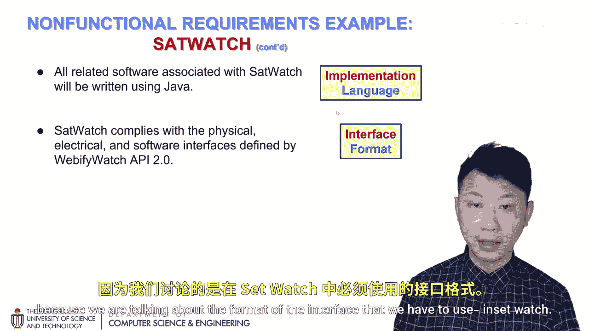
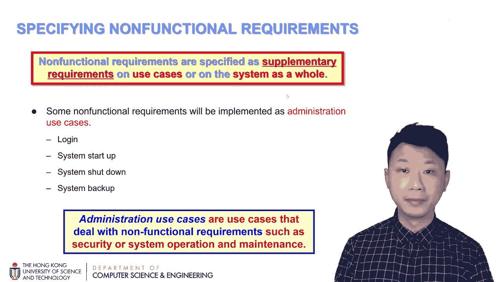

# 软件工程：P19：非功能性需求与系统需求验证 🎯

在本节课中，我们将学习如何捕获非功能性需求，以及如何验证系统需求。首先，我们将探讨非功能性需求的具体内容。

## 什么是非功能性需求？

非功能性需求本质上是对系统用例施加的约束。这意味着我们试图对系统的某些功能施加额外的限制条件。

这些约束可能涉及多个方面，以下是其主要类别：

*   **设计质量**：例如可靠性、可移植性、可维护性或文档要求（需要何种文档，面向谁）。
*   **硬件**：例如实现平台、内存大小、存储容量等。
*   **实现**：例如标准、编程语言以及错误处理。
*   **接口**：例如与用户界面或外部系统相关的事项。
*   **管理**：例如系统备份、安装或维护。
*   **性能**：例如速度、吞吐量、响应时间或准确性。
*   **物理环境**：例如异常条件或分布式操作（如果我们讨论的是分布式系统）。
*   **安全**：例如系统安全、数据安全或物理访问控制。

## 非功能性需求实例分析

现在，让我们通过一个具体例子来学习如何识别非功能性需求。我们将分析一款名为“SetWatch”的卫星手表的原始需求陈述。

以下是该需求陈述的逐句分析：

*   **陈述1**：“任何知道如何读取数字手表并理解所显示的缩写国际时间的用户，都应该能够使用SetWatch。”
    *   **需求类型**：接口与可用性。因为它对用户界面和易用性提出了要求。
*   **陈述2**：“SetWatch不应出现任何需要重置手表的软件故障。”
    *   **需求类型**：设计质量（可靠性）。它要求系统必须高度可靠。
*   **陈述3**：“SetWatch应能通过USB接口接受其板载处理器的升级。”
    *   **需求类型**：设计质量（可支持性）。它要求系统支持通过USB进行升级。
*   **陈述4**：“SetWatch应在GPS信号中断期结束后的五分钟内显示正确时间。”
    *   **需求类型**：性能（响应时间）。它对系统恢复并显示正确时间的速度提出了要求。
*   **陈述5**：“SetWatch应在五年内将时间测量精度保持在百分之一秒内。”
    *   **需求类型**：性能（准确性）。它对系统的长期计时精度提出了严格要求。
*   **陈述6**：“SetWatch应能在全部24个时区正确显示时间。”
    *   **需求类型**：性能。它要求系统功能覆盖全球所有时区。
*   **陈述7**：“所有与SetWatch相关的软件都将使用Java语言编写。”
    *   **需求类型**：实现。它指定了系统开发所使用的编程语言：`Java`。
*   **陈述8**：“SetWatch应符合Webify Watch API 2.0定义的物理、电气及软件接口规范。”
    *   **需求类型**：接口。它规定了系统必须遵循的外部接口标准。

## 如何指定非功能性需求

在明确了非功能性需求的类别和分析方法后，我们来看看如何正式地指定它们。

非功能性需求可以指定在我们已定义的用例之上，也可以指定在整个系统之上。需要注意的是，部分非功能性需求会以**管理用例**的形式实现。

例如，与安全、系统启动、系统关闭或系统备份相关的需求，可以指定为管理用例。**管理用例**是专门处理非功能性需求（如安全性、系统操作或维护）的用例。

因此，我们可以通过编写管理用例来详细描述这些非功能性需求。

## 总结

本节课中，我们一起学习了非功能性需求的核心概念。我们了解到非功能性需求是对系统功能的约束，涵盖了质量、硬件、性能、安全等多个维度。我们通过分析“SetWatch”的实例，练习了如何从需求陈述中识别和分类不同的非功能性需求。最后，我们知道了非功能性需求可以通过补充规格说明或管理用例来具体指定。理解并准确捕获非功能性需求，对于构建一个高质量、符合期望的软件系统至关重要。