# 香港科技大学【中英⚡软件工程｜Software Engineering Specialization】 p20 P20 02_验证系统需求 -BV1MMEjzoEhg_p20-

And the next topic that we're going to cover is how to validate system requirements。

So after we capture all the data requirements in terms of a class diagram and also how。

So after we capture all the data requirements in terms of a domain model and all the functional requirements in terms of a use case model and also all of the nonfunctional requirements。

 we have to validate all the requirements that we have captured。

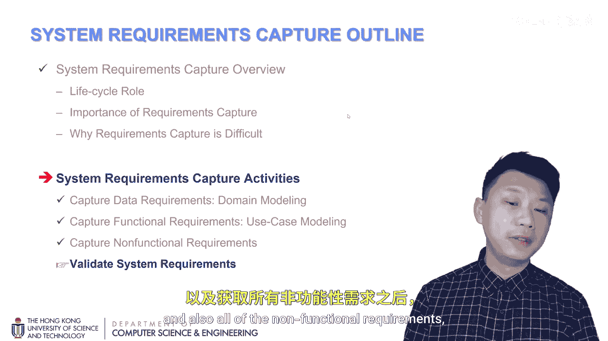

So notice that all the requirements that we have captured in the SRS。

 the system requirements specification should be validated continuously with the client or user to make sure that all the requirements they are complete。

Complete means we have captured all the requirements。And they are consistent。Okay。

 that means the requirements they do not contradict with themselves。And also they should be clear。

 that means any stakeholder they should be able to understand the requirements and they should be correct and also realistic。

 that means they should be feasible。

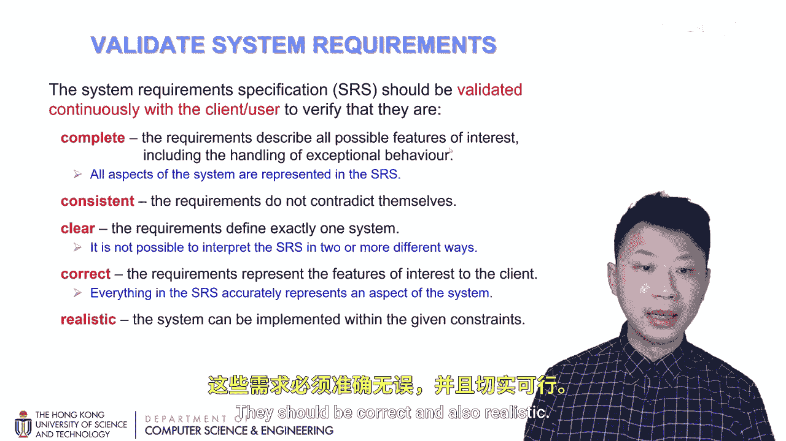

So acceptance and tasks， they are the primary means to validate the system implementation satisfy the requirements。

 and we will talk about acceptance tasks when we talk about testing。So in acceptance tasks。

 we try to validate all the requirements in front of our client or in front of our user。

So now we talk about some requirements， validation examples， the first one is incomplete。

 and we say that the set watchtch specification does not specify the boundary behavior when the user is standing within GPS accuracy limitations of a time zones boundary。

 That means when a user is standing between two time zones。

The time on Swatch should not take between the two time zones again and again。

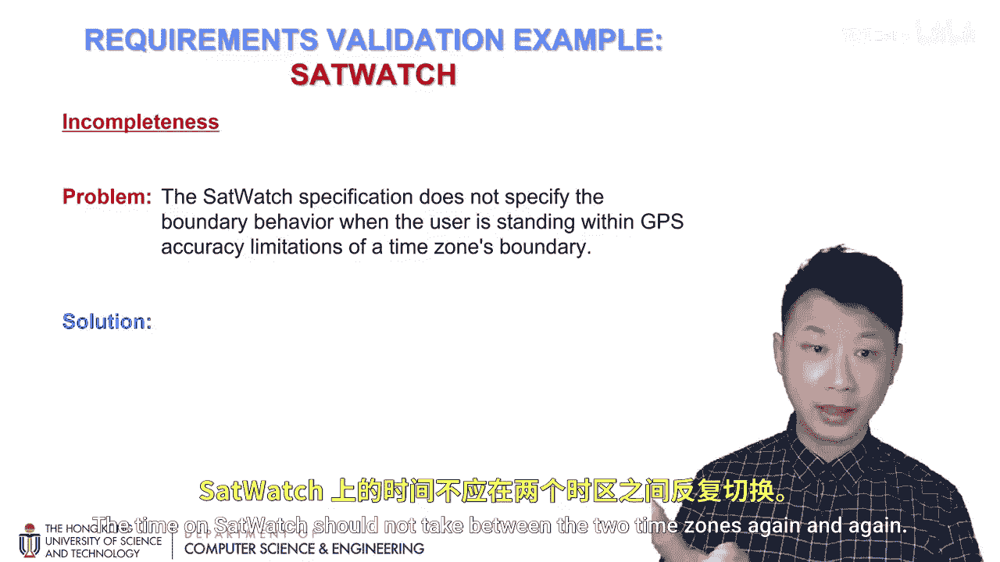

So the solution is that we have to add another functional requirement saying that the time zone depicted by SWattch should not change more often than once every five minutes。

That means when a user is standing between two time zones。

 the time on set watch will not change again and again。 It will only change once every five minutes。

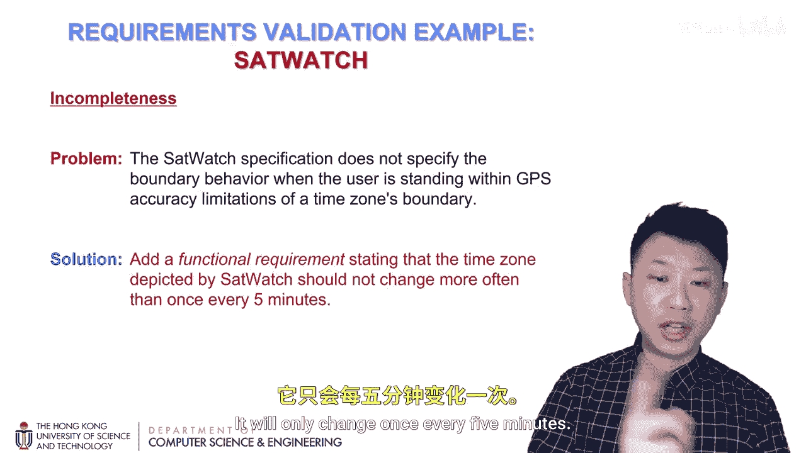

And this one is inconsistent。So we say that SaW software should not have bugs nor need to be upgraded。

And in the second requirement， we say that SWtch software should be easily upgraded using the USB interfaces。

 so in one requirement you say that should not be upgraded in the other requirement you say that should be easily upgraded using USB so they are conflicting with one another so what do we have to do we have to revise one of the conflicting requirements。

And then the next one is unclear。 We say that S watch specification refer to time zones。

So do we have to deal with daylight saving time or not？So in this example。

 we have to refine and clarify the requirement。By adding another requirement。

 saying that SWtch should deal with daylight saving time。

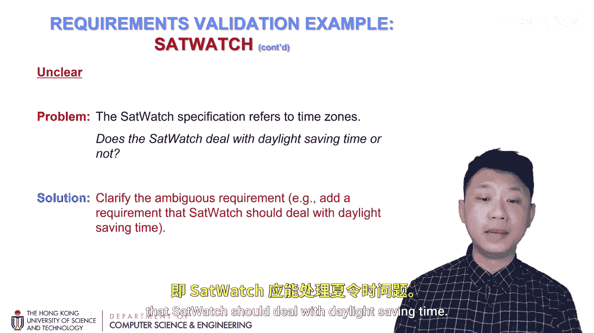

And this is an example of incorrect requirement。 We say that setwatch supports only 24 time zones。

But we know that in reality we have more than 24 time zones。

 so we have to fix and we find the requirement and change the requirement to support all the time zones。

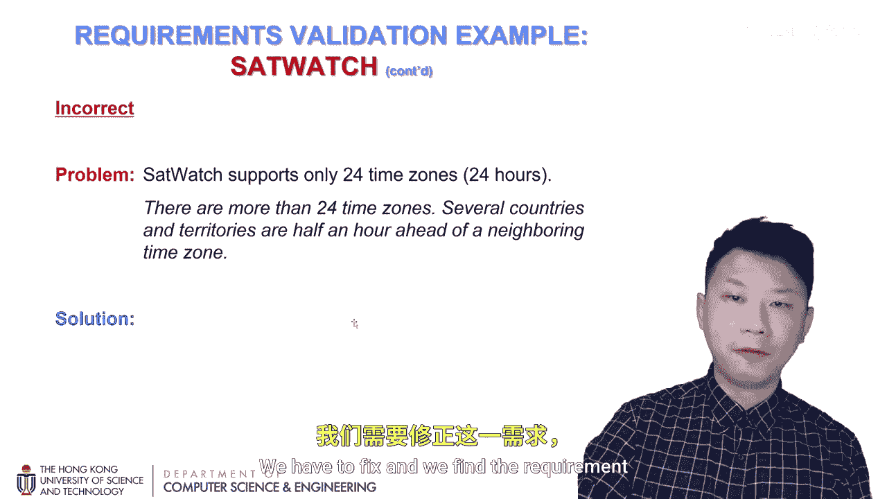

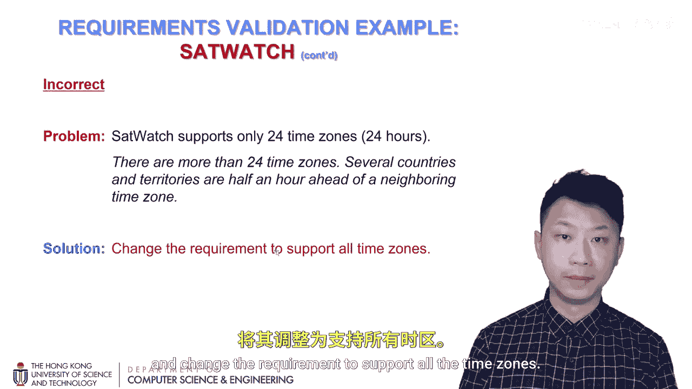

So in our system requirement specification， we should have a domain model to capture all the data requirements of an application that means we should have a class diagram to capture all the important objects that persist in the software system。

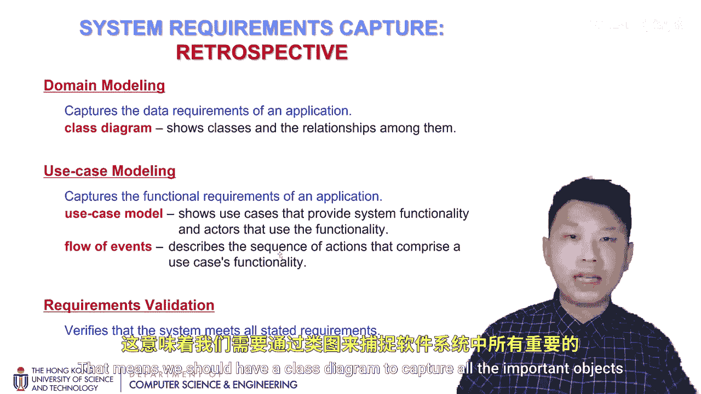

And we should have a use case model to capture the functional requirements of the application。

 We should have a use case diagram to capture all the functionalities provided by the software system。

 And also we describe the flow of events using use case specifications。 And finally。

 after we capture all the requirements， we have to validate all the requirements that we have captured。

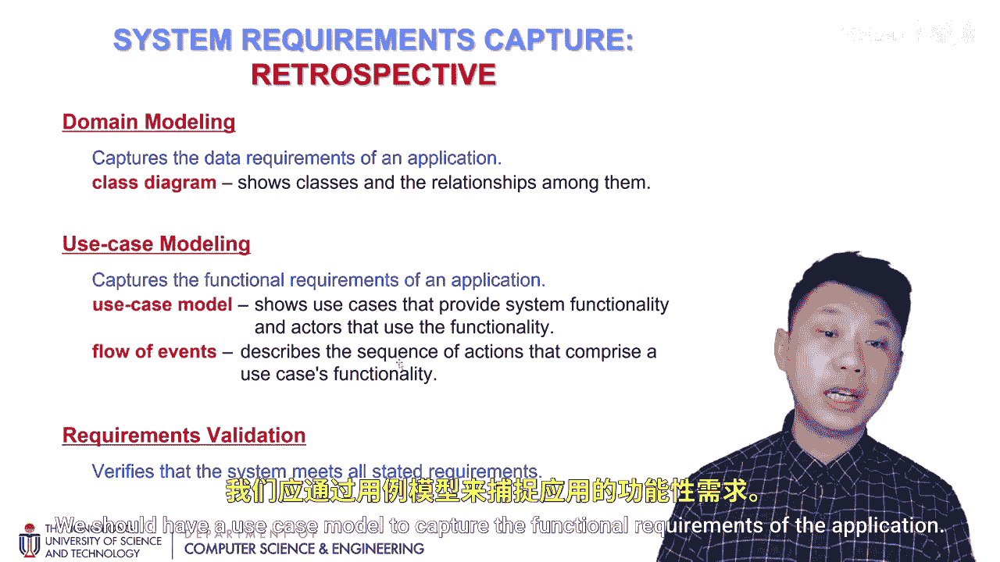

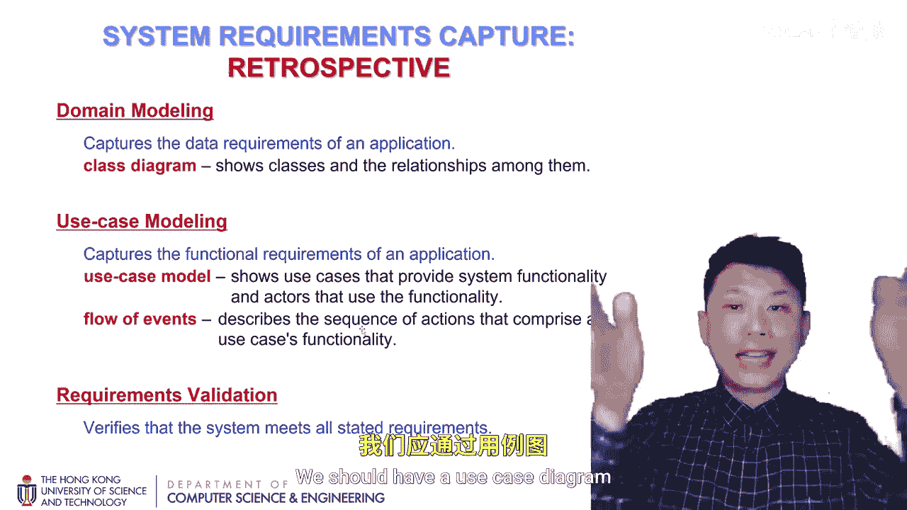

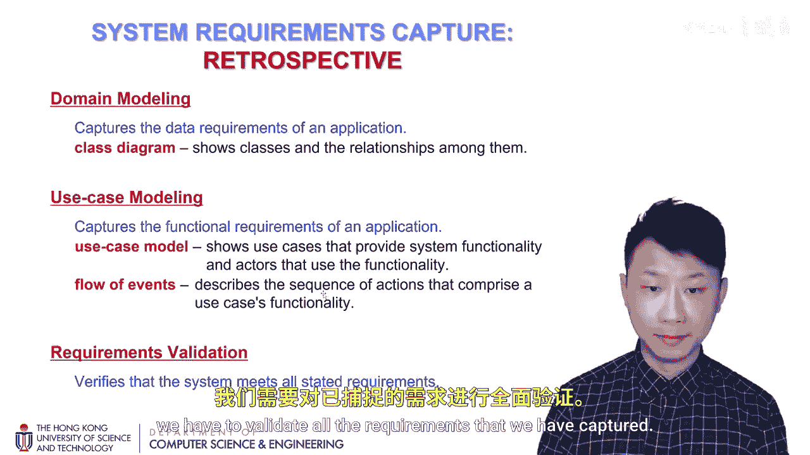

And this is a little summary of what we have covered in this lecture and also in the last few lectures。

 we have talked about how to capture all the data requirements using a domain model and also how to capture all the functional requirements using a use case model and also nonfunctional requirements that means additional constraints that we have over use cases or on top of the system as a whole and all requirements they should be specifieding within our system requirements specification SRS and in the subsequent iterations or phrases。

 we refine and also transform the requirements by specifying more details for each of the above artifacts and also a set of test cases in the test model。

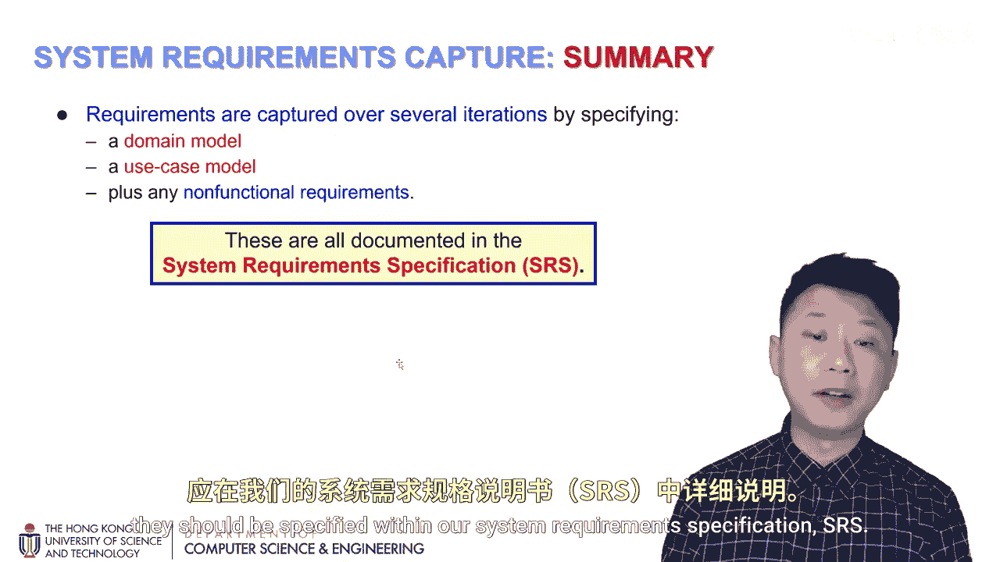

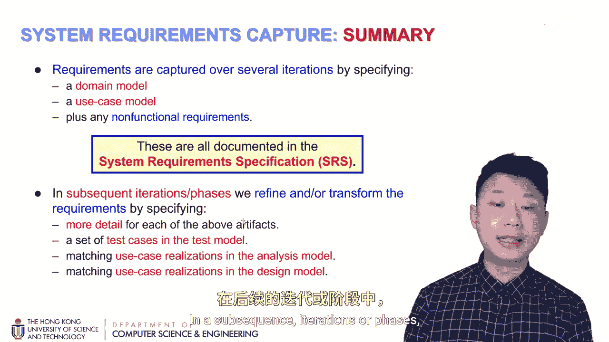

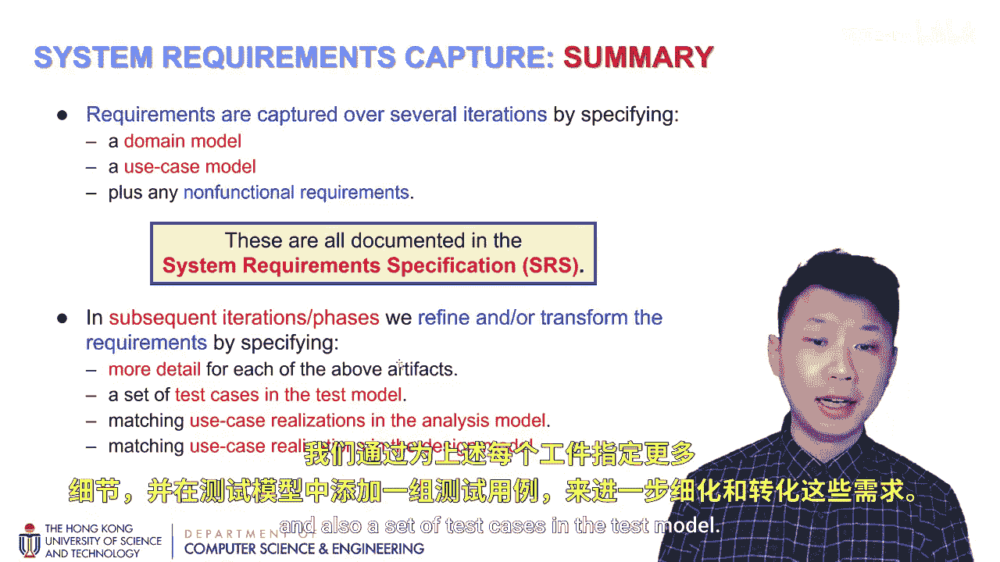

And then we should come up with a matching use case realization in the analysis model and also a matching use case realization in the design model。

 and we're going to use the analysis model and also the design model for implementation。

And that's why we say that the use case drive the subsequent iterations and also phrases。

 and that's what I want to cover in this lecture。

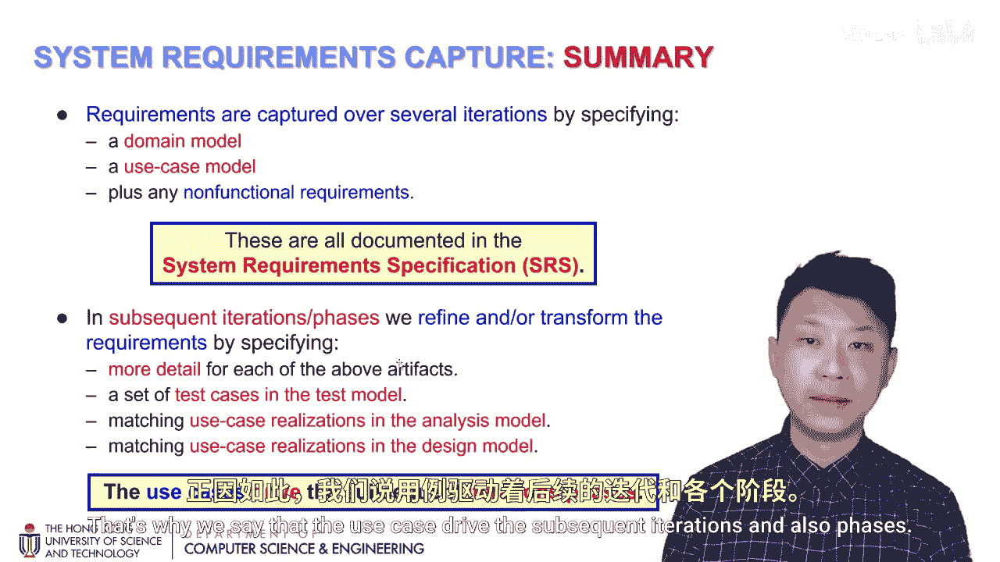